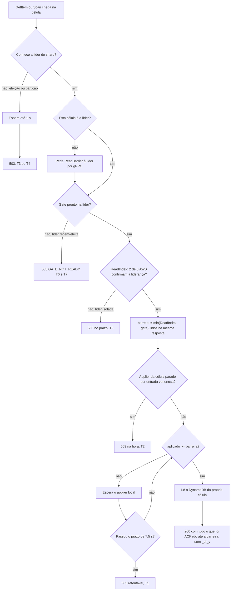
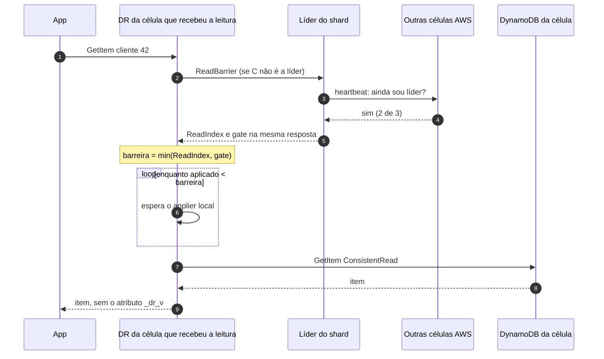
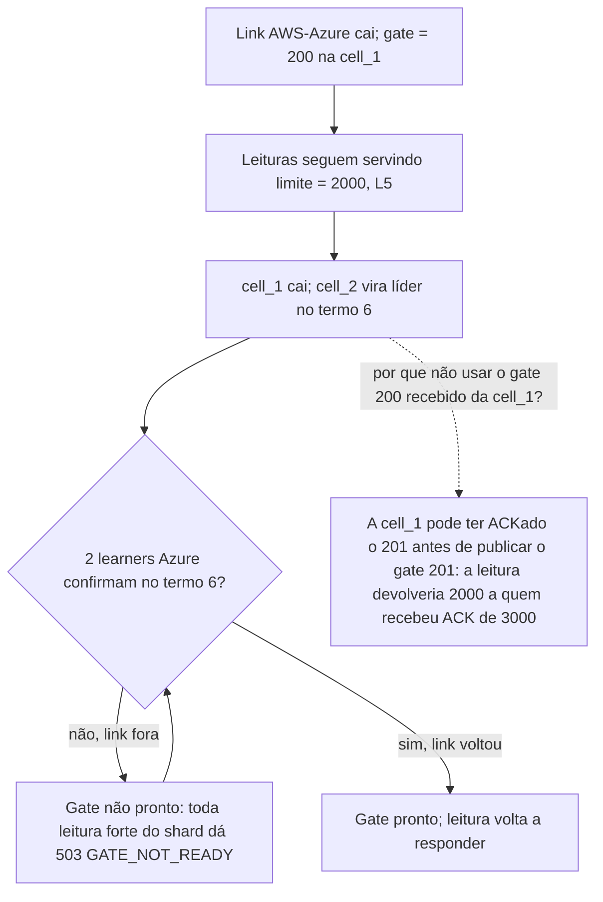

# X08 — Leitura forte explicada com dados mock

**Status:** Explicação didática (14/10/2026). Não decide nada novo, exceto a pergunta 3 no fim · **ADRs:** [ADR-049](../../03_adr/ADR-049-barreira-da-leitura-forte-e-o-gate.md), [ADR-057](../../03_adr/ADR-057-um-unico-modo-strong-consistency.md), [ADR-039](../../03_adr/ADR-039-sem-lider-conhecida-espera-ate-1s-e-503.md), [ADR-029](../../03_adr/ADR-029-gate-monotonico-na-troca-de-lider.md), [ADR-046](../../03_adr/ADR-046-gate-so-conta-progresso-validado-pelo-raft.md) · **Relacionados:** [X07](X07-gate-explicado-com-exemplos.md), [C05](../atualizados/C05-leitura-strong.md), [R16](../a_rever/R16-leitura-forte-em-celulas-follower.md), [SPEC_POC_LOCAL](../../../spec/SPEC_POC_LOCAL.md) (A.6)

## Cenário

### A ideia em uma frase

A leitura forte **não fala com a Azure e não conta células**. Ela pergunta à líder "até que índice o cliente pode ter recebido ACK?" (a barreira), espera o DynamoDB **da própria célula** chegar até esse índice e lê.

### Os quatro números que aparecem em toda leitura

| Número | O que é | Quem tem |
|---|---|---|
| `ReadIndex` | Commit do Raft no momento da leitura, com a liderança confirmada por 2 de 3 AWS (um heartbeat, só AWS) | Líder |
| `gate` | Maior índice durável em 2 de 3 AWS **e** 2 de 3 Azure (calculado na escrita, fica na memória) | Líder |
| `barreira` | `min(ReadIndex, gate)`: o maior índice que pode ter recebido ACK | Calculado por leitura |
| `aplicado` | Até que índice o applier já gravou no DynamoDB daquela célula | Cada célula |

**Regra da leitura:** espera `aplicado >= barreira` e então lê o DynamoDB local.

Por que `min`? Escrita acima do gate ainda não recebeu ACK; escrita acima do `ReadIndex` nem foi commitada. Nenhum cliente pode ter visto algo acima da barreira, então não é preciso esperar por isso.

## Diagrama: decisão da leitura forte, com os pontos em que ela falha

## Diagrama: sequência da leitura

Repare: nenhuma seta vai para a Azure.

## Etapas

### Dados mock

Tabela lógica `cadastro_cliente_{cell}`, item `cliente#42`. Histórico do log do shard:

| Índice | Escrita | Situação no início dos exemplos |
|---|---|---|
| 198 | `limite = 1000` | ACKada |
| 199 | `limite = 1500` | ACKada |
| 200 | `limite = 2000` | ACKada |
| 201 | `limite = 3000` | ainda não existe |

Estado inicial (cell_1 é a líder):

| | commit | gate | aplicado | `limite` no DynamoDB |
|---|---|---|---|---|
| cell_1 (líder) | 200 | 200 | 200 | 2000 |
| cell_2 | 200 | 200 | 200 | 2000 |
| cell_3 | 200 | 200 | 199 | 1500 |

### L1 — Tudo em dia, leitura na líder

1. App lê `cliente#42` na cell_1.
2. ReadIndex = 200, gate = 200 → barreira = **200**.
3. Aplicado na cell_1 = 200 ≥ 200: não espera.
4. Resposta: **`limite = 2000`**. Custo: um heartbeat dentro da AWS mais o GetItem.

### L2 — Leitura numa célula atrasada

1. App lê na cell_3. A cell_3 pede a barreira à líder: ReadIndex = 200, gate = 200 → barreira = **200**.
2. Aplicado na cell_3 = **199** (o DynamoDB dela ainda tem 1500).
3. Espera o applier gravar o 200 (alguns ms).
4. Resposta: **`limite = 2000`**. Sem a barreira, a cell_3 responderia **1500**, um valor que o cliente já sabe estar velho.

### L3 — Escrita em voo durante a leitura

Chega a escrita 201 (`limite = 3000`). A AWS commita, mas a Azure ainda não confirmou.

| | commit | gate | aplicado |
|---|---|---|---|
| cell_1 (líder) | 201 | 200 | 200 |

1. Leitura na cell_1: ReadIndex = 201, gate = 200 → barreira = **200**.
2. Aplicado = 200 ≥ 200: não espera.
3. Resposta: **`limite = 2000`**.

Está certo: a escrita 201 ainda não recebeu ACK; o cliente que a enviou ainda está esperando a resposta. Se a leitura devolvesse 3000 e a AWS caísse agora, a Azure seria promovida **sem** o 3000: o valor lido "desapareceria". É isso que o gate na leitura impede.

### L4 — Ler o que acabei de escrever, em outra célula

1. A Azure confirma 201: gate = 201, cell_1 aplica, **ACK** para a app (`limite = 3000`).
2. Logo em seguida a app lê pela **cell_3**, que ainda não sabe de nada:

| | commit | gate local | aplicado |
|---|---|---|---|
| cell_3 | 200 | 200 | 200 |

3. A cell_3 pede a barreira à líder: ReadIndex = 201, gate = 201 → barreira = **201**.
4. A cell_3 espera: recebe o commit 201 do Raft, recebe o gate 201 publicado pela líder (G-06), aplica 201.
5. Resposta: **`limite = 3000`**.

Esse é o motivo de a follower pedir o gate à líder **na hora**, e não usar um gate guardado: com o gate guardado (200) ela responderia 2000 para quem acabou de receber ACK de 3000.

### L5 — Link com a Azure caído (`DEGRADED_POLICY=reject`)

| | commit | gate | aplicado |
|---|---|---|---|
| cell_1 (líder) | 230 | 200 | 200 |

As escritas 201 a 230 estão commitadas na AWS, mas sem ACK (`503 PENDING`) e sem apply.

1. Leitura: ReadIndex = 230, gate = 200 → barreira = **200**.
2. Aplicado = 200: não espera.
3. Resposta: **`limite = 2000`**, na hora.

**A leitura não trava com a Azure fora.** Ela mostra o último estado confirmado nas duas nuvens, e é exatamente o que os clientes sabem: ninguém recebeu ACK de 201 a 230.

## Falhas e tratativas

### Quando a leitura trava ou falha

| # | Situação | Dados mock | O que a app vê |
|---|---|---|---|
| T1 | **Apply lento** na célula (throttling do DynamoDB) | barreira = 200, aplicado na cell_2 = 190 e andando devagar | Espera; se passar de 7,5 s, `503` retentável. Problema daquela célula: as outras respondem |
| T2 | **Entrada venenosa** (o DynamoDB recusa o item 196 na cell_2) | barreira = 200, aplicado na cell_2 parado em 195 | `503` **na hora** (não espera o prazo) para leituras daquele shard na cell_2 ([C26](../atualizados/C26-entrada-venenosa.md)) |
| T3 | **Sem líder** (eleição em andamento) | ninguém responde o ReadBarrier | Espera até 1 s e `503` ([ADR-039](../../03_adr/ADR-039-sem-lider-conhecida-espera-ate-1s-e-503.md)) |
| T4 | **Célula isolada** das outras AWS | a cell_3 não alcança a líder | Espera até 1 s e `503`. Ela nunca responde com o próprio dado sem barreira |
| T5 | **Líder isolada que ainda acha que é líder** | a cell_1 não recebe resposta do heartbeat | O ReadIndex não se completa; `503` no prazo. Evita ler de uma líder antiga |
| T6 | **Líder recém-eleita** | A2 eleita no termo 6, gate ainda não pronto | `503 GATE_NOT_READY` até 2 Azure confirmarem no termo 6. Com a Azure saudável isso dura um RTT AWS↔Azure mais um fsync (poucos ms) |
| **T7** | **T6 com a Azure fora** (cenário oculto) | A2 eleita, link caído, gate parado em 200 e não pronto | **`503` em toda leitura forte do shard enquanto a Azure estiver fora** (ver o cenário oculto T7 abaixo) |

Resumo: a leitura **não** depende da Azure no dia a dia (L5). Ela trava por problema **local** (T1, T2), por falta de **líder AWS** (T3 a T5) e, por um tempo curto, logo depois de uma **troca de líder** (T6). O único caso em que a Azure trava a leitura é o T7.

### O cenário oculto T7

Linha do tempo com os dados mock:

1. Link AWS↔Azure cai. Gate = 200 na cell_1. Leituras seguem servindo `limite = 2000` (L5).
2. A cell_1 cai (manutenção ou falha). A cell_2 vira líder no termo 6.
3. A cell_2 precisa de 2 learners Azure confirmando no termo 6 para o gate ficar pronto (G-07). O link está fora: isso nunca acontece.
4. **Toda leitura forte do shard responde `503 GATE_NOT_READY`** até o link voltar.

Por que a cell_2 não usa o gate 200 que recebeu da cell_1 (G-06)? Porque esse valor pode estar velho. Se a cell_1 tinha ACKado o 201 e caiu antes de publicar o gate 201, a cell_2 leria com barreira 200 e devolveria **2000 a quem recebeu ACK de 3000**. A regra G-07 escolhe recusar em vez de responder errado.

Com `reject` isso é certo. Com `accept`, a líder nova herda o `DEGRADE` mas trata o lease como expirado ([ADR-044](../../03_adr/ADR-044-lease-do-modo-degradado-e-promocao-da-azure.md), item 2), então o resultado tende a ser o mesmo; o modelo TLA+ precisa confirmar.

O impacto: uma queda do link **somada** a uma troca de líder (por exemplo, manutenção de uma célula AWS durante o problema no link) derruba a leitura forte daquele shard, não só a escrita.

## Pontos em aberto

### Pergunta para o Bruno

**3. O que fazer com a leitura forte numa líder nova enquanto a Azure está fora (T7)?**
- **a) (recomendado para a v1)** Aceitar: `503 GATE_NOT_READY` até o link voltar. É correto e simples. Registrar como risco, alertar e **proibir transferência planejada de liderança (ADR-013) e manutenção de célula AWS enquanto o link estiver fora**, o que elimina a causa mais comum.
- **b)** Fazer a líder só ACKar depois que o gate novo chegar a 2 de 3 células AWS (vai junto do próximo AppendEntries). Assim a líder nova sempre conhece um gate que cobre todo ACK e pode servir leitura com ele. Custa cerca de um RTT dentro da AWS a mais por escrita e muda a G-06/G-07; precisaria entrar no modelo TLA+.
