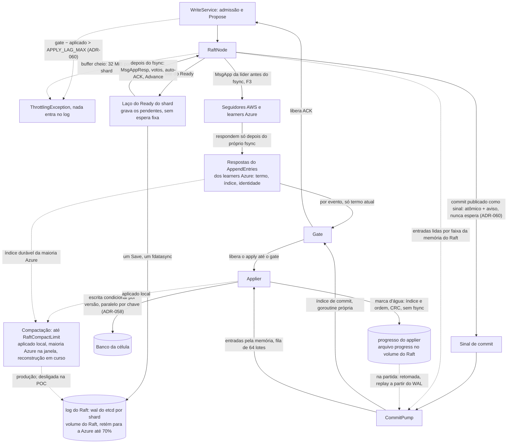

# D04 — CommitPump e o log do Raft

[Início](../00_COMECE_AQUI.md) · [Documento principal](../DataReplication_Versao_1.md) · [Índice de diagramas](INDEX.md)

O **log do Raft** (`wal` do etcd, um por shard, num volume de bloco dedicado por nó) é o único log do nó: tem fsync antes do ACK e é a única fonte das entradas commitadas. Ele também retém o que a Azure atrasada ainda precisa, até o teto de 70% do volume ([ADR-041](../03_adr/ADR-041-disco-do-log-teto-de-70-por-cento-sem-s3-na-v1.md)). O `CommitPump` liga o commit ao gate e ao applier (pela memória). O **gate é alimentado por evento**: cada resposta de `AppendEntries` dos learners Azure (termo, índice, identidade) o atualiza na hora, sem esperar um novo commit. O applier só avança até o gate e grava o progresso **por item** (marca d'água: índice e ordem) num registro pequeno com CRC, sem fsync, no volume do Raft. A escrita do log do Raft é o **group commit por shard** do laço do `Ready` ([ADR-056](../03_adr/ADR-056-group-commit-por-shard-e-nada-sai-antes-do-fsync.md)): grava o que chegou durante o fsync anterior num único `Save` com `fdatasync` e só depois libera as respostas; só o `MsgApp` da líder sai antes. Pelo [ADR-060](../03_adr/ADR-060-laco-do-raft-nunca-espera-o-apply-e-admissao-por-atraso.md), **o commit é um sinal e não uma fila**: o laço do Raft publica o índice commitado e nunca espera ninguém; o `CommitPump` lê as entradas por faixa da memória do Raft quando o applier tem espaço, e o gate segue o commit numa goroutine própria. A líder recusa escrita (`atraso_apply`) quando `gate − aplicado` passa de `APPLY_LAG_MAX`. A compactação do log do Raft (produção; desligada na POC) nunca passa de `RaftCompactLimit`, que segura o aplicado local, o índice durável da maioria Azure enquanto ela estiver na janela e o início de uma reconstrução em tabela sombra em curso.

## Caminho do dado em um nó

## Onde é detalhado

- Desenho: [03_consenso_raft_quorum_e_gate](../01_arquitetura/03_consenso_raft_quorum_e_gate.md) (5.5 e 5.5.1) e [ADR-019](../03_adr/ADR-019-wal-proprio-volume-dedicado.md).
- Gate por termo e por evento: [03_consenso_raft_quorum_e_gate](../01_arquitetura/03_consenso_raft_quorum_e_gate.md) (5.3.1) e [ADR-046](../03_adr/ADR-046-gate-so-conta-progresso-validado-pelo-raft.md).
- Progresso por item e fsync: [04_wal_e_fsync](../01_arquitetura/04_wal_e_fsync.md) (6.3.1) e [ADR-048](../03_adr/ADR-048-skip-por-item.md).
- Retenção e compactação do log do Raft: [04_wal_e_fsync](../01_arquitetura/04_wal_e_fsync.md) (6.9), [ADR-041](../03_adr/ADR-041-disco-do-log-teto-de-70-por-cento-sem-s3-na-v1.md) e [ADR-063](../03_adr/ADR-063-snapshot-e-compactacao-do-log-do-raft.md) (pendente).
- Group commit, regra de envio e contrapressão: [04_wal_e_fsync](../01_arquitetura/04_wal_e_fsync.md) (6.10) e [ADR-056](../03_adr/ADR-056-group-commit-por-shard-e-nada-sai-antes-do-fsync.md).
- Commit como sinal, admissão por atraso do apply e banco lento: [ADR-060](../03_adr/ADR-060-laco-do-raft-nunca-espera-o-apply-e-admissao-por-atraso.md) e [C35](../02_cenarios/atualizados/C35-banco-lento-nao-derruba-a-lideranca.md).
- Partida e recuperação: [X04](../02_cenarios/complexos/X04-partida-e-recuperacao-do-no.md).
