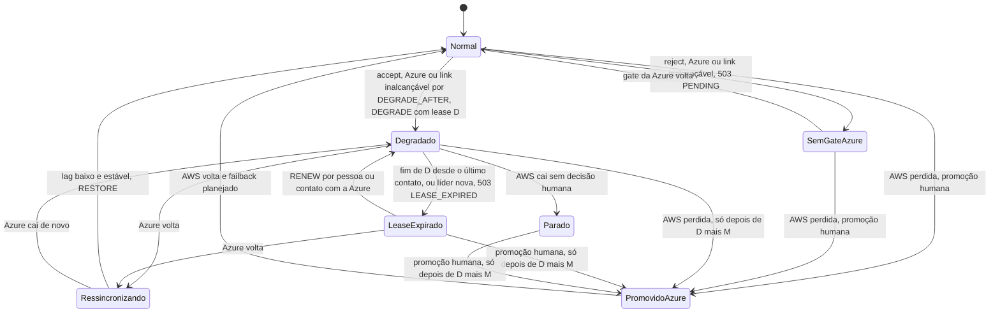
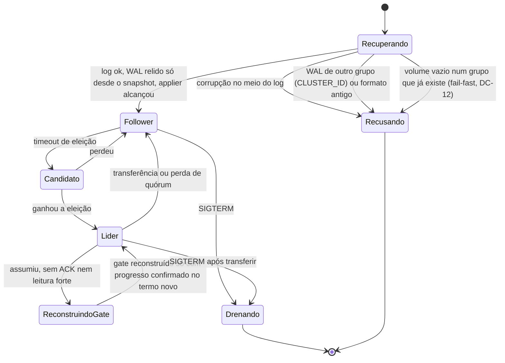

# D06 — Estados do shard e do nó

[Início](../00_COMECE_AQUI.md) · [Documento principal](../DataReplication_Versao_1.md) · [Índice de diagramas](INDEX.md)

Dois níveis: os **modos de operação do shard** (decididos pelo consenso e pela política da instalação) e os **estados do processo** em cada nó. Com `DEGRADED_POLICY=accept` o modo degradado tem **lease D**; ao fim dele a AWS recusa escrita (`LeaseExpirado`) e só uma pessoa prorroga. Com `reject` não existe `Degradado`: sem o gate da Azure as escritas recebem `503 PENDING`. A Azure só é promovida depois de **D + M**.

## Modos de operação do shard

## Estados do nó

## Estados da célula diante do log

Independente do papel no Raft (líder ou follower), a célula tem um estado em relação ao log retido ([especificação](../../spec/compactacao_do_log/especificacao.md), seções 5 e 6). Fora de `normal`, o `/readyz` é falso e a leitura forte responde 503. Na POC, o Incremento A já descarta o marcador à frente do aplicado (a célula fica em `atrasCauda`, visível no `/status`); a recuperação e a reconstrução vêm no Incremento B.

```mermaid
stateDiagram-v2
    [*] --> normal
    normal --> recuperando: MsgSnap com índice acima do aplicado (descartado, SG-19)
    recuperando --> normal: aplicado alcança o marcador pelo CatchUp, aceita o marcador
    recuperando --> reconstruindo: nenhuma célula retém aplicado + 1 (fora da janela)
    normal --> reconstruindo: progresso atrás do disco retido na partida, ou POST /admin/reconstruir
    reconstruindo --> reconstruindo: teto duro de disco aborta; nova tentativa depois de REBUILD_RETRY
    reconstruindo --> [*]: cópia por sobrescrita até F, progresso F com fsync, reinício (DC-04, DC-11)
```

## Onde é detalhado

- Cenários: [C17](../02_cenarios/atualizados/C17-maquina-de-estados.md) e [C18](../02_cenarios/atualizados/C18-partida-e-recuperacao-do-no.md).
- Estados da célula diante do log, partida pela cauda e fail-fast do volume perdido: [especificação](../../spec/compactacao_do_log/especificacao.md) e [troca de PVC em cell ativa](../../parklot/adr-troca-de-pvc-em-cell-ativa.md) (parking lot).
- Modo degradado em detalhe: [X02](../02_cenarios/complexos/X02-modo-degradado.md). Lease, `RENEW` e promoção depois de D + M: [C32](../02_cenarios/atualizados/C32-particao-e-lease-do-modo-degradado.md) e [ADR-044](../03_adr/ADR-044-lease-do-modo-degradado-e-promocao-da-azure.md). Política por instalação: [ADR-045](../03_adr/ADR-045-politica-de-degradacao-por-instalacao.md).
