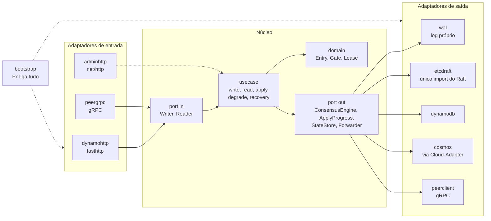
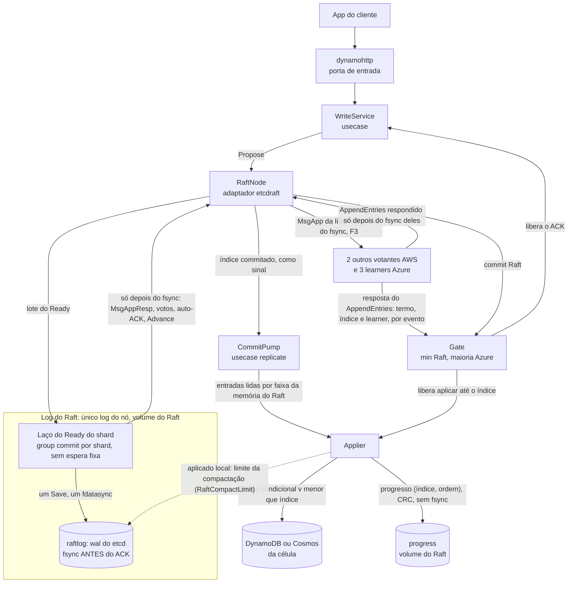
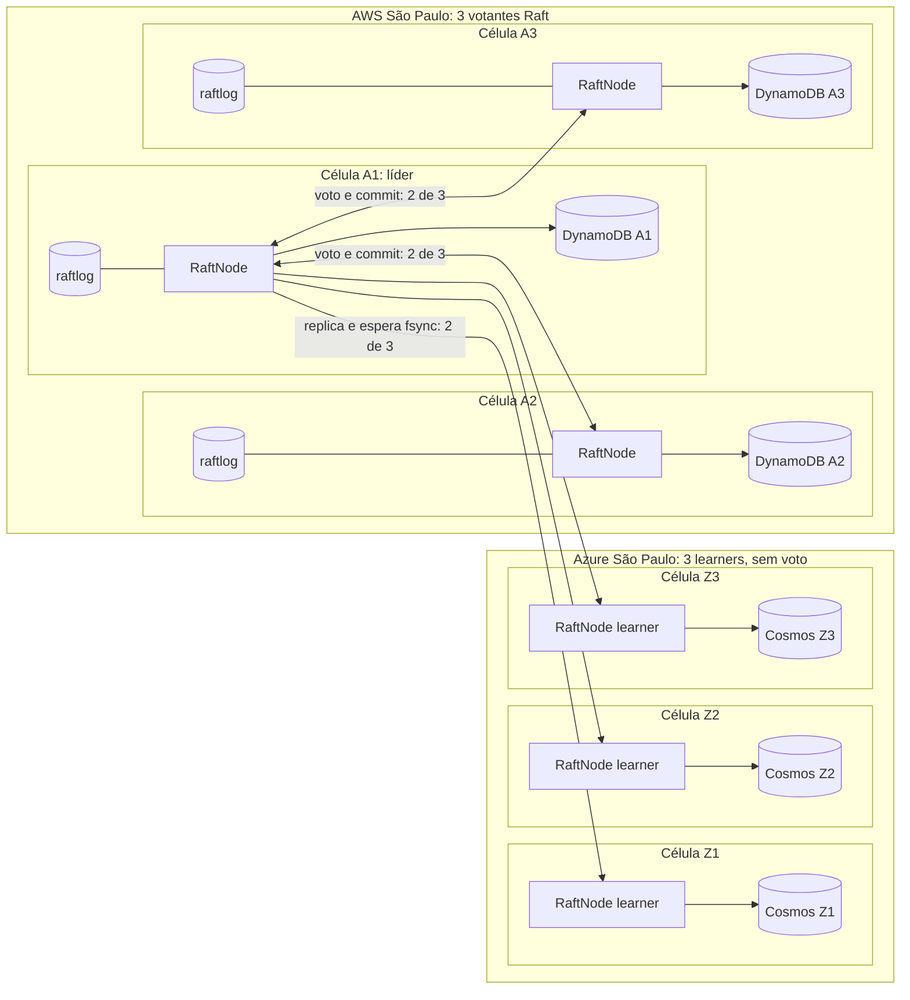
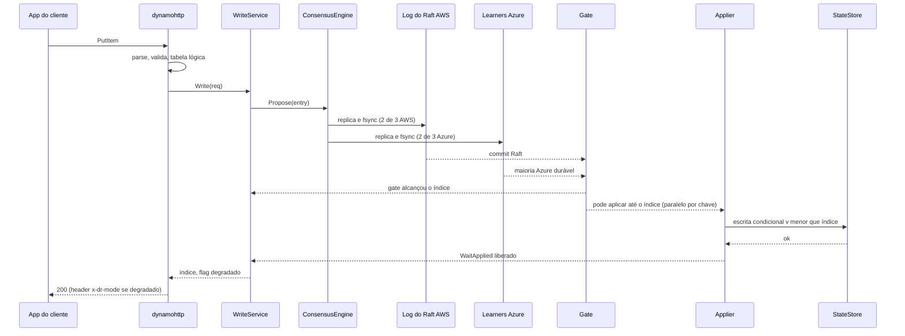
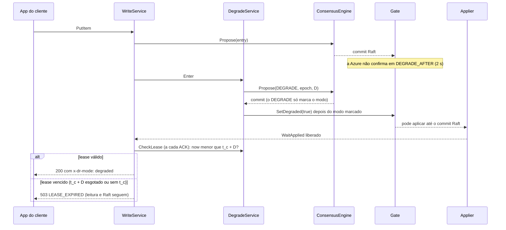
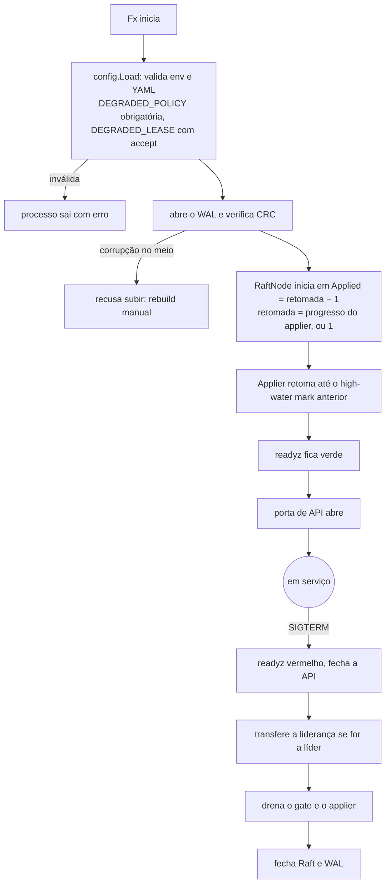
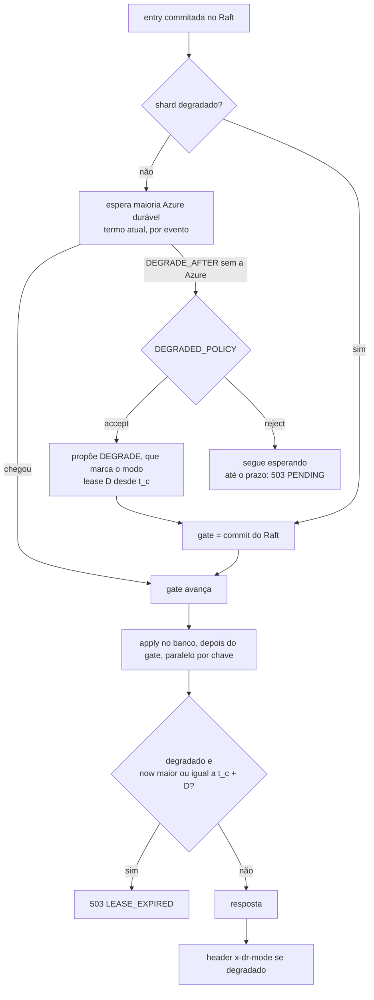
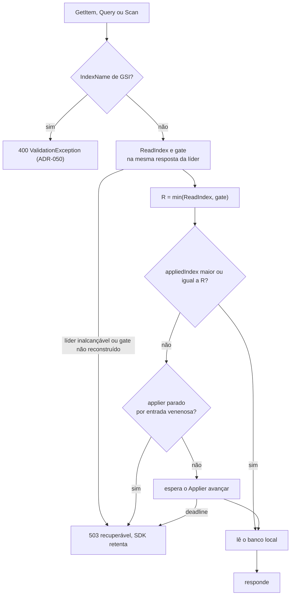
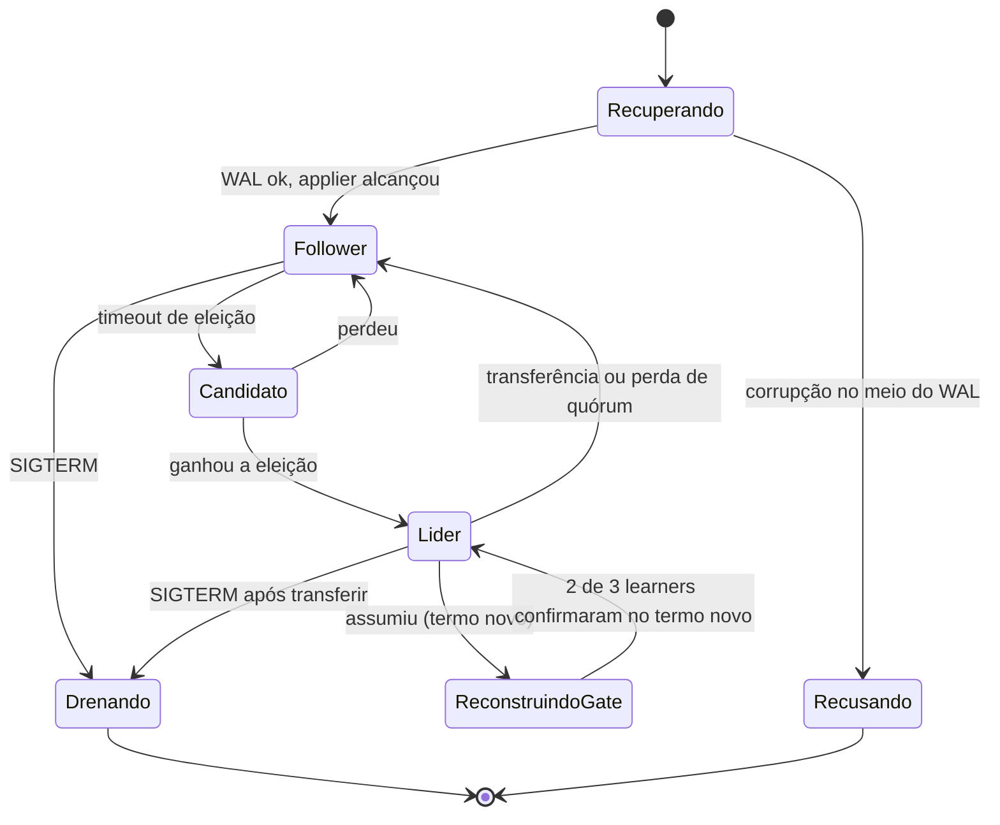
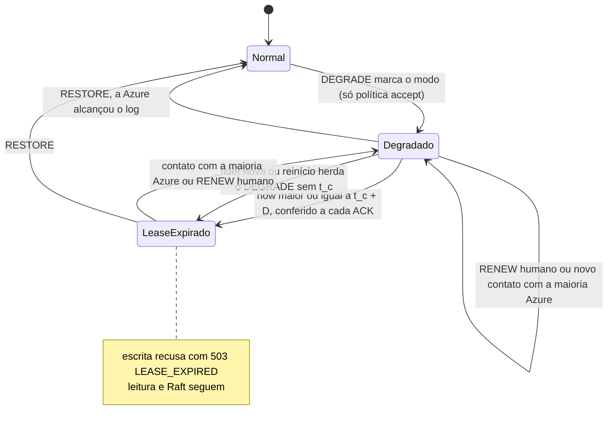

# Desenho da arquitetura e diagramas de processo e de fluxo

[Início](../00_COMECE_AQUI.md) · [Documento principal](../DataReplication_Versao_1.md) · [Índice da implementação](README.md)

## 4. Desenho da arquitetura

**Como ler:** as setas da esquerda (quem chama) entram pelas portas de entrada; o núcleo chama as portas de saída; os adaptadores da direita implementam essas portas. A única coisa que "conhece" tudo é o `bootstrap`.

### 4.1 Camadas e responsabilidade

| Camada | Pode importar | Não pode importar | Teste |
|---|---|---|---|
| `domain` | biblioteca padrão | tudo o mais | unitário puro, sem mock |
| `usecase` | `domain`, `port` | adaptadores, `fx`, libs de infraestrutura | unitário com fakes das portas |
| `adapter` | `port`, `domain`, sua lib de infraestrutura | outro adaptador | conformidade + integração |
| `bootstrap` | tudo | — | `fx.ValidateApp` |

### 4.2 Como o Raft e a replicação atuam (o log do Raft)

O diagrama da seção 4 mostra **quem pode falar com quem**. Este mostra **o caminho do dado** dentro de um nó: o log do Raft é o único log do nó e a única fonte das entradas commitadas.

**Passo a passo de uma escrita:**
1. `WriteService` chama `Propose` no `RaftNode` (única porta que fala com o Raft).
2. O Raft envia a entrada aos pares (só o `MsgApp` da líder sai antes do fsync, F3) e o laço do `Ready` grava o lote no **log do Raft** com um fsync; nenhuma resposta (`MsgAppResp`, voto, auto-ACK da líder) sai antes do fsync ([ADR-056](../03_adr/ADR-056-group-commit-por-shard-e-nada-sai-antes-do-fsync.md)). Na replicação por gRPC, 2 de 3 votantes AWS decidem o commit, e os 3 learners da Azure recebem a mesma entrada.
3. Cada learner informa o índice que já tornou durável **na resposta do `AppendEntries`**, com o termo e a identidade dele ([ADR-046](../03_adr/ADR-046-gate-so-conta-progresso-validado-pelo-raft.md)). Cada resposta alimenta o `Gate` na hora, sem esperar um commit novo; o gate só adota o termo atual e guarda `min(commit do Raft, maioria Azure)`. **Só aqui o ACK é liberado.**
4. O índice commitado chega ao `CommitPump` como sinal; ele lê as entradas commitadas por faixa **da memória do Raft** e as entrega ao `Applier`, fora do caminho do ACK. O progresso dos learners e o gate correm em goroutines próprias do `CommitPump` ([ADR-060](../03_adr/ADR-060-laco-do-raft-nunca-espera-o-apply-e-admissao-por-atraso.md)): um applier lento não atrasa o gate.
5. O `Applier` escreve no banco da célula com escrita condicional por versão, **sempre depois do gate** ([ADR-057](../03_adr/ADR-057-um-unico-modo-strong-consistency.md)) e **em paralelo por chave**, com a mesma chave na ordem do log ([ADR-058](../03_adr/ADR-058-apply-paralelo-por-chave-com-marca-dagua.md)); o `applied` é a marca d'água contígua, e o progresso salvo é ela `(índice, ordem)` ([ADR-048](../03_adr/ADR-048-skip-por-item.md)).
6. O log do Raft só é compactado até `domain.RaftCompactLimit`, o menor entre o aplicado local, o índice durável da maioria Azure enquanto a Azure estiver dentro da janela e F − 1 de uma reconstrução em tabela sombra em curso, com uma folga até o menor `match` dos votantes AWS limitada por `RAFT_RETAIN_MAX` ([ADR-063](../03_adr/ADR-063-snapshot-e-compactacao-do-log-do-raft.md), pendente). O que ele retém serve a Azure atrasada pelo próprio Raft (`MsgApp`); acima do teto de 70% do volume do Raft ([ADR-041](../03_adr/ADR-041-disco-do-log-teto-de-70-por-cento-sem-s3-na-v1.md)), a Azure sai da janela e volta por reconstrução em tabela sombra ([ADR-047](../03_adr/ADR-047-delete-real-invariante-e-reconstrucao-em-tabela-sombra.md)).

**Quem grava o quê, por escrita lógica:**

| Onde | O que grava | Quando | No caminho do ACK? |
|---|---|---|---|
| `raftlog` (cada réplica) | Entrada do consenso | Antes de responder ao líder, com fsync | **Sim** |
| Banco da célula (DynamoDB ou Cosmos) | Item com versão | Depois do gate, em paralelo por chave (ADR-058) | **Sim**, na célula da líder o ACK espera o apply (o `t_apply` está no orçamento, [ADR-036](../03_adr/ADR-036-slo-de-50ms-exclui-a-escrita-no-banco.md)) |
| Volume do Raft, arquivo `progress` (progresso do applier) | Progresso por item `(índice, ordem)`, com CRC | Depois de cada item aplicado, sem fsync | Não |

**Visão do cluster:** quem replica para quem, e o que cada célula guarda.

Os learners da Azure guardam o log do Raft para poder confirmar durabilidade, mas só os votantes AWS decidem eleição e commit. Na Azure o applier de cada célula lê as entradas commitadas do próprio log do Raft (omitido no desenho para não poluir) e alimenta o Cosmos pelo Cloud-Adapter.

## 5. Diagramas de processo

### 5.1 Escrita em modo Strong (caminho feliz)

**O ACK sai só depois do gate e do apply na célula da líder** (6.9, item 4 do documento de arquitetura). O apply é sempre depois do gate, em todas as instalações (modo único, [ADR-057](../03_adr/ADR-057-um-unico-modo-strong-consistency.md)), em paralelo por chave, e o ACK espera a marca d'água contígua ([ADR-058](../03_adr/ADR-058-apply-paralelo-por-chave-com-marca-dagua.md)). Antes de responder, a líder ainda confere a validade do lease se o shard estiver degradado ([ADR-044](../03_adr/ADR-044-lease-do-modo-degradado-e-promocao-da-azure.md)).

### 5.1b Escrita em modo degradado (política `accept`, com lease)

Há um único modo, strong ([ADR-057](../03_adr/ADR-057-um-unico-modo-strong-consistency.md)): a escrita tem um único caminho, o do 5.1. O que muda o caminho é a Azure fora do alcance, e só com `DEGRADED_POLICY=accept` ([ADR-045](../03_adr/ADR-045-politica-de-degradacao-por-instalacao.md)).

O prazo D conta desde `t_c`, o último contato com a maioria dos learners da Azure, e não desde a proposta do `DEGRADE`: se o `DEGRADE` só é proposto muito depois de `t_c`, o lease já nasce vencido ([ADR-044](../03_adr/ADR-044-lease-do-modo-degradado-e-promocao-da-azure.md)). Com `reject` o `Enter` recusa sempre: o gate fica sem a Azure e o cliente recebe `503 PENDING` no fim do prazo, com RPO 0.

### 5.2 Ciclo de vida do processo (partida e parada)

Ordem de `OnStart` no Fx: config, log, WAL, Raft, gate, applier, e **por último** a porta de API. O Fx executa `OnStop` na ordem inversa, então a API fecha primeiro e o WAL por último, sem código extra.

## 6. Diagramas de fluxo

### 6.1 Decisão de ACK (gate, política e lease)

### 6.2 Leitura (sempre forte, ADR-057)

A barreira é `min(ReadIndex, gate)` ([ADR-049](../03_adr/ADR-049-barreira-da-leitura-forte-e-o-gate.md)): toda escrita ACKada está abaixo do gate, então uma Azure lenta não atrasa a leitura forte. Isso exige que `applied` nunca passe do gate.

### 6.3 Estados do nó

### 6.4 Estados do modo degradado (lease)

O estado `Normal` com política `reject` nunca sai para `Degradado`. O lease conta desde `t_c`, o último contato da líder com a maioria Azure. A Azure só é promovida (ação humana) depois de D mais a margem M (deriva máxima de relógio mais pausa máxima de processo) contados desde o último contato com a AWS; a regra de prorrogação contra promoção (H-DR13) está para o modelo TLA+.
