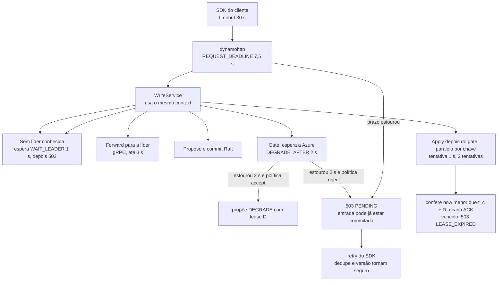

# Exemplos de código

[Início](../00_COMECE_AQUI.md) · [Documento principal](../DataReplication_Versao_1.md) · [Índice da implementação](README.md)

## 7. Exemplos de código

> Os trechos 7.1 a 7.8 estão na pasta [`codigo_exemplo/`](codigo_exemplo/) e foram compilados (`go build`, `go vet`, Go 1.26.0, com `fx`, `fasthttp` e `zerolog` reais); os testes passam com `go test -race`. O de 7.9 e o `main` são ilustrativos. Tudo é **esboço para fixar o desenho**, não o código final: faltam o log, o Raft, o parser e os provedores que o `bootstrap` espera (`ConsensusEngine`, `Forwarder`, `AppliedWaiter` e o parser entram por módulos de adaptador). O Go 1.27 não existia neste ambiente; reconfirmar a compatibilidade no primeiro build.

> **Atualizado em 14/10/2026 ([ADR-060](../03_adr/ADR-060-laco-do-raft-nunca-espera-o-apply-e-admissao-por-atraso.md)):** o `Committed() <-chan CommitBatch` deste esboço foi trocado no código da POC (`DataReplicationApp/`) por `CommitIndex()`, `CommitChanged()`, `CommittedEntries(lo, hi, maxBytes)` e `FirstIndex()`: o laço do Raft só publica o commit e o `CommitPump` lê por faixa. O canal bloqueante deste esboço é justamente o que parou o laço do Raft no teste de carga. Os trechos abaixo ficam como registro do desenho anterior.

### 7.0 O que mudou na revisão crítica de 13/10/2026

O esboço original tinha oito defeitos, confirmados na [revisão](../06_pendencias_e_riscos/analise_do_arquiteto_13_10.md) (seção 2.14). Todos foram corrigidos e cada um tem teste de concorrência (`-race`).

| # | Defeito no esboço | Correção | Teste que o prende |
|---|---|---|---|
| 1 | `Gate.WaitFor` deixava o waiter registrado quando o contexto expirava (vazamento sob Azure fora) | O waiter é removido na expiração; `Waiting()` expõe o contador | `TestWaitForRemovesWaiterOnTimeout`, `TestWaitForRaceReleaseVsTimeout` |
| 2 | `SetAzureDurable` guardava só um número, sem termo nem identidade | `SetAzureDurable(termo, índice, learner)` só adota o termo atual ([ADR-046](../03_adr/ADR-046-gate-so-conta-progresso-validado-pelo-raft.md)); termo novo descarta o progresso herdado e o gate continua monotônico | `TestGateAdoptsOnlyCurrentTerm`, `TestGateNewTermRebuildsWithoutRecuar`, `TestGateConcurrentAdvanceIsMonotonicAndReleasesAll` |
| 3 | O gate só consultava os learners ao processar um lote commitado: sem commit novo, a escrita esperava até o timeout | `CommitPump` com duas goroutines; cada resposta de learner (`LearnerEvents`) alimenta o gate na hora | `TestGateIsFedByLearnerEventsWithoutNewCommit`, `TestGateAdvancesWhileLogAppendIsBlocked`, `TestGateAdvancesWhileApplierIsStuck` |
| 4 | `b.Entries[len(b.Entries)-1]` quebrava com lote vazio; canal fechado não era tratado | Lote vazio é ignorado; canal fechado devolve `ErrStreamClosed` | `TestEmptyBatchDoesNotPanic`, `TestClosedChannelsReturnError` |
| 5 | Sem líder conhecida o código seguia para `Propose` | Espera até `WAIT_LEADER` (1 s) e devolve `ErrNoLeader` (503); requisição já encaminhada nunca é reencaminhada; teto de esperantes ([ADR-039](../03_adr/ADR-039-sem-lider-conhecida-espera-ate-1s-e-503.md)) | `TestNoLeaderWaitsThenFailsWithoutPropose`, `TestForwardedIsNeverReforwarded`, `TestMaxWaitingLeader` |
| 6 | Nenhuma validade do modo degradado; `DEGRADED_POLICY` inexistente | `Lease` contado desde `t_c`, o último contato com a maioria Azure (não desde a proposta do `DEGRADE`), conferido a cada ACK com relógio injetável (`now < t_c + D`, `503 LEASE_EXPIRED`); líder nova ou nó reiniciado herda o `DEGRADE` sem `t_c` (vencido até contato ou `RENEW`); `reject` nunca propõe `DEGRADE` ([ADR-044](../03_adr/ADR-044-lease-do-modo-degradado-e-promocao-da-azure.md), [ADR-045](../03_adr/ADR-045-politica-de-degradacao-por-instalacao.md)) | `TestLateDegradeWithOldContactIsExpired`, `TestNewLeaderWithoutContactIsExpired`, `TestLeaseRenewAndClear`, `TestLeaseCheckedAtEveryAck`, `TestRejectNeverDegrades`, `TestConcurrentWritesEnterDegradedOnce` |
| 7 | `WriteTimeout` de 5 s contra `REQUEST_DEADLINE` de 7,5 s; erro JSON montado por concatenação | `WriteTimeout = REQUEST_DEADLINE + folga`; `IdleTimeout` da configuração; `json.Marshal`; `ConsistentRead` em GSI recusada ([ADR-050](../03_adr/ADR-050-query-em-gsi-recusada.md)) | `TestTimeoutsAreCoherent`, `TestErrorBodyIsAlwaysValidJSON`, `TestConsistentReadOnGSIRefused` |
| 8 | `Degraded` sempre `false`: o header `x-dr-mode` nunca saía | O `WriteService` pergunta ao `Degrader` (estado real do shard: lease ativo) | `TestDegradedFlagFollowsShardState`, `TestWriterDegradedFollowsRealShardState` |

Também mudou a configuração: `DEGRADED_POLICY` é obrigatória e sem padrão; `DEGRADED_LEASE` também não tem padrão e é obrigatória **só com `DEGRADED_POLICY=accept`** (com `reject` é ignorada, sem erro); não há variável de modo ([ADR-057](../03_adr/ADR-057-um-unico-modo-strong-consistency.md)), e `READ_MODE_DEFAULT`, `WRITE_MODE` ou `MAX_STALENESS` ainda definidas derrubam a partida (evita um manifesto antigo ser ignorado em silêncio).

**Pontos que o esboço não resolve (de propósito):** `Log.Append` continua síncrono dentro da goroutine de commits (o gate não depende dela, mas o próximo lote ao `Applier` sim; a versão final usa fila limitada); o `DegradeService` é disparado por requisição que espera a Azure, enquanto a versão final terá um monitor com histerese (`DegradeController`); a regra de promoção contra prorrogação (H-DR13) fica para o TLA+; o `t_c` depende de o adaptador do Raft preencher `SentAt` (instante de envio, relógio monotônico da líder) em cada resposta de learner, heartbeat incluído; o parser, a leitura (barreira `min(ReadIndex, gate)`, [ADR-049](../03_adr/ADR-049-barreira-da-leitura-forte-e-o-gate.md)), o `Applier` com checkpoint por item ([ADR-048](../03_adr/ADR-048-skip-por-item.md)) e o mTLS por aplicação ([ADR-052](../03_adr/ADR-052-autorizacao-por-aplicacao-com-mtls.md)) não existem no esboço.

### 7.1 Domínio: a entrada replicada

```go
package domain

import "time"

// Index é a posição no log; também é a versão do item no banco (6.4).
type Index uint64

type Term uint64

type ShardID uint32

type EntryKind uint8

const (
	KindWrite   EntryKind = iota + 1 // escrita do cliente
	KindDegrade                      // DEGRADE(epoch, validade D) (ADR-044)
	KindRestore                      // RESTORE(epoch)
	KindRenew                        // RENEW(epoch, nova validade): só humana (ADR-044)
)

type OpKind uint8

const (
	OpPut OpKind = iota + 1
	OpDelete
)

// Op é uma mutação já normalizada: tabela lógica, chave e imagem final.
type Op struct {
	Table LogicalTable
	Kind  OpKind
	Key   []byte // chave serializada (partição + ordenação)
	Item  []byte // post-image no formato DynamoDB JSON; vazio no delete
}

// Entry é a unidade replicada. Uma chamada BatchWriteItem vira UMA Entry (achado 2).
type Entry struct {
	Index    Index
	Term     Term
	Kind     EntryKind
	Shard    ShardID
	Ops      []Op
	Epoch    uint64        // só para Degrade, Restore e Renew
	Lease    time.Duration // validade D, só para Degrade e Renew (ADR-044)
	ClientID string        // id estável do SDK, quando houver (D11)
}

// LogicalTable é o nome com o marcador {cell}, ex.: "cliente_cell_{cell}".
type LogicalTable string
```

### 7.2 Domínio: o gate (monotônico, com termo)

O gate só adota o progresso de um learner etiquetado com o **termo atual** (ADR-046). Quando o termo avança, o progresso herdado é descartado e o índice já liberado não recua (ADR-029). `Ready()` diz se o gate foi reconstruído no termo novo; a leitura forte da líder nova só começa depois disso (ADR-049).

```go
package domain

import (
	"context"
	"sort"
	"sync"
)

// MaxLearners é o número de learners da Azure por shard (1 por AZ).
const MaxLearners = 3

// Gate calcula até onde o ACK e o applier podem avançar:
//
//	min(commit do Raft, índice durável em >= 2 de 3 learners da Azure).
//
// Regras (ADR-029 e ADR-046):
//   - o valor nunca recua (monotônico), nem na troca de líder;
//   - o progresso de um learner só vale se vier etiquetado com o TERMO ATUAL da
//     líder; progresso de outro termo (sufixo de uma líder antiga, número vindo de
//     fora de banda) é ignorado;
//   - quando o termo avança, o progresso dos learners é descartado e só volta a
//     contar depois da primeira confirmação no termo novo (reconstrução do gate);
//     o valor já liberado (current) não recua;
//   - em modo degradado a Azure sai da conta (a validade do lease é conferida por
//     quem ACKa, ver usecase.DegradeService).
//
// O valor zero é utilizável. Todos os métodos são seguros para uso concorrente.
type Gate struct {
	mu          sync.Mutex
	term        Term
	raftCommit  Index
	learners    map[string]Index // progresso por learner, SÓ no termo atual
	azureQuorum Index
	current     Index
	waiters     map[*waiter]struct{}
	degraded    bool // em modo degradado a Azure sai da conta
}

type waiter struct {
	idx Index
	ch  chan struct{}
}

func (g *Gate) Index() Index {
	g.mu.Lock()
	defer g.mu.Unlock()
	return g.current
}

// Term devolve o termo atual conhecido pelo gate.
func (g *Gate) Term() Term {
	g.mu.Lock()
	defer g.mu.Unlock()
	return g.term
}

// SetTerm informa o termo atual da líder. Termo menor ou igual ao atual é ignorado.
// Termo maior descarta o progresso dos learners: a líder nova só adota o que for
// confirmado no termo novo (ADR-046, item 3). O índice já liberado não recua.
func (g *Gate) SetTerm(t Term) {
	g.update(func() {
		if t > g.term {
			g.term = t
			g.learners = nil
			g.azureQuorum = 0
		}
	})
}

func (g *Gate) SetRaftCommit(i Index) { g.update(func() { g.raftCommit = max(g.raftCommit, i) }) }

// SetAzureDurable registra o índice durável de UM learner, vindo da resposta do
// AppendEntries (ADR-046). Devolve true se o valor foi adotado. Não é adotado quando
// o termo difere do atual, quando o learner é um quarto nome distinto (troca de membro
// passa por ForgetLearner) ou quando o valor não avança o do próprio learner.
func (g *Gate) SetAzureDurable(term Term, idx Index, learner string) bool {
	adopted := false
	g.update(func() {
		if term != g.term || learner == "" {
			return
		}
		if _, known := g.learners[learner]; !known && len(g.learners) >= MaxLearners {
			return
		}
		if g.learners == nil {
			g.learners = make(map[string]Index, MaxLearners)
		}
		if old, known := g.learners[learner]; known && idx <= old {
			return
		}
		g.learners[learner] = idx
		g.azureQuorum = g.quorumLocked()
		adopted = true
	})
	return adopted
}

// ForgetLearner remove um learner que saiu do conjunto (disco trocado, identidade nova,
// ADR-034). O valor já liberado do gate não recua.
func (g *Gate) ForgetLearner(learner string) {
	g.update(func() {
		delete(g.learners, learner)
		g.azureQuorum = g.quorumLocked()
	})
}

// quorumLocked devolve o 2º maior índice entre os learners que já confirmaram no termo
// atual, ou 0 enquanto menos de 2 confirmaram.
func (g *Gate) quorumLocked() Index {
	if len(g.learners) < 2 {
		return 0
	}
	d := make([]Index, 0, len(g.learners))
	for _, v := range g.learners {
		d = append(d, v)
	}
	sort.Slice(d, func(a, b int) bool { return d[a] > d[b] })
	return d[1]
}

// Ready diz se o gate foi reconstruído no termo atual: pelo menos 2 learners
// confirmaram nele (ou o modo é degradado). A leitura forte da líder nova só começa
// depois disso (ADR-049).
func (g *Gate) Ready() bool {
	g.mu.Lock()
	defer g.mu.Unlock()
	return g.degraded || len(g.learners) >= 2
}

func (g *Gate) SetDegraded(on bool) { g.update(func() { g.degraded = on }) }

func (g *Gate) update(mutate func()) {
	g.mu.Lock()
	defer g.mu.Unlock()
	mutate()
	next := g.raftCommit
	if !g.degraded {
		next = min(next, g.azureQuorum)
	}
	g.current = max(g.current, next) // monotônico
	for w := range g.waiters {
		if w.idx <= g.current {
			close(w.ch)
			delete(g.waiters, w)
		}
	}
}

// Waiting devolve quantos waiters estão registrados (diagnóstico e testes de vazamento).
func (g *Gate) Waiting() int {
	g.mu.Lock()
	defer g.mu.Unlock()
	return len(g.waiters)
}

// WaitFor bloqueia até o gate alcançar idx ou o contexto expirar. Quando o contexto
// expira o waiter é removido: sob carga com a Azure fora, as requisições não deixam
// registros para trás.
func (g *Gate) WaitFor(ctx context.Context, idx Index) error {
	g.mu.Lock()
	if g.current >= idx {
		g.mu.Unlock()
		return nil
	}
	w := &waiter{idx: idx, ch: make(chan struct{})}
	if g.waiters == nil {
		g.waiters = make(map[*waiter]struct{})
	}
	g.waiters[w] = struct{}{}
	g.mu.Unlock()

	select {
	case <-w.ch:
		return nil
	case <-ctx.Done():
		g.mu.Lock()
		defer g.mu.Unlock()
		if _, still := g.waiters[w]; !still {
			return nil // foi liberado no mesmo instante em que o contexto expirou
		}
		delete(g.waiters, w)
		return ctx.Err()
	}
}
```

Dois dos testes que fixam o comportamento (o arquivo completo tem também o teste de 200 esperantes com timeout, o de avanço concorrente por três learners com observador de monotonicidade e a corrida entre liberação e expiração):

```go
// O bug original: WaitFor deixava o waiter para trás quando o contexto expirava.
func TestWaitForRemovesWaiterOnTimeout(t *testing.T) {
	g := newGate(1)
	var wg sync.WaitGroup
	for i := 0; i < 200; i++ {
		wg.Add(1)
		go func() {
			defer wg.Done()
			ctx, c := context.WithTimeout(context.Background(), 5*time.Millisecond)
			defer c()
			if g.WaitFor(ctx, Index(1000+i)) == nil {
				t.Error("não devia liberar")
			}
		}()
	}
	wg.Wait()
	if n := g.Waiting(); n != 0 {
		t.Fatalf("vazamento: %d waiters depois dos timeouts", n)
	}
}

// ADR-046: só o termo atual conta. Progresso de termo antigo ou futuro é ignorado.
func TestGateAdoptsOnlyCurrentTerm(t *testing.T) {
	g := newGate(5)
	g.SetRaftCommit(100)
	for _, term := range []Term{4, 6, 0} {
		if g.SetAzureDurable(term, 100, "az1") || g.SetAzureDurable(term, 100, "az2") {
			t.Fatalf("termo %d não devia ser adotado no termo 5", term)
		}
	}
	if g.Index() != 0 {
		t.Fatalf("nada devia ter sido liberado, veio %d", g.Index())
	}
	if !g.SetAzureDurable(5, 100, "az1") || !g.SetAzureDurable(5, 90, "az2") {
		t.Fatal("termo atual devia ser adotado")
	}
	if g.Index() != 90 {
		t.Fatalf("esperado 90, veio %d", g.Index())
	}
}
```

### 7.2b Domínio: lease do modo degradado e política

O lease conta no relógio monotônico da líder desde `t_c`, o **último contato com a maioria dos learners da Azure** (instante de envio do último heartbeat ou `AppendEntries` confirmado por 2 de 3), e **não** desde a proposta do `DEGRADE`, que só marca o modo. A conferência a cada ACK é `now < t_c + D` (ADR-044). Líder nova ou nó reiniciado herda o `DEGRADE` sem `t_c`: o lease fica vencido até haver contato com a Azure ou um `RENEW`. O relógio é injetável (`Clock`); um salto para trás conta como lease expirado.

```go
package domain

import (
	"errors"
	"fmt"
	"sort"
	"sync"
	"time"
)

// Clock é o relógio injetável. Em produção é time.Now, cuja leitura carrega o relógio
// MONOTÔNICO do Go: Sub entre duas leituras não sofre saltos do relógio de parede.
type Clock func() time.Time

// ErrLeaseExpired: o lease do modo degradado acabou (ADR-044); a API responde
// 503 LEASE_EXPIRED. Leitura e Raft seguem; só uma pessoa prorroga (RENEW).
var ErrLeaseExpired = errors.New("lease do modo degradado expirou")

// DegradedPolicy é a política de degradação da instalação (ADR-045).
type DegradedPolicy string

const (
	PolicyAccept DegradedPolicy = "accept" // modo degradado com lease e header
	PolicyReject DegradedPolicy = "reject" // nunca DEGRADE: sem gate da Azure, 503 PENDING
)

func ParseDegradedPolicy(s string) (DegradedPolicy, error) {
	switch p := DegradedPolicy(s); p {
	case PolicyAccept, PolicyReject:
		return p, nil
	}
	return "", fmt.Errorf("DEGRADED_POLICY inválida %q: use accept ou reject", s)
}

// Lease é a validade D do modo degradado (ADR-044).
//
// O prazo NÃO conta desde a proposta do DEGRADE: conta desde o ÚLTIMO CONTATO com a
// maioria dos learners da Azure, t_c, o instante de ENVIO (relógio monotônico da líder)
// do último heartbeat ou AppendEntries que 2 de 3 learners confirmaram. A conferência
// a cada ACK é now < t_c + D. A entrada DEGRADE só marca o modo. Assim a janela não
// depende de quando chega a primeira escrita depois da partição: proposta tardia com
// t_c antigo já nasce vencida.
//
// Líder nova (ou nó reiniciado) que herda o DEGRADE não herda t_c: o lease fica vencido
// até haver contato com a maioria Azure no termo novo ou um RENEW (Inherit).
//
// Zero value = modo normal (sem lease ativo). Seguro para uso concorrente.
type Lease struct {
	mu       sync.Mutex
	active   bool // DEGRADE em vigor
	epoch    uint64
	duration time.Duration // D

	term     Term
	contacts map[string]time.Time // t_c por learner, SÓ no termo atual

	renewedAt time.Time // RENEW humano: vale até renewedAt + renewDur
	renewDur  time.Duration
}

// SetTerm informa o termo atual da líder. Termo maior descarta os contatos (líder nova
// não herda t_c) e o RENEW anterior.
func (l *Lease) SetTerm(t Term) {
	l.mu.Lock()
	defer l.mu.Unlock()
	if t > l.term {
		l.term = t
		l.contacts = nil
		l.renewDur = 0
	}
}

// ObserveContact registra que o learner confirmou uma mensagem ENVIADA em sentAt (lida
// no relógio monotônico da líder antes do envio). Só vale no termo atual e nunca recua.
func (l *Lease) ObserveContact(term Term, learner string, sentAt time.Time) {
	l.mu.Lock()
	defer l.mu.Unlock()
	if term != l.term || learner == "" || sentAt.IsZero() {
		return
	}
	if old, ok := l.contacts[learner]; ok && !sentAt.After(old) {
		return
	}
	if _, ok := l.contacts[learner]; !ok && len(l.contacts) >= MaxLearners {
		return
	}
	if l.contacts == nil {
		l.contacts = make(map[string]time.Time, MaxLearners)
	}
	l.contacts[learner] = sentAt
}

// contactLocked devolve t_c: o 2º instante mais recente entre os learners (maioria de 3).
func (l *Lease) contactLocked() (time.Time, bool) {
	if len(l.contacts) < 2 {
		return time.Time{}, false
	}
	ts := make([]time.Time, 0, len(l.contacts))
	for _, t := range l.contacts {
		ts = append(ts, t)
	}
	sort.Slice(ts, func(a, b int) bool { return ts[a].After(ts[b]) })
	return ts[1], true
}

// Mark marca o modo degradado da época epoch com duração D (entrada DEGRADE commitada).
// Não zera os contatos: o prazo segue contando desde t_c.
func (l *Lease) Mark(epoch uint64, d time.Duration) {
	l.mu.Lock()
	defer l.mu.Unlock()
	l.active, l.epoch, l.duration = true, epoch, d
}

// Inherit é o que uma líder nova (ou um nó reiniciado) faz ao encontrar um DEGRADE em
// vigor no log: marca o modo, mas sem t_c e sem RENEW, ou seja, com o lease vencido até
// haver contato com a maioria Azure ou um RENEW.
func (l *Lease) Inherit(epoch uint64, d time.Duration) {
	l.mu.Lock()
	defer l.mu.Unlock()
	l.active, l.epoch, l.duration = true, epoch, d
	l.contacts = nil
	l.renewDur = 0
}

// Renew é a prorrogação humana (entrada RENEW replicada): vale por dur a partir de
// renewedAt (relógio lido antes da proposta), mesmo sem contato com a Azure. A regra
// contra a promoção da Azure (H-DR13) é do modelo TLA+.
func (l *Lease) Renew(epoch uint64, renewedAt time.Time, dur time.Duration) bool {
	l.mu.Lock()
	defer l.mu.Unlock()
	if !l.active || l.epoch != epoch {
		return false
	}
	l.renewedAt, l.renewDur = renewedAt, dur
	return true
}

// Clear encerra o modo degradado (RESTORE).
func (l *Lease) Clear() {
	l.mu.Lock()
	defer l.mu.Unlock()
	l.active = false
	l.renewDur = 0
}

func (l *Lease) Active() bool {
	l.mu.Lock()
	defer l.mu.Unlock()
	return l.active
}

func (l *Lease) Epoch() uint64 {
	l.mu.Lock()
	defer l.mu.Unlock()
	return l.epoch
}

// Check devolve nil fora do modo degradado ou com lease válido (now < t_c + D, ou dentro
// de um RENEW), e ErrLeaseExpired caso contrário, inclusive sem nenhum t_c. Um relógio
// que anda para trás (now antes do instante de referência) conta como expirado.
func (l *Lease) Check(now time.Time) error {
	l.mu.Lock()
	defer l.mu.Unlock()
	if !l.active {
		return nil
	}
	if l.renewDur > 0 {
		if e := now.Sub(l.renewedAt); e >= 0 && e < l.renewDur {
			return nil
		}
	}
	tc, ok := l.contactLocked()
	if !ok {
		return ErrLeaseExpired
	}
	if e := now.Sub(tc); e < 0 || e >= l.duration {
		return ErrLeaseExpired
	}
	return nil
}
```

### 7.3 Portas

`LearnerDurable()` devolve `(termo, índice, identidade)` e `LearnerEvents()` entrega cada resposta de `AppendEntries` no momento em que chega (ADR-046).

```go
package port

import (
	"context"
	"time"

	"example.com/datareplication/internal/domain"
)

// ---- Portas de saída (driven): o núcleo pede, o adaptador implementa ----

// ReplicationLog é o log de replicação (5.5.1): log segmentado próprio, em volume separado,
// derivado do log do Raft (ADR-055). Append grava SEM fsync (fora do caminho do ACK).
// Sync é o checkpoint durável: faz fsync e devolve o novo DurableIndex. Só até o
// DurableIndex o log do Raft pode ser compactado; nunca até o índice apenas copiado.
type ReplicationLog interface {
	Append(ctx context.Context, batch []domain.Entry) error
	Read(ctx context.Context, from, to domain.Index) ([]domain.Entry, error)
	TruncateSuffix(ctx context.Context, from domain.Index) error
	CompactPrefix(ctx context.Context, upTo domain.Index) error
	Sync(ctx context.Context) (domain.Index, error)
	DurableIndex() domain.Index
	LastIndex() domain.Index
}

// ApplyProgress guarda o progresso do applier por item (índice, ordem), no volume do log
// de replicação e sem fsync (ADR-048, ADR-055). Perder o progresso só alonga o replay,
// que é idempotente pela versão.
type ApplyProgress interface {
	SaveProgress(idx domain.Index, ord uint32) error
	LoadProgress() (domain.Index, uint32, error)
}

// RaftCompactor é o que o checkpoint precisa do adaptador do Raft para compactar o log
// do Raft (ADR-055): o menor índice confirmado pelos pares e a compactação em si.
type RaftCompactor interface {
	MinPeerMatch() domain.Index
	Compact(upTo domain.Index) error
}

// ConsensusEngine esconde a biblioteca Raft (5.5).
type ConsensusEngine interface {
	Propose(ctx context.Context, e domain.Entry) (domain.Index, error)
	ReadIndex(ctx context.Context) (domain.Index, error)
	Leader() (LeaderInfo, bool)
	TransferLeadership(ctx context.Context, to string) error
	Committed() <-chan CommitBatch // entradas já commitadas, entregues da memória
	// Term é o termo atual da líder local (ADR-046: o gate só adota progresso desse termo).
	Term() domain.Term
	// LearnerEvents entrega CADA resposta de AppendEntries dos learners da Azure, no
	// momento em que chega (o gate é alimentado por evento, ADR-046). O progresso da
	// Azure não tem outro canal.
	LearnerEvents() <-chan LearnerProgress
	// LearnerDurable é o retrato atual do progresso: (termo, índice, identidade) por learner.
	LearnerDurable() []LearnerProgress
}

// LearnerProgress é o índice de casamento devolvido por um learner depois do fsync,
// com o termo em que foi confirmado e a identidade do learner (ADR-046, ADR-034).
type LearnerProgress struct {
	Term    domain.Term
	Index   domain.Index
	Learner string
	// SentAt é o instante de ENVIO (relógio monotônico da líder) da mensagem que o
	// learner confirmou, heartbeat ou AppendEntries. Alimenta t_c, o último contato com a
	// maioria Azure, de onde o lease do modo degradado conta (ADR-044).
	SentAt time.Time
}

// CommitBatch é um lote de entradas commitadas pelo Raft, em ordem.
type CommitBatch struct {
	Entries []domain.Entry
}

type LeaderInfo struct {
	NodeID string
	Local  bool
}

// StateStore é o banco da célula (DynamoDB ou Cosmos via Cloud-Adapter).
type StateStore interface {
	ApplyBatch(ctx context.Context, ops []VersionedOp) error
	Get(ctx context.Context, table domain.LogicalTable, key []byte, consistent bool) ([]byte, error)
	AppliedIndex() domain.Index
}

type VersionedOp struct {
	domain.Op
	Version domain.Index
}

// Forwarder leva a escrita inteira à líder quando a célula é follower (ADR-010).
// A líder executa o mesmo caminho (propor, gate, apply local) e devolve o resultado.
type Forwarder interface {
	Forward(ctx context.Context, leader string, r WriteRequest) (WriteResult, error)
}

// AppliedWaiter bloqueia até o Applier da célula ter aplicado o índice no banco.
// O ACK de uma escrita só sai depois disso na célula da líder (6.9, item 4).
type AppliedWaiter interface {
	WaitApplied(ctx context.Context, idx domain.Index) error
}

// ---- Portas de entrada (driving): o adaptador chama, o núcleo implementa ----

type WriteRequest struct {
	Ops      []domain.Op
	ClientID string // id estável do SDK, se houver
	Deadline int64  // unix nano
	// Forwarded marca a requisição que já foi encaminhada por um follower: nunca é
	// reencaminhada (limite de um salto, ADR-039).
	Forwarded bool
}

type WriteResult struct {
	Index    domain.Index
	Degraded bool // vira o header x-dr-mode: degraded (D10); vem do estado real do shard
}

type Writer interface {
	Write(ctx context.Context, r WriteRequest) (WriteResult, error)
}

type Reader interface {
	Get(ctx context.Context, table domain.LogicalTable, key []byte, strong bool) ([]byte, error)
}
```

### 7.4 Caso de uso: escrever

Ordem do `Write`: acha a líder (espera até `WAIT_LEADER`, ADR-039), recusa se o lease venceu (`now >= t_c + D`), propõe, espera o gate (com `DEGRADE_AFTER` e a política), espera o apply local e **confere o lease de novo antes de responder**. O apply é sempre depois do gate (ADR-057), em paralelo por chave, e a espera é pela marca d'água (ADR-058).

```go
package usecase

import (
	"context"
	"errors"
	"sync/atomic"
	"time"

	"example.com/datareplication/internal/domain"
	"example.com/datareplication/internal/port"
)

var (
	// ErrPending: resultado desconhecido; o cliente repete (dedupe e versão absorvem).
	ErrPending = errors.New("resultado desconhecido: o cliente deve repetir")
	// ErrNoLeader: sem líder conhecida depois de WAIT_LEADER (ADR-039). Nada foi proposto.
	ErrNoLeader = errors.New("sem líder conhecida")
	// ErrLeaseExpired: o lease do modo degradado acabou (ADR-044). Alias do domínio.
	ErrLeaseExpired = domain.ErrLeaseExpired
)

// WriteService é o caso de uso "escrever": acha a líder, propõe, espera o gate, espera
// o apply local, confere o lease e responde. O apply é sempre depois do gate (marca d'água, ADR-058)
// (ADR-057); o ACK é sempre depois do gate E do apply.
type WriteService struct {
	Consensus port.ConsensusEngine
	Forward   port.Forwarder
	Gate      *domain.Gate
	Applied   port.AppliedWaiter
	Degrade   Degrader // estado real do shard; nil = nunca degradado

	WaitLeader       time.Duration // WAIT_LEADER (1 s); 0 = não espera
	LeaderPoll       time.Duration // intervalo de consulta da líder; padrão 10 ms
	MaxWaitingLeader int           // teto de requisições esperando líder; 0 = sem teto
	DegradeAfter     time.Duration // DEGRADE_AFTER (2 s); 0 = nunca propõe DEGRADE

	waitingLeader atomic.Int64
}

func (s *WriteService) Write(ctx context.Context, r port.WriteRequest) (port.WriteResult, error) {
	leader, err := s.resolveLeader(ctx)
	if err != nil {
		return port.WriteResult{}, err // 503, sem Propose (ADR-039)
	}
	if !leader.Local {
		if r.Forwarded {
			return port.WriteResult{}, ErrNoLeader // já foi encaminhada uma vez: nunca de novo
		}
		r.Forwarded = true
		return s.Forward.Forward(ctx, leader.NodeID, r) // um salto; a líder responde (ADR-010)
	}

	// Lease vencido: recusa antes de gastar um índice do log.
	if err := s.checkLease(); err != nil {
		return port.WriteResult{}, err
	}

	e := domain.Entry{Kind: domain.KindWrite, Ops: r.Ops, ClientID: r.ClientID}
	idx, err := s.Consensus.Propose(ctx, e) // commit Raft: 2/3 AWS com fsync
	if err != nil {
		return port.WriteResult{}, err
	}
	if err := s.waitGate(ctx, idx); err != nil { // + 2/3 Azure com fsync, ou DEGRADE
		return port.WriteResult{}, ErrPending
	}
	if err := s.Applied.WaitApplied(ctx, idx); err != nil { // apply no banco da célula da líder
		return port.WriteResult{}, ErrPending
	}
	// Conferência a CADA ACK, depois do fsync e do apply e antes de responder (ADR-044):
	// uma pausa de processo durante as esperas acima vence o lease e é pega aqui. A
	// escrita já está commitada: o 503 é "resultado desconhecido" e o retry é absorvido
	// pelo dedupe.
	if err := s.checkLease(); err != nil {
		return port.WriteResult{}, err
	}
	return port.WriteResult{Index: idx, Degraded: s.degraded()}, nil
}

func (s *WriteService) degraded() bool { return s.Degrade != nil && s.Degrade.Active() }

func (s *WriteService) checkLease() error {
	if s.Degrade == nil {
		return nil
	}
	return s.Degrade.CheckLease()
}

// resolveLeader devolve a líder conhecida; sem líder espera até WaitLeader pela eleição
// e depois falha com ErrNoLeader (ADR-039). O teto de esperantes protege memória e
// conexões durante a eleição.
func (s *WriteService) resolveLeader(ctx context.Context) (port.LeaderInfo, error) {
	if l, ok := s.Consensus.Leader(); ok {
		return l, nil
	}
	if s.WaitLeader <= 0 {
		return port.LeaderInfo{}, ErrNoLeader
	}
	n := s.waitingLeader.Add(1)
	defer s.waitingLeader.Add(-1)
	if s.MaxWaitingLeader > 0 && n > int64(s.MaxWaitingLeader) {
		return port.LeaderInfo{}, ErrNoLeader
	}
	poll := s.LeaderPoll
	if poll <= 0 {
		poll = 10 * time.Millisecond
	}
	deadline := time.NewTimer(s.WaitLeader)
	defer deadline.Stop()
	tick := time.NewTicker(poll)
	defer tick.Stop()
	for {
		select {
		case <-ctx.Done():
			return port.LeaderInfo{}, ErrNoLeader
		case <-deadline.C:
			return port.LeaderInfo{}, ErrNoLeader
		case <-tick.C:
			if l, ok := s.Consensus.Leader(); ok {
				return l, nil
			}
		}
	}
}

// waitGate espera o gate. Se a Azure não confirma em DegradeAfter, tenta o DEGRADE;
// com DEGRADED_POLICY=reject o Enter recusa e a espera continua até o prazo da requisição
// (503 PENDING, RPO 0). Falha do Enter (DEGRADE não commitou) também só segue esperando.
func (s *WriteService) waitGate(ctx context.Context, idx domain.Index) error {
	if s.Degrade == nil || s.DegradeAfter <= 0 {
		return s.Gate.WaitFor(ctx, idx)
	}
	gctx, cancel := context.WithTimeout(ctx, s.DegradeAfter)
	err := s.Gate.WaitFor(gctx, idx)
	cancel()
	if err == nil {
		return nil
	}
	if ctx.Err() != nil {
		return ctx.Err()
	}
	_ = s.Degrade.Enter(ctx) // erro ignorado de propósito: o que vale é o gate abaixo
	return s.Gate.WaitFor(ctx, idx)
}
```

O `DegradeService` é o dono do estado degradado do shard. Com `reject` o `Enter` recusa sempre, inclusive para valor de política desconhecido:

```go
package usecase

import (
	"context"
	"errors"
	"sync"
	"time"

	"example.com/datareplication/internal/domain"
	"example.com/datareplication/internal/port"
)

// ErrDegradeRefused: DEGRADED_POLICY=reject. A instalação nunca entra em modo degradado
// (ADR-045); sem o gate da Azure o cliente recebe 503 PENDING e o RPO é 0.
var ErrDegradeRefused = errors.New("DEGRADED_POLICY=reject: o shard nunca entra em modo degradado")

// Degrader é o que o WriteService precisa saber do modo degradado do shard.
type Degrader interface {
	// Active diz se o shard está em modo degradado (alimenta o header x-dr-mode).
	Active() bool
	// Enter propõe o DEGRADE com lease. Idempotente. Com reject devolve ErrDegradeRefused.
	Enter(ctx context.Context) error
	// CheckLease confere o lease (now < t_c + D); chamada a cada ACK (ADR-044, item 2).
	CheckLease() error
}

// DegradeService é o dono do estado degradado do shard: política, lease e o interruptor
// do gate. Entrar, restaurar e prorrogar passam sempre pelo Raft (entradas replicadas).
type DegradeService struct {
	Policy        domain.DegradedPolicy
	LeaseDuration time.Duration // D (DEGRADED_LEASE); valor depende do negócio (PEND-02)
	Consensus     port.ConsensusEngine
	Gate          *domain.Gate
	Lease         *domain.Lease // também recebe t_c do CommitPump
	Clock         domain.Clock  // injetável; produção usa time.Now (monotônico)

	// mu serializa Enter/Adopt/Restore/Renew. Fica preso durante o Propose, que é limitado
	// pelo prazo do chamador; os demais esperam no máximo esse prazo.
	mu sync.Mutex
}

var _ Degrader = (*DegradeService)(nil)

func (d *DegradeService) Active() bool { return d.Lease.Active() }

func (d *DegradeService) CheckLease() error { return d.Lease.Check(d.Clock()) }

// Enter propõe DEGRADE(epoch, D). O DEGRADE só MARCA o modo: o prazo do lease conta
// desde t_c, o último contato com a maioria Azure (alimentado pelo CommitPump), não
// desde esta proposta. Se a proposta ocorre muito depois de t_c, o lease já nasce
// vencido e as escritas recebem LEASE_EXPIRED. A ordem importa: só depois do commit do
// DEGRADE o lease é marcado e só então o gate deixa de contar a Azure, para que o gate
// nunca fique degradado sem o modo marcado.
func (d *DegradeService) Enter(ctx context.Context) error {
	if d.Policy != domain.PolicyAccept { // fecha para qualquer valor desconhecido
		return ErrDegradeRefused
	}
	d.mu.Lock()
	defer d.mu.Unlock()
	if d.Lease.Active() {
		return nil
	}
	epoch := d.Lease.Epoch() + 1
	if _, err := d.Consensus.Propose(ctx, domain.Entry{Kind: domain.KindDegrade, Epoch: epoch, Lease: d.LeaseDuration}); err != nil {
		return err // não commitou: o shard continua normal (lado seguro)
	}
	d.Lease.Mark(epoch, d.LeaseDuration)
	d.Gate.SetDegraded(true)
	return nil
}

// Adopt é chamado por uma líder nova (ou por um nó reiniciado) ao reencontrar entradas
// de modo no log. Um DEGRADE em vigor é herdado SEM t_c: o lease fica vencido até haver
// contato com a Azure ou um RENEW (ADR-044, item 2). Um RENEW antigo não é herdado: a
// prorrogação só vale na líder que a fez, a partir do relógio dela.
func (d *DegradeService) Adopt(e domain.Entry) {
	d.mu.Lock()
	defer d.mu.Unlock()
	switch e.Kind {
	case domain.KindDegrade:
		d.Lease.Inherit(e.Epoch, e.Lease)
		d.Gate.SetDegraded(true)
	case domain.KindRestore:
		d.Gate.SetDegraded(false)
		d.Lease.Clear()
	}
}

// Restore volta ao modo normal (RESTORE) depois que a Azure alcançou o log.
func (d *DegradeService) Restore(ctx context.Context) error {
	d.mu.Lock()
	defer d.mu.Unlock()
	if !d.Lease.Active() {
		return nil
	}
	if _, err := d.Consensus.Propose(ctx, domain.Entry{Kind: domain.KindRestore, Epoch: d.Lease.Epoch()}); err != nil {
		return err
	}
	d.Gate.SetDegraded(false)
	d.Lease.Clear()
	return nil
}

// Renew é a prorrogação humana (RENEW), válida por dur a partir de agora mesmo sem
// contato com a Azure. Não há prorrogação automática. A interação
// com a promoção da Azure (H-DR13) é regra do modelo TLA+, não deste esboço.
func (d *DegradeService) Renew(ctx context.Context, dur time.Duration) error {
	d.mu.Lock()
	defer d.mu.Unlock()
	if !d.Lease.Active() {
		return errors.New("sem lease ativo para prorrogar")
	}
	epoch := d.Lease.Epoch()
	renewedAt := d.Clock() // lido antes da proposta, para errar do lado seguro
	if _, err := d.Consensus.Propose(ctx, domain.Entry{Kind: domain.KindRenew, Epoch: epoch, Lease: dur}); err != nil {
		return err
	}
	d.Lease.Renew(epoch, renewedAt, dur)
	return nil
}
```

Testes que fixam as regras (relógio injetado, fakes das portas):

```go
// ADR-044: pausa de processo DURANTE a espera (o relógio anda enquanto o apply demora).
// A conferência a cada ACK pega o lease vencido, mesmo com gate e apply liberados.
func TestLeaseCheckedAtEveryAck(t *testing.T) {
	var clk *fakeClock
	applied := appliedOK()
	applied.onWait = func() { clk.Advance(leaseD + time.Second) } // pausa de processo
	r := newRig(applied, domain.PolicyAccept)
	clk = r.clk
	r.deg.Lease.Mark(1, leaseD)
	r.g.SetDegraded(true)
	r.g.SetRaftCommit(100)

	_, err := r.svc.Write(context.Background(), port.WriteRequest{})
	if !errors.Is(err, ErrLeaseExpired) {
		t.Fatalf("esperado ErrLeaseExpired no ACK, veio %v", err)
	}
	if r.cons.count(domain.KindWrite) != 1 {
		t.Fatal("a escrita estava commitada; o 503 é resultado desconhecido")
	}
	// Prorrogação humana reabre, mesmo sem contato com a Azure.
	r.deg.Lease.Renew(1, clk.Now(), leaseD)
	applied.onWait = nil
	r.svc.Applied = appliedOK()
	if _, err := r.svc.Write(context.Background(), port.WriteRequest{}); err != nil {
		t.Fatalf("depois do RENEW devia aceitar: %v", err)
	}
}

// Proposta tardia com t_c antigo: o DEGRADE só marca o modo e a escrita recebe LEASE_EXPIRED,
// mesmo com o DEGRADE recém-commitado.
func TestLateDegradeWithOldContactRefusesWrites(t *testing.T) {
	r := newRig(appliedOK(), domain.PolicyAccept) // t_c = agora
	r.svc.DegradeAfter = 10 * time.Millisecond
	r.g.SetRaftCommit(1000)
	r.clk.Advance(3 * leaseD) // a Azure some e a primeira escrita só chega muito depois

	if _, err := r.svc.Write(context.Background(), port.WriteRequest{}); !errors.Is(err, ErrLeaseExpired) {
		t.Fatalf("esperado ErrLeaseExpired, veio %v", err)
	}
	// Se o DEGRADE entra mesmo assim (outra requisição), o ACK segue recusado.
	if err := r.deg.Enter(context.Background()); err != nil {
		t.Fatal(err)
	}
	if _, err := r.svc.Write(context.Background(), port.WriteRequest{}); !errors.Is(err, ErrLeaseExpired) {
		t.Fatalf("lease nasce vencido: %v", err)
	}
	// Contato novo com a maioria Azure reabre a janela.
	contact(r.deg.Lease, 1, r.clk.Now())
	if _, err := r.svc.Write(context.Background(), port.WriteRequest{}); err != nil {
		t.Fatalf("depois do contato: %v", err)
	}
}

// reject: NUNCA entra em degradado. Sem o gate da Azure o cliente recebe PENDING.
func TestRejectNeverDegrades(t *testing.T) {
	r := newRig(appliedOK(), domain.PolicyReject)
	r.svc.DegradeAfter = 10 * time.Millisecond
	r.g.SetRaftCommit(100)

	var wg sync.WaitGroup
	for i := 0; i < 20; i++ {
		wg.Add(1)
		go func() {
			defer wg.Done()
			ctx, cancel := timeout(120 * time.Millisecond)
			defer cancel()
			if _, err := r.svc.Write(ctx, port.WriteRequest{}); !errors.Is(err, ErrPending) {
				t.Errorf("esperado ErrPending, veio %v", err)
			}
		}()
	}
	wg.Wait()
	if r.cons.count(domain.KindDegrade) != 0 || r.deg.Active() {
		t.Fatal("reject propôs DEGRADE ou ficou degradado")
	}
	if r.g.Index() != 0 {
		t.Fatalf("o gate liberou sem a Azure: %d", r.g.Index())
	}
}

// ADR-039: sem líder conhecida espera até WAIT_LEADER, responde ErrNoLeader (503) e
// NÃO segue para o Propose.
func TestNoLeaderWaitsThenFailsWithoutPropose(t *testing.T) {
	r := newRig(appliedOK(), domain.PolicyReject)
	r.cons.setLeader(port.LeaderInfo{}, false)
	r.svc.WaitLeader = 80 * time.Millisecond
	r.svc.LeaderPoll = 5 * time.Millisecond

	start := time.Now()
	_, err := r.svc.Write(context.Background(), port.WriteRequest{})
	el := time.Since(start)
	if !errors.Is(err, ErrNoLeader) {
		t.Fatalf("esperado ErrNoLeader, veio %v", err)
	}
	if el < 70*time.Millisecond || el > 2*time.Second {
		t.Fatalf("devia esperar ~WAIT_LEADER, esperou %v", el)
	}
	if n := r.cons.total(); n != 0 {
		t.Fatalf("sem líder não pode haver Propose, houve %d", n)
	}
}
```

### 7.4b Caso de uso: ligar o Raft ao log de replicação, ao gate e ao applier

Duas goroutines: uma só de progresso (cada resposta de learner alimenta o gate na hora) e uma de commits. Um `Append` lento ou um applier parado não atrasam o gate.

```go
package usecase

import (
	"context"
	"errors"
	"sync"

	"example.com/datareplication/internal/domain"
	"example.com/datareplication/internal/port"
)

// ErrStreamClosed: um canal do motor de consenso fechou (o motor parou). É fatal para o
// processo: sem eventos o gate nunca mais avança.
var ErrStreamClosed = errors.New("canal do consenso fechado")

// CommitPump liga o Raft ao resto, em DUAS goroutines independentes:
//
//  1. progresso: cada resposta de learner da Azure (evento) alimenta o gate no momento
//     em que chega, com termo e identidade (ADR-046), e registra o contato (t_c) que sustenta
//     o lease do modo degradado (ADR-044). Não depende de haver commit novo,
//     nem de o disco do log de replicação ou o applier estarem lentos;
//  2. commits: cada lote commitado vai (a) para o gate (commit Raft), (b) para o Applier,
//     da memória, e (c) para o log de replicação.
//
// Ponto de atenção: Log.Append continua SÍNCRONO dentro da goroutine de commits (gravação
// sem fsync no log de replicação, ADR-055). Ele atrasa a entrega do próximo lote ao Applier, mas não atrasa o
// gate, que tem goroutine própria. Na versão final o Append roda numa goroutine com
// fila limitada (backpressure), e o Applier espera o gate, não o Append.
type CommitPump struct {
	Consensus port.ConsensusEngine
	Log       port.ReplicationLog
	Gate      *domain.Gate
	Lease     *domain.Lease // opcional: recebe t_c (último contato com a maioria Azure)
	ToApplier chan<- []domain.Entry
}

func (p *CommitPump) Run(ctx context.Context) error {
	ctx, cancel := context.WithCancelCause(ctx)
	defer cancel(nil)
	var wg sync.WaitGroup
	wg.Add(1)
	go func() {
		defer wg.Done()
		if err := p.runProgress(ctx); err != nil {
			cancel(err)
		}
	}()
	err := p.runCommits(ctx)
	cancel(err)
	wg.Wait()
	if cause := context.Cause(ctx); cause != nil && !errors.Is(cause, context.Canceled) {
		return cause
	}
	return err
}

func (p *CommitPump) runProgress(ctx context.Context) error {
	events := p.Consensus.LearnerEvents()
	for {
		select {
		case <-ctx.Done():
			return nil
		case ev, ok := <-events:
			if !ok {
				return ErrStreamClosed
			}
			// O termo vem do motor antes do evento: líder nova descarta o progresso
			// herdado e só adota o confirmado no termo novo (ADR-046, item 3).
			term := p.Consensus.Term()
			p.Gate.SetTerm(term)
			p.Gate.SetAzureDurable(ev.Term, ev.Index, ev.Learner)
			if p.Lease != nil { // heartbeat também conta: é contato, mesmo sem índice novo
				p.Lease.SetTerm(term)
				p.Lease.ObserveContact(ev.Term, ev.Learner, ev.SentAt)
			}
		}
	}
}

func (p *CommitPump) runCommits(ctx context.Context) error {
	committed := p.Consensus.Committed()
	for {
		select {
		case <-ctx.Done():
			return ctx.Err()
		case b, ok := <-committed:
			if !ok {
				return ErrStreamClosed
			}
			if len(b.Entries) == 0 {
				continue // lote vazio: nada a fazer (e nada de b.Entries[len-1])
			}
			p.Gate.SetTerm(p.Consensus.Term())
			p.Gate.SetRaftCommit(b.Entries[len(b.Entries)-1].Index)
			select {
			case p.ToApplier <- b.Entries: // memória: não espera o disco
			case <-ctx.Done():
				return ctx.Err()
			}
			if err := p.Log.Append(ctx, b.Entries); err != nil {
				return err // erro de escrita no log de replicação é fatal (ADR-055)
			}
		}
	}
}
```

Teste do defeito principal (o commit chega antes da Azure e nenhum commit novo vem depois):

```go
// O defeito principal: o commit chega ANTES da confirmação da Azure e nenhum commit novo
// vem depois. Com o gate alimentado só por lote, a escrita ficava esperando até o
// timeout. Com evento, cada resposta de learner libera o gate na hora.
func TestGateIsFedByLearnerEventsWithoutNewCommit(t *testing.T) {
	r := startPump(t, &fakeLog{}, 10)
	r.commit(t, 5)
	<-r.toApply
	if r.g.Index() != 0 {
		t.Fatalf("sem Azure o gate não passa de 0, veio %d", r.g.Index())
	}
	r.learner(t, "az1", 1, 5)
	r.learner(t, "az2", 1, 5)
	waitGate(t, r.g, 5) // nenhum commit novo foi enviado
}
```

### 7.5 Adaptador de entrada: HTTP compatível com DynamoDB

```go
// Package dynamohttp é o adaptador de entrada: HTTP compatível com DynamoDB.
// Só traduz protocolo; nenhuma regra de negócio mora aqui.
package dynamohttp

import (
	"context"
	"encoding/json"
	"errors"
	"strconv"
	"time"

	"github.com/valyala/fasthttp"

	"example.com/datareplication/internal/port"
	"example.com/datareplication/internal/usecase"
)

// Deadline é o prazo de toda requisição; vem da configuração e é menor que o timeout do SDK.
type Deadline time.Duration

// Options reúne os prazos do servidor, todos vindos da configuração.
type Options struct {
	Deadline    Deadline      // REQUEST_DEADLINE (7,5 s)
	IdleTimeout time.Duration // IDLE_TIMEOUT: maior que o idle dos SDKs (Java 60 s, Go 90 s)
}

// writeMargin é a folga entre o fim do prazo da requisição e o fim da escrita da
// resposta. WriteTimeout = REQUEST_DEADLINE + folga: a resposta (inclusive o 503 de
// prazo estourado) ainda precisa caber depois de o contexto expirar.
const writeMargin = 2 * time.Second

type Server struct {
	deadline time.Duration
	srv      *fasthttp.Server
	writer   port.Writer
	parse    func(target string, body []byte) (port.WriteRequest, error)
}

func New(w port.Writer, parse func(string, []byte) (port.WriteRequest, error), o Options) *Server {
	s := &Server{writer: w, parse: parse, deadline: time.Duration(o.Deadline)}
	s.srv = &fasthttp.Server{
		Handler:               s.handle,
		ReadTimeout:           5 * time.Second,
		WriteTimeout:          s.deadline + writeMargin, // coerente com REQUEST_DEADLINE: nunca corta a resposta antes do prazo
		IdleTimeout:           o.IdleTimeout,            // maior que o idle dos SDKs, senão o SDK reusa conexão já fechada
		MaxRequestBodySize:    4 << 20,                  // 4 MiB (decisão de entrada máxima)
		NoDefaultServerHeader: true,
		ReduceMemoryUsage:     false, // preferir velocidade; medir no spike
	}
	return s
}

// APIError é o erro de protocolo que o parser (ou qualquer validação de borda) devolve
// para escolher o status e o tipo de exceção DynamoDB.
type APIError struct {
	Status  int
	Type    string // ex.: ValidationException
	Message string
}

func (e *APIError) Error() string { return e.Type + ": " + e.Message }

// ValidateIndex aplica o ADR-050: Query ou Scan em índice secundário global (GSI) é
// recusado com ValidationException, com ou sem ConsistentRead, porque o GSI nunca é
// forte e o DataReplication tem um único modo, strong (ADR-057). O parser de Query/Scan
// chama esta função assim que lê IndexName; isGlobal vem do catálogo de tabelas.
func ValidateIndex(indexName string, isGlobal bool) error {
	if indexName != "" && isGlobal {
		return &APIError{Status: 400, Type: "ValidationException", Message: "Queries on global secondary indexes are not supported: the DataReplication serves only strongly consistent reads"}
	}
	return nil
}

func (s *Server) handle(c *fasthttp.RequestCtx) {
	target := string(c.Request.Header.Peek("X-Amz-Target")) // ex.: DynamoDB_20120810.PutItem
	// ATENÇÃO: o body pertence ao fasthttp e é reutilizado depois do handler.
	// O parser deve copiar tudo o que for ao log antes de retornar.
	req, err := s.parse(target, c.PostBody())
	if err != nil {
		var ae *APIError
		if errors.As(err, &ae) {
			writeErr(c, ae.Status, ae.Type, ae.Message)
		} else {
			writeErr(c, 400, "ValidationException", err.Error())
		}
		return
	}
	ctx, cancel := context.WithTimeout(context.Background(), s.deadline)
	defer cancel()
	res, err := s.writer.Write(ctx, req)
	switch {
	case errors.Is(err, usecase.ErrLeaseExpired):
		c.Response.Header.Set("x-dr-mode", "degraded") // ainda degradado, mas sem escrever (ADR-044)
		writeCoded(c, "LEASE_EXPIRED", "degraded-mode lease expired: writes are refused until a human renews it")
		return
	case errors.Is(err, usecase.ErrNoLeader):
		c.Response.Header.Set("Retry-After", strconv.Itoa(1))
		writeCoded(c, "NO_LEADER", "no leader known, retry")
		return
	case errors.Is(err, usecase.ErrPending), errors.Is(err, context.DeadlineExceeded):
		writeCoded(c, "PENDING", "result unknown, retry") // o SDK retenta; dedupe e versão absorvem
		return
	case err != nil:
		writeErr(c, 500, "InternalServerError", "internal error")
		return
	}
	if res.Degraded {
		c.Response.Header.Set("x-dr-mode", "degraded") // D10
	}
	c.SetContentType("application/x-amz-json-1.0")
	c.SetBodyString("{}")
}

// writeCoded responde 503 ServiceUnavailable com um código da camada no header x-dr-code.
func writeCoded(c *fasthttp.RequestCtx, code, msg string) {
	c.Response.Header.Set("x-dr-code", code)
	writeErr(c, 503, "ServiceUnavailable", code+": "+msg)
}

type errBody struct {
	Type    string `json:"__type"`
	Message string `json:"message"`
}

// writeErr serializa com encoding/json: mensagens com aspas, barras ou quebras de linha
// continuam sendo JSON válido (nada de concatenação).
func writeErr(c *fasthttp.RequestCtx, status int, typ, msg string) {
	b, err := json.Marshal(errBody{Type: "com.amazonaws.dynamodb.v20120810#" + typ, Message: msg})
	if err != nil { // inalcançável com strings; falha fechada
		b = []byte(`{"__type":"com.amazonaws.dynamodb.v20120810#InternalServerError","message":"internal error"}`)
		status = 500
	}
	c.SetStatusCode(status)
	c.SetContentType("application/x-amz-json-1.0")
	c.SetBody(b)
}

func (s *Server) ListenAndServe(addr string) error { return s.srv.ListenAndServe(addr) }
func (s *Server) Shutdown(ctx context.Context) error {
	return s.srv.ShutdownWithContext(ctx)
}
```

### 7.6 Configuração (12 Factors)

> O esboço lê as variáveis de ambiente direto, para não puxar dependência. A versão final lê o YAML com `viper` (`UnmarshalExact`, para recusar chaves desconhecidas) e valida do mesmo jeito: variável obrigatória ausente ou prazos fora de ordem impedem a partida ([ADR-031](../03_adr/ADR-031-hexagonal-e-bibliotecas.md)). `DEGRADED_POLICY` e `DEGRADED_LEASE` não têm valor padrão ([ADR-045](../03_adr/ADR-045-politica-de-degradacao-por-instalacao.md)); `DEGRADED_LEASE` só é exigida com `accept` e é ignorada, sem erro, com `reject`. O valor de D depende do negócio (PEND-02) e não é sugerido aqui. Não há variável de modo (modo único strong, [ADR-057](../03_adr/ADR-057-um-unico-modo-strong-consistency.md)): `READ_MODE_DEFAULT`, `WRITE_MODE` ou `MAX_STALENESS` ainda definidas derrubam a partida.

```go
package config

import (
	"errors"
	"fmt"
	"os"
	"time"
)

// Config é lido uma vez na partida e é imutável (12 Factors, III). Sem hot reload.
type Config struct {
	CellID    string // env CELL_ID (obrigatória)
	APIAddr   string
	AdminAddr string
	WALDir    string

	// Modo degradado (ADR-044 e ADR-045). DEGRADED_POLICY é OBRIGATÓRIA e sem valor
	// padrão. DEGRADED_LEASE (D) também não tem padrão e é obrigatória só com
	// DEGRADED_POLICY=accept; com reject é ignorada, sem erro (nunca há lease). O valor de
	// D depende do negócio (PEND-02).
	DegradedPolicy string        // env DEGRADED_POLICY: accept | reject
	DegradedLease  time.Duration // env DEGRADED_LEASE: validade D, contada desde t_c; 0 com reject

	// Orçamento de tempo (ver 9.4 do documento base e ADR-028). Opcionais, com padrão.
	ClientTimeout   time.Duration // CLIENT_TIMEOUT: menor timeout do SDK dos clientes; padrão 30s
	RequestDeadline time.Duration // REQUEST_DEADLINE: prazo de TODA requisição; padrão ClientTimeout/4 (7,5 s)
	DegradeAfter    time.Duration // DEGRADE_AFTER: espera pela Azure antes de propor DEGRADE; padrão 2s
	WaitLeader      time.Duration // WAIT_LEADER: espera por eleição antes do 503 (ADR-039); padrão 1s
	ForwardTimeout  time.Duration // FORWARD_TIMEOUT: limite do encaminhamento à líder; padrão 3s
	IdleTimeout     time.Duration // IDLE_TIMEOUT: conexão ociosa; padrão 120s (> idle dos SDKs)
}

// RemovedModeVars são as variáveis do antigo modo Eventual (ADR-057).
var RemovedModeVars = []string{"READ_MODE_DEFAULT", "WRITE_MODE", "MAX_STALENESS"}

// MinIdleTimeout é o maior idle de SDK conhecido (Go, 90 s). O servidor precisa ficar
// acima, senão o SDK reusa uma conexão que o servidor já fechou.
const MinIdleTimeout = 90 * time.Second

// Load lê o ambiente do processo.
func Load() (Config, error) { return LoadFrom(os.Getenv) }

// LoadFrom lê de qualquer fonte (testes). Reúne TODOS os erros: o processo não sobe se
// faltar ou estiver incoerente qualquer valor.
func LoadFrom(getenv func(string) string) (Config, error) {
	var errs []error
	c := Config{
		CellID:         getenv("CELL_ID"),
		DegradedPolicy: getenv("DEGRADED_POLICY"),
		APIAddr:        ":8000",
		AdminAddr:      ":9090",
		WALDir:         "/var/lib/dr/wal",
	}
	dur := func(key string, def time.Duration, required bool) time.Duration {
		s := getenv(key)
		if s == "" {
			if required {
				errs = append(errs, errors.New("variável obrigatória ausente: "+key))
			}
			return def
		}
		d, err := time.ParseDuration(s)
		if err != nil || d <= 0 {
			errs = append(errs, fmt.Errorf("%s inválida %q: duração positiva (ex.: 30s)", key, s))
			return def
		}
		return d
	}
	if c.DegradedPolicy == "accept" { // com reject (ou política inválida) a variável é ignorada
		c.DegradedLease = dur("DEGRADED_LEASE", 0, true) // sem padrão
	}
	c.ClientTimeout = dur("CLIENT_TIMEOUT", 30*time.Second, false)
	c.RequestDeadline = dur("REQUEST_DEADLINE", c.ClientTimeout/4, false)
	c.DegradeAfter = dur("DEGRADE_AFTER", 2*time.Second, false)
	c.WaitLeader = dur("WAIT_LEADER", time.Second, false)
	c.ForwardTimeout = dur("FORWARD_TIMEOUT", 3*time.Second, false)
	c.IdleTimeout = dur("IDLE_TIMEOUT", 120*time.Second, false)

	for k, v := range map[string]string{"CELL_ID": c.CellID, "DEGRADED_POLICY": c.DegradedPolicy} {
		if v == "" {
			errs = append(errs, errors.New("variável obrigatória ausente: "+k))
		}
	}
	if c.DegradedPolicy != "" && c.DegradedPolicy != "accept" && c.DegradedPolicy != "reject" {
		errs = append(errs, fmt.Errorf("DEGRADED_POLICY inválida %q: use accept ou reject", c.DegradedPolicy))
	}
	// Modo único strong (ADR-057): não há variável de modo. Um manifesto antigo que ainda
	// define uma delas falha na partida, em vez de ser ignorado.
	for _, k := range RemovedModeVars {
		if getenv(k) != "" {
			errs = append(errs, fmt.Errorf("%s não existe mais (modo único strong, ADR-057): retire-a da configuração", k))
		}
	}

	// Regras de consistência entre prazos: quem está mais dentro responde antes de quem está mais fora.
	if c.RequestDeadline >= c.ClientTimeout {
		errs = append(errs, errors.New("REQUEST_DEADLINE deve ser menor que CLIENT_TIMEOUT"))
	}
	if c.DegradeAfter >= c.RequestDeadline {
		errs = append(errs, errors.New("DEGRADE_AFTER deve ser menor que REQUEST_DEADLINE"))
	}
	if c.ForwardTimeout >= c.RequestDeadline {
		errs = append(errs, errors.New("FORWARD_TIMEOUT deve ser menor que REQUEST_DEADLINE"))
	}
	if c.WaitLeader > c.ForwardTimeout {
		errs = append(errs, errors.New("WAIT_LEADER deve caber em FORWARD_TIMEOUT (ADR-039)"))
	}
	if c.IdleTimeout <= MinIdleTimeout {
		errs = append(errs, fmt.Errorf("IDLE_TIMEOUT deve ser maior que %s (idle dos SDKs)", MinIdleTimeout))
	}
	// D é o teto do RPO > 0; um D menor que uma requisição não deixaria nem um ACK degradado.
	if c.DegradedPolicy == "accept" && c.DegradedLease != 0 && c.DegradedLease <= c.RequestDeadline {
		errs = append(errs, errors.New("DEGRADED_LEASE deve ser maior que REQUEST_DEADLINE"))
	}
	return c, errors.Join(errs...)
}
```

### 7.6b Prazos em cascata (timeouts)

O prazo nasce **uma vez**, na borda, e desce como `context` por todas as camadas; ninguém cria um prazo maior do que o recebido.



Regras de código: (1) `context.WithTimeout` só na borda (`dynamohttp`); (2) nenhuma chamada de porta usa `context.Background()`; (3) o cliente do DynamoDB/Cosmos recebe `MaxAttempts` e `AttemptTimeout` da configuração; (4) o `Config.Load` recusa subir se `DEGRADE_AFTER >= REQUEST_DEADLINE`, `REQUEST_DEADLINE >= CLIENT_TIMEOUT`, `FORWARD_TIMEOUT >= REQUEST_DEADLINE` ou `WAIT_LEADER > FORWARD_TIMEOUT` (7.6); (5) o `WriteTimeout` do servidor é `REQUEST_DEADLINE` mais uma folga, para a resposta (inclusive o 503 de prazo estourado) caber depois que o contexto expira.

### 7.7 Montagem com Fx

O `Degraded` do resultado não é mais uma função fixa: o `WriteService` recebe o `Degrader`, cujo estado é o lease do shard. A política e a validade vêm da configuração.

```go
// Package bootstrap liga adaptadores às portas. É o ÚNICO lugar que importa fx.
package bootstrap

import (
	"context"
	"time"

	"github.com/rs/zerolog"
	"go.uber.org/fx"

	"example.com/datareplication/internal/adapter/in/dynamohttp"
	"example.com/datareplication/internal/domain"
	"example.com/datareplication/internal/platform/config"
	"example.com/datareplication/internal/platform/logx"
	"example.com/datareplication/internal/port"
	"example.com/datareplication/internal/usecase"
)

// maxWaitingLeader é o teto de requisições esperando uma eleição (ADR-039, consequências).
const maxWaitingLeader = 1000

func New(extra ...fx.Option) *fx.App {
	return fx.New(
		fx.StartTimeout(60*time.Second), // recuperação do WAL pode demorar
		fx.StopTimeout(25*time.Second),  // < terminationGracePeriodSeconds do pod
		fx.Provide(
			config.Load,
			logx.New,
			func() *domain.Gate { return &domain.Gate{} },
			func() *domain.Lease { return &domain.Lease{} },
			func() domain.Clock { return time.Now }, // monotônico; os testes injetam outro
			fx.Annotate(newDegradeService, fx.As(new(usecase.Degrader))),
			fx.Annotate(newWriteService, fx.As(new(port.Writer))),
			func(c config.Config) dynamohttp.Options {
				return dynamohttp.Options{Deadline: dynamohttp.Deadline(c.RequestDeadline), IdleTimeout: c.IdleTimeout}
			},
			dynamohttp.New,
		),
		fx.Invoke(runHTTP),
		fx.Options(extra...), // adaptadores de Raft, WAL e banco entram por módulos
	)
}

// newDegradeService liga a política e o lease da configuração ao estado do shard.
// DEGRADED_POLICY e DEGRADED_LEASE já foram validadas por config.Load.
func newDegradeService(cfg config.Config, c port.ConsensusEngine, g *domain.Gate, l *domain.Lease, clk domain.Clock) (*usecase.DegradeService, error) {
	policy, err := domain.ParseDegradedPolicy(cfg.DegradedPolicy)
	if err != nil {
		return nil, err
	}
	return &usecase.DegradeService{Policy: policy, LeaseDuration: cfg.DegradedLease, Consensus: c, Gate: g, Lease: l, Clock: clk}, nil
}

// newWriteService: o header x-dr-mode vem do estado REAL do shard (o Degrader consulta o
// lease), não de uma função fixa.
func newWriteService(cfg config.Config, c port.ConsensusEngine, f port.Forwarder, a port.AppliedWaiter, g *domain.Gate, d usecase.Degrader) *usecase.WriteService {
	return &usecase.WriteService{
		Consensus: c, Forward: f, Gate: g, Applied: a, Degrade: d,
		WaitLeader: cfg.WaitLeader, DegradeAfter: cfg.DegradeAfter, MaxWaitingLeader: maxWaitingLeader,
	}
}

// runHTTP abre a porta de API só depois que as dependências estão prontas (ordem de OnStart).
func runHTTP(lc fx.Lifecycle, s *dynamohttp.Server, cfg config.Config, log zerolog.Logger) {
	lc.Append(fx.Hook{
		OnStart: func(context.Context) error {
			go func() {
				if err := s.ListenAndServe(cfg.APIAddr); err != nil {
					log.Fatal().Err(err).Msg("api caiu")
				}
			}()
			return nil
		},
		OnStop: func(ctx context.Context) error { return s.Shutdown(ctx) },
	})
}
```

```go
// cmd/datareplication/main.go
package main

import "example.com/datareplication/internal/bootstrap"

func main() { bootstrap.New(adapters.Module).Run() } // adapters.Module: um fx.Option por adaptador
```

### 7.8 Teste de que o grafo do Fx fecha e de que o header vem do estado real

Os adaptadores de Raft, WAL e banco não existem no esboço; o teste entra com fakes das três portas e valida o grafo (`fx.New` falha em `app.Err()` se faltar dependência ou se a configuração for inválida). Em produção o CI roda `fx.ValidateApp` com os módulos reais.

```go
func build(t *testing.T, policy string) (usecase.Degrader, port.Writer, *domain.Gate, *domain.Lease) {
	t.Helper()
	setEnv(t, policy)
	var (
		deg usecase.Degrader
		w   port.Writer
		g   *domain.Gate
		l   *domain.Lease
	)
	app := New(
		fx.NopLogger,
		fx.Provide(
			func() port.ConsensusEngine { return &stubConsensus{} },
			func() port.Forwarder { return stubForwarder{} },
			func() port.AppliedWaiter { return stubApplied{} },
			// parser mínimo para o grafo fechar; o adaptador de verdade não faz parte do esboço
			func() func(string, []byte) (port.WriteRequest, error) {
				return func(string, []byte) (port.WriteRequest, error) { return port.WriteRequest{}, nil }
			},
		),
		fx.Populate(&deg, &w, &g, &l),
	)
	if err := app.Err(); err != nil {
		t.Fatalf("grafo de dependências inválido: %v", err)
	}
	return deg, w, g, l
}

// O header x-dr-mode vem do estado real do shard: o Degraded do esboço antigo era false fixo.
func TestWriterDegradedFollowsRealShardState(t *testing.T) {
	deg, w, g, lease := build(t, "accept")
	g.SetTerm(1)
	lease.SetTerm(1)
	lease.ObserveContact(1, "az1", time.Now()) // último contato com a maioria Azure (t_c)
	lease.ObserveContact(1, "az2", time.Now())
	g.SetRaftCommit(100)
	g.SetAzureDurable(1, 100, "az1")
	g.SetAzureDurable(1, 100, "az2")

	res, err := w.Write(context.Background(), port.WriteRequest{})
	if err != nil || res.Degraded {
		t.Fatalf("normal: %+v %v", res, err)
	}
	if err := deg.Enter(context.Background()); err != nil {
		t.Fatal(err)
	}
	res, err = w.Write(context.Background(), port.WriteRequest{})
	if err != nil || !res.Degraded {
		t.Fatalf("degradado: %+v %v", res, err)
	}
}
```

### 7.9 Log de replicação, applier e checkpoint (ADR-055)

> Agora no [`codigo_exemplo/`](codigo_exemplo/README.md), compilado e testado: `internal/adapter/out/replog` (log segmentado), `internal/usecase/apply.go` (`Applier`), `internal/usecase/checkpoint.go` (`Checkpointer`) e `internal/domain/retention.go` (regras de retenção). O trecho abaixo é o coração do checkpoint.

```go
// usecase.Checkpointer.Tick: um ciclo, fora do caminho do ACK.
func (c *Checkpointer) Tick(ctx context.Context) error {
	durable, err := c.Log.Sync(ctx) // fsync do segmento ativo: publica o DurableIndex
	if err != nil {
		return err // fatal, como o fsync do Raft (ADR-034)
	}
	// Nunca além do durável; folga para o par mais atrasado, se couber em RetainMax.
	if err := c.Raft.Compact(domain.RaftCompactLimit(durable, c.Raft.MinPeerMatch(), c.RetainMax)); err != nil {
		return err
	}
	if c.Retention == nil {
		return nil
	}
	// min(applied, maioria Azure se dentro da janela, F-1 de um rebuild): apaga segmentos inteiros.
	return c.Log.CompactPrefix(ctx, domain.ReplogTruncateLimit(c.Retention()))
}
```

### 7.10 Laço do Ready e regra de envio (ADR-056)

> No [`codigo_exemplo/`](codigo_exemplo/README.md), compilado e testado: `internal/domain/sendrule.go` (o que pode sair antes do fsync). O adaptador `etcdraft`, que ainda não existe, a usa no laço do `Ready` sobre o `wal` do etcd e o `MemoryStorage`.

No modo síncrono com F3, o laço do shard separa as mensagens do `Ready`, grava o lote com um fsync e só então envia o resto:

```go
before, after := domain.SplitBeforeSync(isLeader, rd.Messages, kindOf) // só MsgApp da líder em before
transport.Send(before)                                                // F3: corre em paralelo ao fsync
if err := wal.Save(rd.HardState, rd.Entries); err != nil {           // um Save, um fdatasync
	return err // fatal, sem enviar nenhuma resposta (ADR-034)
}
_ = storage.Append(rd.Entries) // MemoryStorage, depois do fsync
transport.Send(after)          // MsgAppResp, votos, auto-ACK da líder
node.Advance()                 // só depois do fsync
```

Erros de proposta: `raft.ErrProposalDropped` (buffer acima de `MaxUncommittedEntriesSize`) vira `usecase.ErrBackpressure`, que o adaptador HTTP responde como `ThrottlingException` (HTTP 400).

