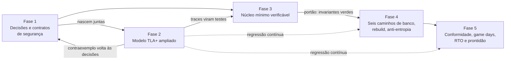

# As cinco fases de trabalho

[Início](../00_COMECE_AQUI.md) · [Documento principal](../DataReplication_Versao_1.md) · [Índice da implementação](README.md)

Decisão 14 da [revisão crítica de 13/10/2026](../06_pendencias_e_riscos/revisao_critica_13_10.md): o trabalho segue **cinco fases**, com o modelo TLA+ ampliado nascendo junto com a fase 1 e o **núcleo mínimo verificável** pronto antes de qualquer um dos seis caminhos de banco.

> **Nota de origem.** O texto das cinco fases do relatório original não está no pacote; esta descrição foi **inferida** do que o Bruno decidiu (decisão 14), do ajuste de ordem do arquiteto (resposta, seção 2.16) e dos ADRs 044 a 054. Se o relatório trouxer outro recorte, ajustar este arquivo.

## Visão geral

**Como ler:** as fases 1 e 2 começam juntas porque o lease só vale se for modelado, e um contraexemplo do modelo pode reabrir uma decisão da fase 1. A fase 3 só começa com as decisões estáveis e usa os traces do modelo como testes. A fase 4 só começa quando o núcleo da fase 3 passa nos seus testes de invariante. O modelo continua rodando como regressão enquanto o desenho muda.

## Fase 1: decisões e contratos de segurança

| Item | Conteúdo |
|---|---|
| **Entregas** | ADRs 044 a 054 aceitos. Contratos que o código e os clientes veem: códigos de erro (`LEASE_EXPIRED`, `NO_LEADER`, `PENDING`), headers (`x-dr-mode`), variáveis obrigatórias (`DEGRADED_POLICY`; `DEGRADED_LEASE` só com `accept`), Query em GSI recusada, mTLS por aplicação com lista identidade -> tabelas, modo único strong sem variável de modo ([ADR-057](../03_adr/ADR-057-um-unico-modo-strong-consistency.md)) |
| **Decisões abertas que bloqueiam** | Valor de D e aceite do RPO > 0 (PEND-02); `DEGRADED_POLICY` por cliente e margem M (PEND-17); lista de permissões por aplicação (PEND-19); inventário real de chamadas e de `ConditionExpression` (PEND-15). Os valores são **a definir**; nenhum número é presumido neste pacote |
| **Documentação** | Matriz automático, assistido e manual ([08, 9.5](../01_arquitetura/08_resiliencia_autocura_e_timeouts.md)); definição de pronto só para as linhas automáticas; SLO ponta a ponta; RTO como distribuição medida em exercícios |
| **Saída** | Decisões sem contradição entre ADRs, cenários e este guia; pendências bloqueantes com dono e prazo; hipóteses H-DR13 e H-DR14 entregues à fase 2 como obrigações do modelo |

## Fase 2: modelo TLA+ ampliado (nasce junto com a fase 1)

| Item | Conteúdo |
|---|---|
| **Escopo do modelo** | Gate por termo e prefixo ([ADR-046](../03_adr/ADR-046-gate-so-conta-progresso-validado-pelo-raft.md)); lease do modo degradado e promoção entre nuvens ([ADR-044](../03_adr/ADR-044-lease-do-modo-degradado-e-promocao-da-azure.md)); troca de membros e identidade nova ([ADR-034](../03_adr/ADR-034-fsync-fatal-e-identidade-nova.md)); dedupe e resultado desconhecido ([ADR-026](../03_adr/ADR-026-dedupe-de-retry-id-estavel.md)); DELETE e replay com `I-DEL` ([ADR-047](../03_adr/ADR-047-delete-real-invariante-e-reconstrucao-em-tabela-sombra.md)); SKIP por item ([ADR-048](../03_adr/ADR-048-skip-por-item.md)); log volátil x durável por nó com queda em qualquer passo, modo síncrono com F3 e `AsyncStorageWrites` ([ADR-056](../03_adr/ADR-056-group-commit-por-shard-e-nada-sai-antes-do-fsync.md)) |
| **Hipóteses a fechar** | H-DR13 (prorrogação do lease contra promoção da Azure) e H-DR14 (partição assimétrica) |
| **Invariantes** | Nunca duas pontas aceitando escrita ao mesmo tempo; índice N durável na Azure significa o mesmo prefixo até N; o gate nunca recua; toda entrada ACKada está no log durável de 2 nós AWS e 2 nós Azure; com as leituras abertas o estado materializado é a dobra do log até `applied` |
| **Saída** | TLC ou Apalache sem violação nas configurações definidas; cada contraexemplo vira decisão da fase 1 ou teste da fase 3. O modelo continua como regressão nas fases seguintes |

## Fase 3: núcleo mínimo verificável

Gate, lease, log do Raft e **um** caminho de banco, antes dos seis. É o que o esboço de [codigo_exemplo/](codigo_exemplo/README.md) começa a fixar.

| Item | Conteúdo |
|---|---|
| **Entregas** | `Gate` com termo; `Lease` (contado desde `t_c`) e `DegradeService` com relógio injetável; `CommitPump` com gate por evento; `raftlog` sobre o `wal` do etcd com group commit por shard no laço do `Ready` (nada sai antes do fsync, [ADR-056](../03_adr/ADR-056-group-commit-por-shard-e-nada-sai-antes-do-fsync.md)) e o progresso do applier (registro com CRC, sem fsync, no volume do Raft); adaptador `etcdraft` no modo síncrono com F3; **um** `StateStore` (um banco por vez) com apply depois do gate, paralelo por chave e com marca d'água ([ADR-058](../03_adr/ADR-058-apply-paralelo-por-chave-com-marca-dagua.md)), e checkpoint por item; `dynamohttp` com os contratos da fase 1 |
| **Testes** | Concorrência com `-race` em toda estrutura compartilhada; simulação determinística com os traces do modelo; propriedade do `I-DEL` (sequências aleatórias de Put e Delete com queda em qualquer ponto convergem para o mesmo estado); suíte de conformidade por porta; falhas no WAL |
| **Spikes** | S1 (infraestrutura, com IOPS por número de shards), S1b (síncrono com F3 x `AsyncStorageWrites`), S2 (Raft e WAL mínimo), S4 (gate e degradado) |
| **Portão para a fase 4** | Os testes de invariante passam; o lease é conferido a cada ACK; `reject` nunca degrada; a leitura forte usa `min(ReadIndex, gate)` e falha rápido com applier parado |

## Fase 4: os seis caminhos de banco, rebuild e anti-entropia

| Item | Conteúdo |
|---|---|
| **Entregas** | Os seis bancos, um por célula ([ADR-054](../03_adr/ADR-054-banco-por-celula-mantido.md)): `DynamoStore` nas três células AWS e `CosmosStore` nas três da Azure pelo Cloud-Adapter; learners da Azure com ressincronização; multi-shard; `drctl` |
| **Reconstrução** | Rebuild em tabela sombra (índice F, cópia difusa condicional, replay, cutover do nome lógico com geração, checksum por faixa, [ADR-047](../03_adr/ADR-047-delete-real-invariante-e-reconstrucao-em-tabela-sombra.md)); anti-entropia por checksum (detecta, não previne); `SKIP` por item e consulta `APPLIED`, `REJECTED`, `PENDING` |
| **Pendências ligadas** | Limite de lag de apply do Cosmos para a elegibilidade ao failover (PEND-18) |
| **Spikes** | S3 (multigrupo) e S5 (compatibilidade DynamoDB, incluindo a medição de `t_apply` e da vazão por shard com 1, 4, 16 e 64 workers, ADR-058) |
| **Saída** | Os seis caminhos passam nos testes de falha de uma célula; o rebuild converge e o checksum fecha; sem divergência entre as seis materializações num soak |

## Fase 5: conformidade, game days, medição do RTO e prontidão

| Item | Conteúdo |
|---|---|
| **Conformidade** | Suíte que roda a mesma sequência contra o DynamoDB real, contra a camada e contra o Cosmos pelo Cloud-Adapter ([ADR-051](../03_adr/ADR-051-compatibilidade-dynamodb-inventario-conformidade-e-idempotencia.md), PEND-16); SDKs Java, Go e .NET com mTLS; `_dr_v` nunca nas respostas; inventário de cada cliente fechado |
| **Game days** | Partição com lease ([C32](../02_cenarios/atualizados/C32-particao-e-lease-do-modo-degradado.md)); queda da AWS em modo degradado (RTO com piso D + M); promoção da Azure; reconstrução em tabela sombra ([C33](../02_cenarios/atualizados/C33-reconstrucao-em-tabela-sombra.md)); entrada venenosa e `SKIP` por item; autorização negada ([C34](../02_cenarios/atualizados/C34-autorizacao-por-aplicacao.md)) |
| **Medição** | RTO como **distribuição medida em exercícios** (mediana, P95, pior caso), não soma de P99; SLO ponta a ponta de latência, erro e recuperação, medido sobre a operação completa |
| **Prontidão** | Definição de pronto só para as linhas automáticas da matriz; as linhas assistidas e manuais têm runbook e exercício registrado; riscos bloqueantes P0 fechados ou aceitos por escrito |
| **Spikes** | S6 (versões) e S7 (bibliotecas) fechados antes de congelar |

## Como as fases se relacionam com a ordem sugerida anterior

A [ordem de implementação](05_testes_armadilhas_e_ordem.md#ordem-sugerida-de-implementação) do guia (oito passos) continua válida **dentro** das fases 3 e 4:

| Passo do guia | Fase |
|---|---|
| 1. `domain`, `Gate` e o modelo TLA+ | 1 e 2 (o modelo nasce primeiro) e 3 |
| 2. Portas, fakes e `WriteService` | 3 |
| 3. Adaptador `wal` e conformidade (S1) | 3 |
| 4. Adaptador `etcdraft` (S2) | 3 |
| 5. `dynamohttp`, `Applier` e **um** `DynamoStore` (um nó, depois três) | 3 (um caminho de banco) |
| 6. `peergrpc`, learners da Azure e gate real | 3 (gate real) e 4 |
| 7. `DegradeController`, `Recovery`, `LeadershipService` | 3 e 4 |
| 8. `CosmosStore`, `drctl`, observabilidade e testes de falha | 4 e 5 |
