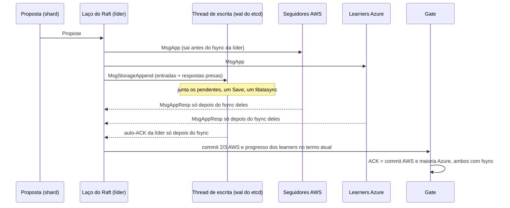

# Análise: group commit com buffer em memória e `AsyncStorageWrites`

> Análise do arquiteto, 13/10/2026, para o pedido do Bruno: (1) fsync com group commit e buffer em memória enquanto as escritas acontecem; (2) viabilidade do `AsyncStorageWrites` do `etcd-io/raft` para batching adaptativo e pipelining de persistência. **Decidido pelo Bruno em 13/10: 1a 2a 3b 4a 5a 6a**, aplicado no [ADR-056](../03_adr/ADR-056-group-commit-por-shard-e-nada-sai-antes-do-fsync.md). Este arquivo fica como registro da análise.
>
> Fontes conferidas no código: `go.etcd.io/raft/v3` v3.6.0 (`raft.go`, `rawnode.go`, `doc.go`, pasta `tla/`) e `go.etcd.io/etcd/server/v3` v3.6.5 (`storage/wal`). O que não foi conferido está marcado como "verificar".

## 1. Resumo

1. **Buffer em memória só é aceitável como área de montagem do lote.** Nenhum ACK ao cliente, voto (`MsgVoteResp`) ou resposta de `AppendEntries` (`MsgAppResp`) pode sair antes do fsync que cobre aquela entrada. Se "buffer em memória" significar responder antes do disco, é o ACK em memória que o Bruno descartou em 12/10, e quebra o RPO = 0 numa falha correlacionada das réplicas (6.8 de [04_wal_e_fsync](../01_arquitetura/04_wal_e_fsync.md)). Com essa regra, o buffer não muda a semântica; muda só quantos fsyncs fazemos.
2. **O group commit por shard já existe hoje, sem código novo.** O `etcd-io/raft` acumula as propostas que chegam enquanto o fsync anterior está em andamento, e o próximo `Ready` leva todas juntas; o `wal.Save` do etcd grava o lote e faz **um** `fdatasync`. É o "agrupamento natural" (F2) que o pacote já pedia.
3. **O que não existe é group commit entre shards.** Um WAL do etcd por shard (ADR-019) significa um fsync por shard. Isso não piora a latência, mas **multiplica as IOPS** e pode encostar no limite de base dos volumes (seção 4). Group commit entre shards exige um WAL compartilhado, ou seja, **código próprio de armazenamento de volta ao caminho do ACK** (o W2, que era o maior risco de perda de dado e saiu em 13/10).
4. **`AsyncStorageWrites` é viável e seguro por construção, mas o ganho de latência é parecido com o de uma otimização mais simples.** O ganho real de latência (tirar o fsync da líder do caminho serial) também se obtém no modo síncrono com a líder enviando antes de gravar (F3, seção 10.2.1 da tese, permitido pelo `doc.go`). O que só o modo assíncrono dá: o laço do Raft não para durante um fsync lento (heartbeats, votos e ReadIndex continuam) e as respostas ficam presas à escrita de forma estrutural, o que tira do nosso código a decisão "qual mensagem pode sair antes do disco".
5. **Recomendação:** 1a, 2a, 3b, 4a, 5a, 6a (seção 9). Em uma frase: manter a regra "nada sai antes do fsync", usar o group commit por shard que já existe com coalescência sem espera fixa, começar no modo síncrono com F3 e decidir o `AsyncStorageWrites` por um spike com critério numérico, com o modelo TLA+ ampliado para log volátil x durável nos dois casos.

## 2. O que o wal do etcd já faz (conferido no código)

| Item | Comportamento | Efeito para nós |
|---|---|---|
| `wal.Save(st, ents)` | Grava todas as entradas e o `HardState` do `Ready` e faz **um** `fdatasync` se `MustSync` (há entradas, ou mudou termo ou voto) | Group commit por `Ready`, por shard |
| Buffer | `encoder` com `PageWriter` que só descarrega em fronteira de 4 KiB (`walPageBytes = 8 × 512`) | Escritas alinhadas (F5) já prontas |
| Segmentos | 64 MB pré-alocados (`SegmentSizeBytes`, `fileutil.Preallocate`); o próximo é preparado em segundo plano | Sem alocação no fsync (F4) |
| fsync | `fileutil.Fdatasync`; aviso no log se passar de 1 s (`warnSyncDuration`) | Precisamos de métrica própria, 1 s é alto demais para nós |
| Entre chamadas | Cada `Save` faz o seu fsync; não junta `Save` de chamadas diferentes | Para coalescer, o chamador precisa juntar o lote **antes** de chamar `Save` |
| Entre shards | Um WAL por shard = um arquivo e um fsync por shard | Sem group commit entre shards |

**Como o lote se forma hoje (modo síncrono):** o laço do shard chama `Ready`, grava (`Save` com fsync), envia mensagens e chama `Advance`. Enquanto o fsync roda, as propostas e as mensagens de rede ficam na fila; o próximo `Ready` leva todas. Com tráfego baixo, o lote é de uma entrada e a latência é um fsync; em rajada, o lote cresce sozinho. É exatamente o "batching adaptativo" do pedido, sem espera fixa.

## 3. `AsyncStorageWrites`: o que é e o que garante (conferido no código)

Com `Config.AsyncStorageWrites = true`, o `Ready` passa a trazer duas mensagens locais:

- **`MsgStorageAppend`** (para a *thread* de escrita): entradas, `HardState` e snapshot a persistir, mais uma lista de **respostas** que só podem ser entregues depois que tudo isso estiver durável. Mensagens para a mesma *thread* não podem ser perdidas nem reordenadas.
- **`MsgStorageApply`** (para a *thread* de apply): entradas commitadas. Não exige durabilidade.

Garantias que vêm da biblioteca e que interessam ao nosso desenho:

1. **`MsgAppResp` e `MsgVoteResp` vão para `msgsAfterAppend`** e viajam como respostas do `MsgStorageAppend`. Ou seja: um seguidor AWS ou learner Azure só confirma uma entrada, e um nó só entrega um voto, depois do fsync, **desde que a nossa *thread* de escrita só entregue as respostas depois do fsync**. A biblioteca até segura as rejeições, por precaução (comentário em `raft.go`).
2. **A líder só se conta no quórum depois de persistir** (`appendEntry` manda um `MsgAppResp` para si mesma pelo mesmo mecanismo). O commit pode ser atingido por dois seguidores com fsync enquanto o disco da líder ainda grava: continua sendo 2 de 3 da AWS com fsync.
3. **No modo assíncrono a líder não aplica entrada que ainda não está no próprio disco** (`applyUnstableEntries()` devolve `false`, então `CommittedEntries` só traz entradas estáveis localmente).
4. Pipelining: o laço do Raft continua produzindo `Ready` (e enviando `MsgApp` aos pares) enquanto o fsync anterior está em andamento. A *thread* de escrita pode juntar vários `MsgStorageAppend` pendentes num só `Save` com um fsync e então entregar todas as respostas, em ordem.

**Uso em produção:** o etcd server **não** usa o `AsyncStorageWrites` (nenhuma referência no `server/v3` 3.6.5). O CockroachDB usa (escrita assíncrona do log do Raft, introduzida por volta da 23.1; verificar a versão). É o caminho menos percorrido pela comunidade do etcd.

## 4. Group commit entre shards: o custo real é IOPS, não latência

Estimativa grosseira por nó (a medir no S1). Com agrupamento natural, o número de fsyncs por segundo de um log é aproximadamente `λ / (1 + λ·t)`, com `λ` = escritas por segundo naquele log e `t` = duração do fsync.

| Cenário (3.000 TPS, fsync de 1,5 ms) | fsyncs/s por nó | IOPS de escrita (1 a 2 por fsync) |
|---|---|---|
| Um WAL compartilhado (W2) | ~545 | ~550 a 1.100 |
| 8 shards, um WAL do etcd por shard | ~1.900 | ~1.900 a 3.800 |
| 16 shards | ~2.300 | ~2.300 a 4.600 |

- O gp3 e o Premium SSD v2 têm **3.000 IOPS de base**. Com 8 ou mais shards, uma rajada de 2x passa do limite e o fsync passa a esperar fila do volume: a **cauda** de latência sobe justamente na rajada.
- O efeito vale em **cada** um dos 6 nós (líder, seguidores e learners), e cada cliente tem a sua instalação (ADR-043): é custo multiplicado.
- Saídas, em ordem de risco: (a) provisionar IOPS (io2, Premium SSD v2 com IOPS acima da base) e limitar o número de shards por nó; (b) WAL compartilhado entre shards (W2), que **volta a pôr código próprio no caminho do ACK** e exigiria de novo a bateria de testes da seção 13. Recomendo (a) e deixar (b) como plano B com gatilho numérico do S1.
- Ponto a medir: fdatasync paralelo em vários arquivos do mesmo sistema de arquivos pode serializar no journal (ext4/jbd2) quando há mudança de metadados; com segmentos pré-alocados isso deve ser raro, mas é exatamente o tipo de coisa que só aparece em horas de carga.

## 5. Latência: onde está o ganho

Notação: `t_L`, `t_S`, `t_Z` = fsync da líder, de um seguidor AWS, de um learner Azure; `RTT_A`, `RTT_Z` = ida e volta até a AWS e até a Azure.

| Modo | Tempo até o gate (sem o apply) |
|---|---|
| Síncrono ingênuo (grava, depois envia) | `t_L + max(RTT_A + t_S, RTT_Z + t_Z)` |
| Síncrono com F3 (envia, depois grava; como o etcd server faz) | `max(t_L, RTT_A + t_S, RTT_Z + t_Z)` |
| `AsyncStorageWrites` | `max(t_L, RTT_A + t_S, RTT_Z + t_Z)` (o mesmo) |

- O ganho de latência das duas otimizações é o mesmo: **tirar `t_L` da soma**. No P99 isso pode valer vários ms, porque a cauda de fsync do volume de rede é o que domina (6.8).
- **O apply continua esperando o disco da líder.** O applier só recebe entrada estável localmente, então um disco lento na líder ainda atrasa o ACK quando o ACK espera o apply (Strong). F7 (transferir liderança quando o fsync da líder passa do limiar) continua necessário.
- O que **só** o assíncrono dá: um fsync de 200 ms na líder não congela o laço do Raft. No modo síncrono, o laço parado não envia heartbeats; com `ElectionTick` curto, os seguidores podem iniciar eleição por causa de um disco, e o CheckQuorum da líder pode derrubá-la. Isso também se mitiga no modo síncrono com timeout de eleição bem acima do P99.9 de fsync e com F7, mas é atenuação, não eliminação.

## 6. Interação com o gate, ReadIndex e eleição

| Tema | Efeito do `AsyncStorageWrites` | Precisa mudar? |
|---|---|---|
| **Gate** (ADR-005, 017, 029, 046) | O progresso dos learners continua vindo do `MsgAppResp`, que só sai depois do fsync deles. O commit da AWS pode ser atingido por dois seguidores sem a líder; continua 2/3 com fsync | Não, desde que a *thread* de escrita respeite a regra das respostas |
| **`ConsensusEngine.Committed()`** | Hoje a interface diz "entregues da memória". No assíncrono, as entradas chegam por `MsgStorageApply` e já estão estáveis na líder | Ajustar o comentário e o adaptador |
| **ReadIndex e barreira `min(ReadIndex, gate)`** (ADR-049) | O ReadIndex depende de heartbeat com quórum, não do disco; no assíncrono ele não para durante um fsync lento. O commit da líder pode estar acima do próprio disco, mas a leitura espera `applied`, que só anda com entrada estável | Não |
| **Eleição** | Voto só sai depois de o `HardState` (termo e voto) estar no disco. A eleição fica mais lenta em um fsync, o que é desprezível | Não |
| **Transferência planejada** (ADR-013) | `TimeoutNow` e a eleição seguem o mesmo contrato | Não |
| **Lease do modo degradado** (ADR-044) | O lease conta desde o último contato com a maioria Azure. No síncrono, um fsync longo na líder atrasa o processamento das respostas e pode fazer o lease parecer vencido; no assíncrono isso não acontece | Não, mas é mais um ponto a favor do assíncrono |
| **`raft.MemoryStorage`** | No assíncrono, a *thread* de escrita precisa fazer `Save` com fsync, **depois** `MemoryStorage.Append`, e só então entregar as respostas. Inverter essa ordem quebra o envio de `MsgApp` a seguidores atrasados | Regra de implementação |
| **fsync fatal** (ADR-034) | Se o fsync falhar, a *thread* encerra o processo **sem** entregar nenhuma resposta do lote | Regra de implementação |

## 7. Cenários ocultos

1. **"Buffer em memória" lido como ACK em memória.** O cenário que mata é a falha correlacionada de software: o mesmo binário nas 6 réplicas, uma requisição venenosa derruba todas antes do fsync, e a entrada ACKada some nas duas nuvens. Por isso a regra da seção 1 é invariante, não configuração.
2. **No modo síncrono, a regra "o que pode sair antes do disco" fica no nosso código.** O `doc.go` permite enviar mensagens enquanto o lote do mesmo `Ready` grava (para a líder), mas o comentário do `rawnode.go` diz que, no síncrono, `Messages` inclui as respostas presas ao disco. Se o adaptador enviar tudo antes do `Save` para ganhar F3, um seguidor ou learner responde `MsgAppResp` antes do próprio fsync, e o gate passa a contar durabilidade da Azure que não existe. É um bug silencioso que nenhum teste de caminho feliz pega. No síncrono com F3, só a líder pode enviar antes de gravar, e só mensagens `MsgApp`; no assíncrono a biblioteca separa isso por construção.
3. **Juntar vários `MsgStorageAppend` num `Save`.** Uma mensagem posterior pode reescrever entradas da anterior (troca de termo, conflito de log). A junção precisa cortar o lote anterior a partir do primeiro índice da nova, usar o último `HardState` e tratar snapshot como fronteira de lote. O wal do etcd tolera sobrescrita na leitura, mas o `MemoryStorage` e as respostas precisam ver a mesma ordem.
4. **Entrada de 4 MiB no lote.** Um lote sem limite de bytes faz um fsync grande atrasar todas as escritas pequenas que entraram junto. O lote precisa de teto (proposta: 1 MiB, ou uma entrada sozinha se ela for maior).
5. **Buffer sem limite em rajada longa ou disco lento.** As entradas não persistidas ficam na memória do Raft. Sem `MaxUncommittedEntriesSize` e `MaxInflightBytes`, a meta de 256 MiB do pod estoura antes de qualquer alarme. Acima do limite, a proposta precisa ser recusada com erro que o SDK repete (`ThrottlingException`), e o dedupe de 5 min cobre a repetição.
6. **IOPS de base do volume** (seção 4): o problema aparece como cauda de latência em rajada, não como erro.
7. **Pouca estrada do `AsyncStorageWrites` fora do CockroachDB.** Bugs na biblioteca nesse caminho teriam menos usuários para achá-los antes de nós.

## 8. TLA+

- O modelo do ADR-030 trata "persistir e responder" como um passo atômico. Com F3 ou com o assíncrono isso deixa de ser verdade: é preciso separar **log volátil** e **log durável** por nó, ter a ação de queda que perde o volátil em qualquer passo, e fazer `MsgAppResp`, voto e auto-ACK da líder dependerem só do durável.
- Invariante nova: **toda entrada ACKada está no log durável de pelo menos 2 nós AWS e 2 nós Azure**, inclusive depois de quedas em qualquer ponto.
- O `etcd-io/raft` tem um modelo TLA+ próprio (`tla/etcdraft.tla`, com estado durável e queda, e validação por *trace*). Ele ajuda a confiar na biblioteca, mas **não cobre o nosso gate nem o lease**: a ampliação do nosso modelo é necessária nos dois modos. A validação por *trace* da biblioteca pode ser reaproveitada nos testes do adaptador (verificar o esforço).

## 9. Perguntas (formato 1a 2b)

**1. Regra do buffer em memória**
- **1a (recomendada):** buffer só como área de montagem do lote; nenhum ACK, voto ou `MsgAppResp` antes do fsync. Vira invariante no ADR e no TLA+.
- 1b: janela de exposição limitada (responder antes do fsync, M3 da seção 6.8). Reverte a decisão de 12/10 e exige aceite formal de RPO > 0 em falha correlacionada.

**2. Escopo do group commit**
- **2a (recomendada):** por shard, que o wal do etcd já faz, mais coalescência dos lotes pendentes; IOPS provisionadas e teto de shards por nó. WAL compartilhado entre shards só se o S1 reprovar (gatilho: fsync P99 acima do orçamento ou IOPS acima de 70% do provisionado na carga de 2x).
- 2b: WAL compartilhado entre shards já na v1 (W2 de volta ao caminho do ACK, com a bateria completa de testes de armazenamento).

**3. `AsyncStorageWrites`**
- 3a: adotar já no adaptador `etcdraft` da fase 1.
- **3b (recomendada):** fase 1 no modo síncrono com F3 restrito a `MsgApp` da líder; spike S1b compara com o assíncrono no volume real, com injeção de fsync lento. Adota o assíncrono se reduzir o P99 do commit em pelo menos 20% **ou** eliminar eleições causadas por fsync lento. A *thread* de escrita é escrita desde já com a forma do assíncrono (coalescência, respostas presas ao lote), para a troca ser só de ligação.
- 3c: os dois modos atrás de uma variável em produção (dobra a matriz de testes; não recomendo).

**4. Espera para formar lote**
- **4a (recomendada):** sem espera fixa (linger); o lote é o que se acumulou durante o fsync anterior, com teto de 1 MiB (ou uma entrada maior sozinha).
- 4b: espera adaptativa curta (por exemplo, até 200 µs quando há fila), só se o S1 mostrar IOPS no limite.

**5. Limite do buffer e contrapressão**
- **5a (recomendada):** `MaxUncommittedEntriesSize` 32 MiB por shard e teto por nó dentro da meta de 256 MiB do pod; acima disso, `ThrottlingException` (o SDK repete; dedupe cobre). Métricas: bytes não persistidos, tamanho do lote, fsyncs/s, duração do fsync (P50/P99/P99.9).
- 5b: só o limite padrão da biblioteca.

**6. TLA+**
- **6a (recomendada):** ampliar o modelo com log volátil x durável, queda em qualquer passo e a invariante "ACK implica fsync em 2 AWS e 2 Azure", antes do código do adaptador, nos dois modos.
- 6b: confiar no TLA+ do `etcd-io/raft` e só testar o adaptador.

## 10. O que muda no pacote depois das respostas (com as recomendações)

- **ADR novo (056):** group commit por shard, regra do buffer, modo síncrono com F3 na fase 1, critério do S1b para o assíncrono, limites de memória e contrapressão.
- **ADR-019** (um WAL por shard e consequências), **ADR-030** (modelo ampliado), **ADR-034** (fsync fatal sem entregar respostas).
- **04_wal_e_fsync** (6.8: F2 e F3 com o que o wal do etcd já faz e a regra de envio), **03_consenso** (5.5), **06_modos** (orçamento), **07_go_memoria** (buffer não persistido), **10_pontos_adicionais** (métricas).
- **Spikes:** S1 ganha a medição de IOPS por número de shards; S1b novo. **Riscos:** IOPS de base e regra de envio no modo síncrono.
- **Diagramas:** D04 (*thread* de escrita e coalescência), D05 (gate com auto-ACK da líder após fsync), D07 (prazos).
- **Código de exemplo:** regra do que pode sair antes do fsync, com testes; comentário de `ConsensusEngine.Committed()`.
