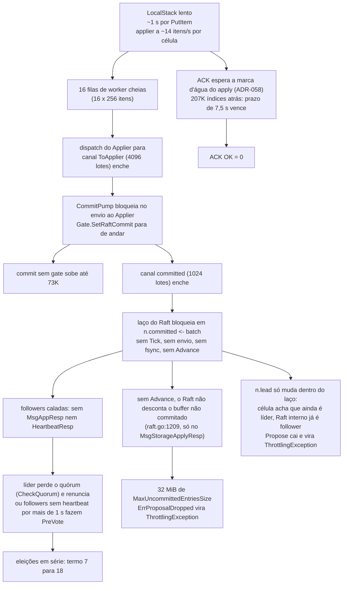

# Teste de carga da POC (14/10/2026): o que aconteceu e por quê

**Status:** decisões tomadas pelo Bruno em 14/10/2026 (1a 2a 3a 4a 5a 6a), registradas no [ADR-060](../03_adr/ADR-060-laco-do-raft-nunca-espera-o-apply-e-admissao-por-atraso.md) e no cenário [C35](../02_cenarios/atualizados/C35-banco-lento-nao-derruba-a-lideranca.md). Este documento é a análise que levou a elas e fica como registro.

> **Correção depois da análise:** o painel "Resultados de escrita por segundo" do dashboard v2 estava **empilhado** (stacking normal). A linha de cima era a soma de todos os resultados, não só o throttling. Por isso a proporção entre throttling e pending continua sem número: a próxima rodada mede isso com `dr_throttled_total{causa}`, o painel sem empilhamento e `task diag`.

Teste do Bruno: notebook RHEL 9, SSD, 32 GB, tudo na mesma máquina (3 células, um LocalStack, Prometheus, Grafana e k6). PutItem com objeto simples (só pk). Aquecimento de 100 TPS por 1 min, rampa até 500 TPS por 1 min, 1000 TPS sustentados por 1 min, 30 s de graceful shutdown. Código analisado: `DataReplicationApp/` no commit `ac25fc2` (ADR-058) e `go.etcd.io/raft/v3 v3.7.0`.

## 1. Resposta curta

- **A segurança se manteve.** "Condições de inversão de índices" ficou em 0, nunca houve dois líderes no mesmo termo e as três células ficaram prontas o tempo todo. O que quebrou foi a vivacidade (progresso) e a vazão.
- **A causa raiz é o apply, não o Raft.** Antes do teste começar, o applier já estava cerca de 210 mil entradas atrás do gate e andava a uns 12 a 14 itens por segundo por célula (o atraso caiu de 218 mil para 207 mil em cerca de 15 minutos). Com 16 workers, isso dá mais ou menos 1 segundo por PutItem no LocalStack. O teste já começou com o sistema afogado.
- **As trocas de líder são consequência.** O laço do Raft entrega os commits ao CommitPump por um canal bloqueante (`node.go`, "applier lento segura o laço (risco 3)"). Quando as filas do apply enchem, o laço do Raft para. Com ele param o tick, o heartbeat, o envio de mensagens, o fsync e o Advance. As followers deixam de responder, a líder perde o quórum (CheckQuorum) e as eleições se sucedem: o termo foi de 7 para 18.
- **ACK OK = 0 era inevitável.** Pelo ADR-058, o ACK espera a marca d'água do apply alcançar o índice da escrita. Toda escrita nova entrou cerca de 207 mil índices atrás da marca d'água, o que daria horas de espera com o prazo de 7,5 s.
- **O fsync de 775 ms (P95) e os picos de 1 a 2 s pioram tudo**, porque o fsync roda dentro do mesmo laço que gera os heartbeats, e o timeout de eleição é de 1 s.

## 2. A cascata

## 3. Cada sintoma, explicado

| Painel | O que mostra | Por quê |
|---|---|---|
| Gate ainda não aplicado | 218K caindo para 207K, já antes do teste | O applier anda a ~12 a 14 itens/s por célula. O atraso vem de testes anteriores: os volumes não foram limpos. |
| Índices locais | apply parado perto de 28K, gate e commit entre 235K e 308K | Mesmo motivo. As três células têm o mesmo apply porque dividem um único LocalStack. |
| Commit sem gate | 0 até 16:56, depois sobe até 73K e fica | O gate só anda quando o CommitPump consegue entregar o lote ao Applier (`replicate.go`, `runCommits`). Com o Applier cheio, o gate fica para trás do commit. Os 73K ficam parados no canal `committed`. Conta de conferência: 32 MiB divididos por cerca de 450 bytes por entrada dão cerca de 73 mil entradas, que é o teto do buffer não commitado do Raft. Isso é inferência: o tamanho real da entrada precisa ser medido. |
| Termo por célula e mudanças de líder | termo de 7 para 18, até 5 mudanças por janela | O laço do Raft bloqueado deixa a célula muda. Ver a seção 2. |
| Quórum ativos e Quórum OK | cai de 3 para 1 ou 2, Quórum OK chega a 0 | `RecentActive` das followers fica falso porque elas não respondem enquanto o laço delas está preso. |
| Última atividade Raft | idade de 6 a 8 s | Laço do Raft parado por segundos (fila cheia mais fsync lento). |
| WAL fsync | P50 de 500 µs, P95 de até 775 ms, picos de 1 a 2 s | Três WALs, LocalStack e Prometheus no mesmo SSD. Em XFS ou ext4, o fsync de um arquivo grande de outro processo pode atrasar o fdatasync dos WALs pelo journal. |
| Resultados de escrita | quase tudo throttling | Throttling só nasce de `raft.ErrProposalDropped` (`node.go:261`). Há duas fontes: buffer de 32 MiB cheio e proposta numa célula que ainda se acha líder (`n.lead` desatualizado). O print não deixa separar throttling de pending: o painel estava empilhado (confirmado no JSON do dashboard e corrigido no ADR-060). |
| Picos verdes em Resultados | coincidem com as trocas de líder | Provavelmente são no_leader, que tem cor parecida. Não são ok: a latência das escritas confirmadas está vazia e ACK OK = 0. É uma inferência pela coincidência de horário. |
| Mensagens descartadas por fila cheia | sem dados | O transporte gRPC não descartou nada. O gargalo não é a rede. |
| Appliers parados | 0 | Não houve item venenoso. O applier está lento, não estacionado. |

## 4. Por que isso também vale para produção

Na AWS real, um PutItem custa de 5 a 10 ms, então 16 workers dão de 1.600 a 3.200 itens/s por célula. A meta de 3.000 TPS fica no limite. O DynamoDB sob demanda também faz throttling quando o tráfego passa do dobro do pico anterior, e numa tabela nova ou recriada (tabela sombra do ADR-047) esse pico anterior é baixo. Com o desenho atual, um throttling do DynamoDB numa célula produz a mesma cascata: o apply atrasa, o laço do Raft para, a célula fica muda e vêm as eleições. Uma lentidão do banco de UMA célula consegue derrubar a liderança do grupo inteiro. Esse acoplamento é o achado mais importante do teste.

Cenário oculto: o atraso do apply das followers entra no RTO. Uma follower que vira líder com 207K de atraso não dá ACK em nada até alcançar a marca d'água, porque o ACK espera o apply local. Na prática, o failover só termina quando o apply da nova líder alcança o log.

## 5. Correções propostas (todas aprovadas, ver ADR-060)

### 5.1 O laço do Raft nunca espera o apply (crítico)

- O laço do Raft só publica o commit (um índice atômico mais um aviso). O CommitPump lê as entradas por faixa do armazenamento do Raft, em vez de recebê-las por canal. O MemoryStorage já guarda tudo, porque a compactação está desligada na POC. Em produção, a compactação nunca passa do que o applier já aplicou.
- `Gate.SetRaftCommit` passa a ser alimentado pelo laço do Raft, e não pelo CommitPump depois da fila do Applier. O gate deixa de depender do banco.
- `n.lead` passa a vir de `node.Status()` ou de um aviso fora do laço, para não ficar desatualizado.
- Alternativa descartada: aumentar as filas. A fila de 4096 lotes já era a versão "generosa" e só adiou o problema.
- Alternativa descartada: fila ilimitada entre o laço e o CommitPump. Com o banco parado, a memória cresce até o OOM.

### 5.2 Admissão por atraso do apply

- Antes do Propose, a líder recusa com ThrottlingException quando `commit - applied` passa de APPLY_LAG_MAX. Valor sugerido: o equivalente a 1 s de vazão do apply medida, com piso de `APPLY_WORKERS x 256`.
- Por quê: se o ACK espera o apply, aceitar uma escrita que não terá ACK no prazo só gera PENDING (resultado desconhecido), retry do SDK, mais entradas no log e mais trabalho para a Azure replicar. Recusar cedo é mais honesto e não grava nada.
- Custo: a escrita fica indisponível enquanto o banco da líder estiver lento. É o mesmo efeito de hoje, só que imediato, sem PENDING e sem derrubar a liderança.

### 5.3 Tick e heartbeat isolados do fsync

- ElectionTick configurável (ELECTION_TICKS). Na POC em notebook, 30 (3 s). Em produção, o valor sai do spike S1 com o P99.9 do fsync.
- Custo: a detecção de queda da líder sobe de 1 a 2 s para 3 a 6 s, e isso entra no RTO.
- O spike S1b (AsyncStorageWrites) ganha um motivo a mais: no modo assíncrono, a líder continua mandando heartbeat durante o fsync.

### 5.4 Ambiente do teste

- Começar de volumes limpos (`task clean`). O atraso de 207K contaminou o teste.
- Medir o teto do LocalStack sozinho: k6 direto no LocalStack com PutItem condicional nas três tabelas. Ver `docker stats` do LocalStack e a variável `DYNAMODB_HEAP_SIZE`. O DynamoDB Local roda em Java com SQLite, e com centenas de milhares de itens um heap pequeno pode provocar GC contínuo (hipótese a confirmar).
- ~~Criar na POC um banco em memória (por exemplo `STORE=memory`) só para teste de carga.~~ **Descartado pelo Bruno (14/10):** ele aceita o limite do LocalStack, testa localmente com TPS baixo (por exemplo 10 TPS) e depois na AWS.
- **Decidido depois (Bruno, 14/10, 1a 2a 3a):** um LocalStack por célula, com heap de 512m cada, e `task test-banco-lento CELL=N`, que pausa o banco de uma célula e confere que o termo não muda.
- Rodar o k6 em outra máquina, ou fixar CPUs com `cpuset` para separar o k6 das células.
- Medir o disco antes: `fio --rw=write --ioengine=sync --fdatasync=1 --size=22m --bs=2300 --name=wal` no diretório dos volumes do Docker.

### 5.5 Partida reaplica o log inteiro

- `RestartNode` recebe `Applied` = índice do snapshot, que é 0 na POC. A cada partida, o Raft reentrega todas as 308K entradas pelo canal. Proposta: retomar no índice do progresso do applier, com `Applied` = retomada − 1. A entrada do progresso é reentregue inteira e o applier pula os itens já gravados pela ordem salva; o replay é idempotente pela versão, então perder o progresso numa queda de host só alonga a partida.

### 5.6 Observabilidade que faltou para fechar o diagnóstico

- Rótulo `causa` no throttling: `buffer_cheio`, `nao_lider`, `transferencia`.
- Ocupação dos canais `committed`, `ToApplier` e das filas dos workers.
- Tempo bloqueado do laço do Raft (histograma do tempo de `handleReady`, com e sem o fsync).
- Taxa de apply por célula: `rate(dr_apply_item_duration_seconds_count[1m])`.

## 6. O que preciso do Bruno para fechar as inferências

1. `sum by (resultado) (increase(dr_writes_total[15m]))` por célula, para separar throttling de pending.
2. `histogram_quantile(0.5, sum by (le, instance) (rate(dr_apply_item_duration_seconds_bucket[1m])))`, para confirmar cerca de 1 s por PutItem.
3. `docker compose logs | grep -c "erro transitório no apply"` e `grep -c "dropping proposal"`. A primeira diz se o apply está repetindo erro; a segunda diz qual causa do Raft gerou o throttling.
4. `dropped_iterations` e o número de VUs do k6. Com escritas esperando 7,5 s, o k6 provavelmente não conseguiu gerar 1000 TPS (o gráfico mostra cerca de 550 req/s).
