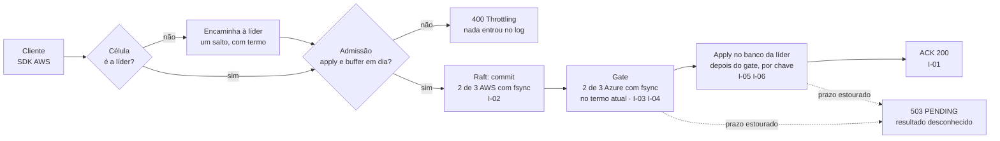
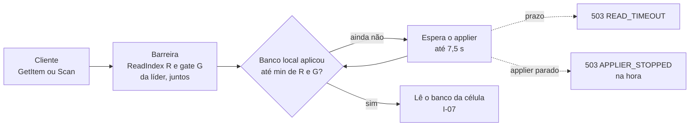

# Estado atual do DataReplication

[Início](00_COMECE_AQUI.md) · [Documento principal](DataReplication_Versao_1.md) · [Inventário dos ADRs](03_adr/INVENTARIO.md) · [Índice dos ADRs](03_adr/INDEX.md)

**Válido em 14/10/2026 · cobre ADR-001 a ADR-063 · rascunho, aguardando a validação do Bruno (seção 6).**

Este documento diz **como o sistema é hoje**, regra por regra, sem a história de como se chegou a cada uma. Quem chega lê este documento primeiro e abre um ADR só para saber o porquê de uma regra. Para o status de cada ADR, quem altera quem e as contradições encontradas, veja o [inventário](03_adr/INVENTARIO.md).

## Como ler

| Marca | Quer dizer |
|---|---|
| `[005]` | O ADR que justifica a regra; o link abre o arquivo |
| **POC: Sim** | Implementado na POC local (`DataReplicationApp`) |
| **POC: Parcial** | Parte implementada; o resto está dito na própria regra |
| **POC: Fora** | Fora do escopo da POC ([spec](../spec/SPEC_POC_LOCAL.md), R.4) |
| **POC: Divergente** | A POC faz diferente da regra; está no inventário |
| ⏳ **Em aberto** | Depende de decisão pendente; a seção 5 diz qual |

Sem marca de POC, a regra não se traduz em código (processo, custo, contrato).

## 1. O sistema em dez linhas

1. O `DataReplication` fica entre as aplicações e o banco, fala o protocolo do DynamoDB e só confirma uma escrita quando ela está durável **na AWS e na Azure**: RPO 0 em operação normal [001](03_adr/ADR-001-camada-intermediaria-agnostica.md) [003](03_adr/ADR-003-aws-primaria-azure-failover.md) [004](03_adr/ADR-004-dynamodb-primeiro-adaptador.md) [005](03_adr/ADR-005-ack-exige-gate.md).
2. Só AWS (sa-east-1, DynamoDB) e Azure (Brazil South, Cosmos DB, pelo Cloud-Adapter); sem terceiro domínio [003](03_adr/ADR-003-aws-primaria-azure-failover.md) [008](03_adr/ADR-008-terceiro-dominio.md).
3. Cada cliente tem a sua instalação. Cada shard tem 3 células AWS (votantes do Raft) e 3 células Azure (learners); cada célula é um cluster numa AZ, com **um** `DataReplication` e **um** banco [002](03_adr/ADR-002-shards-logicos-celulas-ativo-passivo.md) [016](03_adr/ADR-016-app-unico-por-celula-monolito-modular.md) [022](03_adr/ADR-022-banco-por-celula-nome-logico.md) [043](03_adr/ADR-043-uma-instalacao-por-cliente-identidade-por-configuracao.md) [054](03_adr/ADR-054-banco-por-celula-mantido.md).
4. A escrita passa pelo Raft (2 de 3 da AWS com fsync), pelo **gate** (2 de 3 da Azure com fsync) e pelo apply no banco da líder. Só então o cliente recebe o ACK [005](03_adr/ADR-005-ack-exige-gate.md) [017](03_adr/ADR-017-azure-learners-e-gate.md) [057](03_adr/ADR-057-um-unico-modo-strong-consistency.md).
5. Toda leitura é forte; não há leitura eventual nem consulta por GSI [049](03_adr/ADR-049-barreira-da-leitura-forte-e-o-gate.md) [050](03_adr/ADR-050-query-em-gsi-recusada.md) [057](03_adr/ADR-057-um-unico-modo-strong-consistency.md).
6. Se a Azure ou o link caem, a política da instalação decide: `reject` para as escritas (RPO 0 sempre) e `accept` segue só com a AWS por um prazo D (RPO > 0) [045](03_adr/ADR-045-politica-de-degradacao-por-instalacao.md) [044](03_adr/ADR-044-lease-do-modo-degradado-e-promocao-da-azure.md).
7. A Azure nunca se promove sozinha: a promoção é humana e só é aceita depois de D + M [033](03_adr/ADR-033-promocao-da-azure-humana.md) [044](03_adr/ADR-044-lease-do-modo-degradado-e-promocao-da-azure.md).

## 2. Invariantes de segurança

As regras que nunca podem ser quebradas. A coluna "Prova" aponta a propriedade do modelo TLA+ ([X01](02_cenarios/complexos/X01-gate-e-troca-de-lider.md), P1 a P18) e, quando existe, o teste da POC.

| # | Invariante | ADRs | Prova | POC |
|---|---|---|---|---|
| I-01 | O ACK só sai depois de: commit em 2 de 3 votantes AWS com fsync, gate com 2 de 3 learners Azure com fsync no termo atual, e apply no banco da líder | [005](03_adr/ADR-005-ack-exige-gate.md) [017](03_adr/ADR-017-azure-learners-e-gate.md) [046](03_adr/ADR-046-gate-so-conta-progresso-validado-pelo-raft.md) [057](03_adr/ADR-057-um-unico-modo-strong-consistency.md) | P1, P2 | Parcial: sem Azure, gate = commit |
| I-02 | Nada sai antes do fsync que cobre a entrada: nem ACK, nem voto, nem `MsgAppResp`. Só o `MsgApp` da líder pode sair antes | [056](03_adr/ADR-056-group-commit-por-shard-e-nada-sai-antes-do-fsync.md) | P1, P4 | Sim (`SplitBeforeSync`) |
| I-03 | O gate nunca recua. A líder nova reconstrói o gate antes de ACKar ou de servir leitura forte | [029](03_adr/ADR-029-gate-monotonico-na-troca-de-lider.md) [046](03_adr/ADR-046-gate-so-conta-progresso-validado-pelo-raft.md) [049](03_adr/ADR-049-barreira-da-leitura-forte-e-o-gate.md) | P3 | Fora |
| I-04 | O gate só conta progresso da Azure que chegou pelo `AppendEntries` no termo atual da líder | [046](03_adr/ADR-046-gate-so-conta-progresso-validado-pelo-raft.md) | P9 | Parcial: no domínio, com teste |
| I-05 | Nada é aplicado antes do gate: `applied ≤ gate` sempre | [057](03_adr/ADR-057-um-unico-modo-strong-consistency.md) [058](03_adr/ADR-058-apply-paralelo-por-chave-com-marca-dagua.md) | P17 | Sim |
| I-06 | A mesma chave é aplicada na ordem do log, e o replay é idempotente pela versão (`_dr_v` = índice) | [015](03_adr/ADR-015-wal-post-image-e-versao.md) [035](03_adr/ADR-035-lote-batchwriteitem-uma-entrada-e-apply-condicional.md) [058](03_adr/ADR-058-apply-paralelo-por-chave-com-marca-dagua.md) | P16 | Sim |
| I-07 | A leitura forte espera `applied ≥ min(ReadIndex, gate)`: nunca devolve estado anterior a uma escrita ACKada nem uma escrita não ACKada | [049](03_adr/ADR-049-barreira-da-leitura-forte-e-o-gate.md) [057](03_adr/ADR-057-um-unico-modo-strong-consistency.md) | P17 | Sim |
| I-08 | O log do Raft só é compactado até o `DurableIndex` do log de replicação, nunca até o índice apenas copiado | [018](03_adr/ADR-018-dois-logs-raft-e-replicacao.md) [055](03_adr/ADR-055-log-de-replicacao-segmentado-derivado-do-raft.md) | — | Sim na regra (`RaftCompactLimit`); a compactação está desligada |
| I-09 | Erro de escrita ou de fsync, no log do Raft ou no de replicação, é fatal e não libera nenhuma resposta do lote | [034](03_adr/ADR-034-fsync-fatal-e-identidade-nova.md) [055](03_adr/ADR-055-log-de-replicacao-segmentado-derivado-do-raft.md) [056](03_adr/ADR-056-group-commit-por-shard-e-nada-sai-antes-do-fsync.md) | P1 | Sim |
| I-10 | Com `reject`, nenhuma escrita é ACKada sem o gate da Azure, e `DEGRADE` nunca é proposto | [045](03_adr/ADR-045-politica-de-degradacao-por-instalacao.md) | P18 | Parcial: política fixa `reject`, sem Azure |
| I-11 | Com `accept`, nenhuma escrita é ACKada depois do lease D sem `RENEW`; a validade é conferida a cada ACK | [044](03_adr/ADR-044-lease-do-modo-degradado-e-promocao-da-azure.md) | P10 | Fora |
| I-12 | Nunca dois lados aceitam escrita confirmada: `ForcePromote` é recusada antes de D + M | [033](03_adr/ADR-033-promocao-da-azure-humana.md) [044](03_adr/ADR-044-lease-do-modo-degradado-e-promocao-da-azure.md) | P11 | Fora |
| I-13 | Um item que o banco recusa para sempre estaciona o applier; pular é sempre decisão humana, por item | [038](03_adr/ADR-038-skip-de-entrada-venenosa-sempre-humano.md) [048](03_adr/ADR-048-skip-por-item.md) | — | Parcial: estaciona e responde na hora; o `SKIP` não existe |
| I-14 | Um nó que perde o disco volta com identidade nova; nunca reusa o ID antigo com log vazio | [034](03_adr/ADR-034-fsync-fatal-e-identidade-nova.md) | P13 | Fora |
| I-15 | Um retry com o mesmo identificador, dentro da janela de 5 min, não gera segunda entrada | [026](03_adr/ADR-026-dedupe-de-retry-id-estavel.md) | P14 | Fora |

⏳ **Em aberto:** hoje um banco com `_dr_v` de outra história do log pode fazer o apply contar como "já aplicado" uma escrita que não gravou [062](03_adr/ADR-062-banco-com-versao-de-outra-historia-do-log.md).

## 3. Regras vigentes por tema

### 3.1 Topologia e implantação

- Uma instalação por cliente, com células, bancos e contas próprios na AWS e na Azure. O cliente é conhecido pela configuração do deploy, não por credencial [043](03_adr/ADR-043-uma-instalacao-por-cliente-identidade-por-configuracao.md).
- Por célula: um único `DataReplication` (API, Raft, logs, applier), sem sidecar e sem HPA. O número de réplicas é o quórum [016](03_adr/ADR-016-app-unico-por-celula-monolito-modular.md). **POC: Sim** (três células).
- Um banco por célula, seis por shard: o ganho é isolamento lógico, não durabilidade; a durabilidade vem dos logs do Raft [022](03_adr/ADR-022-banco-por-celula-nome-logico.md) [054](03_adr/ADR-054-banco-por-celula-mantido.md). O nome lógico da tabela troca o id da célula por `{cell}` [022](03_adr/ADR-022-banco-por-celula-nome-logico.md). **POC: Sim** (um LocalStack por célula).
- Cada nó tem dois volumes: um pequeno e rápido para o log do Raft e um maior para o log de replicação [019](03_adr/ADR-019-wal-proprio-volume-dedicado.md) [055](03_adr/ADR-055-log-de-replicacao-segmentado-derivado-do-raft.md). **POC: Sim**.
- Raft por shard com `etcd-io/raft` e uma camada multi-grupo nossa [006](03_adr/ADR-006-consenso-por-shard-eleicao-na-aws.md) [020](03_adr/ADR-020-raft-etcd-io-camada-multigrupo.md). **POC: Parcial** (um shard).
- Entre células, gRPC com streams e mTLS [021](03_adr/ADR-021-grpc-entre-celulas.md). **POC: Parcial** (sem mTLS).
- Código em Go, hexagonal, com Fx, fasthttp, grpc-go, zerolog e viper; `depguard` impõe as fronteiras [031](03_adr/ADR-031-hexagonal-e-bibliotecas.md). Parse completo do JSON [032](03_adr/ADR-032-parse-json-completo-e-rust.md). **POC: Parcial** (sem `depguard`).

### 3.2 Escrita: do pedido ao ACK

Legenda: losango é decisão; caixa é etapa; seta tracejada é o caminho de erro depois do commit. `I-NN` é a invariante da seção 2 que a etapa garante. Sem a Azure, como na POC, o gate é igual ao commit.

1. **Chegada.** Numa follower, a escrita é encaminhada à líder com o termo, em um salto só. Sem líder conhecida, o servidor espera até 1 s (`WAIT_LEADER`) e responde `503` [010](03_adr/ADR-010-follower-encaminha-para-lider.md) [039](03_adr/ADR-039-sem-lider-conhecida-espera-ate-1s-e-503.md). **POC: Sim**.
2. **Admissão.** A líder recusa com `ThrottlingException` se o apply local está mais de `APPLY_LAG_MAX` atrás do gate [060](03_adr/ADR-060-laco-do-raft-nunca-espera-o-apply-e-admissao-por-atraso.md), ou se o buffer de entradas não persistidas do Raft (32 MiB por shard) está cheio [056](03_adr/ADR-056-group-commit-por-shard-e-nada-sai-antes-do-fsync.md). Nada entra no log. **POC: Sim**.
3. **Dedupe.** Um retry com o mesmo identificador estável do SDK, dentro de 5 min, devolve o resultado anterior; o dedupe é por requisição [026](03_adr/ADR-026-dedupe-de-retry-id-estavel.md) [051](03_adr/ADR-051-compatibilidade-dynamodb-inventario-conformidade-e-idempotencia.md). **POC: Fora**.
4. **Commit.** A líder propõe; o Raft commita com 2 de 3 votantes AWS com fsync. Um `BatchWriteItem` é uma única entrada [035](03_adr/ADR-035-lote-batchwriteitem-uma-entrada-e-apply-condicional.md) [056](03_adr/ADR-056-group-commit-por-shard-e-nada-sai-antes-do-fsync.md). **POC: Parcial** (`BatchWriteItem` é fase 2).
5. **Gate.** `gate = min(commit do Raft, 2º maior índice durável dos learners Azure)`, só com progresso do termo atual [017](03_adr/ADR-017-azure-learners-e-gate.md) [046](03_adr/ADR-046-gate-so-conta-progresso-validado-pelo-raft.md). **POC: Parcial** (gate = commit).
6. **Apply.** Depois do gate, o item é gravado no banco da líder (seção 3.4) [057](03_adr/ADR-057-um-unico-modo-strong-consistency.md) [058](03_adr/ADR-058-apply-paralelo-por-chave-com-marca-dagua.md). **POC: Sim**.
7. **ACK.** Sai quando a marca d'água do apply na líder alcança o índice da escrita; com `accept`, o lease é conferido antes de responder [044](03_adr/ADR-044-lease-do-modo-degradado-e-promocao-da-azure.md) [057](03_adr/ADR-057-um-unico-modo-strong-consistency.md) [058](03_adr/ADR-058-apply-paralelo-por-chave-com-marca-dagua.md). **POC: Sim** (sem lease).

O SLO de 50 ms de overhead **exclui** a escrita no banco; ao cliente a latência é publicada como "overhead + banco" [036](03_adr/ADR-036-slo-de-50ms-exclui-a-escrita-no-banco.md).

### 3.3 Leitura forte

Legenda: igual à da seção 3.2. Antes da barreira, a célula recusa GSI (`400`), e sem líder ou com o gate da líder ainda não reconstruído responde `503` (seção 3.9).

- Toda leitura de tabela base é forte, com ou sem `ConsistentRead=true` [057](03_adr/ADR-057-um-unico-modo-strong-consistency.md). **POC: Sim**.
- Barreira: a célula obtém `ReadIndex` e gate da líder **na mesma resposta** e espera o próprio `applied` alcançar `min(ReadIndex, gate)`. Sem barreira no prazo, responde `503` e nunca dado possivelmente velho [049](03_adr/ADR-049-barreira-da-leitura-forte-e-o-gate.md) [057](03_adr/ADR-057-um-unico-modo-strong-consistency.md). **POC: Sim**.
- Com o applier estacionado num item venenoso, a leitura responde na hora `503 APPLIER_STOPPED`, inclusive para quem já esperava [049](03_adr/ADR-049-barreira-da-leitura-forte-e-o-gate.md). **POC: Sim** (desde 14/10).
- `Query` e `Scan` com `IndexName` de GSI são recusados com `400 ValidationException` [050](03_adr/ADR-050-query-em-gsi-recusada.md). **POC: Sim**.
- `Scan` paga a barreira a cada página e não tem instantâneo entre páginas, como no DynamoDB [024](03_adr/ADR-024-delete-real-ttl-local-gsi.md) [057](03_adr/ADR-057-um-unico-modo-strong-consistency.md). **POC: Sim**.

### 3.4 Apply

- Só depois do gate. Paralelo por chave: `APPLY_WORKERS` workers por shard (padrão 16); a mesma chave sempre no mesmo worker, na ordem do log [058](03_adr/ADR-058-apply-paralelo-por-chave-com-marca-dagua.md). **POC: Sim**.
- Cada item é um `PutItem` ou `DeleteItem` **condicional pela versão** (`_dr_v < índice`); `ConditionalCheckFailed` conta como "já aplicado" [015](03_adr/ADR-015-wal-post-image-e-versao.md) [035](03_adr/ADR-035-lote-batchwriteitem-uma-entrada-e-apply-condicional.md). **POC: Sim** (só `PutItem`). ⏳ [062](03_adr/ADR-062-banco-com-versao-de-outra-historia-do-log.md).
- `applied` é a **marca d'água contígua**: o maior índice que, com todos os anteriores, está no banco. O ACK, a leitura forte e o `/status` usam só ela [058](03_adr/ADR-058-apply-paralelo-por-chave-com-marca-dagua.md). **POC: Sim**.
- O progresso (índice, ordem) é gravado sem fsync a cada avanço; perdê-lo só alonga o replay [048](03_adr/ADR-048-skip-por-item.md) [055](03_adr/ADR-055-log-de-replicacao-segmentado-derivado-do-raft.md). **POC: Sim**.
- Erro transitório do banco: repete com espera exponencial de 100 ms a 5 s, sem limite; o limite de 1 s por tentativa e 2 tentativas vale só no caminho da requisição [028](03_adr/ADR-028-timeouts-em-cascata.md) [058](03_adr/ADR-058-apply-paralelo-por-chave-com-marca-dagua.md). Erro permanente: estaciona o applier do shard naquela célula, com métrica e alerta; `SKIP(índice, ordem)` é humano e replicado [038](03_adr/ADR-038-skip-de-entrada-venenosa-sempre-humano.md) [048](03_adr/ADR-048-skip-por-item.md). Quem espera o apply de um índice no item venenoso ou depois dele recebe a resposta na hora (seção 3.9) [049](03_adr/ADR-049-barreira-da-leitura-forte-e-o-gate.md). **POC: Parcial** (sem `SKIP`).
- O laço do Raft nunca espera o apply: o commit é um sinal, e o `CommitPump` lê as entradas por faixa [060](03_adr/ADR-060-laco-do-raft-nunca-espera-o-apply-e-admissao-por-atraso.md). **POC: Sim**.

### 3.5 Os dois logs, o fsync e a retenção

- **Log do Raft:** pacote `wal` do etcd, um por shard, fsync antes de responder; é o **único fsync no caminho do ACK** [019](03_adr/ADR-019-wal-proprio-volume-dedicado.md) [055](03_adr/ADR-055-log-de-replicacao-segmentado-derivado-do-raft.md). Group commit por shard sem espera fixa (teto de 1 MiB por lote); modo síncrono com F3; `AsyncStorageWrites` só se o spike S1b mostrar ganho [056](03_adr/ADR-056-group-commit-por-shard-e-nada-sai-antes-do-fsync.md). **POC: Parcial** (o lote vem só do `Ready`; o `raftstore.Writer`, pronto e testado, entra junto com o `AsyncStorageWrites`, se o S1b aprovar).
- **Log de replicação:** segmentado, nosso, derivado do Raft, gravado depois do commit **sem fsync por entrada**, em goroutine própria com fila limitada. Um checkpoint periódico faz o fsync fora da trava do `Append` e publica o `DurableIndex` [055](03_adr/ADR-055-log-de-replicacao-segmentado-derivado-do-raft.md) [059](03_adr/ADR-059-checkpoint-do-log-de-replicacao-sem-trava-no-append.md). **POC: Sim**.
- **Retenção:** o Raft guarda só uma folga (`RAFT_RETAIN_MAX`) e é compactado até o `DurableIndex` (I-08). A retenção longa para a Azure fica no log de replicação, com teto de 70% do volume; passado o teto, a Azure só volta por reconstrução completa. Sem S3 na v1 [041](03_adr/ADR-041-disco-do-log-teto-de-70-por-cento-sem-s3-na-v1.md) [055](03_adr/ADR-055-log-de-replicacao-segmentado-derivado-do-raft.md). **POC: Fora** (compactação e truncamento desligados). ⏳ [063](03_adr/ADR-063-snapshot-e-compactacao-do-log-do-raft.md).
- **Partida:** retoma em `min(último do log de replicação + 1, progresso do applier)`, sem reaplicar o log inteiro [060](03_adr/ADR-060-laco-do-raft-nunca-espera-o-apply-e-admissao-por-atraso.md). **POC: Sim**.

### 3.6 Consenso e liderança

- Eleição só entre os votantes AWS; a Azure nunca vota [006](03_adr/ADR-006-consenso-por-shard-eleicao-na-aws.md) [017](03_adr/ADR-017-azure-learners-e-gate.md).
- A liderança muda só por eleição de saúde ou por transferência planejada; uma requisição numa follower nunca move a liderança [010](03_adr/ADR-010-follower-encaminha-para-lider.md).
- Transferência planejada em 5 fases: pré-checagem, catch-up a quente, barreira curta (≤ 50 ms), retomada e roteamento [013](03_adr/ADR-013-transferencia-planejada-de-lideranca.md). A nova líder volta a aceitar escritas com o no-op, mas só confirma depois de reconstruir o gate e aplicar; o fencing da líder antiga vem do Raft e do gate, não de condição no banco [013](03_adr/ADR-013-transferencia-planejada-de-lideranca.md) [029](03_adr/ADR-029-gate-monotonico-na-troca-de-lider.md) [046](03_adr/ADR-046-gate-so-conta-progresso-validado-pelo-raft.md). **POC: Parcial** (só `TransferLeadership`).
- Timeout de eleição configurável (`ELECTION_TICKS`, 30 ticks de 100 ms na POC) [060](03_adr/ADR-060-laco-do-raft-nunca-espera-o-apply-e-admissao-por-atraso.md). **POC: Sim**.

### 3.7 Modo degradado, promoção e retorno da AWS

- `DEGRADED_POLICY` é obrigatória por instalação, sem padrão: `accept` ou `reject` [045](03_adr/ADR-045-politica-de-degradacao-por-instalacao.md). **POC: Parcial** (fixa em `reject`).
- Com `accept`: depois de `DEGRADE_AFTER` (2 s) sem a Azure, a líder propõe `DEGRADE` com lease D, contado desde o último contato com a maioria Azure (`t_c`). As respostas levam `x-dr-mode: degraded`. Ao fim de D sem `RENEW` humano, `503 LEASE_EXPIRED`. Uma líder nova herda o modo, mas não o `t_c` [014](03_adr/ADR-014-modo-degradado-opcao-b.md) [027](03_adr/ADR-027-sinalizacao-do-modo-degradado.md) [044](03_adr/ADR-044-lease-do-modo-degradado-e-promocao-da-azure.md). **POC: Fora**.
- Com `reject`: sem o gate da Azure a escrita não é ACKada (`503 PENDING`); RPO 0 sempre [045](03_adr/ADR-045-politica-de-degradacao-por-instalacao.md).
- Link lento abaixo de `DEGRADE_AFTER` (a "faixa cinzenta") só gera alerta [037](03_adr/ADR-037-faixa-cinzenta-do-link-so-alerta.md).
- Promoção da Azure (`ForcePromote`, epoch E+1): humana, com checklist, e recusada antes de D + M; sem contorno de emergência na v1 [033](03_adr/ADR-033-promocao-da-azure-humana.md) [044](03_adr/ADR-044-lease-do-modo-degradado-e-promocao-da-azure.md).
- A AWS que volta: boot cercado (appliers desligados até confirmar a epoch), credenciais revogadas, identidade nova e banco recriado; as escritas órfãs são extraídas antes [042](03_adr/ADR-042-aws-que-volta-boot-cercado-e-recriacao-da-celula.md). ⏳ [062](03_adr/ADR-062-banco-com-versao-de-outra-historia-do-log.md) propõe o mecanismo no caminho dos dados.

### 3.8 Dados e API

- API v1: `PutItem`, `DeleteItem`, `BatchWriteItem`, `GetItem`, `BatchGetItem`, `Query` e `Scan`. Recusados com `400`: `UpdateItem` com expressão, escrita condicional e `TransactWriteItems`. SDKs: Java 2.x, Go v2 e .NET v4. Entrada máxima de 4 MiB [025](03_adr/ADR-025-escopo-da-api-v1-e-sdks.md). **POC: Parcial** (`PutItem`, `GetItem`, `Scan`).
- O log guarda a **post-image** e a versão (= índice); `_dr_v` nunca aparece nas respostas [015](03_adr/ADR-015-wal-post-image-e-versao.md) [051](03_adr/ADR-051-compatibilidade-dynamodb-inventario-conformidade-e-idempotencia.md). **POC: Sim**.
- DELETE real, sem tombstone, com ordem por chave; a invariante I-DEL vale por chave. TTL expira localmente em cada célula [024](03_adr/ADR-024-delete-real-ttl-local-gsi.md) [047](03_adr/ADR-047-delete-real-invariante-e-reconstrucao-em-tabela-sombra.md) [058](03_adr/ADR-058-apply-paralelo-por-chave-com-marca-dagua.md). **POC: Fora**.
- Reconstrução de um banco: tabela sombra, cópia difusa mais replay desde F, cutover por geração do nome lógico e checksum por faixa [047](03_adr/ADR-047-delete-real-invariante-e-reconstrucao-em-tabela-sombra.md). **POC: Fora**.
- Antes de cada cliente entrar: inventário real de chamadas, levantamento de escrita condicional e suíte de conformidade contra DynamoDB, camada e Cosmos [051](03_adr/ADR-051-compatibilidade-dynamodb-inventario-conformidade-e-idempotencia.md).

### 3.9 Prazos e respostas de erro

| Situação | Resposta | ADRs |
|---|---|---|
| Prazo de toda requisição | `REQUEST_DEADLINE` = timeout do SDK ÷ 4 = 7,5 s; a partida recusa prazos fora de ordem | [028](03_adr/ADR-028-timeouts-em-cascata.md) |
| Prazo estourado depois do commit | `503 PENDING` (resultado desconhecido; o retry é absorvido pelo dedupe e pela versão) | [028](03_adr/ADR-028-timeouts-em-cascata.md) |
| Sem líder conhecida depois de 1 s | `503 NO_LEADER` | [039](03_adr/ADR-039-sem-lider-conhecida-espera-ate-1s-e-503.md) |
| Barreira da leitura não alcançada | `503 READ_TIMEOUT` | [049](03_adr/ADR-049-barreira-da-leitura-forte-e-o-gate.md) [057](03_adr/ADR-057-um-unico-modo-strong-consistency.md) |
| Applier da célula parado num item venenoso | Leitura: `503 APPLIER_STOPPED` na hora; escrita que espera o apply: `503 PENDING` na hora | [038](03_adr/ADR-038-skip-de-entrada-venenosa-sempre-humano.md) [049](03_adr/ADR-049-barreira-da-leitura-forte-e-o-gate.md) |
| Líder nova sem o gate reconstruído | `503 GATE_NOT_READY` | [029](03_adr/ADR-029-gate-monotonico-na-troca-de-lider.md) [049](03_adr/ADR-049-barreira-da-leitura-forte-e-o-gate.md) |
| Lease do modo degradado vencido | `503 LEASE_EXPIRED` | [044](03_adr/ADR-044-lease-do-modo-degradado-e-promocao-da-azure.md) |
| Contrapressão (buffer do Raft, atraso do apply) | `400 ThrottlingException`; nada entrou no log | [056](03_adr/ADR-056-group-commit-por-shard-e-nada-sai-antes-do-fsync.md) [060](03_adr/ADR-060-laco-do-raft-nunca-espera-o-apply-e-admissao-por-atraso.md) |
| Operação fora do recorte, GSI | `400 ValidationException` | [025](03_adr/ADR-025-escopo-da-api-v1-e-sdks.md) [050](03_adr/ADR-050-query-em-gsi-recusada.md) |
| Aplicação sem permissão para a tabela ou operação | `403` | [052](03_adr/ADR-052-autorizacao-por-aplicacao-com-mtls.md) |

### 3.10 Segurança

- A NetworkPolicy do namespace é a primeira barreira; o IAM das aplicações fica sem permissão de escrita nas tabelas [043](03_adr/ADR-043-uma-instalacao-por-cliente-identidade-por-configuracao.md).
- Cada aplicação fala **mTLS** com o `DataReplication`, que autoriza por uma lista identidade → tabelas e operações [052](03_adr/ADR-052-autorizacao-por-aplicacao-com-mtls.md). **POC: Fora**.

### 3.11 Falhas e recuperação

- Corrupção no meio de um log faz o nó recusar subir; cauda rasgada é truncada [034](03_adr/ADR-034-fsync-fatal-e-identidade-nova.md) [055](03_adr/ADR-055-log-de-replicacao-segmentado-derivado-do-raft.md). **POC: Sim**.
- Perda só do volume do log de replicação é tratada como disco perdido [055](03_adr/ADR-055-log-de-replicacao-segmentado-derivado-do-raft.md).
- Reconstrução manual na v1 (`drctl rebuild`) [034](03_adr/ADR-034-fsync-fatal-e-identidade-nova.md) [047](03_adr/ADR-047-delete-real-invariante-e-reconstrucao-em-tabela-sombra.md).

### 3.12 Verificação

- O modelo TLA+ (gate, `DEGRADE`/`RESTORE`, lease e promoção, troca de membros, dedupe, resultado desconhecido, DELETE e replay, barreira, log volátil e durável) vem **antes** do código do gate com learners reais [030](03_adr/ADR-030-verificacao-formal-tla.md). A POC usa gate = commit e o código de domínio do gate, testado com learners simulados, não conta para essa regra. **POC: Fora** (o modelo não existe ainda).
- Spikes que fixam números: S1 (fsync e IOPS), S1b (síncrono x assíncrono), S5 (apply e `APPLY_WORKERS`) [056](03_adr/ADR-056-group-commit-por-shard-e-nada-sai-antes-do-fsync.md) [058](03_adr/ADR-058-apply-paralelo-por-chave-com-marca-dagua.md).

## 4. O que mudou

Só o que um leitor de documento antigo pode encontrar ainda escrito de outro jeito.

| Antes | Agora | ADRs |
|---|---|---|
| Sidecar com coordenação compartilhada | Um app por célula | [007](03_adr/ADR-007-sidecar-e-coordenacao-compartilhada.md) → [016](03_adr/ADR-016-app-unico-por-celula-monolito-modular.md) |
| Terceiro domínio de desempate | Descartado; a autoridade única vem do lease | [008](03_adr/ADR-008-terceiro-dominio.md) → [044](03_adr/ADR-044-lease-do-modo-degradado-e-promocao-da-azure.md) |
| Modo Eventual (escrita, leitura, variáveis `READ_MODE_DEFAULT`, `WRITE_MODE`, `MAX_STALENESS`) | Um único modo, strong; os ADRs 009, 012, 023, 040 e 053 foram removidos | [057](03_adr/ADR-057-um-unico-modo-strong-consistency.md) |
| WAL próprio com fsync para os dois logs (W2) | WAL do etcd para o Raft; log de replicação segmentado sem fsync por entrada | [019](03_adr/ADR-019-wal-proprio-volume-dedicado.md) → [055](03_adr/ADR-055-log-de-replicacao-segmentado-derivado-do-raft.md) |
| "Truncar o Raft até o durável no log de replicação" (ambíguo) | Até o `DurableIndex` do checkpoint | [018](03_adr/ADR-018-dois-logs-raft-e-replicacao.md) → [055](03_adr/ADR-055-log-de-replicacao-segmentado-derivado-do-raft.md) |
| Leitura forte em GSI até a propagação do índice | GSI recusado | [024](03_adr/ADR-024-delete-real-ttl-local-gsi.md) → [050](03_adr/ADR-050-query-em-gsi-recusada.md) |
| `SKIP` da entrada inteira | `SKIP` por item | [038](03_adr/ADR-038-skip-de-entrada-venenosa-sempre-humano.md) → [048](03_adr/ADR-048-skip-por-item.md) |
| Apply "em série" lido como um item por vez | Paralelo por chave, marca d'água contígua | [057](03_adr/ADR-057-um-unico-modo-strong-consistency.md) → [058](03_adr/ADR-058-apply-paralelo-por-chave-com-marca-dagua.md) |
| Modo degradado sem prazo | Lease D e promoção só depois de D + M | [014](03_adr/ADR-014-modo-degradado-opcao-b.md) → [044](03_adr/ADR-044-lease-do-modo-degradado-e-promocao-da-azure.md) |
| Header `x-dr-mode` como aceite de risco | `DEGRADED_POLICY` por instalação | [027](03_adr/ADR-027-sinalizacao-do-modo-degradado.md) → [045](03_adr/ADR-045-politica-de-degradacao-por-instalacao.md) |
| "mTLS por aplicação não é necessário" | mTLS por aplicação com lista de permissões | [043](03_adr/ADR-043-uma-instalacao-por-cliente-identidade-por-configuracao.md) → [052](03_adr/ADR-052-autorizacao-por-aplicacao-com-mtls.md) |
| Laço do Raft esperando o applier | Commit como sinal; admissão por atraso do apply | [056](03_adr/ADR-056-group-commit-por-shard-e-nada-sai-antes-do-fsync.md) [059](03_adr/ADR-059-checkpoint-do-log-de-replicacao-sem-trava-no-append.md) → [060](03_adr/ADR-060-laco-do-raft-nunca-espera-o-apply-e-admissao-por-atraso.md) |
| ACK e GetItem esperando o slot da chave | Descartado depois da medição; vale a marca d'água contígua | [061](03_adr/ADR-061-ack-e-getitem-esperam-a-marca-dagua-do-slot-da-chave.md) |
| Termo novo exigido nas escritas condicionais do applier, na transferência planejada | Fencing da líder antiga pelo Raft e pelo gate; condição de escrita só pela versão | [013](03_adr/ADR-013-transferencia-planejada-de-lideranca.md) |
| Witness com manifesto, snapshots e WAL | Sem uso; a recuperação vem dos logs e da tabela sombra | [011](03_adr/ADR-011-witness-manifesto-snapshots.md) |
| Leitura com o applier parado esperando o prazo | Resposta na hora, `503 APPLIER_STOPPED` | [049](03_adr/ADR-049-barreira-da-leitura-forte-e-o-gate.md) |

## 5. Em aberto

**Decisões pendentes de ADR:**

- [062](03_adr/ADR-062-banco-com-versao-de-outra-historia-do-log.md) Banco com versão de outra história do log: detector no apply e marcador conferido no boot.
- [063](03_adr/ADR-063-snapshot-e-compactacao-do-log-do-raft.md) Snapshot e compactação do log do Raft, e o estado que hoje só existe como entrada do log (modo degradado, `SKIP`, dedupe).
- As 8 perguntas do [inventário](03_adr/INVENTARIO.md#pontos-a-decidir-perguntas-para-o-bruno) foram respondidas em 14/10 (1a 2a 3a 4a 5a 6b 7a 8a) e já estão nas regras acima; o witness ([011](03_adr/ADR-011-witness-manifesto-snapshots.md)) ficou sem uso.
- Recusar escritas **antes de propor** enquanto o applier está parado, para não encher o log com escritas que só serão aplicadas depois do `SKIP` ([C26](02_cenarios/atualizados/C26-entrada-venenosa.md)).

**Pendências que bloqueiam** ([lista completa](06_pendencias_e_riscos/01_pendencias.md)): PEND-01 e PEND-02 (valores de D e M, aceite do RPO > 0, prova no TLA+) para ligar `accept`; PEND-15 e PEND-16 (inventário e suíte de conformidade) antes do primeiro cliente.

## 6. Validação deste documento

O documento está validado quando o Bruno confere as seções 2 e 3 e um recém-chegado responde, **só com ele**, às perguntas abaixo. O gabarito diz onde está a resposta.

| # | Pergunta | Onde |
|---|---|---|
| 1 | Quando sai o ACK de uma escrita? | 3.2, I-01 |
| 2 | Uma escrita numa célula follower faz o quê? | 3.2, passo 1 |
| 3 | O que acontece com as escritas se o link com a Azure cai, com `reject` e com `accept`? | 3.7 |
| 4 | Por que uma leitura forte numa follower nunca devolve dado velho? | 3.3, I-07 |
| 5 | Até onde o log do Raft pode ser compactado, e por quê? | 3.5, I-08 |
| 6 | O que o applier faz com um item que o banco recusa para sempre? | 3.4, I-13 |
| 7 | Quem pode promover a Azure, e quando? | 3.7, I-12 |
| 8 | O que muda na resposta quando a líder está sobrecarregada? | 3.9 |

## 7. Como manter

- **Todo ADR novo, ou mudança de status, atualiza este documento na mesma alteração**: a regra na seção 3, a linha na seção 4 se substitui algo, e "cobre até ADR-0NN" no cabeçalho. O modelo de ADR tem o campo "Afeta o estado atual".
- `task check-estado` (em `DataReplicationApp/taskfile.yaml`) falha se um ADR "Decidido" não estiver citado aqui ou se o "cobre até" não for o último ADR. Pega o esquecimento, não o conteúdo errado.
