# Arquitetura AWS — DataReplication

Diagrama da arquitetura declarada em `terraform/conta`, `terraform/sessao` e nos
charts Helm desta pasta. A stack `conta` é aplicada uma vez; a stack `sessao`
é criada e destruída a cada sessão de testes.

```mermaid
flowchart TB
    operador["Operador / CLI<br/>kubectl, Helm e Task"]
    subgraph conta["Conta AWS · stack permanente"]
        budget["AWS Budgets<br/>mensal e diário"]
        anomaly["Cost Anomaly Detection"]
        scheduler["EventBridge Scheduler<br/>a cada 15 min"]
        lambda["Lambda autodestruição<br/>limpa recursos vencidos"]
        logs["CloudWatch Logs<br/>retenção de 7 dias"]
        cwmetrics["CloudWatch Metrics<br/>EBS e DynamoDB"]
        sns["SNS · alertas por e-mail"]
        budget --> sns
        anomaly --> sns
        scheduler --> lambda
        lambda --> logs
        lambda -->|"aviso após ações"| sns
    end

    subgraph sessao["Conta AWS · stack sessão · sa-east-1"]
        subgraph vpc["VPC 10.20.0.0/16 · sem subnets privadas e sem NAT"]
            direction TB
            route53["Route 53 Private Hosted Zone<br/>dr.internal"]

            subgraph az1["sa-east-1a · subnet pública"]
                subgraph eks1["EKS dr-poc-cell-1"]
                    cell1["Célula 1<br/>StatefulSet · API :8000<br/>gRPC :7000 · admin/métricas :9090"]
                    wal1[("PVC gp3 · WAL")]
                    exp1["node-exporter :9100<br/>cAdvisor :8085"]
                    prom["Prometheus<br/>nó dedicado on-demand"]
                    promvol[("PVC gp3 · TSDB")]
                    k6["k6<br/>nó Spot"]
                    cell1 --- wal1
                    exp1 -.- prom
                    prom --- promvol
                end
            end

            subgraph az2["sa-east-1b · subnet pública"]
                subgraph eks2["EKS dr-poc-cell-2"]
                    cell2["Célula 2<br/>StatefulSet · API :8000<br/>gRPC :7000 · admin/métricas :9090"]
                    wal2[("PVC gp3 · WAL")]
                    exp2["node-exporter :9100<br/>cAdvisor :8085"]
                    cell2 --- wal2
                end
            end

            subgraph az3["sa-east-1c · subnet pública"]
                subgraph eks3["EKS dr-poc-cell-3"]
                    cell3["Célula 3<br/>StatefulSet · API :8000<br/>gRPC :7000 · admin/métricas :9090"]
                    wal3[("PVC gp3 · WAL")]
                    exp3["node-exporter :9100<br/>cAdvisor :8085"]
                    cell3 --- wal3
                end
            end

            route53 -. "ExternalDNS publica os headless Services" .-> cell1
            route53 -.-> cell2
            route53 -.-> cell3
        end

        ddbep["VPC Gateway Endpoint<br/>para DynamoDB"]
        subgraph ddb["Amazon DynamoDB · on-demand"]
            table1[("cadastro_cliente_cell_1")]
            table2[("cadastro_cliente_cell_2")]
            table3[("cadastro_cliente_cell_3")]
        end

        identity["IAM Pod Identity<br/>app · ExternalDNS · Prometheus · EBS CSI"]
        api["Endpoints públicos da API EKS<br/>acesso restrito ao CIDR do operador"]
    end

    subgraph local["Ambiente local do operador"]
        grafana["Grafana local<br/>Docker · localhost:3001"]
    end

    operador -->|"kubectl / Helm · HTTPS restrito por IP"| api
    operador -->|"port-forward :19090"| prom
    prom -->|"scrape :9090 · DNS privado"| cell1
    prom -->|"scrape :9090 · DNS privado"| cell2
    prom -->|"scrape :9090 · DNS privado"| cell3
    prom -. "EC2 service discovery<br/>scrape :9100 e :8085" .-> exp1
    prom -.-> exp2
    prom -.-> exp3
    grafana -->|"Prometheus via port-forward"| prom
    grafana -. "CloudWatch datasource" .-> cwmetrics

    cell1 <-->|"Raft/gRPC :7000<br/>descoberta por dr.internal"| cell2
    cell2 <-->|"Raft/gRPC :7000<br/>descoberta por dr.internal"| cell3
    cell3 <-->|"Raft/gRPC :7000<br/>descoberta por dr.internal"| cell1
    k6 -->|"testes HTTP :8000<br/>alvos conforme ENTRADA"| cell1
    k6 --> cell2
    k6 --> cell3

    cell1 -->|"PutItem / GetItem<br/>Pod Identity"| ddbep
    cell2 -->|"PutItem / GetItem<br/>Pod Identity"| ddbep
    cell3 -->|"PutItem / GetItem<br/>Pod Identity"| ddbep
    ddbep --> table1
    ddbep --> table2
    ddbep --> table3
    identity -. "credenciais temporárias e permissões" .-> cell1
    identity -.-> cell2
    identity -.-> cell3
    identity -.-> prom
    identity -.-> route53

    lambda -. "remove node groups, clusters,<br/>tabelas e volumes EBS vencidos" .-> eks1
    lambda -.-> eks2
    lambda -.-> eks3
    lambda -.-> ddb

    classDef compute fill:#fff3cd,stroke:#b58105,color:#302500
    classDef storage fill:#e8ddff,stroke:#6842a6,color:#25163d
    classDef observability fill:#d9f2e6,stroke:#28734d,color:#123b27
    classDef governance fill:#e2ecff,stroke:#315b9a,color:#172b4d
    class cell1,cell2,cell3,k6 compute
    class wal1,wal2,wal3,promvol,table1,table2,table3 storage
    class prom,exp1,exp2,exp3,grafana observability
    class budget,anomaly,scheduler,lambda,logs,cwmetrics,sns,identity governance
```

## Leitura do diagrama

- Cada célula roda em seu próprio cluster EKS, em uma AZ e subnet pública. Os
  nós usam IP público para saída; o security group não permite entrada da
  internet. O acesso à API do control plane é limitado ao CIDR configurado.
- Não há NAT Gateway, Load Balancer ou subnets privadas. O tráfego com
  DynamoDB usa o VPC Gateway Endpoint; as três células têm acesso às três
  tabelas via Pod Identity.
- ExternalDNS registra os serviços headless na zona privada `dr.internal`,
  usada para descoberta entre células. Prometheus no cluster 1 coleta métricas
  das células e dos nós dos três clusters.
- O Grafana e o datasource CloudWatch rodam localmente. O Prometheus da sessão
  é acessado por port-forward; um snapshot pode ser analisado localmente após
  a destruição da infraestrutura.
- A stack permanente monitora custos e agenda a autodestruição dos recursos
  de sessão vencidos. Os logs configurados no CloudWatch são os da Lambda; os
  logs do control plane EKS estão desativados.