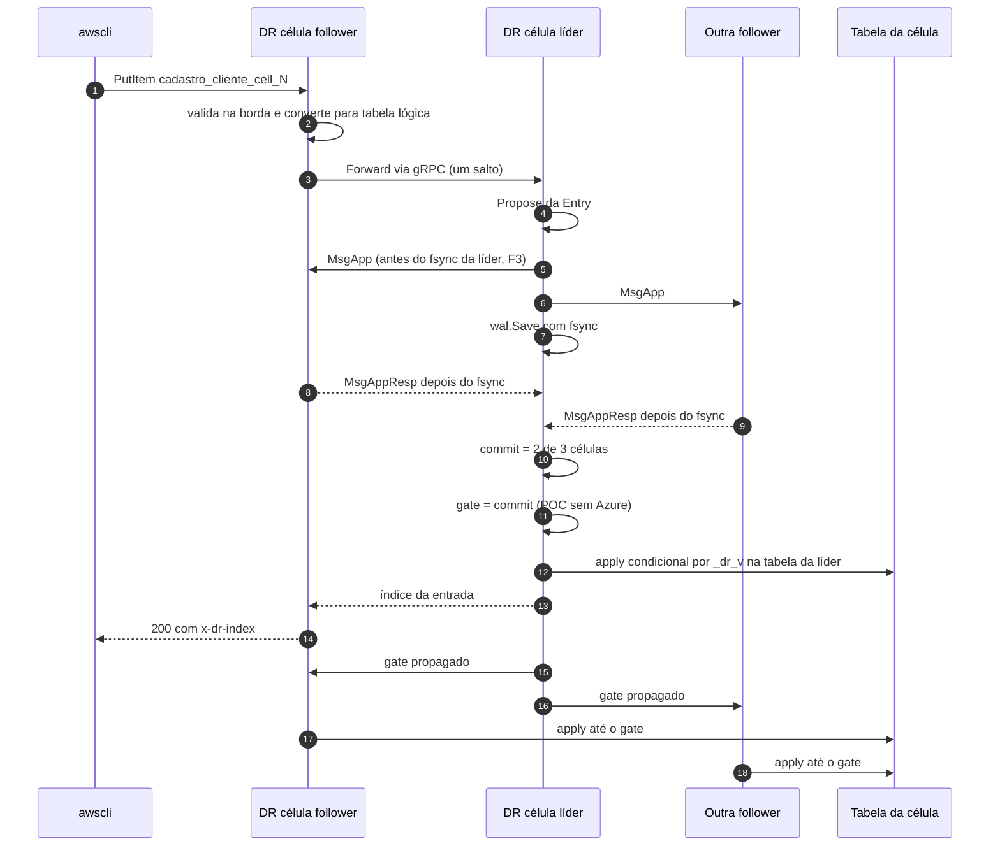

# SPDD Analysis: POC local do DataReplication com três células AWS

## Original Business Requirement

# Especificação da POC local do DataReplication (REASONS Canvas)

[Início](../doc/00_COMECE_AQUI.md) · [Documento principal](../doc/DataReplication_Versao_1.md) · [Implementação](../doc/05_implementacao/README.md)

**Para:** execução no SPDD pelo Bruno · **Data:** 13/10/2026 · **Status:** revisada com as decisões do Bruno (só AWS com 3 células, busca pelo DR, Delete e Batch na fase 2)
**Formato:** REASONS Canvas (Requirements, Entities, Approach, Structure, Operations, Norms, Safeguards), confirmado pelo Bruno em 13/10/2026.

Esta especificação **não traz código**. Ela diz o que a POC precisa fazer, como verificar e quais regras não podem ser quebradas. Cada requisito tem um identificador e cada critério de aceite pode ser verificado por comando.

Convenções: **DEVE** é obrigatório; **PODE** é opcional; "DR" é o DataReplication; "célula" é um serviço DR do compose (1, 2 e 3, todas AWS); índices e versões são o índice do log do Raft.

> **Escopo decidido pelo Bruno (13/10/2026): só AWS, 3 células.** Não há Azure na POC. O gate continua implementado com a regra completa (commit do Raft e maioria Azure), mas, com a lista de learners vazia, ele vira o commit do Raft (G-08). A POC prova Raft, apply, propagação do gate e leitura forte entre as 3 células; ela **não** prova o RPO 0 entre nuvens. As regras do gate que dependem da Azure (G-01 a G-05, G-07) são provadas por testes de unidade com learners simulados (O-02), não pelo compose.

---

## R. Requirements (o problema e quando está pronto)

### R.1 Objetivo

Provar, numa máquina local com Docker, o conceito central do DataReplication entre as três células AWS: **uma escrita feita em qualquer célula só é confirmada (ACK) depois de commitada pelo Raft (2 de 3 células com fsync), liberada pelo gate e aplicada no banco da célula líder; depois disso, as três células aplicam o mesmo item, com a mesma versão, cada uma na sua tabela**. A leitura forte, feita em qualquer célula, devolve o item.

### R.2 Requisitos funcionais

| ID | Requisito |
|---|---|
| RF-01 | O projeto DEVE gerar uma imagem Docker do DR a partir de um `Dockerfile` na raiz da POC. |
| RF-02 | Um `docker-compose.yml` DEVE subir o LocalStack (só DynamoDB) e **três serviços DR** (`cell-1`, `cell-2`, `cell-3`), todos com a mesma imagem e numa só rede, simulando três clusters. |
| RF-03 | Cada célula DEVE ter **dois volumes locais** do Docker (driver `local`): um para o log do Raft (o "WAL") e outro para o log de replicação, como no [ADR-055](../doc/03_adr/ADR-055-log-de-replicacao-segmentado-derivado-do-raft.md). Os dados DEVEM sobreviver a `docker compose restart` e `down` (sem `-v`). |
| RF-04 | Um `taskfile.yaml` (Task v3) DEVE oferecer: subir o compose, criar as tabelas, escrever um cliente via `awscli` no endpoint do DR, buscar os registros nas três tabelas via DR, ler via DR, inspecionar as tabelas direto no LocalStack, ver o estado das células, ver os logs, parar e limpar (lista na seção S.5). |
| RF-05 | Existem três tabelas no DynamoDB do LocalStack: `cadastro_cliente_cell_1`, `cadastro_cliente_cell_2` e `cadastro_cliente_cell_3`, com chave de partição `pk` (String), sem chave de ordenação, sem índices, cobrança sob demanda. |
| RF-06 | O cadastro do cliente DEVE ter `pk` e os campos fixos `nome`, `sobrenome`, `email` e `contato`. Só a `pk` muda a cada escrita: uma string com prefixo e o timestamp em nanossegundos (ex.: `cli-1791934579927602214`). |
| RF-07 | A escrita DEVE usar `aws dynamodb put-item` apontando para o endpoint HTTP do DR da célula escolhida, com o nome físico da tabela **daquela** célula (`cadastro_cliente_cell_<id>`). |
| RF-08 | A busca DEVE passar pelo DR: para cada uma das três células, um `aws dynamodb scan` no endpoint do DR daquela célula, na tabela daquela célula, com leitura forte. O stdout mostra o nome da tabela e os itens contidos nela, sem `_dr_v`. |
| RF-09 | A leitura via DR (`GetItem` com a `pk`) DEVE funcionar em qualquer célula, líder ou follower, com leitura forte (seção A.6), e NÃO devolve `_dr_v`. |
| RF-10 | A escrita feita numa célula follower DEVE ser encaminhada à líder (um salto, [ADR-010](../doc/03_adr/ADR-010-follower-encaminha-para-lider.md)) e ter o mesmo resultado de uma escrita feita na líder. |
| RF-11 | Cada célula DEVE expor um endpoint de administração com o seu estado (papel, líder, termo, commit, gate, aplicado, log de replicação, Azure ligada ou não). |
| RF-12 | Uma task de inspeção DEVE ler as três tabelas **direto no LocalStack**, mostrando `_dr_v`. É a prova física de que o mesmo item tem a mesma versão nos três bancos; a busca via DR não mostra a versão ([ADR-051](../doc/03_adr/ADR-051-compatibilidade-dynamodb-inventario-conformidade-e-idempotencia.md)). |

### R.3 Operações da API do DynamoDB na POC

| Operação | Na POC | Observação |
|---|---|---|
| `PutItem` | DEVE | Caminho de escrita do happy path |
| `GetItem` | DEVE | Leitura de uma `pk` |
| `Scan` na tabela base | DEVE | Caminho da busca; com `IndexName` é recusado ([ADR-050](../doc/03_adr/ADR-050-query-em-gsi-recusada.md)); `FilterExpression`, `Segment` e `ProjectionExpression` ficam fora |
| `DeleteItem`, `BatchWriteItem` | Fase 2 | Na POC respondem 400 `ValidationException` "não suportado nesta fase" |
| `UpdateItem`, `Query`, `TransactWriteItems`, condicionais | Fora | 400 `ValidationException` ([ADR-025](../doc/03_adr/ADR-025-escopo-da-api-v1-e-sdks.md)) |

### R.4 Fora do escopo da POC

Azure inteira (learners, Cosmos, Cloud-Adapter, promoção, link AWS↔Azure), vários shards (um shard só), dedupe de retry ([ADR-026](../doc/03_adr/ADR-026-dedupe-de-retry-id-estavel.md)), mTLS ([ADR-052](../doc/03_adr/ADR-052-autorizacao-por-aplicacao-com-mtls.md)), modo degradado (política fixa `reject`), compactação do Raft e snapshots, truncamento do log de replicação, reconstrução em tabela sombra, TTL, GSI, lista de SDKs por User-Agent, métricas Prometheus (PODE), transferência de liderança (PODE). Fase 2: `DeleteItem` e `BatchWriteItem`.

### R.5 Definição de pronto

A POC está pronta quando, numa máquina com Docker, Task v3 e AWS CLI v2, partindo de volumes vazios, **todos os critérios de aceite da seção O.3 passam**, e `go test -race ./...` passa dentro do container de build, inclusive os testes do gate com learners simulados.

---

## E. Entities (o domínio da POC)

| Entidade | O que é | Onde vive |
|---|---|---|
| **Célula** | Um serviço DR do compose, com `CELL_ID` (1, 2, 3) e a sua tabela | Configuração |
| **Nó** | O participante do Raft, com `NODE_ID` igual ao `CELL_ID`. As 3 células são votantes; não há learners na POC | Configuração |
| **Shard** | O grupo Raft. A POC tem um só | `etcdraft` |
| **Entry** | A unidade replicada: índice, termo, tipo (`Write`, `Noop`), operações e um identificador da proposta | `domain/entry.go` |
| **Op** | Uma mutação já normalizada: tabela lógica, tipo, chave e imagem final do item (post-image, [ADR-015](../doc/03_adr/ADR-015-wal-post-image-e-versao.md)) | `domain/entry.go` |
| **Tabela lógica** | O nome com `{cell}` no lugar do id: `cadastro_cliente_cell_{cell}` ([ADR-022](../doc/03_adr/ADR-022-banco-por-celula-nome-logico.md)) | `domain/tablemap.go` |
| **KeySchema** | A chave primária da tabela, lida com `DescribeTable` na partida | `domain` (tipo) e `adapter/out/dynamodb` |
| **Gate** | O índice até onde o ACK e o apply podem ir (seção A.3) | `domain/gate.go` |
| **Progresso do learner** | (termo, índice durável, identidade) de um learner. Na POC só existe nos testes de unidade | `port.LearnerProgress` |
| **Progresso do applier** | (índice, ordem) do último item aplicado, sem fsync | `adapter/out/replog` |
| **Versão** | O atributo reservado `_dr_v`, igual ao índice da entrada | Banco da célula |
| **Cadastro do cliente** | `pk` (S), `nome` (S), `sobrenome` (S), `email` (S), `contato` (S) | Payload do taskfile |

Valores fixos do cadastro: `nome` = `Maria`, `sobrenome` = `Silva`, `email` = `maria.silva@exemplo.com`, `contato` = `+55 11 91234-5678`.

---

## A. Approach (a estratégia)

### A.1 Base de código

A POC DEVE partir do esboço em [`05_implementacao/codigo_exemplo`](../doc/05_implementacao/codigo_exemplo/README.md), reaproveitando `domain`, `port`, `usecase` (`WriteService`, `CommitPump`, `Applier`, `Checkpointer`, `DegradeService`), `adapter/out/replog`, `adapter/in/dynamohttp`, `platform` e `bootstrap`, e completando o que o esboço declara como ausente: adaptador `etcdraft`, transporte gRPC, `StateStore` do DynamoDB, parser do JSON do DynamoDB, leitura forte, propagação do gate e ligação de tudo no `bootstrap`. Os testes existentes do esboço DEVEM continuar passando, ajustados só onde a interface mudar.

O código DEVE aceitar learners pela configuração (`LEARNERS`), mesmo que a POC rode com a lista vazia. Assim, ligar a Azure depois é configuração, não reescrita.

### A.2 Fluxo de escrita (happy path)



1. A borda (HTTP compatível com DynamoDB) valida a requisição **antes** de propor (SG-07) e troca o nome físico pelo lógico.
2. Se a célula não é líder, encaminha a escrita inteira à líder por gRPC. Se não há líder conhecida, espera até `WAIT_LEADER` e responde 503 `NO_LEADER`.
3. A líder propõe uma `Entry` ao Raft e recebe o índice quando a entrada é commitada (2 de 3 células com fsync).
4. A líder espera o gate alcançar o índice e espera o applier da própria célula aplicar o índice.
5. Só então responde 200. Prazo estourado em qualquer espera vira 503 `PENDING` (resultado desconhecido).
6. As duas follower aplicam a mesma entrada nas suas tabelas, sem bloquear o ACK, mas nunca além do gate que a líder propagou.

### A.3 Regras do gate

O gate é o índice máximo que pode ser confirmado ao cliente e aplicado em qualquer banco. As regras G-01 a G-07 são as do produto e DEVEM estar no código; na POC, sem learners, vale a G-08.

| ID | Regra |
|---|---|
| G-01 | Na líder, **gate = min(commit do Raft, maioria Azure)**. A maioria Azure é o 2º maior índice durável entre os 3 learners, contando só os que confirmaram no termo atual. Com menos de 2 confirmados, a maioria Azure é 0 e o gate não anda. |
| G-02 | O gate é **monotônico**: nunca recua, nem na troca de líder nem quando um learner sai ([ADR-029](../doc/03_adr/ADR-029-gate-monotonico-na-troca-de-lider.md)). |
| G-03 | Só conta progresso de learner etiquetado com o **termo atual da líder**. Quando o termo avança, o progresso dos learners é descartado e só volta a contar com confirmações no termo novo ([ADR-046](../doc/03_adr/ADR-046-gate-so-conta-progresso-validado-pelo-raft.md)). |
| G-04 | O progresso de um learner vem **só** de uma resposta de AppendEntries (`MsgAppResp`) sem rejeição, recebida de um id que está na lista de learners. Resposta de heartbeat não conta. Nenhum evento de progresso pode ser descartado: o canal bloqueia em vez de perder. |
| G-05 | O learner só envia `MsgAppResp` **depois do fsync** das entradas no próprio disco (RT-04). É isso que torna "índice confirmado" igual a "índice durável na Azure". |
| G-06 | Em toda célula que não é a líder, **gate = min(commit local do Raft, maior gate recebido da líder)**. A líder publica o gate às outras células a cada avanço e, sem avanço, a cada `GATE_PUBLISH_INTERVAL` (100 ms). Um gate recebido é um valor já provado, então a célula adota o máximo e o commit local continua limitando. Vale também na POC. |
| G-07 | O gate fica "pronto" numa líder nova só depois que 2 learners confirmarem no termo dela. Antes disso a líder não atende leitura forte (503 `GATE_NOT_READY`) ([ADR-049](../doc/03_adr/ADR-049-barreira-da-leitura-forte-e-o-gate.md), item 3). |
| G-08 | **POC sem Azure** (lista de learners vazia): **gate = commit do Raft** e o gate está sempre pronto. O DR DEVE registrar um aviso na partida e o `/status` DEVE mostrar `azure: "off"`. Isso é RPO 0 só entre as células AWS e existe só na POC (SG-12). |
| G-09 | Quem espera o gate (escrita, applier, leitura) é removido da lista de espera quando o prazo dele acaba: as requisições não deixam registros para trás. |
| G-10 | Modo degradado fica desligado na POC (`DEGRADED_POLICY=reject`). Sem Azure ele nunca seria acionado. |

### A.4 Comportamento do Raft

| ID | Regra |
|---|---|
| RT-01 | Um grupo Raft (um shard) com votantes = as 3 células (ids 1, 2, 3). Commit = 2 de 3 com fsync. O código aceita learners pela configuração, mas a POC roda sem nenhum. Learner nunca vota e nunca vira líder ([ADR-033](../doc/03_adr/ADR-033-promocao-da-azure-humana.md)). |
| RT-02 | Biblioteca `go.etcd.io/raft/v3` e o `wal` do etcd (`go.etcd.io/etcd/server/v3/storage/wal`), um WAL por shard. Só o pacote `adapter/out/etcdraft` importa essas bibliotecas. |
| RT-03 | **Partida do zero:** todas as células nascem do mesmo snapshot sintético (índice 1, termo 1) com a mesma `ConfState` (votantes e, se houver, learners), gravado no WAL. É assim que os learners seriam declarados sem `ConfChange`. A primeira entrada útil tem índice 2. |
| RT-04 | **Ordem do laço do Ready (modo síncrono com F3, [ADR-056](../doc/03_adr/ADR-056-group-commit-por-shard-e-nada-sai-antes-do-fsync.md)):** (1) só o `MsgApp` da líder sai antes do fsync (`domain.SplitBeforeSync`); (2) `wal.Save` grava HardState e entradas com um fdatasync (é o group commit do shard); (3) as entradas vão ao `MemoryStorage`; (4) as demais mensagens saem, inclusive `MsgAppResp` e votos; (5) as entradas commitadas vão ao `CommitPump`; (6) `Advance`. |
| RT-05 | Erro de `wal.Save` (fsync) é **fatal**: o processo sai com código diferente de zero e o Docker reinicia ([ADR-034](../doc/03_adr/ADR-034-fsync-fatal-e-identidade-nova.md)). Nunca se repete o fsync. |
| RT-06 | Parâmetros: tick 100 ms, `ElectionTick` 10 (configurável em `ELECTION_TICKS` desde o ADR-060; 30 no compose), `HeartbeatTick` 1, `CheckQuorum` e `PreVote` ligados, `MaxSizePerMsg` 1 MiB, `MaxInflightMsgs` 256, `MaxUncommittedEntriesSize` 32 MiB, `DisableProposalForwarding` ligado (o encaminhamento é do DR, não do Raft). |
| RT-07 | `Propose` devolve o índice **quando a entrada é commitada**, casando a entrada pelo identificador da proposta guardado no payload. `ErrProposalDropped` vira 400 `ThrottlingException` (nada entrou no log). Prazo estourado vira `PENDING`. |
| RT-08 | Entradas vazias da eleição e de `ConfChange` são entregues ao `CommitPump` como `Noop`, para que os índices cheguem **contíguos** ao log de replicação, que recusa buraco. |
| RT-09 | **Reinício:** a célula reabre o WAL, recarrega snapshot, HardState e entradas, e reinicia com `Applied` = índice do snapshot. O Raft reentrega as entradas commitadas e o applier as pula pelo progresso salvo (replay idempotente). |
| RT-10 | Se a lista de votantes ou de learners da configuração diferir da `ConfState` gravada no WAL, a célula NÃO sobe e diz para apagar os volumes (`task limpar`). A POC não troca membros. |
| RT-11 | A POC não gera snapshot nem compacta o log do Raft (a memória cresce com o uso). Receber um snapshot de um par é erro. |
| RT-12 | **Transporte:** gRPC entre células ([ADR-021](../doc/03_adr/ADR-021-grpc-entre-celulas.md)) com quatro métodos: `Step` (lote de mensagens do Raft já serializadas), `Forward` (escrita encaminhada), `ReadBarrier` (ReadIndex e gate na mesma resposta) e `GateUpdate` (gate da líder). Uma fila por par, sem bloquear o laço do Ready; fila cheia descarta a mensagem e avisa o Raft (`ReportUnreachable`). Sem TLS na POC. |

### A.5 Comportamento do apply (LogApply)

| ID | Regra |
|---|---|
| AP-01 | O `CommitPump` recebe cada lote commitado e, nesta ordem: informa o termo e o commit ao gate; entrega o lote ao applier **pela memória**; grava o lote no log de replicação **sem fsync**. Um erro de escrita no log de replicação é fatal. |
| AP-02 | O progresso dos learners corre numa goroutine própria do `CommitPump`, por evento, sem depender de haver commit novo ([`usecase/replicate.go`](../doc/05_implementacao/codigo_exemplo/internal/usecase/replicate.go)). Na POC, sem learners, ela fica parada. |
| AP-03 | O applier é **serial** e na ordem do índice. Antes de cada entrada, espera `gate >= índice`. **Invariante: aplicado <= gate**, sempre, nas três células. |
| AP-04 | Cada item vira um `PutItem` **condicional** na tabela da célula, com `_dr_v` = índice e a condição `attribute_not_exists(_dr_v) OR _dr_v < :v`. `ConditionalCheckFailedException` significa "já aplicado" e não é erro ([ADR-015](../doc/03_adr/ADR-015-wal-post-image-e-versao.md), [ADR-035](../doc/03_adr/ADR-035-lote-batchwriteitem-uma-entrada-e-apply-condicional.md)). |
| AP-05 | A tabela física é a lógica com `{cell}` trocado pelo `CELL_ID` **da célula que aplica**: a mesma entrada vai para `cadastro_cliente_cell_1`, `_2` e `_3`. |
| AP-06 | Depois de cada item, o applier grava o progresso (índice, ordem) no volume do log de replicação, **sem fsync**. Perder o progresso só alonga o replay. |
| AP-07 | Erro transitório do banco (throttling, 5xx, rede) é repetido com backoff exponencial de 100 ms a 5 s, sem limite, com log a cada tentativa. Erro permanente (4xx que não seja a condição de versão) **para o applier do shard naquela célula**: o processo continua de pé, o `/readyz` fica falso, o `/status` mostra o erro e a entrada, e a saída é humana ([ADR-038](../doc/03_adr/ADR-038-skip-de-entrada-venenosa-sempre-humano.md)). |
| AP-08 | Entradas `Noop` só avançam o índice aplicado. |
| AP-09 | Na líder, o ACK espera o apply **da própria célula**. Nas follower o apply é assíncrono ao ACK. Por isso, logo depois do ACK, uma leitura **direta** no LocalStack (task `inspecionar`) pode ainda não mostrar o item nas três tabelas; a busca e a leitura via DR (A.6) sempre mostram. |
| AP-10 | O `Checkpointer` faz o fsync do log de replicação a cada `REPLOG_SYNC_INTERVAL` (1 s) e publica o índice durável. A compactação do Raft fica desligada na POC (o `RaftCompactor` não faz nada e registra em log). |

### A.6 Leitura forte (GetItem e Scan)

1. Toda leitura é forte ([ADR-057](../doc/03_adr/ADR-057-um-unico-modo-strong-consistency.md)); `ConsistentRead` ausente é tratado como verdadeiro.
2. Na líder: espera o gate ficar pronto (G-07; na POC está sempre pronto), faz `ReadIndex` (confirma a liderança com o quórum) e lê o gate **depois** do `ReadIndex`.
3. Na follower: pergunta à líder pelo gRPC `ReadBarrier`, que devolve `ReadIndex` e gate **na mesma resposta** ([R16](../doc/02_cenarios/a_rever/R16-leitura-forte-em-celulas-follower.md)). A follower não usa um gate guardado.
4. Espera o apply local alcançar **min(ReadIndex, gate)** ([ADR-049](../doc/03_adr/ADR-049-barreira-da-leitura-forte-e-o-gate.md)) e lê a tabela da própria célula com `ConsistentRead=true`.
5. A barreira vale uma vez por chamada: no `Scan` paginado, cada página é uma chamada com a sua barreira.
6. A resposta nunca contém `_dr_v` ([ADR-051](../doc/03_adr/ADR-051-compatibilidade-dynamodb-inventario-conformidade-e-idempotencia.md)).

---

## S. Structure (onde cada coisa fica)

### S.1 Pastas

A POC fica numa pasta própria, com a estrutura de [01_principios_bibliotecas_e_pastas.md](../doc/05_implementacao/01_principios_bibliotecas_e_pastas.md), seção 3:

```text
poc/
├── Dockerfile
├── docker-compose.yml
├── taskfile.yaml
├── README.md                      # como rodar e o que cada task faz
├── go.mod / go.sum                # módulo example.com/datareplication, go 1.27
├── cmd/datareplication/main.go    # só chama o bootstrap
├── api/peerv1/                    # contrato gRPC entre células
└── internal/
    ├── domain/                    # entry, gate, lease, tablemap, retention, sendrule
    ├── port/                      # portas de entrada e saída
    ├── usecase/                   # write, read, apply, replicate, checkpoint, degrade, gatesync
    ├── adapter/
    │   ├── in/dynamohttp/         # API compatível com DynamoDB (fasthttp) + parser
    │   ├── in/peergrpc/           # servidor gRPC entre células
    │   ├── in/adminhttp/          # /livez /readyz /status (net/http)
    │   └── out/
    │       ├── etcdraft/          # ÚNICO que importa o Raft e o wal do etcd
    │       ├── peerclient/        # cliente gRPC: transporte, forward, barreira, gate
    │       ├── replog/            # log de replicação segmentado (já existe no esboço)
    │       └── dynamodb/          # StateStore com aws-sdk-go-v2
    ├── platform/config, logx
    └── bootstrap/                 # ÚNICO que importa o fx
```

### S.2 Portas novas ou alteradas em relação ao esboço

| Porta | Mudança |
|---|---|
| `Reader` | `Get(ctx, tabela, chave)` sem o parâmetro `strong` (sempre forte) e `Scan(ctx, tabela, limite, chave inicial)` |
| `Scanner` | Nova: varredura da tabela base no banco da célula |
| `BarrierClient` | Nova: pergunta à líder `ReadIndex` e gate na mesma resposta |
| `GatePublisher` | Nova: leva o gate da líder às outras células |
| `Catalog` | Nova: `KeySchema` por tabela lógica, lido na partida |
| `domain.Gate` | Ganha o gate propagado (G-06) e o modo sem Azure (G-08) sem mudar o comportamento atual |
| `domain.EntryKind` | Ganha `KindNoop` (RT-08) |

### S.3 Imagem (Dockerfile)

| ID | Requisito |
|---|---|
| D-01 | Multi-estágio. Build com `golang:1.27-alpine` (existe a 1.27.2), `CGO_ENABLED=0`, `-trimpath`, cache de módulos e de build com `--mount=type=cache`. |
| D-02 | Execução com `alpine` (para permitir `ls` nos volumes durante a POC), usuário não root fixo (uid 10001), diretórios `/var/lib/dr/raft` e `/var/lib/dr/replog` criados no build e pertencentes a esse usuário (assim o volume novo herda o dono). |
| D-03 | Expõe 8000 (API), 7000 (gRPC entre células) e 9090 (administração). `HEALTHCHECK` no `/livez`. |
| D-04 | O build não depende de nada fora do contexto da pasta `poc/`. A imagem é construída uma vez e usada pelas três células. |

### S.4 Compose

| ID | Requisito |
|---|---|
| C-01 | Serviço `localstack` com a imagem **fixada** `localstack/localstack:4.14.0` (versões novas da imagem da comunidade podem exigir token, SG-14), `SERVICES=dynamodb`, porta 4566, healthcheck em `/_localstack/health`. |
| C-02 | Serviços `cell-1`, `cell-2`, `cell-3` com a mesma imagem (`build: .` num deles e `image:` com o mesmo nome nos outros, para não construir três vezes), `depends_on` do LocalStack saudável, `restart: on-failure` e as variáveis da tabela S.6. |
| C-03 | Portas no host: API da célula N em `800N` (8001, 8002, 8003) e administração em `909N` (9091, 9092, 9093). A porta gRPC não é publicada. |
| C-04 | Volumes nomeados por célula: `cell-N-raft` em `/var/lib/dr/raft` e `cell-N-replog` em `/var/lib/dr/replog`, seis no total. O WAL do etcd fica num **subdiretório** (`/var/lib/dr/raft/wal`), porque o `wal.Create` renomeia o diretório e não pode renomear o ponto de montagem. |
| C-05 | `PEERS` e `LEARNERS` são iguais nas três células (a `ConfState` de partida tem de ser a mesma em todas, RT-03). Ficam declarados uma vez no compose (bloco de extensão `x-`) e reaproveitados. `LEARNERS` fica vazia. |

### S.5 Taskfile

| Task | O que faz | Critério |
|---|---|---|
| `subir` | `docker compose up -d --build`, depois `criar-tabelas`, depois espera o `/readyz` das três células | CA-01 |
| `criar-tabelas` | Cria as três tabelas no LocalStack se não existirem e espera ficarem ativas; idempotente | CA-02 |
| `escrever` | `put-item` via `awscli` no endpoint do DR da célula `CELL` (padrão 1), tabela `cadastro_cliente_cell_<CELL>`, payload da seção E; imprime a `pk` e o índice | CA-03, CA-04 |
| `buscar` | Para cada célula: imprime o nome da tabela e faz `scan` **no endpoint do DR daquela célula**, mostrando os itens | CA-03 |
| `ler` | `get-item` da `PK` informada no endpoint do DR de cada célula, imprimindo célula e item | CA-05 |
| `inspecionar` | Para cada tabela: imprime o nome e faz `scan` **direto no LocalStack**, mostrando os itens com `_dr_v` | CA-03 |
| `status` | Imprime o `/status` das três células | CA-01 |
| `wal` | Lista os arquivos dos dois volumes de uma célula (`CELL`) | CA-11 |
| `logs` | `docker compose logs -f` | |
| `parar` | `docker compose down` (mantém os volumes) | |
| `limpar` | `docker compose down -v` (apaga os volumes) | |
| `e2e` | Roda `subir`, `escrever`, `buscar`, `ler` e `inspecionar`, e falha com mensagem clara se algo não bate | CA-03 a CA-05 |

Requisitos do taskfile:

| ID | Requisito |
|---|---|
| T-01 | A `pk` é gerada pelo **template do próprio Task** (`now` em nanossegundos, avaliado uma vez por execução da task), e não por `date +%s%N`, que não funciona no macOS. Duas execuções seguidas geram `pk` diferentes. |
| T-02 | O comando do AWS CLI é uma variável (`AWS`, padrão `aws`), para quem preferir rodar o CLI em container. |
| T-03 | As credenciais são fixas de teste (`test`/`test`), região `sa-east-1`, `AWS_PAGER` vazio. Nenhuma credencial real. |
| T-04 | `escrever`, `buscar` e `ler` usam o nome físico da tabela da célula de destino. Escrever em `cell-2` com o nome `cadastro_cliente_cell_1` é recusado (CA-10). |
| T-05 | As tasks que chamam o DR rodam o AWS CLI com `AWS_MAX_ATTEMPTS=1` (variável, padrão 1). Sem isso o CLI repete o 503 sozinho, a CA-07 demora três prazos e gera entradas repetidas (risco 4). |
| T-06 | A lista de células (1 a 3) e de portas é uma variável do taskfile, para não repetir o laço em cada task. |

### S.6 Configuração (variáveis de ambiente, lidas com viper)

| Variável | Exemplo na célula 1 | Regra |
|---|---|---|
| `CELL_ID` | `1` | Obrigatória |
| `NODE_ID` | `1` | Obrigatória, maior que zero; na POC igual ao `CELL_ID` |
| `PEERS` | `1=cell-1:7000,2=cell-2:7000,3=cell-3:7000` | Votantes, igual nas três células |
| `LEARNERS` | vazia | Vazia = POC sem Azure (G-08). Com valor, 3 ids de learners |
| `TABLES` | `cadastro_cliente_cell_{cell}` | Lista separada por vírgula; cada uma com `{cell}` uma vez |
| `DYNAMODB_ENDPOINT` | `http://localstack:4566` | Vazio = AWS real |
| `AWS_REGION`, `AWS_ACCESS_KEY_ID`, `AWS_SECRET_ACCESS_KEY` | `sa-east-1`, `test`, `test` | Só teste |
| `API_ADDR`, `PEER_ADDR`, `ADMIN_ADDR` | `:8000`, `:7000`, `:9090` | |
| `RAFT_DIR`, `REPLOG_DIR` | `/var/lib/dr/raft/wal`, `/var/lib/dr/replog` | C-04 |
| `DEGRADED_POLICY` | `reject` | Obrigatória (G-10) |
| `TABLE_WAIT` | `120s` | Espera pelas tabelas na partida |
| `GATE_PUBLISH_INTERVAL`, `REPLOG_SYNC_INTERVAL` | `100ms`, `1s` | |
| `CLIENT_TIMEOUT`, `REQUEST_DEADLINE`, `WAIT_LEADER`, `FORWARD_TIMEOUT` | padrões do esboço (30 s, 7,5 s, 1 s, 3 s) | Regras de coerência do `config.go` |

As variáveis do antigo modo eventual (`READ_MODE_DEFAULT`, `WRITE_MODE`, `MAX_STALENESS`) continuam derrubando a partida ([ADR-057](../doc/03_adr/ADR-057-um-unico-modo-strong-consistency.md)).

### S.7 Endpoint de administração

| Caminho | Resposta |
|---|---|
| `GET /livez` | 200 se o processo está de pé |
| `GET /readyz` | 200 só com tabela conferida, Raft rodando, líder conhecida e applier sem erro |
| `GET /status` | JSON com `celula`, `no`, `papel` (líder ou follower), `lider`, `termo`, `commit`, `gate`, `gatePronto`, `aplicado`, `azure` (`on`/`off`), `replog` (`ultimo`, `duravel`), `erroApply`; na líder também o `match` de cada par |
| `POST /transferir?para=N` | PODE: transferência planejada de liderança ([ADR-013](../doc/03_adr/ADR-013-transferencia-planejada-de-lideranca.md)) |

---

## O. Operations (passos e critérios de aceite)

### O.1 Ordem de implementação

| Passo | Entrega | Pronto quando |
|---|---|---|
| O-01 | Copiar o esboço para `poc/`, subir o `go.mod` para Go 1.27 e as bibliotecas da seção N | `go build ./...` e os testes do esboço passam |
| O-02 | `domain`: gate propagado (G-06), modo sem Azure (G-08), `KindNoop`, `TableMap` e `KeySchema` | Testes de tabela com `-race` cobrindo **todas** as regras G-01 a G-09, com learners simulados: maioria de 2 de 3, termo antigo ignorado, troca de termo zera o progresso, monotonia, gate pronto, propagado, sem Azure e limpeza dos que esperam |
| O-03 | `adapter/out/etcdraft` (RT-01 a RT-11) | Teste com 3 nós em memória: elege líder, commita, reinicia e reentrega. PODE incluir um learner simulado para provar que o `MsgAppResp` dele vira evento de progresso (G-04) |
| O-04 | `api/peerv1`, `peergrpc`, `peerclient` (RT-12) | Teste de ida e volta de cada método |
| O-05 | `adapter/out/dynamodb`: conversão do JSON do DynamoDB, `DescribeTable` na partida, apply condicional, `GetItem` e `Scan` sem `_dr_v` | Teste contra o LocalStack |
| O-06 | Parser e handler do `dynamohttp` (R.3, SG-07, SG-08) | Testes de cada recusa da seção SG |
| O-07 | `usecase/read.go` (A.6) e `usecase/gatesync.go` (G-06) | Testes com motor de consenso falso |
| O-08 | `adminhttp` (S.7) | |
| O-09 | `config` com viper (S.6) e `bootstrap` com fx | Teste de grafo com `fx.ValidateApp` |
| O-10 | `Dockerfile` (S.3) | `docker build` limpo |
| O-11 | `docker-compose.yml` (S.4) | `docker compose config` sem erro |
| O-12 | `taskfile.yaml` (S.5) | Critérios da O.3 |
| O-13 | `README.md` da POC: pré-requisitos, comandos, o que observar | |

### O.2 Pré-requisitos na máquina

Docker com Compose v2, Task v3, AWS CLI v2. Nada de Go no host (o build é no container).

### O.3 Critérios de aceite

| ID | Dado / Quando / Então |
|---|---|
| **CA-01** | **Dado** volumes vazios, **quando** rodo `task subir`, **então** em até 60 s as três células respondem 200 no `/readyz`, e o `task status` mostra exatamente uma célula líder, as três com o mesmo `lider` e o mesmo `termo`, e `azure: "off"`. |
| **CA-02** | **Dado** as tabelas já criadas, **quando** rodo `task criar-tabelas` de novo, **então** termina com sucesso sem erro de tabela existente. |
| **CA-03** | **Dado** o ambiente de pé, **quando** rodo `task escrever` (célula 1), **então** o comando sai com 0 e imprime a `pk` e o índice (`x-dr-index`); **logo em seguida** o `task buscar` mostra a `pk` nas três tabelas, com os mesmos `nome`, `sobrenome`, `email` e `contato`; e o `task inspecionar` mostra, nas três tabelas, o **mesmo `_dr_v`**, igual ao índice impresso (pode levar até 2 s, AP-09). |
| **CA-04** | **Dado** que a líder é a célula X, **quando** rodo `task escrever CELL=Y` com Y diferente de X, **então** o resultado é o mesmo da CA-03 (a escrita foi encaminhada), e o log de Y registra o encaminhamento. |
| **CA-05** | **Dada** uma `pk` escrita, **quando** rodo `task ler PK=<pk>`, **então** as três células devolvem o mesmo item, **sem** `_dr_v`. |
| **CA-06** | **Quando** rodo `task escrever` duas vezes, **então** as `pk` são diferentes e o `_dr_v` da segunda é maior que o da primeira. |
| **CA-07** | **Sem quórum não há ACK nem apply.** **Quando** paro duas células (`docker compose stop cell-2 cell-3`, se a líder for a 1) e escrevo na célula que sobrou, **então** a escrita responde 503 (`NO_LEADER` ou `PENDING`) depois do prazo, o `commit` e o `gate` não avançam e **nenhuma das três tabelas** recebe o item. **Quando** religo as duas, **então** o cluster volta a ter líder e uma nova escrita funciona normalmente. |
| **CA-08** | **Quando** reinicio uma follower (`docker compose restart cell-N`) depois de algumas escritas, **então** ela volta ao `/readyz`, alcança o mesmo `aplicado` da líder e os itens dela não mudam de `_dr_v` (replay idempotente). |
| **CA-09** | **Quando** paro a líder, **então** em até 5 s outra célula vira líder e `task escrever` numa das células restantes funciona. **Quando** a antiga líder volta, **então** ela alcança as escritas que perdeu. |
| **CA-10** | **Quando** envio `put-item` com um atributo `_dr_v`, **ou** sem o atributo `pk`, **ou** com `pk` numérica, **ou** para `cell-2` com a tabela `cadastro_cliente_cell_1`, **então** recebo 400 (`ValidationException` ou `ResourceNotFoundException`) e nada entra no log (o `commit` não muda). |
| **CA-11** | **Quando** rodo `task wal CELL=1`, **então** vejo arquivos `.wal` em `/var/lib/dr/raft/wal` e segmentos `.seg` e o arquivo `progress` em `/var/lib/dr/replog`. |
| **CA-12** | **Dados** volumes já criados, **quando** mudo `PEERS` ou `LEARNERS` e subo sem limpar, **então** a célula não sobe e o log pede `task limpar` (RT-10). |
| **CA-13** | **Quando** envio `delete-item` ou `batch-write-item`, **então** recebo 400 `ValidationException` "não suportado nesta fase". |
| **CA-14** | **Quando** rodo `go test -race ./...` no container de build, **então** todos os testes passam, inclusive os do gate com learners simulados (O-02). |

---

## N. Norms (padrões de engenharia)

| ID | Norma |
|---|---|
| N-01 | Go 1.27, módulo `example.com/datareplication`. Bibliotecas: `fasthttp` (API), `net/http` (administração), `zerolog`, `viper`, `fx` (só no `bootstrap` e no `cmd`), `google.golang.org/grpc`, `go.etcd.io/raft/v3`, `go.etcd.io/etcd/server/v3` (só o `wal`), `aws-sdk-go-v2` (`dynamodb` e `config`). Nenhuma outra sem justificativa no README. |
| N-02 | Regra de dependência para dentro: `adapter → usecase → domain` e `adapter → port`. `domain` só usa a biblioteca padrão. Só `etcdraft` importa o Raft e o wal; os outros adaptadores trocam mensagens do Raft como bytes. |
| N-03 | gRPC sem `.proto` gerado é aceitável na POC (codec de bytes crus e serviço declarado à mão em `api/peerv1`), desde que os quatro métodos de RT-12 estejam isolados nesse pacote. |
| N-04 | Logs em JSON no stdout, com `celula`, `no` e `termo`. Nada de log por requisição no caminho quente; logs de mudança de líder, de gate parado, de encaminhamento e de erro do applier. |
| N-05 | Erros da API no formato do DynamoDB (`__type` e `message`), serializados com `encoding/json`. 503 traz o motivo no header `x-dr-code`. O 200 do `PutItem` traz o índice no header `x-dr-index` (extensão da POC, ignorada pelos SDKs). |
| N-06 | O corpo da requisição do `fasthttp` é reutilizado depois do handler: tudo o que vai ao log é copiado antes. |
| N-07 | Comentários e mensagens de log em português, como no esboço. |
| N-08 | Toda estrutura compartilhada tem teste com `-race`. |

---

## S. Safeguards (o que não pode ser quebrado)

| ID | Salvaguarda |
|---|---|
| SG-01 | **Nenhum ACK antes de: commit do Raft (2 de 3), gate >= índice e apply na célula da líder.** |
| SG-02 | **Aplicado <= gate**, nas três células, sempre. Uma follower nunca aplica além do gate propagado (G-06). |
| SG-03 | **Nada sai antes do fsync**, exceto o `MsgApp` da líder (RT-04). Em especial, `MsgAppResp` e votos só depois do `wal.Save`. |
| SG-04 | O gate nunca recua e só conta learner no termo atual (G-02, G-03). |
| SG-05 | Erro de fsync no WAL do Raft derruba o processo (RT-05). |
| SG-06 | O apply é sempre condicional pela versão: reaplicar nunca regride um item. |
| SG-07 | **Validação antes do commit:** tudo o que o DynamoDB recusaria (chave ausente ou de tipo errado, item acima de 400 KB, atributo `_dr_v`, operação ou parâmetro fora do escopo) é recusado na borda com 400. Um item recusado pelo banco **depois** do commit vira entrada venenosa e para o shard. |
| SG-08 | O nome lógico é derivado pela **lista de tabelas permitidas** (físico de cada lógica na célula local, comparado ao pedido), nunca trocando o texto do `CELL_ID` no nome: com `CELL_ID=1`, uma troca de texto erraria em nomes como `t1_cell_1`. |
| SG-09 | Learner nunca vira líder pelo Raft; promoção da Azure é humana e fora da POC. |
| SG-10 | O laço do Ready nunca bloqueia no envio de rede (filas por par que descartam). |
| SG-11 | Prazos em cascata coerentes: `REQUEST_DEADLINE` < `CLIENT_TIMEOUT`; `FORWARD_TIMEOUT` < `REQUEST_DEADLINE`; `WAIT_LEADER` <= `FORWARD_TIMEOUT` ([ADR-028](../doc/03_adr/ADR-028-timeouts-em-cascata.md)). |
| SG-12 | O modo sem Azure (G-08) é **só da POC**: aviso na partida, `azure: "off"` no `/status` e um comentário no código dizendo que nunca vai para produção. Em produção, `LEARNERS` vazia derruba a partida. |
| SG-13 | Nenhuma credencial real em arquivo; nada de push para o repositório sem pedido do Bruno. |
| SG-14 | Imagem do LocalStack com versão fixa (`4.14.0`): a imagem da comunidade avisa que muda de modelo em 2026 e as versões novas podem exigir token. |

---

## Riscos e cenários ocultos da POC

1. **Sem Azure, o gate de ponta a ponta não é testado.** Com a lista de learners vazia, o gate é o commit do Raft: a POC prova RPO 0 entre as 3 células AWS, não entre nuvens. A parte da Azure (maioria 2 de 3, termo, monotonia, gate pronto) fica provada só nos testes de unidade (O-02, CA-14). Ligar a Azure depois é configuração (`LEARNERS`), mas o caminho do learner (fsync antes de responder, evento de progresso, gate esperando a Azure) só será exercitado de verdade nessa hora.
2. **O risco de "gate = commit" escapar para produção.** O modo sem Azure torna o ACK igual ao commit AWS. SG-12 exige que, fora da POC, a lista vazia derrube a partida.
3. **Applier lento trava o Raft.** A fila entre o laço do Ready, o `CommitPump` e o applier é limitada. Se o banco de uma célula fica lento ou o applier para (entrada venenosa), a fila enche, o laço do Ready espera, os heartbeats atrasam e a célula pode provocar eleição. Na POC, filas grandes resolvem. Em produção o applier precisa ler do log de replicação quando fica para trás, sem segurar o laço do Ready.
4. **Retry do AWS CLI sem dedupe.** O AWS CLI v2 repete 503 automaticamente. Uma escrita `PENDING` repetida vira outra entrada no log, com outro índice. O item final é o mesmo, mas o `_dr_v` fica com o índice da repetição. É o comportamento esperado sem o [ADR-026](../doc/03_adr/ADR-026-dedupe-de-retry-id-estavel.md). T-05 desliga o retry nas tasks.
5. **Um LocalStack para as três células.** As três tabelas estão no mesmo processo: não há isolamento de falha entre bancos. Serve para o conceito, não para medir.
6. **Leitura direta no LocalStack logo depois do ACK.** O ACK só espera o apply da líder (AP-09). Um `task inspecionar` imediato pode mostrar o item em 1 ou 2 tabelas. A busca via DR não tem esse problema, porque espera a barreira.
7. **Memória do Raft sem compactação** (RT-11): rodar a POC por horas sob carga faz o processo crescer. Fora do escopo do teste de conceito.
8. **Gate atrasado nas follower.** Cada follower só aplica até o último gate recebido. Se uma mensagem `GateUpdate` se perde, a reenvio periódica (G-06) cobre; o atraso máximo é `GATE_PUBLISH_INTERVAL`.

---

## Domain Concept Identification

> Base explorada: o esboço compilado em `doc/05_implementacao/codigo_exemplo` (Go 1.26.0, módulo `example.com/datareplication`, dependências atuais só `fasthttp`, `zerolog` e `fx`). Ainda não existe a pasta `poc/` nem nenhum artefato de execução (Dockerfile, compose, taskfile). A pasta `DataReplicationApp/` na raiz está vazia. Não havia `spdd/` antes desta análise.

### Existing Concepts (from codebase)

- **Entry / Op / LogicalTable** (`domain/entry.go`): a unidade replicada e a mutação normalizada com post-image e tabela lógica. Hoje os tipos de entrada são `Write`, `Degrade`, `Restore` e `Renew`; **não existe `Noop`** e **não existe identificador de proposta**. O único identificador é `ClientID`, que é o id estável do SDK, reservado ao dedupe (fora da POC) — relaciona-se com o Raft (payload), o log de replicação (gravado como JSON) e o Applier (consome `Ops`).
- **Gate** (`domain/gate.go`): implementa G-01 a G-05, G-07 e G-09 com fidelidade (maioria 2 de 3 learners, termo atual, descarte na troca de termo, monotonia, teto de 3 learners, `Ready`, `WaitFor` que remove o waiter no prazo). **Com a lista de learners vazia o gate fica parado em 0 e `Ready` é falso para sempre** — sem G-08 nenhuma escrita da POC seria confirmada. Também não conhece o gate recebido da líder (G-06): hoje o mesmo objeto serve líder e follower sem distinção de papel.
- **Regra de envio antes do fsync** (`domain/sendrule.go`): `CanSendBeforeSync`/`SplitBeforeSync`, independentes da biblioteca Raft, prontas para o laço do Ready (RT-04, SG-03).
- **Lease e política do modo degradado** (`domain/lease.go`, `usecase/degrade.go`): existe e é testado; com `reject` o `Enter` recusa sem propor. Na POC só precisa continuar funcionando com `reject` (G-10).
- **ConsensusEngine** (`port/ports.go`): fronteira com o Raft — `Propose`, `ReadIndex`, `Leader`, `Term`, `Committed`, `LearnerEvents`, `LearnerDurable`, `TransferLeadership`. Não tem implementação real; os testes usam motores falsos.
- **WriteService** (`usecase/write.go`): resolve a líder com espera limitada (`WAIT_LEADER`), encaminha uma única vez (`Forwarded`), propõe, espera o gate, espera o apply local e confere o lease. Já cobre SG-01 e o caminho da A.2 do lado da líder; não devolve nada além do índice.
- **CommitPump** (`usecase/replicate.go`): duas goroutines (progresso de learner por evento; lotes commitados → gate → Applier pela memória → log de replicação sem fsync). Cobre AP-01 e AP-02.
- **Applier** (`usecase/apply.go`): serial, espera o gate por entrada, aplica item a item com progresso (índice, ordem), oferece `WaitApplied`. **Diverge da AP-07**: qualquer erro do banco encerra o `Run` com erro (não há repetição de transitórios nem estado "parado" observável), e o teste `TestPoisonItemStopsTheShard` fixa esse comportamento. Ignora tudo que não é `KindWrite`, o que já serve para `Noop` (AP-08). O `applied` em memória começa em 0 a cada partida.
- **Checkpointer** (`usecase/checkpoint.go`): fsync periódico do log de replicação e compactação do Raft via `RaftCompactor`; o truncamento é opcional (`Retention` nulo). Precisa só de um compactador que não faz nada (AP-10, RT-11).
- **Log de replicação** (`adapter/out/replog`): segmentos `%020d.seg`, arquivo `progress` com CRC, `Append` sem fsync que **ignora sobreposição e recusa buraco**, `Sync` que publica o durável. Já atende CA-11 e o replay de RT-09 (as entradas reentregues pelo Raft são ignoradas pelo log).
- **Escritor do log do Raft** (`adapter/out/raftstore`): group commit por shard com respostas presas até o fsync, no formato do `AsyncStorageWrites`. **A especificação não o menciona**: a RT-04 descreve o laço síncrono chamando `wal.Save` diretamente.
- **Adaptador DynamoDB HTTP** (`adapter/in/dynamohttp`): servidor `fasthttp`, mapa de erros (`NO_LEADER`, `PENDING`, `ThrottlingException`, `LEASE_EXPIRED`) no formato DynamoDB com `encoding/json`, `ValidateIndex` (ADR-050). **Só conhece escrita**: recebe um `Writer` e um `parse` que devolve `WriteRequest`; não há roteamento de `GetItem`/`Scan`, nem header `x-dr-index`, nem o parser em si.
- **StateStore / Reader / Forwarder / AppliedWaiter** (`port/ports.go`): portas existentes. `StateStore.Get` e `Reader.Get` ainda carregam o parâmetro `consistent`/`strong` do modo antigo; `StateStore.AppliedIndex` não tem dono claro (quem sabe o aplicado é o Applier).
- **Config** (`platform/config`): lida com `os.Getenv` (não viper), com `DEGRADED_POLICY` obrigatória, recusa das variáveis do modo eventual e coerência dos prazos (inclusive `DEGRADE_AFTER < REQUEST_DEADLINE`, que a S.6 não lista). Não tem `NODE_ID`, `PEERS`, `LEARNERS`, `TABLES`, `DYNAMODB_ENDPOINT`, `PEER_ADDR`, `RAFT_DIR`, `REPLOG_DIR`, `TABLE_WAIT`, `GATE_PUBLISH_INTERVAL`, `REPLOG_SYNC_INTERVAL`; o diretório padrão é `/var/lib/dr/wal`, diferente do `RAFT_DIR` da C-04.
- **Bootstrap** (`bootstrap/app.go`): grafo `fx` que liga config, logger, gate, lease, `DegradeService`, `WriteService` e o servidor HTTP; Raft, Forwarder, AppliedWaiter, Applier, CommitPump e Checkpointer entram "por módulos" que ainda não existem. Testes de grafo com motor falso.

### New Concepts Required

- **Célula e Nó** (configuração): identidade local (`CELL_ID`, `NODE_ID`) e o mapa de pares votantes (`PEERS`) e learners (`LEARNERS`), iguais em todas as células — origem da `ConfState` de partida e da tabela física local.
- **Membro do cluster / ConfState de partida**: o conjunto votantes + learners gravado no snapshot sintético (índice 1, termo 1). É o que a célula compara com a configuração para recusar a partida (RT-10, CA-12).
- **Nó Raft (etcdraft)**: implementação real do `ConsensusEngine` sobre `go.etcd.io/raft/v3` e o `wal` do etcd — laço do Ready, casamento de proposta por identificador, tradução de entradas vazias em `Noop`, reinício a partir do WAL, eventos de progresso de learner.
- **Identificador de proposta**: valor carregado no payload da `Entry` para a líder saber que a entrada commitada é a sua (RT-07). Distinto do `ClientID` do SDK.
- **Entrada Noop**: tipo de entrada para manter os índices contíguos no log de replicação (RT-08, AP-08).
- **Mapa de tabelas (TableMap)**: lista de tabelas lógicas permitidas e o nome físico de cada uma na célula local; resolve físico → lógico na borda por comparação, e lógico → físico no apply (SG-08, AP-05).
- **KeySchema e Catálogo**: chave primária de cada tabela lógica, lida do banco na partida com espera limitada (`TABLE_WAIT`); base da validação de chave na borda (SG-07, CA-10).
- **Gate propagado (G-06)** e **modo sem Azure (G-08)**: duas novas entradas do gate — o maior gate recebido da líder, que limita a follower junto do commit local, e o modo em que o gate é o commit do Raft e está sempre pronto.
- **Sincronização do gate (GateSync / GatePublisher)**: a líder publica o gate a cada avanço e periodicamente; as follower adotam o máximo recebido.
- **Barreira de leitura (ReadBarrier / BarrierClient)**: par (ReadIndex, gate) obtido da líder numa só resposta, que define até onde o apply local precisa chegar antes de ler.
- **Serviço de leitura forte (ReadService)**: caso de uso de `GetItem` e `Scan` com a barreira da A.6, sempre forte, sem `_dr_v` na resposta.
- **Varredura (Scanner) e página de Scan**: leitura paginada da tabela base da célula, com uma barreira por página.
- **Transporte entre células (peerv1, peergrpc, peerclient)**: contrato com quatro métodos (`Step`, `Forward`, `ReadBarrier`, `GateUpdate`), filas por par que descartam e avisam o Raft.
- **StateStore do DynamoDB**: apply condicional por `_dr_v`, `GetItem`/`Scan` com leitura consistente e remoção de `_dr_v`, `DescribeTable`, classificação de erros em transitório / "já aplicado" / permanente.
- **Parser do JSON do DynamoDB e validação de borda**: interpretação das operações da R.3, recusas da SG-07 e das operações fora de escopo/fase 2.
- **Saúde do applier (entrada venenosa)**: estado observável "applier parado em (índice, ordem) com erro X", consultado por `/readyz` e `/status` (AP-07).
- **Retrato de estado da célula (Status)**: agregação de papel, líder, termo, commit, gate, gate pronto, aplicado, Azure on/off, replog (último, durável), erro do apply e `match` dos pares.
- **Cadastro do cliente** (dado de teste): item com `pk` gerada pelo Task e quatro atributos fixos; só existe no taskfile.
- **Artefatos de execução**: imagem Docker multi-estágio, compose com LocalStack fixado e seis volumes nomeados, taskfile com as tarefas da S.5.

### Key Business Rules

- **ACK só depois de commit (2 de 3), gate ≥ índice e apply na líder** (SG-01): governa WriteService, Gate, Applier, Nó Raft.
- **Aplicado ≤ gate em toda célula, sempre** (SG-02, AP-03): governa Applier, Gate propagado, GateSync.
- **Gate monotônico e só com progresso do termo atual** (G-02, G-03, SG-04): governa Gate, inclusive quando a célula muda de papel (follower → líder e vice-versa).
- **Na follower, gate = min(commit local, maior gate recebido)** (G-06): governa Gate e GateSync; um gate recebido maior que o commit local não libera nada.
- **Sem learners, gate = commit e sempre pronto, só na POC** (G-08, SG-12): governa Gate, Config, Status; fora da POC a lista vazia derruba a partida.
- **Nada sai antes do fsync, exceto o MsgApp da líder; erro de fsync é fatal** (SG-03, SG-05, RT-04, RT-05): governa Nó Raft.
- **Validação completa antes de propor; o que o banco recusaria é recusado na borda** (SG-07): governa Parser, Catálogo, TableMap. Implícito: qualquer recusa que escape da borda vira entrada venenosa que para o shard na célula.
- **Nome lógico por lista permitida, nunca por troca de texto** (SG-08): governa TableMap.
- **Apply condicional pela versão; "já aplicado" não é erro** (SG-06, AP-04): governa StateStore, Applier.
- **Encaminhamento de no máximo um salto** (RF-10, ADR-010): governa WriteService e Forward; implícito: o resultado e o tipo do erro precisam atravessar o salto sem perder a classe (NO_LEADER ≠ PENDING ≠ Throttling ≠ Validation).
- **Leitura sempre forte, barreira por chamada, sem `_dr_v`** (A.6, RF-08, RF-09): governa ReadService, BarrierClient, StateStore.
- **Membros fixos: configuração diferente da ConfState gravada impede a partida** (RT-10): governa Nó Raft e Config.
- **Prazos em cascata** (SG-11): governa Config, WriteService, Forward, ReadBarrier. Implícito: o prazo da barreira de leitura também precisa caber no `REQUEST_DEADLINE`.
- **Implícita — índices contíguos no log de replicação**: toda entrada commitada (inclusive vazia) chega ao CommitPump; a sobreposição na partida é ignorada, buraco é erro fatal.
- **Implícita — PENDING é "resultado desconhecido", não "falhou"**: uma escrita que recebeu 503 pode aparecer depois (ver CA-07 na seção de riscos).

---

## Strategic Approach

### Solution Direction

- **Partir do esboço e completar, não reescrever.** Copiar `codigo_exemplo` para `poc/`, manter a arquitetura hexagonal existente (domain só com biblioteca padrão; usecase dependente de portas; adaptadores de entrada e saída; `fx` só no bootstrap) e acrescentar os adaptadores que faltam. O esboço continua na documentação como referência.
- **Fluxo de escrita**: HTTP compatível com DynamoDB → parser e validação de borda (Catálogo + TableMap) → WriteService → (follower) Forward por gRPC à líder → Propose no Nó Raft → commit → CommitPump → Gate (commit, e na POC gate = commit) → Applier da líder → ACK com índice. Em paralelo: GateSync publica o gate → follower adotam → Applier de cada follower aplica até o gate na própria tabela.
- **Fluxo de leitura**: HTTP → parser → ReadService → barreira (ReadIndex local na líder ou ReadBarrier na líder a partir da follower) → espera o apply local alcançar min(ReadIndex, gate) → StateStore lê a tabela local com leitura consistente → remove `_dr_v` → resposta.
- **Raft e transporte isolados**: só o adaptador `etcdraft` conhece a biblioteca e o WAL; o transporte carrega mensagens do Raft como bytes opacos. O contrato entre células fica num pacote próprio, sem geração de código.
- **Estado observável**: um retrato de estado agregado de Nó Raft, Gate, Applier e log de replicação alimenta o endpoint de administração; `/readyz` reflete catálogo conferido, Raft rodando, líder conhecida e applier sem erro.
- **Execução local reprodutível**: imagem única multi-estágio, compose com LocalStack fixado e seis volumes, taskfile como interface do operador e roteiro dos critérios de aceite.
- **Ordem de trabalho**: seguir a O.1 (domínio e testes do gate primeiro, depois Raft, transporte, banco, borda, leitura, administração, configuração, empacotamento), porque cada passo tem um critério verificável isolado.

### Key Design Decisions

- **D1 — Modo sem Azure no Gate**: inferir de "nenhum learner confirmou" × modo explícito ligado pela configuração. Inferir é perigoso (um gate de produção com a Azure caída viraria commit puro, quebrando RPO 0). → **Modo explícito, desligado por padrão**, ligado só pelo bootstrap quando `LEARNERS` está vazia, com aviso e o comentário da SG-12. O valor zero do Gate mantém o comportamento atual, o que preserva os testes do esboço.
- **D2 — Gate propagado (G-06) no mesmo tipo ou num tipo separado**: tipo separado deixa claro o papel, mas duplica monotonia, waiters e limpeza (G-09), e a célula troca de papel em tempo de execução. → **Mesmo `domain.Gate` com uma entrada nova "gate recebido" e consciência de papel**; a fórmula muda com o papel, a monotonia vale através da troca. O Applier continua esperando um único gate.
- **D3 — Laço do Ready: escritor `raftstore` existente × `wal.Save` síncrono no laço**: o `raftstore.Writer` já testa group commit e respostas presas, mas tem formato assíncrono e acrescenta uma fila e uma goroutine; a RT-04 descreve o modo síncrono, em que cada `Ready` já agrupa entradas e o `wal.Save` faz um único fdatasync. → **Seguir a RT-04 literalmente (síncrono, `SplitBeforeSync`, `wal.Save` no laço)** e manter o `raftstore` intacto e fora do bootstrap na POC, registrando isso no README. Menos peças móveis para provar o conceito; o spike do modo assíncrono continua possível depois.
- **D4 — Erros do apply (AP-07)**: hoje o Applier devolve erro e encerraria o processo pelo ciclo de vida. → **Classificar o erro no adaptador do banco** (transitório, "já aplicado", permanente) e fazer o Applier **repetir transitórios com backoff** e **estacionar** no permanente, expondo o estado (índice, ordem, erro) sem derrubar o processo. O teste do item venenoso é ajustado para "para sem pular e expõe o erro", o que a A.1 permite por ser mudança de interface.
- **D5 — Borda com leitura e escrita**: o handler hoje só aceita `Writer` e um parser de `WriteRequest`. → **Parser devolve uma requisição tipada por operação** e o handler despacha para `Writer` ou `Reader`; todas as recusas (R.3, SG-07, fase 2) ficam no parser, antes de qualquer caso de uso. O header `x-dr-index` sai no 200 do `PutItem`.
- **D6 — Semântica do Forward**: devolver só "erro genérico" × preservar a classe do erro da líder. → **Preservar a classe** (NO_LEADER, PENDING, Throttling, Validation, sucesso com índice) no contrato do `Forward`, para que a follower responda exatamente como a líder (RF-10, CA-04). Prazo do Forward esgotado na follower vira PENDING (a escrita pode ter sido proposta).
- **D7 — Identificador de proposta**: reaproveitar `ClientID` × campo próprio. → **Campo próprio na `Entry`**, gerado pela líder por proposta; `ClientID` fica reservado ao dedupe (ADR-026, fora da POC).
- **D8 — Codificação da `Entry` no Raft**: o log de replicação já grava `Entry` como JSON com CRC. → **Uma única codificação da `Entry` compartilhada** entre o payload do Raft e o log de replicação, para que a mesma entrada seja byte a byte a mesma nos dois logs; o formato exato fica para o Canvas.
- **D9 — Leitura na follower**: gate guardado × barreira na líder. → **Sempre a barreira na líder** (A.6 item 3, R16), mesmo custando uma ida à líder por leitura; é o que torna a leitura da follower forte de verdade.
- **D10 — Configuração**: manter `LoadFrom(getenv)` × migrar para viper. → **viper como fonte (N-01), mantendo a função pura de validação testável** e todas as regras de coerência atuais, acrescentando as variáveis da S.6. Decidir se `DEGRADE_AFTER` continua validada (ver ambiguidades).
- **D11 — Partida antes das tabelas existirem**: o `task subir` cria as tabelas **depois** do `compose up`. → **A célula espera as tabelas até `TABLE_WAIT`** antes de ficar pronta (catálogo conferido é condição do `/readyz`), em vez de exigir ordem rígida no compose.
- **D12 — Compactação do Raft**: um `RaftCompactor` que não faz nada e registra em log, para manter o Checkpointer igual ao esboço (AP-10, RT-11).

### Alternatives Considered

- **Deixar o Raft encaminhar propostas (`DisableProposalForwarding` desligado)**: rejeitado — o encaminhamento é do DR (ADR-010), porque a líder precisa executar gate e apply antes de responder; o forward do Raft não devolve o resultado do ACK.
- **Follower lendo com o último gate recebido**: rejeitado — leitura possivelmente atrasada (R16, ADR-049); quebraria a garantia forte da A.6.
- **Derivar o nome lógico trocando o texto do `CELL_ID`**: rejeitado pela SG-08 (`t1_cell_1`).
- **Learners simulados no compose para exercitar a Azure**: rejeitado por decisão de escopo (só AWS); as regras da Azure são provadas por testes de unidade (O-02).
- **`.proto` com geração de código**: possível, mas exige toolchain extra no build; a N-03 aceita codec de bytes crus com os quatro métodos isolados.
- **Um LocalStack por célula**: mais isolamento de falha (risco 5), mas mais recursos e nada a mais para o conceito; rejeitado.
- **Gate como objeto separado por papel**: rejeitado na D2 pela duplicação das regras de monotonia e limpeza.
- **Ligar o `raftstore.Writer` assíncrono já na POC**: rejeitado na D3; adiciona concorrência sem ser necessário para os critérios.

---

## Risk & Gap Analysis

### Requirement Ambiguities

- **Papel do `adapter/out/raftstore`**: a A.1 lista o que reaproveitar e não cita o `raftstore`; a S.1 também não. Confirmar se ele fica fora da POC (recomendação D3), se é removido da cópia, ou se o `etcdraft` deve usá-lo.
- **`Reader.Scan` × porta `Scanner`**: a S.2 cria as duas. Esclarecer que `Scanner` é a porta de saída (banco da célula) e `Reader.Scan` a porta de entrada (caso de uso), e o que é "limite" e "chave inicial" frente ao `Limit`/`ExclusiveStartKey` do DynamoDB.
- **`StateStore.AppliedIndex` e o parâmetro `consistent` de `StateStore.Get`**: a S.2 só fala do `Reader`. Decidir se a porta de saída também perde o parâmetro (sempre consistente) e quem é dono do índice aplicado.
- **Formato e geração do identificador de proposta**: a E pede "um identificador da proposta" sem dizer unicidade entre reinícios da líder nem tamanho.
- **`DEGRADE_AFTER`**: o `config.go` valida `DEGRADE_AFTER < REQUEST_DEADLINE`, mas a S.6 não lista a variável. Com `reject`, o WriteService ainda chama `Enter` depois de `DEGRADE_AFTER`; confirmar que fica com o padrão (2 s) e é inofensivo.
- **Go 1.27 e `golang:1.27-alpine`**: o esboço foi compilado em 1.26.0 e o próprio README pede reconfirmação. Confirmar a disponibilidade da imagem e das bibliotecas (etcd `server/v3` puxa muitas dependências) antes da O-01.
- **Comportamento de `/readyz` sem líder**: "líder conhecida" faz `/readyz` cair durante eleições e na CA-07; o `HEALTHCHECK` é no `/livez`, então não há reinício — confirmar que é o pretendido.
- **`match` dos pares no `/status`**: só a líder tem; definir o que a follower mostra (ausente × vazio).
- **"Cada uma com `{cell}` uma vez" em `TABLES`**: falta dizer o que acontece com nomes duplicados ou com tabela que não existe no LocalStack depois do `TABLE_WAIT` (sair com erro e deixar o `restart: on-failure` agir, ou ficar não pronta).
- **Item acima de 400 KB e cálculo de tamanho**: a SG-07 exige a recusa; o cálculo do DynamoDB (nomes + valores) precisa ser definido no Canvas.
- **Resposta do `Scan` paginado**: `Count`, `ScannedCount` e `LastEvaluatedKey` precisam sair coerentes depois da remoção de `_dr_v`; a R.3 deixa `ProjectionExpression` de fora, mas não diz o que fazer com `Limit` e `Select`.

### Edge Cases

- **CA-07 com escrita proposta antes da queda da liderança**: se a escrita chega à célula 1 antes de o `CheckQuorum` a derrubar (até ~1 s depois de parar as outras duas), a entrada entra no log da célula 1 sem commit e a resposta é PENDING. Ao religar, a célula 1 tem o log mais longo, pode vencer a eleição e **commitar e aplicar essa entrada** nas três tabelas. A frase "nenhuma das três tabelas recebe o item" só vale durante a falta de quórum. O critério precisa dizer em que momento é verificado (ou esperar a queda da liderança antes de escrever).
- **Troca de papel e gate**: uma follower que vira líder passa de min(commit, gate recebido) para gate = commit (POC) ou maioria Azure (produção); uma líder que vira follower passa a depender do gate recebido. A monotonia precisa valer nas duas direções, e waiters pendentes não podem ser liberados indevidamente.
- **Gate recebido de líder antiga**: um `GateUpdate` atrasado de um termo anterior é um valor já provado (G-06) e pode ser adotado, mas continua limitado pelo commit local — confirmar que não há etiqueta de termo no `GateUpdate` ou se deve haver.
- **Reinício (CA-08)**: o Applier recomeça com aplicado = 0 em memória; o Raft reentrega desde o índice 2; o log de replicação ignora a sobreposição; o progresso salvo pula os itens já aplicados. A follower reiniciada só avança quando recebe o gate da líder (até `GATE_PUBLISH_INTERVAL`). O `/status` vai mostrar o aplicado subindo durante o replay.
- **Reinício da líder (CA-09)**: a nova líder só tem o gate = commit depois de commitar a entrada vazia do termo; as escritas imediatamente após a eleição esperam isso.
- **Escrita na follower com a líder mudando no meio**: o `Forward` pode chegar a uma ex-líder, que por ser `Forwarded` não reencaminha e responde NO_LEADER — resultado correto, mas visível na CA-09.
- **Tabela física de outra célula (CA-10)**: `cadastro_cliente_cell_1` enviada à célula 2 deve resultar em `ResourceNotFoundException` (não está na lista permitida local), sem chegar ao Raft.
- **`pk` repetida**: duas escritas com a mesma `pk` geram índices diferentes; o apply condicional mantém o item com o maior `_dr_v`. Não é um cenário dos CAs, mas é o comportamento do risco 4.
- **Scan com tabela vazia ou sem itens ainda aplicados** numa follower recém-iniciada: a barreira faz esperar o apply; se o prazo estoura, a leitura precisa de um 503 próprio (não é PENDING de escrita).
- **Entrada venenosa numa só célula**: o applier daquela célula para, as outras seguem. ~~A fila do CommitPump daquela célula enche (risco 3) e pode provocar eleições.~~ Desde o ADR-060 o laço do Raft não espera o apply: o atraso cresce (`dr_apply_lag`) sem eleição.

### Technical Risks

- **Gate parado sem G-08**: o esboço, como está, nunca confirma uma escrita sem learners. É a primeira mudança obrigatória (O-02); qualquer atraso aqui bloqueia todos os CAs de escrita.
- **Fila do CommitPump bloqueando o laço do Ready** (risco 3): **aconteceu no teste de carga de 14/10** (LocalStack a ~1 s por PutItem, eleições em série) e foi **fechado pelo ADR-060**: o commit é publicado como sinal, o `CommitPump` lê por faixa da memória do Raft e a líder recusa escrita com `atraso_apply` quando o apply fica para trás.
- **Correção do laço do Ready**: a ordem RT-04, o casamento de proposta por identificador, a tradução de entradas vazias e de ConfChange em `Noop` e o tratamento de `ErrProposalDropped` são as partes de maior risco de bug sutil. Mitigação: teste com 3 nós em memória (O-03) cobrindo eleição, commit, reinício e reentrega, e testes com `-race`.
- **Snapshot sintético e ConfState idênticos nas três células** (RT-03): divergência em `PEERS`/`LEARNERS` entre células gera clusters incompatíveis; o bloco `x-` do compose reduz o risco, a verificação da RT-10 detecta na partida.
- **`wal.Create` e ponto de montagem** (C-04): o WAL precisa ficar num subdiretório; permissões do volume dependem do diretório criado na imagem com o uid 10001.
- **Dependências pesadas**: `go.etcd.io/etcd/server/v3` traz uma árvore grande (gRPC, bbolt, prometheus); conflitos de versão com o `google.golang.org/grpc` escolhido são prováveis. Mitigação: resolver na O-01, antes de escrever código.
- **Transporte com descarte**: fila cheia descarta mensagens do Raft (correto com `ReportUnreachable`), mas `GateUpdate` e respostas de `Forward`/`ReadBarrier` não podem usar a mesma política de descarte silencioso.
- **Semântica de leitura consistente no LocalStack**: o LocalStack aceita `ConsistentRead`, mas não reproduz a latência nem as falhas do DynamoDB real; os testes de O-05 provam o protocolo, não o comportamento sob carga.
- **Imagem do LocalStack 4.14.0** (SG-14): se a versão fixada exigir token ou sair do registro, o compose quebra; manter a versão fixa e documentar.
- **Retry do AWS CLI** (risco 4, T-05): esquecer `AWS_MAX_ATTEMPTS=1` em uma task duplica entradas e alonga a CA-07.
- **Tempo da CA-01 (60 s)**: build da imagem, LocalStack saudável, criação das tabelas, `TABLE_WAIT` e eleição somados; o build com cache frio pode passar disso. Medir o tempo a partir do fim do build ou aceitar build prévio.
- **Testes do esboço que mudam**: `TestPoisonItemStopsTheShard` (D4), os testes que usam `Reader`/`StateStore.Get` com `strong`, e o grafo do bootstrap (novos provedores) precisam de ajuste; a A.1 permite, mas o escopo do ajuste deve ficar explícito no Canvas.

### Acceptance Criteria Coverage

| AC# | Description | Addressable? | Gaps/Notes |
|-----|-------------|--------------|------------|
| CA-01 | Subir do zero; três `/readyz` 200 em 60 s; uma líder, mesmo líder e termo, `azure: "off"` | Yes | Depende de G-08, `TABLE_WAIT` e do `/status`. O limite de 60 s com build frio é um risco; definir se conta o build. |
| CA-02 | `criar-tabelas` idempotente | Yes | Só taskfile; tratar "tabela já existe" como sucesso. |
| CA-03 | Escrever na célula 1; buscar via DR nas três; inspecionar mostra o mesmo `_dr_v` = índice | Yes | Exige `x-dr-index`, Scan com barreira, GateSync e apply nas follower. `inspecionar` pode precisar de espera de até 2 s (AP-09). |
| CA-04 | Escrever numa follower; mesmo resultado; log registra encaminhamento | Yes | Depende da D6 (classe do erro preservada) e de um log de encaminhamento fora do caminho quente (N-04). |
| CA-05 | `ler PK` nas três células, mesmo item, sem `_dr_v` | Yes | ReadService + ReadBarrier na follower. |
| CA-06 | Duas escritas, `pk` diferentes, `_dr_v` crescente | Yes | `pk` pelo template `now` do Task (T-01). |
| CA-07 | Sem quórum: 503, commit e gate parados, nenhuma tabela recebe; religar volta ao normal | Partial | Ambiguidade de tempo: uma escrita proposta antes da queda da liderança pode ser commitada e aplicada depois de religar (ver Edge Cases). O critério precisa fixar o momento da verificação. |
| CA-08 | Reiniciar follower; volta pronta; alcança o aplicado da líder; `_dr_v` não muda | Yes | Replay idempotente já suportado pelo log de replicação e pelo progresso; depende do RT-09 no `etcdraft` e do gate recebido após o reinício. |
| CA-09 | Parar a líder; nova líder em 5 s; escrita funciona; antiga alcança | Yes | Parâmetros da RT-06 dão eleição em 1–2 s; o `/readyz` cai durante a eleição. |
| CA-10 | Recusas na borda (`_dr_v`, sem `pk`, `pk` numérica, tabela de outra célula) sem mudar o commit | Yes | Depende do Catálogo (KeySchema) e do TableMap com lista permitida (SG-08). |
| CA-11 | `task wal CELL=1` mostra `.wal`, `.seg` e `progress` | Yes | Nomes de arquivos já batem com o `replog` existente; o `.wal` vem do `wal` do etcd. |
| CA-12 | Mudar `PEERS`/`LEARNERS` sem limpar impede a partida e pede `task limpar` | Yes | RT-10; a ConfState precisa ser lida do snapshot gravado no WAL. |
| CA-13 | `delete-item` e `batch-write-item` recusados com 400 "não suportado nesta fase" | Yes | Só parser; a mensagem exata precisa ser fixada. |
| CA-14 | `go test -race ./...` no container de build, inclusive gate com learners simulados | Yes | Exige estágio de teste no Dockerfile ou alvo próprio; testes do esboço ajustados (D4, portas de leitura). O-05 depende do LocalStack: decidir se roda dentro do `go test ./...` (tag de build ou variável) para não quebrar o CA-14 sem LocalStack. |
