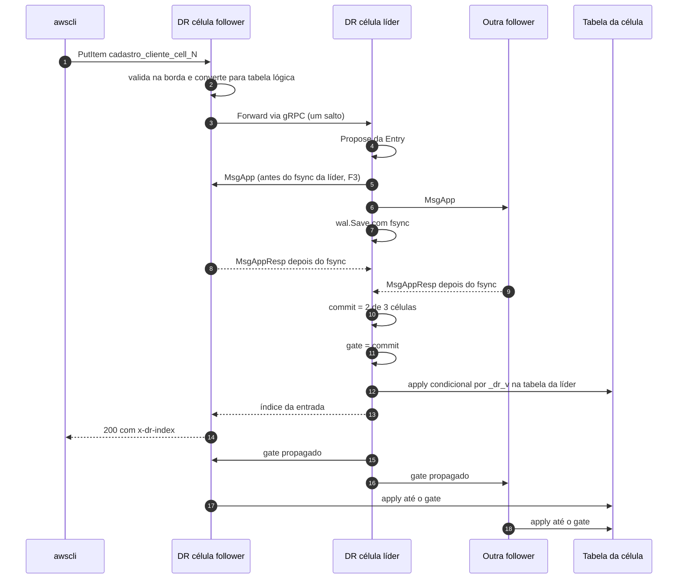

# SPDD Analysis: Compactação do log do Raft com snapshot-marcador, recuperação e reconstrução na POC

## Original Business Requirement

Fontes, transcritas sem alteração (cada uma num bloco próprio): `spec/compactacao_do_log/especificacao.md`, `spec/compactacao_do_log/spec_poc_trecho.md` (versão com alterações locais não commitadas), `spec/compactacao_do_log/decisoes.md`, `spec/compactacao_do_log/solucao_aws_primaria_azure_failover.md` e `spec/SPEC_POC_LOCAL.md` (a spec da POC em que a trecho será incorporada).

### Fonte: `spec/compactacao_do_log/especificacao.md`

````markdown
# Especificação: log do Raft com memória, disco e partida limitados

Versão 1, 18/10/2026. Origem: thread "Compactação do log: grill". Decisões e o porquê de cada uma: [decisoes.md](decisoes.md). Topologia: [solucao_aws_primaria_azure_failover.md](solucao_aws_primaria_azure_failover.md).

Esta especificação substitui o desenho anterior da compactação e da retenção (ver a seção 9). Ela vale para o produto. O que entra na POC está em [spec_poc_trecho.md](spec_poc_trecho.md).

## 1. Requisitos

| ID | Requisito |
|---|---|
| R1 | A memória do log é limitada por configuração, independentemente de carga, tempo no ar ou atraso de qualquer réplica. |
| R2 | O disco do log é limitado por um orçamento e por um teto duro; nenhuma réplica atrasada derruba o disco das outras. |
| R3 | A partida relê só a cauda do log (desde o último snapshot), não o histórico inteiro. |
| R4 | Nenhum ACK é perdido: RPO=0 contra a perda de uma célula/AZ e, no multicloud, contra a perda da AWS inteira. |
| R5 | Uma réplica atrasada nunca tem o índice do Raft à frente do que está no seu banco. |
| R6 | O laço do Raft nunca lê disco nem espera o apply. |

## 2. Topologia e regra de confirmação

| Instalação | Células | Confirmação |
|---|---|---|
| Só AWS | 3 ou 5 | Maioria do Raft |
| Multicloud | 3 AWS + 2 Azure (até 7, sempre com a maioria na AWS) | Maioria do Raft **e** pelo menos K=1 célula Azure com fsync |

- O índice confirmado é `min(commit do Raft, maior índice durável entre as células Azure)`, para K=1. ACK e apply só andam até ele, e ele nunca recua, nem na troca de líder nem depois de um reinício (ele vai no snapshot, seção 3).
- As células Azure votam, mas não se candidatam: enquanto follower, não avançam o relógio de eleição. Só viram líder por comando de promoção.
- Azure inteira inalcançável: as escritas seguem automaticamente na AWS, com RPO>0 sinalizado ao cliente. Quando o link volta, a Azure alcança pelo log (seção 5) ou, fora da janela, por reconstrução (seção 6).
- Promoção (AWS fora): comando via API, por automação ou operador; escolhe a célula Azure com o maior índice durável e recria o grupo só com as células Azure. **Risco aceito:** o comando dado com a AWS viva gera duas líderes, e a história de uma delas será descartada.
- Membros: a configuração do deploy só cria o grupo. Depois, entrar ou sair é comando de administração pelo log do Raft (ConfChange): a célula nova entra sem voto, passa pela reconstrução (seção 6), alcança e só então vira votante; uma de cada vez.

## 3. Snapshot (marcador)

O snapshot não carrega dados: o estado vive no banco de cada célula.

| Campo | Onde |
|---|---|
| Índice S, termo, membros (`ConfState`) | Metadados do snapshot do Raft |
| Versão do registro, CRC | `Data` |
| Identidade do grupo (`cluster_id`) e da história (`epoch`) | `Data` |
| Índice confirmado no momento do snapshot | `Data` |

Regras:
- **Gatilho:** a cada 10.000 entradas ou 64 MiB desde o último snapshot, o que vier primeiro (`SNAPSHOT_EVERY_ENTRIES`, `SNAPSHOT_EVERY_BYTES`).
- **Índice:** S = último índice commitado já entregue pelo laço (o `applied` do Raft). S não depende do apply no banco: a falta de dados no banco é tratada pela retenção em disco (seção 4) e pela regra de aceitação (seção 5).
- **Ordem:** (1) grava o progresso do applier com fsync; (2) `wal.SaveSnapshot` (fsync); (3) `MemoryStorage.CreateSnapshot(S)`; (4) compacta a RAM (seção 4); (5) libera o disco (seção 4).
- Roda numa goroutine própria, nunca no laço. O `wal` do etcd serializa `SaveSnapshot` e `Save` com o próprio mutex, então cada snapshot custa ao laço no máximo um fsync extra de espera. Isso precisa ser medido (`dr_raft_loop_duration_seconds`).

## 4. Retenção: RAM e disco

### RAM

- Compacta o `MemoryStorage` até `S − RAFT_CATCHUP_ENTRIES` (padrão 5.000), para que uma follower poucos milissegundos atrás não precise do canal de recuperação.
- **Teto duro:** se os bytes no `MemoryStorage` passarem de `RAFT_RAM_MAX`, compacta até S, mesmo com followers atrás.
- `GOMEMLIMIT` em ~80% do limite do container.
- O que fica na RAM em regime: a cauda desde o último snapshot (até 64 MiB ou 10.000 entradas), mais as entradas não commitadas (`MaxUncommittedEntriesSize`, 32 MiB). O atraso do apply **não** fica na RAM: o leitor do log vai ao disco (seção 5).

### Disco

O WAL do etcd é o único armazenamento. Os segmentos `.wal` antigos ficam no disco até o **limite de disco** liberar:

```
limite_disco = min(
  aplicado no banco local (progresso com fsync),
  piso de retenção (menor índice durável das réplicas dentro da janela),
  pinos (leituras do canal de recuperação em curso, F − 1 de reconstrução em curso),
  S
)
```

- O piso de retenção é calculado pela líder (menor `Match` das réplicas na janela) e publicado às followers junto com o índice confirmado. Assim, uma follower que vira líder ainda tem o que as atrasadas precisam.
- **Janela:** uma réplica está na janela enquanto os bytes retidos desde o seu `Match` forem ≤ `RETAIN_MAX_BYTES` (orçamento; ~1 h de escrita, ~15 GiB a 3000 TPS). Passou, ela sai da janela e deixa de segurar o piso.
- **Teto duro** `RETAIN_DISK_HARD` (fração do volume): passou, os pinos de reconstrução são soltos (a reconstrução aborta e tenta depois) e as escritas seguem.
- Se o termo que segura o disco for o **aplicado local** (applier da própria célula parado), a célula não apaga o que o banco dela ainda não tem. No teto duro ela se declara fora (`/readyz` falso) e volta por reconstrução. Num item venenoso, que para o applier em todas as células, a admissão por atraso já para as escritas antes disso.
- Bytes retidos: soma do tamanho dos arquivos `.wal` a partir do arquivo que contém o índice (o nome do arquivo traz o primeiro índice dele).
- Liberação: `wal.ReleaseLockTo(limite_disco)` e remoção dos arquivos sem trava cujo arquivo seguinte começa em índice ≤ `limite_disco`.

## 5. Leitor do log e canal de recuperação

### Leitor do log (`LogReader`)

Um único leitor de entradas commitadas, usado pelo `CommitPump` (apply local) e pelo canal de recuperação:
- Lê da RAM quando o índice ainda está no `MemoryStorage`; abaixo disso, lê os segmentos `.wal` em sequência com `wal.NewDecoder` (exportado no `go.etcd.io/etcd/server/v3` v3.7.2), sempre fora do laço.
- **Regra da entrada final:** o WAL pode ter uma versão antiga, não commitada, de um índice, sobrescrita depois por outra líder. O leitor guarda as entradas num buffer, substitui o buffer a partir de i quando reaparece um índice i, e só libera as entradas ≤ c ao ler um registro de `HardState` com `commit = c`. Assim só sai entrada commitada e definitiva.
- Enquanto lê, registra um pino no índice em que está (seção 4).

### Canal de recuperação

Para uma réplica cujo próximo índice já foi compactado da RAM da líder:
1. O Raft da líder quer enviar `MsgSnap`. O marcador é pequeno, então é enviado normalmente, e a líder reporta `SnapshotFinish` quando o transporte entrega.
2. A réplica **só dá `Step` no `MsgSnap` quando o seu aplicado ≥ índice do marcador**. Antes disso, descarta a mensagem e inicia a recuperação. A líder volta a sondar e reenvia o marcador a cada sondagem; é barato.
3. A réplica escolhe uma fonte, qualquer célula cujo primeiro índice retido em disco seja ≤ `aplicado + 1`, preferindo uma follower para poupar a líder. Ela pede por gRPC as entradas a partir de `aplicado + 1`, em lotes de até 1 MiB, só até o índice confirmado.
4. As entradas entram no applier pelo mesmo caminho do `CommitPump` (apply condicional pela versão, marca d'água, progresso).
5. Quando o aplicado alcança o marcador, a réplica dá `Step` no `MsgSnap`, grava o snapshot (`wal.SaveSnapshot` + `ApplySnapshot`) e segue pelo Raft normal.

Risco conhecido: a réplica que voltou assim não tem as entradas anteriores ao marcador no próprio WAL. Ela não serve de fonte para elas, e o piso publicado pela líder garante que outras células sirvam.

## 6. Reconstrução (réplica fora da janela, ou célula nova)

Quando nenhuma célula retém `aplicado + 1`:
1. A réplica fica fora (`/readyz` falso, não responde leitura forte).
2. A fonte (uma célula sã) fixa `F = aplicado no banco da fonte` e registra o pino `F − 1` (seção 4).
3. A fonte envia as tabelas por Scan paginado pelo próprio adaptador de banco. A réplica grava numa tabela sombra com a versão (`_dr_v`) original e a mesma condição do apply (`_dr_v < :v`). Um item alterado depois de F chega com versão maior, e o apply do log não o regride.
4. Ao terminar a cópia: progresso = F com fsync, depois o canal de recuperação a partir de F + 1, depois a troca da tabela sombra pela tabela ativa, e só então `/readyz` verdadeiro.
5. Bateu no teto duro de disco: a reconstrução aborta, o pino é solto e ela tenta de novo depois.

Limites conhecidos:
- **DELETE real** quebra o passo 3: um item apagado na fonte depois de ser copiado volta como zumbi. Isso exige lápide ou cópia consistente, e está em aberto (lacuna 6).
- Se a cópia for mais lenta que a taxa de escrita, o pino segura o disco até o teto duro, e a reconstrução nunca termina. A vazão da reconstrução precisa ser medida.

## 7. Partida

- `wal.Open` a partir do último snapshot S: o `ReadAll` só traz as entradas depois de S para a RAM.
- O applier retoma do progresso P. Se P < S, as entradas de P+1 a S vêm do disco pelo leitor do log. O limite de disco ≤ aplicado local garante que elas ainda estão lá.
- Se o progresso estiver ausente ou corrompido e as entradas já tiverem sido apagadas, a célula não sobe e vai para reconstrução.

## 8. Garantias (o que não pode ser quebrado)

| ID | Garantia |
|---|---|
| G1 | O disco nunca é liberado além do aplicado no banco local, com fsync do progresso antes. |
| G2 | Uma réplica nunca dá `Step` num `MsgSnap` com o aplicado menor que o índice do marcador. |
| G3 | O leitor do log só entrega entradas confirmadas como definitivas por um `HardState` posterior. |
| G4 | O canal de recuperação só envia até o índice confirmado. |
| G5 | Nada de snapshot, compactação ou leitura de disco dentro do laço do Raft. |
| G6 | O índice confirmado nunca recua (no snapshot e na troca de líder). |
| G7 | Os bytes no `MemoryStorage` nunca passam de `RAFT_RAM_MAX` por mais de um ciclo do compactador. |

## 9. O que esta especificação substitui (para revisar depois, sem apagar nada ainda)

| ADR / item | Situação |
|---|---|
| ADR-063 (snapshot e compactação) | Substituída por esta especificação. |
| ADR-041 (teto de 70%, sem S3) | Substituída: orçamento em bytes (`RETAIN_MAX_BYTES`) + teto duro; continua sem S3. |
| Risco 46 / PEND-24 (RAM no degradado longo) | Resolvidos: a retenção da Azure fica em disco; a RAM tem teto próprio. |
| ADR-047 (reconstrução em tabela sombra) | Mantida no essencial (F, sombra, versão); o zumbi do DELETE continua aberto. |
| ADR-017 (Azure learners, gate 2/3 AWS + 2/3 Azure) | Muda: Azure votante e sem candidatura; gate = maioria + K=1 Azure. |
| ADR-014, ADR-044, ADR-045 (degradado, licença D+M, política) | Mudam: o degradado é automático e não há licença; o risco de duas líderes é aceito. |
| ADR-033 (promoção humana) | Muda: promoção por comando via API, por automação ou operador. |
| ADR-046 (gate monotônico) | Mantida (G6). |
| RT-10 da POC (membros fixos pelo `PEERS`) | Muda: a configuração só cria o grupo; membros por ConfChange. |

## 10. Hipóteses em aberto

- O tamanho médio da entrada (~1,5 KiB) e o orçamento de ~15 GiB, a medir com o soak (CF-06).
- A vazão da reconstrução por Scan e se ela converge sob 3000 TPS.
- A latência AWS↔Azure em São Paulo somada ao fsync da Azure em cada ACK.
- O custo do fsync do `SaveSnapshot` no laço (a cada 10.000 entradas).
- A supressão de candidatura nas células Azure é um desvio do uso padrão do etcd-raft e precisa de teste.

````

### Fonte: `spec/compactacao_do_log/spec_poc_trecho.md`

````markdown
# Trecho para a spec da POC: compactação, recuperação e reconstrução

Para incorporar em `spec/SPEC_POC_LOCAL.md` (REASONS Canvas) e implementar via SPDD. Base: main local `c9f42af`. Desenho completo: [especificacao.md](especificacao.md). Decisão de escopo: DO (a POC implementa tudo).

A POC só tem AWS (3 células), então não entram a regra K=1 da Azure, a supressão de candidatura nem a promoção. Também ficam fora deste trecho a troca de membros por ConfChange (D'a) e o RT-10 continua como está. Escolhi esse padrão porque a troca de membros é uma entrega separada e não é necessária para resolver o OOM.

Desvio consciente da D8 na POC: a reconstrução **recria a tabela** da célula, em vez de usar uma tabela sombra. A célula reconstruída fica fora (`/readyz` falso) durante todo o processo, então não há leitura a preservar, e isso evita uma indireção de nome físico no `TableMap`. No produto continua a tabela sombra. Se preferir a sombra já na POC, é só trocar o AP-18.

## A.4 Comportamento do Raft: itens alterados e novos

| ID | Regra |
|---|---|
| RT-09 (alterado) | **Reinício:** `wal.Open` a partir do **último** snapshot gravado; o `ReadAll` só traz para o `MemoryStorage` as entradas depois dele. A retomada do applier continua sendo o progresso (`ResumeFrom`); se ela for anterior ao snapshot, as entradas que faltam vêm do disco pelo `LogReader` (RT-16). Sem progresso válido e com as entradas já apagadas do disco, a célula não sobe e o log pede `task reconstruir CELL=N`. |
| RT-11 (substituído) | **Snapshot-marcador:** uma goroutine `Compactor` por shard, fora do laço do Ready. Gatilho: `SNAPSHOT_EVERY_ENTRIES` (padrão 10.000) ou `SNAPSHOT_EVERY_BYTES` (padrão 64 MiB) desde o último snapshot, o que vier primeiro. Índice S = último commit publicado pelo laço. Ordem: (1) `SaveProgress` com fsync; (2) `wal.SaveSnapshot(S, termo, ConfState)`; (3) `MemoryStorage.CreateSnapshot(S, ConfState, data)`; (4) compactação da RAM (RT-14); (5) liberação do disco (RT-15). `data` é um registro versionado com CRC: `{versao: 1, cluster_id, epoch: 1, confirmado: gate}`. |
| RT-14 (novo) | **RAM:** `MemoryStorage.Compact(S − RAFT_CATCHUP_ENTRIES)` (padrão 5.000), nunca abaixo do primeiro índice atual. Na líder, também não compacta abaixo do menor `Match` das followers (uma follower parada segura a RAM até o teto, sem precisar do canal de recuperação). Se os bytes no `MemoryStorage` passarem de `RAFT_RAM_MAX` (padrão 256 MiB), compacta até S, ignorando o `Match` das followers. O `Compactor` mede os bytes a cada ciclo (`RAFT_COMPACT_INTERVAL`, padrão 1 s). |
| RT-15 (novo) | **Disco:** `limite = min(aplicado local, piso, pinos, S)`. O piso é o menor `Match` das followers dentro da janela, calculado na líder e publicado no `GateUpdate`; a follower usa o último piso recebido. Uma follower sai da janela quando os bytes retidos desde o seu `Match` passam de `RETAIN_MAX_BYTES` (padrão 2 GiB na POC). Liberação: `wal.ReleaseLockTo(limite)` e remoção dos `.wal` sem trava cujo arquivo seguinte começa em índice ≤ limite. Acima de `RETAIN_DISK_HARD` (padrão 85% do volume do Raft), os pinos de reconstrução são soltos. Se o aplicado local for o que segura, nada dele é apagado: no teto duro a célula fica com `/readyz` falso e o `/status` pede reconstrução. |
| RT-16 (novo) | **`LogReader`:** substitui a leitura do `CommittedEntries` pelo `MemoryStorage`. Lê da RAM quando o índice está no `MemoryStorage`; abaixo disso, abre os `.wal` em modo leitura e decodifica com `wal.NewDecoder` (etcd v3.7.2). Aplica a regra da entrada final: buffer de entradas; um índice i que reaparece substitui o buffer a partir de i; só libera as entradas ≤ c ao ler um `HardState` com `commit = c`. Registra um pino no índice que está lendo enquanto lê. Nunca roda no laço do Ready. |
| RT-17 (novo) | **`MsgSnap` (envio):** a líder envia o marcador normalmente e chama `ReportSnapshot(SnapshotFinish)` quando o transporte entrega, ou `SnapshotFailure` se a fila descartar. Substitui o "MsgSnap não enviado" atual em `sendAll`. |
| RT-18 (novo) | **`MsgSnap` (recebimento):** no `Step`, se o aplicado local < índice do marcador, a mensagem é descartada e o `Recovery` é iniciado (AP-17). Com o aplicado ≥ índice, segue para o Raft; no `handleReady`, `rd.Snapshot` não vazio grava `wal.SaveSnapshot`, `MemoryStorage.ApplySnapshot` e move o cursor do `CommitPump` para S + 1. Substitui o erro fatal "snapshot recebido de um par". |
| RT-19 (novo) | **Transporte:** três métodos novos no gRPC entre células. `Retained` devolve o primeiro índice retido em disco e o commit. `CatchUp(from, to)` é um fluxo do servidor com lotes de até 1 MiB de entradas lidas pelo `LogReader`, só até o gate da fonte. `CopyTable(tabela, F)` é um fluxo do servidor com páginas do `Scan` do banco da fonte, com `_dr_v`. |
| RT-20 (novo) | **Identidade:** metadado do WAL = `{node_id, cluster_id}` (JSON), com `CLUSTER_ID` obrigatório e igual nas 3 células. WAL com metadado antigo não sobe: pede `task limpar`. |

## A.5 Comportamento do apply: itens alterados e novos

| ID | Regra |
|---|---|
| AP-01 (alterado) | O `CommitPump` lê as entradas commitadas pelo `LogReader` (RT-16), não direto do `MemoryStorage`. O resto da regra fica igual. |
| AP-06 (alterado) | Progresso com fsync **antes de cada snapshot** (RT-11, passo 1) e antes de cada liberação de disco. Nos demais avanços continua sem fsync. |
| AP-10 (substituído) | A compactação está ligada (RT-11, RT-14, RT-15). |
| AP-15 (novo) | **`GOMEMLIMIT`:** a imagem define `GOMEMLIMIT` por variável, e o compose passa ~80% do `mem_limit` do serviço. O compose passa a ter `mem_limit` por célula (padrão 1 GiB). |
| AP-16 (novo) | **Estados da célula:** `normal`, `recuperando` (AP-17) e `reconstruindo` (AP-18). O `/status` e a métrica `dr_cell_state` mostram o estado; fora de `normal`, `/readyz` é falso e a leitura forte responde 503. |
| AP-17 (novo) | **`Recovery`:** chama `Retained` nos pares e escolhe a fonte com primeiro índice retido ≤ aplicado + 1, preferindo uma follower. Consome o `CatchUp` desde aplicado + 1 e entrega os lotes ao applier pelo mesmo caminho do `CommitPump` (contiguidade, apply condicional, marca d'água, progresso). Termina quando o aplicado alcança o marcador recebido; o próximo `MsgSnap` passa pelo RT-18. Sem nenhuma fonte retendo aplicado + 1, vai para o AP-18. |
| AP-18 (novo) | **Reconstrução:** a fonte fixa F = aplicado no banco dela e registra o pino F − 1 até o fim. Por tabela: a célula apaga e recria a tabela física dela (mesmo `KeySchema` da fonte), consome `CopyTable` e grava cada item com o `_dr_v` original pela condição do AP-04. Depois grava progresso = F com fsync e entra no AP-17 a partir de F + 1. Abortada pelo teto duro (RT-15), recomeça do zero depois de `REBUILD_RETRY` (padrão 1 min). Disparo automático pelo AP-17 ou manual por `POST /admin/reconstruir`. |
| AP-19 (novo) | **Limite da POC:** sem `DeleteItem` (fase 2), a cópia por Scan com versão é suficiente. Quando o DELETE entrar, a reconstrução precisa de lápide ou de cópia consistente (lacuna 6). |

## S.6 Configuração: variáveis novas

| Variável | Padrão | Regra |
|---|---|---|
| `CLUSTER_ID` | (obrigatória) | Igual nas 3 células (RT-20) |
| `SNAPSHOT_EVERY_ENTRIES` | `10000` | De 100 a 10.000.000 |
| `SNAPSHOT_EVERY_BYTES` | `64MiB` | De 1 MiB a 1 GiB |
| `RAFT_CATCHUP_ENTRIES` | `5000` | Menor que `SNAPSHOT_EVERY_ENTRIES` |
| `RAFT_RAM_MAX` | `256MiB` | Maior que `SNAPSHOT_EVERY_BYTES` + 32 MiB (não commitadas) |
| `RAFT_COMPACT_INTERVAL` | `1s` | |
| `RETAIN_MAX_BYTES` | `2GiB` | Menor que o volume do Raft × `RETAIN_DISK_HARD` |
| `RETAIN_DISK_HARD` | `0.85` | Entre 0,5 e 0,95 |
| `REBUILD_RETRY` | `1m` | |
| `GOMEMLIMIT` | ~80% do `mem_limit` | Lida pelo runtime do Go |

Para exercitar os caminhos localmente com pouco tráfego, os testes usam valores baixos, por exemplo `SNAPSHOT_EVERY_ENTRIES=200`, `RAFT_CATCHUP_ENTRIES=50` e `RETAIN_MAX_BYTES=8MiB`.

## S.7 `/status` e métricas novas

`raft.snapshot` (índice), `raft.memoria` (entradas e bytes no `MemoryStorage`), `wal.retido` (bytes e arquivos), `wal.piso`, `wal.pinos`, `celula.estado`, `recuperacao` (fonte, de, até, alcançado) e `reconstrucao` (tabela, itens copiados, F).

Métricas: `dr_raft_mem_bytes`, `dr_raft_mem_entries` (M-04), `dr_raft_snapshot_index`, `dr_raft_snapshot_duration_seconds`, `dr_wal_retained_bytes`, `dr_wal_files`, `dr_retention_floor`, `dr_cell_state`, `dr_catchup_entries_total`, `dr_rebuild_items_total`, `dr_startup_duration_seconds` (M-05).

## S.5 Taskfile: tarefas novas

- `task reconstruir CELL=N`: `POST /admin/reconstruir` na célula N.
- `task test-atrasada CELL=N`: para a célula N, escreve até passar do `RAFT_CATCHUP_ENTRIES`, religa e espera `normal`.
- `task test-fora-da-janela CELL=N`: o mesmo, passando do `RETAIN_MAX_BYTES`.

## SG. Salvaguardas novas

| ID | Regra |
|---|---|
| SG-18 | O disco nunca é liberado além do aplicado local, e o progresso tem fsync antes (RT-15, AP-06). |
| SG-19 | A célula nunca dá `Step` num `MsgSnap` com o aplicado menor que o índice do marcador (RT-18). |
| SG-20 | O `LogReader` só entrega entradas confirmadas como definitivas por um `HardState` posterior (RT-16). |
| SG-21 | O `CatchUp` só envia até o gate da fonte (RT-19). |
| SG-22 | Snapshot, compactação, leitura de `.wal` e reconstrução nunca rodam no laço do Ready. O único efeito aceito no laço é a espera pelo mutex do WAL durante um `SaveSnapshot`. |
| SG-23 | Os bytes no `MemoryStorage` nunca passam de `RAFT_RAM_MAX` por mais de um ciclo do `Compactor`. |

## O.1 Ordem de implementação: passos novos

| ID | Passo | Pronto quando |
|---|---|---|
| O-16 | `LogReader` com a regra da entrada final (RT-16) e `CommitPump` lendo por ele (AP-01) | CA-20 |
| O-17 | `Compactor`: snapshot-marcador, RAM e disco (RT-11, RT-14, RT-15), partida pelo último snapshot (RT-09), identidade (RT-20), `GOMEMLIMIT` e `mem_limit` (AP-15) | CA-21, CA-22, CA-23 |
| O-18 | `MsgSnap` nos dois sentidos (RT-17, RT-18), `Retained` e `CatchUp` (RT-19), `Recovery` (AP-16, AP-17) | CA-24 |
| O-19 | `CopyTable` e reconstrução (AP-18) | CA-25, CA-26 |
| O-20 | Métricas, `/status` e tarefas (S.5, S.7) | CA-27 |

## O.3 Critérios de aceite novos

| ID | Dado / Quando / Então |
|---|---|
| **CA-20** | **Quando** rodo `go test -race ./...`, **então** passa o teste do `LogReader` com um WAL que tem entradas não commitadas sobrescritas por outra líder: só saem as versões commitadas, contíguas, e nada acima do último `HardState.commit`. **E** a leitura que atravessa da RAM para o disco devolve as mesmas entradas que a leitura só do disco. |
| **CA-21** | **Dado** `SNAPSHOT_EVERY_ENTRIES=200`, **quando** escrevo 5.000 entradas, **então** o `/status` das 3 células mostra `raft.snapshot` avançando, `raft.memoria.entradas` ≤ 200 + `RAFT_CATCHUP_ENTRIES` e `wal.retido` caindo depois de cada snapshot. |
| **CA-22** | **Dado** um WAL com 100.000 entradas e snapshot recente, **quando** reinicio uma célula, **então** o `ReadAll` traz só as entradas depois do snapshot (log de partida mostra a contagem) e `dr_startup_duration_seconds` não cresce com o total escrito. |
| **CA-23** | **Dado** uma follower com o banco pausado (`task test-banco-lento`), **quando** a carga continua por mais que `RAFT_RAM_MAX` em bytes, **então** a memória dela fica abaixo do teto (`dr_raft_mem_bytes`), o `CommitPump` passa a ler do disco, e depois de despausar ela alcança o gate sem reiniciar. |
| **CA-24** | **Quando** rodo `task test-atrasada CELL=N`, **então** a célula N passa por `recuperando`, alcança o aplicado da líder, aceita o marcador e volta a `normal`; o `task buscar` mostra os mesmos itens e `_dr_v` nas 3 tabelas. **E** um teste de unidade prova que um `MsgSnap` com índice acima do aplicado não chega ao Raft. |
| **CA-25** | **Quando** rodo `task test-fora-da-janela CELL=N`, **então** a célula N passa por `reconstruindo` e `recuperando`, volta a `normal`, e as 3 tabelas têm os mesmos itens e `_dr_v`, inclusive os itens escritos durante a cópia. |
| **CA-26** | **Dado** `RETAIN_DISK_HARD` baixo, **quando** uma reconstrução passa do teto, **então** ela é abortada, o disco é liberado, as escritas continuam com ACK, e ela recomeça depois de `REBUILD_RETRY`. |
| **CA-27** | **Dado** a carga do CF-06 por 1 h, **então** `process_resident_memory_bytes` e `dr_wal_retained_bytes` ficam estáveis (sem tendência de alta) nas 3 células, e nenhum container é morto por OOM. |

## Riscos da POC (acrescentar à lista)

- **Tamanho da entrega.** Esta é a maior mudança desde o ADR-060 (cinco componentes novos e três métodos gRPC novos), e a apresentação é por volta de 22/10. Se o prazo apertar, a ordem O-16 → O-17 já resolve o OOM e o disco. Os passos O-18 e O-19 são o que torna seguro uma célula ficar atrás.
- Depender do formato interno do WAL do etcd (`wal.NewDecoder`) prende a versão: a atualização do etcd precisa rodar o CA-20 de novo.
- A reconstrução por Scan contra o LocalStack é lenta, porque cada PutItem no LocalStack é lento. Para o CA-25 terminar rápido, a tabela precisa ser pequena.

````

### Fonte: `spec/compactacao_do_log/decisoes.md`

````markdown
# Compactação do log do Raft: decisões (do zero)

Início: 18/10/2026, thread "Compactação do log: grill". Desconsidera as ADRs antigas (063, 041, 047, PEND-24) a pedido do Bruno; elas serão revistas depois à luz deste arquivo.
Problema: [poc_log_sem_compactacao_oom.md](../explicacoes/poc_log_sem_compactacao_oom.md).
Objetivo: RAM, disco e tempo de partida limitados, sem quebrar RPO=0 e sem réplica atrasada divergir.

## Rodada 1 (Bruno, 18/10 16:56: 1b 2b 3b 4a 5a)

| # | Decisão |
|---|---|
| D1 | Uma réplica atrasada (Azure ou célula AWS parada) segura a compactação, mas só até um orçamento de tempo e bytes; passou, ela se reconstrói. |
| D2 | Orçamento-alvo: até ~1 h de atraso recuperável pelo log (~15 GiB a 3000 TPS e ~1,5 KiB por entrada). |
| D3 | Cauda recente em RAM; o restante retido fica em disco e é lido fora do laço do Raft. |
| D4 | Snapshot = marcador (índice, termo, membros e o estado pequeno derivado do log). O dado fica no banco da célula. |
| D5 | Estourou o orçamento: a réplica atrasada sai da janela e vai para reconstrução; as escritas continuam. |

- D3 impede `raft.MemoryStorage` com tudo dentro: é preciso um armazenamento com índice por posição ou um canal de catch-up sequencial.

## Mudança de premissa (Bruno, 18/10 17:00)

Não existe mais AWS primária e Azure failover. O grupo é um quórum homogêneo de N = 3, 5 ou no máximo 7 células, cada uma em qualquer provedor; o provedor só muda a latência. A solução deve ser agnóstica de provedor.

Como as decisões da rodada 1 se traduzem:
- "Réplica atrasada" (D1, D5) = qualquer célula fora da maioria que fecha o commit: lenta por latência ou parada. Não há modo especial: o Raft sempre confirma com a maioria, e D5 é o comportamento natural.
- O custo de retenção não cresce com N: o log retido é o mesmo, segurado pela célula mais atrasada dentro do orçamento. O que cresce com N é o tráfego de recuperação.
- A pergunta 6 da rodada 2 (modo sem a Azure) deixou de existir.
- Ponto aberto crítico: com 2 provedores, um deles sempre tem a maioria das células. Perder esse provedor inteiro tira o quórum, e as últimas escritas confirmadas podem existir só nele. RPO=0 contra perda de provedor depende do posicionamento (rodada 2).

## Rodada 2a (Bruno, 18/10 17:11)

| # | Decisão |
|---|---|
| DA | RPO=0 na perda de uma célula/AZ **e** na perda de um provedor inteiro. |
| DB | Em aberto: Bruno não entendeu as opções; reexplicadas com exemplo. |
| DC | Qualquer célula pode ser líder, com preferência pela que fecha a maioria mais rápido (transferência quando a latência muda). |
| DD | N fixo por instalação; uma célula nova entra por novo deploy via IaC, **sem reiniciar** os pods existentes. |

Contradição em DD, levantada na thread: entrar uma célula com as outras rodando é troca de membros em operação. Se cada célula tira a lista de membros da própria configuração, as antigas contam maioria de 3 e as novas de 5, e duas maiorias disjuntas podem eleger duas líderes. Exige ConfChange pelo log do Raft (célula nova entra como não votante, alcança, depois vira votante). A configuração só serve para a partida do grupo. Pergunta reformulada na rodada 2c.

## Rodada 2c

| # | Decisão |
|---|---|
| DD' | (Bruno, 18/10 17:19) A configuração do deploy só cria o grupo na primeira vez. Depois, a entrada de uma célula é um comando de administração que passa pelo log do Raft (ConfChange). A célula nova entra sem voto, copia o banco e alcança o log pelo canal de recuperação (perguntas 7 e 8), e só então vira votante. Os pods existentes não reiniciam. Subir N de 3 para 5 é feito uma célula por vez; com N=4 a maioria é 3 e o grupo tolera só uma falha. |

Consequências: a lista de membros passa a ser estado do log (vai no snapshot-marcador, D4), não configuração; a checagem de partida da POC (`ErrMembership`, PEERS × WAL) precisa mudar para "configuração só vale no bootstrap". A célula nova é o caso extremo de réplica atrasada, então o caminho de entrada e o de reconstrução (D5) são o mesmo.

## Mudança de premissa 2 (Bruno, 18/10 17:22)

Caso de uso real: AWS primária, Azure failover usada só com a AWS totalmente fora; composições 2+1, 3+2, 3 AWS, 5 AWS, até 7, **sempre com a maioria na AWS**. Análise: [solucao_aws_primaria_azure_failover.md](solucao_aws_primaria_azure_failover.md). B fica respondida por essa análise.

## Rodada 3 (Bruno, 18/10 17:27: Ea Fa Gb Ha)

| # | Decisão |
|---|---|
| DE | Multicloud: confirmação = maioria do Raft **e** K células Azure com fsync. ACK e apply só até esse índice; o índice nunca recua, nem na troca de líder. Só AWS: maioria simples. |
| DF | K = 1. Na promoção, escolhe-se a célula Azure com o maior índice durável. |
| DG | Azure inteira fora: as escritas seguem automaticamente com RPO>0, sinalizado ao cliente. É só nesse modo que o orçamento de retenção (D1, D2, D5) importa. |
| DH | Célula Azure vota, mas não vira líder por eleição; só vira líder por comando via API, executado por automação ou operador, quando a AWS de fato caiu. |

Consequências levantadas na thread:
- DH na prática é a promoção: com a maioria na AWS, a Azure sozinha não tem quórum, então "virar líder" exige recriar o grupo só com as células Azure a partir da de maior índice.
- O etcd-raft não tem votante que nunca se candidata; a célula Azure precisa suprimir a candidatura (não avançar o relógio de eleição enquanto follower). Desvio do uso padrão da biblioteca, precisa de teste.
- **DG + promoção por automação = risco de duas líderes** no corte do link: a AWS vê a Azure fora e segue (DG); a Azure vê a AWS fora e a automação promove. Exige cerca de tempo (lease) ou só operador. Pergunta J'.

## Rodada 3b (Bruno, 18/10 17:33: J'a, Ib)

| # | Decisão |
|---|---|
| DI | Multicloud usa sempre 3 AWS + 2 Azure. A opção 2 AWS + 1 Azure sai. A maioria fica sempre na AWS. Só AWS: 3 ou 5 células. |
| DJ | A promoção da Azure pode ser feita por automação ou operador, protegida por uma licença: a AWS só segue sem a Azure enquanto a licença D vale; a Azure só é promovida depois de D+M sem notícia da AWS. |

Contradição entre DG e DJ, levantada na thread: a licença só impede duas líderes se a AWS **parar** de escrever quando D vencer. Se a AWS seguir sem a Azure indefinidamente (DG puro), a Azure promovida depois de D+M convive com uma AWS viva escrevendo (corte do link). Sem terceiro local não há como resolver isso só com a licença. Pergunta K.

## Rodada 3c (Bruno, 18/10 17:37): K resolvida sem licença

Comportamento definido: link AWS↔Azure cai → a AWS segue com a líder e escrevendo (RPO>0 aceito enquanto durar); a Azure nunca elege líder sozinha; só vira líder por comando via API; quando o link volta, a Azure sincroniza até alcançar a AWS. **Substitui DJ: não há licença D+M.**

Risco residual levantado: o comando de promoção dado com a AWS viva (link cortado, AWS acessível aos clientes) cria duas líderes. A proteção passa a ser de quem dá o comando. Pergunta L (cerca antes da promoção).

Ligação com a compactação: o atraso da Azure cresce com a duração do corte. Até o orçamento (~1 h, D2), ela sincroniza pelo log; acima disso, sai da janela e se reconstrói (D5).

## Rodada 4 (Bruno, 18/10 17:41: Lb 7b 8a 9b 10c 11a)

| # | Decisão |
|---|---|
| DL | O comando de promoção não exige cercar a AWS antes. **Risco aceito:** comando dado com a AWS viva (corte de link) gera duas líderes aceitando escritas; a história de uma delas será descartada. |
| D7 | Réplica atrasada recebe as entradas antigas por um canal de recuperação separado, fora do laço do Raft, lendo os segmentos do WAL em sequência de qualquer célula que as tenha; só entradas commitadas e confirmáveis; a réplica grava no banco e depois aceita um snapshot-marcador no índice alcançado. |
| D8 | Reconstrução: cópia do banco de uma célula AWS sã pelo adaptador dela até F, numa tabela sombra; depois aplica o log desde F e troca. |
| D9 | Se a cópia passar do orçamento, F continua segurando o log só em disco, com teto duro de disco e alerta. |
| D10 | Snapshot e compactação da RAM a cada 10 mil entradas ou 64 MiB, o que vier primeiro. A partida relê só desde o último snapshot. |
| D11 | `GOMEMLIMIT` + teto duro de bytes no cache em RAM; estourou, o cache descarta e o leitor vai ao disco. O processo não cai por memória do log. |

Derivações (sem pergunta nova):
- Limite de compactação da RAM: até o aplicado local (o apply nunca precisa de entrada compactada). Limite de compactação do disco: `min(aplicado local, menor índice durável das réplicas dentro da janela, F − 1 de uma reconstrução em curso)`, limitado pelo orçamento D2.
- O WAL do etcd continua sendo o armazenamento: `wal.Open` a partir do último snapshot faz a partida reler só a cauda; os segmentos anteriores ficam só para o canal de recuperação até o limite de disco liberar (`ReleaseLockTo`).
- O progresso do applier é gravado com fsync antes de cada snapshot.

## Rodada 5 (Bruno, 18/10 17:44: Ma Na Ob)

| # | Decisão |
|---|---|
| DM | Snapshot = índice, termo, membros, índice confirmado (regra da Azure; nunca recua após reinício), identidade do grupo e da história. O resto fica no banco ou é recalculado. |
| DN | Reconstrução que bate no teto duro de disco é abortada; a réplica fica fora e tenta depois; as escritas seguem. |
| DO | A POC implementa tudo: snapshot-marcador, compactação da RAM e do disco, partida pela cauda, `GOMEMLIMIT`, teto do cache, canal de recuperação e reconstrução. |

Especificação consolidada: [especificacao.md](especificacao.md). Trecho da spec da POC: [spec_poc_trecho.md](spec_poc_trecho.md).

````

### Fonte: `spec/compactacao_do_log/solucao_aws_primaria_azure_failover.md`

````markdown
# Solução para AWS primária e Azure failover, com quórum de 3 a 7 células

Data: 18/10/2026. Origem: thread "Compactação do log: grill", cenários do Bruno (17:22). Decisões em [decisoes.md](decisoes.md).

Legenda: **[F]** fato do algoritmo (Raft, maiorias); **[I]** inferência, sem medição.

## O caso de uso

- AWS é a primária. A Azure só é usada quando a AWS fica totalmente fora.
- Composições: (1) 2 AWS + 1 Azure; (2) 3 AWS + 2 Azure; (3) 3 AWS; (4) 5 AWS; até 7 células, sempre com a **maioria na AWS**.
- Requisito (resposta A): RPO=0 na perda de uma célula/AZ **e** na perda do provedor inteiro.

## 1. O problema central: com a maioria na AWS, a maioria simples não basta

[F] O Raft confirma uma escrita quando a maioria das células gravou. Com a maioria na AWS, uma maioria pode ser formada **só por células AWS**:

| Composição | Maioria | Pode confirmar sem a Azure? |
|---|---|---|
| 2 AWS + 1 Azure | 2 de 3 | Sim (as 2 AWS) |
| 3 AWS + 2 Azure | 3 de 5 | Sim (as 3 AWS) |
| 4 AWS + 3 Azure | 4 de 7 | Sim (as 4 AWS) |

Se a AWS cair inteira logo depois, a escrita confirmada pode não estar em nenhuma célula da Azure. Isso é RPO>0, o que viola a resposta A.

Logo, no multicloud, **a regra de confirmação precisa ser mais forte que a maioria do Raft**:

> Uma escrita só é confirmada ao cliente quando estiver gravada (fsync) na maioria do Raft **e** em pelo menos K células da Azure.

Isso é o que o desenho antigo chamava de "gate". Chegamos a ele de novo, agora a partir do zero e pelo motivo certo: não é um detalhe da Azure, é a única forma de ter RPO=0 contra a perda do provedor quando o provedor primário tem a maioria. [F]

### Como implementar sem mexer no etcd-raft

[F] O etcd-raft só conhece maioria. A regra extra fica na aplicação:

- o Raft continua commitando por maioria (índice `commit`);
- cada célula Azure informa o índice que já tem com fsync;
- o índice confirmável é `min(commit, K-ésimo maior índice durável entre as células Azure)`;
- o ACK ao cliente **e o apply no banco** só acontecem até esse índice. Se o apply andasse antes, uma leitura poderia ver um dado que some se a AWS cair.

Três cuidados que isso exige:
- O índice confirmável nunca pode recuar, nem na troca de líder: a nova líder recalcula a partir do que as células Azure informam no termo dela. [F]
- Uma escrita commitada no Raft mas ainda não confirmada não é perdida em operação normal: ela segue no log e é confirmada quando a Azure gravar. Só é perdida se a AWS cair antes, e aí o cliente não recebeu ACK (recebeu timeout). Isso é permitido pelo RPO=0. [F]
- Latência: toda escrita espera a ida e volta AWS↔Azure mais o fsync da Azure. Com as duas em São Paulo e link dedicado, isso deve ficar em poucos milissegundos, mas precisa ser medido. [I]

## 2. Composição a composição

### Opção 1: 2 AWS + 1 Azure (N=3)

| Falha | Escritas | RPO |
|---|---|---|
| 1 célula AWS | continuam (1 AWS + Azure = maioria e K=1) | 0 |
| A célula Azure | **param**, ou entram no modo sem Azure (pergunta G) | 0 se param; >0 se seguem |
| AWS inteira | param; promoção humana da Azure | 0 |

Crítica [F + I]:
- A única célula Azure está em **toda** escrita. Um reinício dela, um deploy ou um fsync lento para as escritas (ou força o modo sem Azure). A célula vira ponto único de falha da disponibilidade.
- Depois do failover, a Azure tem **uma** célula só, sem redundância nenhuma: o próximo disco que falhar perde dado.
- Recomendação: não usar a opção 1 como multicloud de produção.

### Opção 2: 3 AWS + 2 Azure (N=5)

| Falha | Escritas | RPO |
|---|---|---|
| 1 ou 2 células AWS | continuam (sobra maioria com Azure) | 0 |
| 1 célula Azure | continuam com K=1 (a outra Azure cobre) | 0 |
| As 2 Azure | param, ou modo sem Azure (pergunta G) | 0 se param; >0 se seguem |
| AWS inteira | param; promoção humana | 0 com K=1, desde que se promova a célula Azure com o maior índice durável |

Com K=1, só uma das duas Azure tem a garantia da última escrita. Se ela falhar durante o próprio desastre, há perda. K=2 elimina isso, mas qualquer falha de uma Azure para as escritas. [F] Essa é a pergunta F.

### Opções 3 e 4: só AWS (3 ou 5 células)

- Maioria simples, sem regra extra. RPO=0 na perda de 1 célula (N=3) ou de 2 (N=5). [F]
- A perda da AWS inteira em São Paulo não tem RPO=0 por definição: não existe outro provedor. A resposta A só se aplica à parte de célula/AZ. [F]
- A compactação aqui é o caso clássico: só células AWS atrasadas seguram o log.

### Até 7 células

A regra generaliza: maioria do Raft + K células Azure. Exemplos: 5 AWS + 2 Azure (K=1), 4 AWS + 3 Azure (K=1 ou K=2).

## 3. A Azure vota ou não?

[F + I] Recomendo que as células Azure sejam **votantes**, mas que **nunca fiquem como líder**:
- Votando, elas entram na maioria. Na opção 1, sem o voto da Azure, a AWS teria N=2 e não tolera perder uma célula.
- Como a maioria está na AWS, a Azure sozinha nunca elege líder: não há duas líderes numa partição AWS×Azure.
- Se uma célula Azure vencer uma eleição (o Raft permite), ela transfere a liderança para uma célula AWS na hora. Liderança na Azure poria toda escrita do lado errado do link.

## 4. Failover para a Azure (AWS totalmente fora)

[F] Com a maioria na AWS, a Azure sozinha não forma quórum. A promoção é sempre forçada:
1. Uma pessoa confirma que a AWS está fora. Não dá para automatizar com segurança: a Azure não distingue "AWS morta" de "link cortado", e promover com a AWS viva cria duas líderes.
2. Escolhe-se a célula Azure com o maior índice durável. Ela tem tudo o que foi confirmado.
3. O grupo é recriado só com as células Azure, a partir dela. A lista de membros muda por decisão humana, não por quórum.
4. A AWS que volta não pode voltar a escrever com a história antiga: entra como célula nova (D'a), pelo caminho de reconstrução.

## 5. Onde a compactação entra

- Em operação normal, as células Azure estão em toda escrita, então quase não atrasam. O log retido é pequeno e a cauda em RAM resolve. [F]
- O atraso grande só existe quando as escritas seguem sem a Azure (pergunta G). É aí que valem as decisões D1, D2, D3 e D5: a Azure segura o log até o orçamento (~1 h), as entradas antigas ficam em disco, e depois disso ela sai da janela e se reconstrói.
- Nas opções só AWS, a compactação é o caso clássico do Raft.

## Perguntas abertas

Estão na thread: E (regra de confirmação), F (valor de K), G (Azure fora), H (liderança), I (opção 1) e J (promoção), mais 7 a 11 da rodada 2.

````

### Fonte: `spec/SPEC_POC_LOCAL.md`

````markdown
# Especificação da POC local do DataReplication (REASONS Canvas)

[Início](../doc/00_COMECE_AQUI.md) · [Documento principal](../doc/DataReplication_Versao_1.md) · [Implementação](../doc/05_implementacao/README.md)

**Para:** execução no SPDD pelo Bruno · **Data:** 13/10/2026, revisada em 14/10/2026 · **Status:** revisada com as decisões do Bruno (só AWS com 3 células, busca pelo DR, Delete e Batch na fase 2; em 14/10, apply paralelo por chave, [ADR-058](../doc/03_adr/ADR-058-apply-paralelo-por-chave-com-marca-dagua.md); ainda em 14/10, depois do teste de carga, o laço do Raft que nunca espera o apply e a admissão por atraso, [ADR-060](../doc/03_adr/ADR-060-laco-do-raft-nunca-espera-o-apply-e-admissao-por-atraso.md))
**Formato:** REASONS Canvas (Requirements, Entities, Approach, Structure, Operations, Norms, Safeguards), confirmado pelo Bruno em 13/10/2026.

Esta especificação **não traz código**. Ela diz o que a POC precisa fazer, como verificar e quais regras não podem ser quebradas. Cada requisito tem um identificador e cada critério de aceite pode ser verificado por comando.

Convenções: **DEVE** é obrigatório; **PODE** é opcional; "DR" é o DataReplication; "célula" é um serviço DR do compose (1, 2 e 3, todas AWS); índices e versões são o índice do log do Raft.

> **Escopo decidido pelo Bruno (13/10/2026): só AWS, 3 células.** Não há Azure na POC, nem no código. Na líder o gate é o commit do Raft (G-01). A POC prova Raft, apply, propagação do gate e leitura forte entre as 3 células; ela **não** prova o RPO 0 entre nuvens.

---

## R. Requirements (o problema e quando está pronto)

### R.1 Objetivo

Provar, numa máquina local com Docker, o conceito central do DataReplication entre as três células AWS: **uma escrita feita em qualquer célula só é confirmada (ACK) depois de commitada pelo Raft (2 de 3 células com fsync), liberada pelo gate e aplicada no banco da célula líder; depois disso, as três células aplicam o mesmo item, com a mesma versão, cada uma na sua tabela**. A leitura forte, feita em qualquer célula, devolve o item.

### R.2 Requisitos funcionais

| ID | Requisito |
|---|---|
| RF-01 | O projeto DEVE gerar uma imagem Docker do DR a partir de um `Dockerfile` na raiz da POC. |
| RF-02 | Um `docker-compose.yml` DEVE subir **um LocalStack por célula** (`localstack-1` a `localstack-3`, só DynamoDB; decisão do Bruno de 14/10, 1a 2a 3a) e **três serviços DR** (`cell-1`, `cell-2`, `cell-3`), todos com a mesma imagem e numa só rede, simulando três clusters. |
| RF-03 | Cada célula DEVE ter **um volume local** do Docker (driver `local`) para o log do Raft (o "WAL") e o progresso do applier, como o volume dedicado do [ADR-019](../doc/03_adr/ADR-019-wal-proprio-volume-dedicado.md). Os dados DEVEM sobreviver a `docker compose restart` e `down` (sem `-v`). |
| RF-04 | Um `taskfile.yaml` (Task v3) DEVE oferecer: subir o compose, criar as tabelas, escrever um cliente via `awscli` no endpoint do DR, buscar os registros nas três tabelas via DR, ler via DR, inspecionar as tabelas direto no LocalStack, ver o estado das células, ver os logs, parar e limpar (lista na seção S.5). |
| RF-05 | Existem três tabelas, cada uma no LocalStack da sua célula (como em produção, um DynamoDB por célula, ADR-022 e ADR-054): `cadastro_cliente_cell_1` em `localstack-1`, `cadastro_cliente_cell_2` em `localstack-2` e `cadastro_cliente_cell_3` em `localstack-3`, com chave de partição `pk` (String), sem chave de ordenação, sem índices, cobrança sob demanda. |
| RF-06 | O cadastro do cliente DEVE ter `pk` e os campos fixos `nome`, `sobrenome`, `email` e `contato`. Só a `pk` muda a cada escrita: uma string com prefixo e o timestamp em nanossegundos (ex.: `cli-1791934579927602214`). |
| RF-07 | A escrita DEVE usar `aws dynamodb put-item` apontando para o endpoint HTTP do DR da célula escolhida, com o nome físico da tabela **daquela** célula (`cadastro_cliente_cell_<id>`). |
| RF-08 | A busca DEVE passar pelo DR: para cada uma das três células, um `aws dynamodb scan` no endpoint do DR daquela célula, na tabela daquela célula, com leitura forte. O stdout mostra o nome da tabela e os itens contidos nela, sem `_dr_v`. |
| RF-09 | A leitura via DR (`GetItem` com a `pk`) DEVE funcionar em qualquer célula, líder ou follower, com leitura forte (seção A.6), e NÃO devolve `_dr_v`. |
| RF-10 | A escrita feita numa célula follower DEVE ser encaminhada à líder (um salto, [ADR-010](../doc/03_adr/ADR-010-follower-encaminha-para-lider.md)) e ter o mesmo resultado de uma escrita feita na líder. |
| RF-11 | Cada célula DEVE expor um endpoint de administração com o seu estado (papel, líder, termo, commit, gate, aplicado). |
| RF-12 | Uma task de inspeção DEVE ler as três tabelas **direto no LocalStack**, mostrando `_dr_v`. É a prova física de que o mesmo item tem a mesma versão nos três bancos; a busca via DR não mostra a versão ([ADR-051](../doc/03_adr/ADR-051-compatibilidade-dynamodb-inventario-conformidade-e-idempotencia.md)). |

### R.3 Operações da API do DynamoDB na POC

| Operação | Na POC | Observação |
|---|---|---|
| `PutItem` | DEVE | Caminho de escrita do happy path |
| `GetItem` | DEVE | Leitura de uma `pk` |
| `Scan` na tabela base | DEVE | Caminho da busca; com `IndexName` é recusado ([ADR-050](../doc/03_adr/ADR-050-query-em-gsi-recusada.md)); `FilterExpression`, `Segment` e `ProjectionExpression` ficam fora |
| `DeleteItem`, `BatchWriteItem` | Fase 2 | Na POC respondem 400 `ValidationException` "não suportado nesta fase" |
| `UpdateItem`, `Query`, `TransactWriteItems`, condicionais | Fora | 400 `ValidationException` ([ADR-025](../doc/03_adr/ADR-025-escopo-da-api-v1-e-sdks.md)) |

### R.4 Fora do escopo da POC

Azure inteira (Cosmos, Cloud-Adapter, promoção, link AWS↔Azure), vários shards (um shard só), dedupe de retry ([ADR-026](../doc/03_adr/ADR-026-dedupe-de-retry-id-estavel.md)), mTLS ([ADR-052](../doc/03_adr/ADR-052-autorizacao-por-aplicacao-com-mtls.md)), modo degradado, compactação do Raft e snapshots, reconstrução em tabela sombra, TTL, GSI, lista de SDKs por User-Agent, métricas Prometheus (PODE), transferência de liderança. Fase 2: `DeleteItem` e `BatchWriteItem`.

### R.5 Definição de pronto

A POC está pronta quando, numa máquina com Docker, Task v3 e AWS CLI v2, partindo de volumes vazios, **todos os critérios de aceite da seção O.3 passam**, e `go test -race ./...` passa dentro do container de build.

---

## E. Entities (o domínio da POC)

| Entidade | O que é | Onde vive |
|---|---|---|
| **Célula** | Um serviço DR do compose, com `CELL_ID` (1, 2, 3) e a sua tabela | Configuração |
| **Nó** | O participante do Raft, com `NODE_ID` igual ao `CELL_ID`. As 3 células são votantes | Configuração |
| **Shard** | O grupo Raft. A POC tem um só | `etcdraft` |
| **Entry** | A unidade replicada: índice, termo, tipo (`Write`, `Noop`), operações e um identificador da proposta | `domain/entry.go` |
| **Op** | Uma mutação já normalizada: tabela lógica, tipo, chave e imagem final do item (post-image, [ADR-015](../doc/03_adr/ADR-015-wal-post-image-e-versao.md)) | `domain/entry.go` |
| **Tabela lógica** | O nome com `{cell}` no lugar do id: `cadastro_cliente_cell_{cell}` ([ADR-022](../doc/03_adr/ADR-022-banco-por-celula-nome-logico.md)) | `domain/tablemap.go` |
| **KeySchema** | A chave primária da tabela, lida com `DescribeTable` na partida | `domain` (tipo) e `adapter/out/dynamodb` |
| **Gate** | O índice até onde o ACK e o apply podem ir (seção A.3) | `domain/gate.go` |
| **Progresso do applier** | (índice, ordem) do último item aplicado, com CRC, sem fsync, no arquivo `progress` do volume do Raft | `adapter/out/progress` |
| **Versão** | O atributo reservado `_dr_v`, igual ao índice da entrada | Banco da célula |
| **Cadastro do cliente** | `pk` (S), `nome` (S), `sobrenome` (S), `email` (S), `contato` (S) | Payload do taskfile |

Valores fixos do cadastro: `nome` = `Maria`, `sobrenome` = `Silva`, `email` = `maria.silva@exemplo.com`, `contato` = `+55 11 91234-5678`.

---

## A. Approach (a estratégia)

### A.1 Base de código

A POC DEVE partir do esboço em [`05_implementacao/codigo_exemplo`](../doc/05_implementacao/codigo_exemplo/README.md), reaproveitando `domain`, `port`, `usecase` (`WriteService`, `CommitPump`, `Applier`, `DegradeService`), `adapter/in/dynamohttp`, `platform` e `bootstrap`, e completando o que o esboço declara como ausente: adaptador `etcdraft`, progresso do applier em disco (`adapter/out/progress`), transporte gRPC, `StateStore` do DynamoDB, parser do JSON do DynamoDB, leitura forte, propagação do gate e ligação de tudo no `bootstrap`. Os testes existentes do esboço DEVEM continuar passando, ajustados só onde a interface mudar.


### A.2 Fluxo de escrita (happy path)



1. A borda (HTTP compatível com DynamoDB) valida a requisição **antes** de propor (SG-07) e troca o nome físico pelo lógico.
2. Se a célula não é líder, encaminha a escrita inteira à líder por gRPC. Se não há líder conhecida, espera até `WAIT_LEADER` e responde 503 `NO_LEADER`.
3. A líder propõe uma `Entry` ao Raft e recebe o índice quando a entrada é commitada (2 de 3 células com fsync).
4. A líder espera o gate alcançar o índice e espera a marca d'água do applier da própria célula alcançar o índice (AP-03).
5. Só então responde 200. Prazo estourado em qualquer espera vira 503 `PENDING` (resultado desconhecido).
6. As duas follower aplicam a mesma entrada nas suas tabelas, sem bloquear o ACK, mas nunca além do gate que a líder propagou.

### A.3 Regras do gate

O gate é o índice máximo que pode ser confirmado ao cliente e aplicado em qualquer banco. As regras abaixo DEVEM estar no código.

| ID | Regra |
|---|---|
| G-01 | Na líder, **gate = commit do Raft** (2 de 3 células com fsync). |
| G-02 | O gate é **monotônico**: nunca recua, nem na troca de líder ([ADR-029](../doc/03_adr/ADR-029-gate-monotonico-na-troca-de-lider.md)). |
| G-06 | Em toda célula que não é a líder, **gate = min(commit local do Raft, maior gate recebido da líder)**. A líder publica o gate às outras células a cada avanço e, sem avanço, a cada `GATE_PUBLISH_INTERVAL` (100 ms). Um gate recebido é um valor já provado, então a célula adota o máximo e o commit local continua limitando. Vale também na POC. |
| G-09 | Quem espera o gate (escrita, applier, leitura) é removido da lista de espera quando o prazo dele acaba: as requisições não deixam registros para trás. |

### A.4 Comportamento do Raft

| ID | Regra |
|---|---|
| RT-01 | Um grupo Raft (um shard) com votantes = as 3 células (ids 1, 2, 3). Commit = 2 de 3 com fsync. |
| RT-02 | Biblioteca `go.etcd.io/raft/v3` e o `wal` do etcd (`go.etcd.io/etcd/server/v3/storage/wal`), um WAL por shard. Só o pacote `adapter/out/etcdraft` importa essas bibliotecas. |
| RT-03 | **Partida do zero:** todas as células nascem do mesmo snapshot sintético (índice 1, termo 1) com a mesma `ConfState` (os votantes), gravado no WAL. A primeira entrada útil tem índice 2. |
| RT-04 | **Ordem do laço do Ready (modo síncrono com F3, [ADR-056](../doc/03_adr/ADR-056-group-commit-por-shard-e-nada-sai-antes-do-fsync.md)):** (1) só o `MsgApp` da líder sai antes do fsync (`domain.SplitBeforeSync`); (2) `wal.Save` grava HardState e entradas com um fdatasync (é o group commit do shard); (3) as entradas vão ao `MemoryStorage`; (4) as demais mensagens saem, inclusive `MsgAppResp` e votos; (5) o índice commitado é **publicado como sinal** (atômico mais aviso), sem esperar ninguém ([ADR-060](../doc/03_adr/ADR-060-laco-do-raft-nunca-espera-o-apply-e-admissao-por-atraso.md)); (6) `Advance`. |
| RT-05 | Erro de `wal.Save` (fsync) é **fatal**: o processo sai com código diferente de zero e o Docker reinicia ([ADR-034](../doc/03_adr/ADR-034-fsync-fatal-e-identidade-nova.md)). Nunca se repete o fsync. |
| RT-06 | Parâmetros: tick 100 ms, `ElectionTick` = `ELECTION_TICKS` (padrão 10, de 3 a 100; o compose usa **30**, porque o fsync do notebook tem picos de 1 a 2 s, [ADR-060](../doc/03_adr/ADR-060-laco-do-raft-nunca-espera-o-apply-e-admissao-por-atraso.md)), `HeartbeatTick` 1, `CheckQuorum` e `PreVote` ligados, `MaxSizePerMsg` 1 MiB, `MaxInflightMsgs` 256, `MaxUncommittedEntriesSize` 32 MiB, `DisableProposalForwarding` ligado (o encaminhamento é do DR, não do Raft). |
| RT-07 | `Propose` devolve o índice **quando a entrada é commitada**, casando a entrada pelo identificador da proposta guardado no payload. `ErrProposalDropped` vira 400 `ThrottlingException` (nada entrou no log), com a causa lida do `Status()` do nó na hora do descarte: `nao_lider` (não é mais a líder) ou `buffer_cheio` (`MaxUncommittedEntriesSize`). Prazo estourado vira `PENDING`. |
| RT-08 | Entradas vazias da eleição e de `ConfChange` são entregues ao `CommitPump` como `Noop`, para que os índices cheguem **contíguos** ao `CommitPump` e ao applier, que conferem a contiguidade (AP-01). |
| RT-09 | **Reinício:** a célula reabre o WAL, recarrega snapshot, HardState e entradas. O ponto de retomada é o índice do progresso do applier (`ResumeFrom`) ou, sem progresso, 1; nunca 0. O Raft reinicia com `Applied = retomada − 1`, limitado entre o índice do snapshot e o commit gravado, e o `CommitPump` começa na retomada ([ADR-060](../doc/03_adr/ADR-060-laco-do-raft-nunca-espera-o-apply-e-admissao-por-atraso.md)). Não se reaplica o log inteiro: o replay vem do WAL do Raft, a partir da retomada. A entrada do progresso é reentregue inteira e o applier pula os itens já gravados pela ordem salva (replay idempotente). O progresso não tem fsync: se ficar para trás numa queda de host, o replay só fica mais longo. |
| RT-10 | Se a lista de votantes da configuração diferir da `ConfState` gravada no WAL, a célula NÃO sobe e diz para apagar os volumes (`task limpar`). A POC não troca membros. |
| RT-11 | A POC não gera snapshot nem compacta o log do Raft: não há laço de compactação, e a memória cresce com o uso. Receber um snapshot de um par é erro. |
| RT-12 | **Transporte:** gRPC entre células ([ADR-021](../doc/03_adr/ADR-021-grpc-entre-celulas.md)) com quatro métodos: `Step` (lote de mensagens do Raft já serializadas), `Forward` (escrita encaminhada), `ReadBarrier` (ReadIndex e gate na mesma resposta) e `GateUpdate` (gate da líder). Uma fila por par, sem bloquear o laço do Ready; fila cheia descarta a mensagem e avisa o Raft (`ReportUnreachable`). Sem TLS na POC. |
| RT-13 | **O laço do Ready nunca espera o apply** ([ADR-060](../doc/03_adr/ADR-060-laco-do-raft-nunca-espera-o-apply-e-admissao-por-atraso.md)): ele só publica o commit e chama `Advance`. O motor expõe `CommitIndex()`, `CommitChanged()` (canal fechado a cada avanço), `CommittedEntries(lo, hi, maxBytes)` (leitura por faixa do `MemoryStorage`) e `FirstIndex()`. A decodificação das entradas sai do laço: só se decodifica quando há proposta local esperando. O laço mede a duração de cada `Ready` (`dr_raft_loop_duration_seconds`) e o intervalo real entre ticks (`dr_raft_tick_gap_seconds`). |

### A.5 Comportamento do apply (LogApply)

| ID | Regra |
|---|---|
| AP-01 | O `CommitPump` tem duas goroutines: gate (AP-12) e commits. A de commits lê as entradas commitadas **por faixa** da memória do Raft (RT-13), a partir do próprio cursor, em leituras de até 1 MiB, confere que os índices são contíguos e entrega o lote ao applier **pela memória** (fila de 64 lotes). Com a fila cheia, a goroutine de commits espera (contrapressão); o gate não espera, porque tem goroutine própria. A única cópia durável das entradas é o WAL do Raft. |
| AP-03 | O applier lê as entradas **na ordem do índice** e, antes de despachar cada entrada, espera `gate >= índice`. Os itens são gravados **em paralelo por chave** ([ADR-058](../doc/03_adr/ADR-058-apply-paralelo-por-chave-com-marca-dagua.md)): `APPLY_WORKERS` workers, e cada item vai para o worker `hash(tabela lógica, chave canônica) mod APPLY_WORKERS`; cada worker grava um item por vez, na ordem em que recebeu. A **mesma chave** é gravada sempre na ordem do log. O **aplicado** é a **marca d'água**: o maior índice que, com todos os anteriores, está no banco; o ACK da líder (AP-09) e a leitura forte (A.6) esperam a marca d'água. **Invariante: aplicado <= gate**, sempre, nas três células: nenhum item é despachado antes do gate da sua entrada. |
| AP-04 | Cada item vira um `PutItem` **condicional** na tabela da célula, com `_dr_v` = índice e a condição `attribute_not_exists(_dr_v) OR _dr_v < :v`. `ConditionalCheckFailedException` significa "já aplicado" e não é erro ([ADR-015](../doc/03_adr/ADR-015-wal-post-image-e-versao.md), [ADR-035](../doc/03_adr/ADR-035-lote-batchwriteitem-uma-entrada-e-apply-condicional.md)). |
| AP-05 | A tabela física é a lógica com `{cell}` trocado pelo `CELL_ID` **da célula que aplica**: a mesma entrada vai para `cadastro_cliente_cell_1`, `_2` e `_3`. |
| AP-06 | A cada avanço da marca d'água, o applier grava o progresso (índice, ordem = número de itens da entrada) no volume do Raft, **sem fsync**: um registro com CRC no arquivo `progress`, ao lado do diretório do WAL (`/var/lib/dr/raft/progress`). Um registro que não confere conta como ausente. Na partida, tudo depois do progresso é reaplicado; o que já estava no banco recebe `ConditionalCheckFailedException` e conta como "já aplicado". Perder o progresso só alonga o replay. |
| AP-07 | Erro transitório do banco (throttling, 5xx, rede) é repetido com backoff exponencial de 100 ms a 5 s, sem limite, com log a cada tentativa. Erro permanente (4xx que não seja a condição de versão) **para o applier do shard naquela célula**: o processo continua de pé, o `/readyz` fica falso, o `/status` mostra o erro e a entrada, e a saída é humana ([ADR-038](../doc/03_adr/ADR-038-skip-de-entrada-venenosa-sempre-humano.md)). Com workers em paralelo: o despacho para, os itens **anteriores** ao venenoso terminam, os **posteriores** não são gravados (salvo os que já estavam a caminho do banco) e a marca d'água para logo antes do item venenoso; com dois itens venenosos, vale o primeiro na ordem do log. Com o applier parado, quem espera um índice no item venenoso ou depois dele recebe a resposta na hora, sem esperar o prazo: a leitura forte responde 503 `APPLIER_STOPPED` e a escrita, 503 `PENDING` ([ADR-049](../doc/03_adr/ADR-049-barreira-da-leitura-forte-e-o-gate.md), item 4; resposta 7a de 14/10). |
| AP-08 | Entradas `Noop` só avançam a marca d'água. |
| AP-09 | Na líder, o ACK espera a marca d'água **da própria célula** alcançar o índice. Nas follower o apply é assíncrono ao ACK. Por isso, logo depois do ACK, uma leitura **direta** no LocalStack (task `inspecionar`) pode ainda não mostrar o item nas três tabelas; a busca e a leitura via DR (A.6) sempre mostram. |
| AP-10 | A compactação do log do Raft fica desligada na POC (RT-11): não há laço de compactação, e o WAL e o `MemoryStorage` guardam tudo desde a partida. |
| AP-11 | `APPLY_WORKERS` (padrão 16, de 1 a 256) define os workers do applier; `1` volta a um item por vez, para comparação. O cliente do SDK do DynamoDB guarda `max(2 × APPLY_WORKERS, 32)` conexões ociosas por host (o padrão do SDK é 10). O `/status` mostra `apply.workers` e `apply.emVoo` (itens a caminho do banco); as métricas `dr_apply_workers`, `dr_apply_inflight` e `dr_apply_item_duration_seconds` mostram o mesmo no dashboard. |
| AP-12 | **Gate pelo commit:** uma goroutine própria do `CommitPump` espera `CommitChanged()` e chama `SetTerm` e `SetRaftCommit(CommitIndex())`. O gate não depende do applier: na POC, gate = commit o tempo todo, mesmo com o applier parado. |
| AP-13 | **Admissão por atraso do apply:** na líder, depois da checagem do lease e antes do `Propose`, se `gate − aplicado > APPLY_LAG_MAX` a escrita é recusada com 400 `ThrottlingException` (causa `atraso_apply`) e nada entra no log. `APPLY_LAG_MAX` tem padrão `APPLY_WORKERS × 256` (4.096 com 16 workers), de 1 a 10.000.000. A conta é contra o gate, nunca contra o commit. |
| AP-14 | **Sem banco em memória** (Bruno, 14/10): a POC usa só o LocalStack. O teste de carga local é com TPS baixo (por exemplo 10 TPS) e o de vazão é na AWS. Com TPS baixo o applier acompanha a carga, então para exercitar a admissão (AP-13) localmente basta baixar `APPLY_LAG_MAX` (`task start APPLY_LAG_MAX=50`). |

### A.6 Leitura forte (GetItem e Scan)

1. Toda leitura é forte ([ADR-057](../doc/03_adr/ADR-057-um-unico-modo-strong-consistency.md)); `ConsistentRead` ausente é tratado como verdadeiro.
2. Na líder: faz `ReadIndex` (confirma a liderança com o quórum) e lê o gate **depois** do `ReadIndex`.
3. Na follower: pergunta à líder pelo gRPC `ReadBarrier`, que devolve `ReadIndex` e gate **na mesma resposta** ([R16](../doc/02_cenarios/a_rever/R16-leitura-forte-em-celulas-follower.md)). A follower não usa um gate guardado.
4. Espera o apply local alcançar **min(ReadIndex, gate)** ([ADR-049](../doc/03_adr/ADR-049-barreira-da-leitura-forte-e-o-gate.md)) e lê a tabela da própria célula com `ConsistentRead=true`.
5. A barreira vale uma vez por chamada: no `Scan` paginado, cada página é uma chamada com a sua barreira.
6. A resposta nunca contém `_dr_v` ([ADR-051](../doc/03_adr/ADR-051-compatibilidade-dynamodb-inventario-conformidade-e-idempotencia.md)).

---

## S. Structure (onde cada coisa fica)

### S.1 Pastas

A POC fica numa pasta própria, com a estrutura de [01_principios_bibliotecas_e_pastas.md](../doc/05_implementacao/01_principios_bibliotecas_e_pastas.md), seção 3:

```text
poc/
├── Dockerfile
├── docker-compose.yml
├── taskfile.yaml
├── README.md                      # como rodar e o que cada task faz
├── go.mod / go.sum                # módulo example.com/datareplication, go 1.27
├── cmd/datareplication/main.go    # só chama o bootstrap
├── api/peerv1/                    # contrato gRPC entre células
└── internal/
    ├── domain/                    # entry, gate, lease, tablemap, sendrule
    ├── port/                      # portas de entrada e saída
    ├── usecase/                   # write, read, apply, replicate, degrade, gatesync
    ├── adapter/
    │   ├── in/dynamohttp/         # API compatível com DynamoDB (fasthttp) + parser
    │   ├── in/peergrpc/           # servidor gRPC entre células
    │   ├── in/adminhttp/          # /livez /readyz /status (net/http)
    │   └── out/
    │       ├── etcdraft/          # ÚNICO que importa o Raft e o wal do etcd
    │       ├── peerclient/        # cliente gRPC: transporte, forward, barreira, gate
    │       ├── progress/          # progresso do applier: arquivo progress com CRC, sem fsync, no volume do Raft
    │       └── dynamodb/          # StateStore com aws-sdk-go-v2
    ├── platform/config, logx
    └── bootstrap/                 # ÚNICO que importa o fx
```

### S.2 Portas novas ou alteradas em relação ao esboço

| Porta | Mudança |
|---|---|
| `Reader` | `Get(ctx, tabela, chave)` sem o parâmetro `strong` (sempre forte) e `Scan(ctx, tabela, limite, chave inicial)` |
| `Scanner` | Nova: varredura da tabela base no banco da célula |
| `BarrierClient` | Nova: pergunta à líder `ReadIndex` e gate na mesma resposta |
| `GatePublisher` | Nova: leva o gate da líder às outras células |
| `Catalog` | Nova: `KeySchema` por tabela lógica, lido na partida |
| `domain.Gate` | Ganha o gate propagado (G-06) |
| `domain.EntryKind` | Ganha `KindNoop` (RT-08) |

### S.3 Imagem (Dockerfile)

| ID | Requisito |
|---|---|
| D-01 | Multi-estágio. Build com `golang:1.27-alpine` (existe a 1.27.2), `CGO_ENABLED=0`, `-trimpath`, cache de módulos e de build com `--mount=type=cache`. |
| D-02 | Execução com `alpine` (para permitir `ls` nos volumes durante a POC), usuário não root fixo (uid 10001), diretório `/var/lib/dr/raft` criado no build e pertencente a esse usuário (assim o volume novo herda o dono). |
| D-03 | Expõe 8000 (API), 7000 (gRPC entre células) e 9090 (administração). `HEALTHCHECK` no `/livez`. |
| D-04 | O build não depende de nada fora do contexto da pasta `poc/`. A imagem é construída uma vez e usada pelas três células. |

### S.4 Compose

| ID | Requisito |
|---|---|
| C-01 | Três serviços `localstack-1`, `localstack-2` e `localstack-3` (um por célula, decisão do Bruno de 14/10, 1a 2a 3a), todos com a imagem **fixada** `localstack/localstack:4.14.0` (versões novas da imagem da comunidade podem exigir token, SG-14), `SERVICES=dynamodb`, `DYNAMODB_HEAP_SIZE=512m`, portas 4566, 4567 e 4568 no host, healthcheck em `/_localstack/health`. |
| C-02 | Serviços `cell-1`, `cell-2`, `cell-3` com a mesma imagem (`build: .` num deles e `image:` com o mesmo nome nos outros, para não construir três vezes), `depends_on` do **próprio** LocalStack saudável (`cell-N` → `localstack-N`), `DYNAMODB_ENDPOINT=http://localstack-N:4566`, `restart: on-failure` e as variáveis da tabela S.6. |
| C-03 | Portas no host: API da célula N em `800N` (8001, 8002, 8003) e administração em `909N` (9091, 9092, 9093). A porta gRPC não é publicada. |
| C-04 | Um volume nomeado por célula: `cell-N-raft` em `/var/lib/dr/raft`, três no total. O WAL do etcd fica num **subdiretório** (`/var/lib/dr/raft/wal`), porque o `wal.Create` renomeia o diretório e não pode renomear o ponto de montagem. O progresso do applier fica no arquivo `progress` ao lado dele (`/var/lib/dr/raft/progress`, o diretório pai de `RAFT_DIR`). |
| C-05 | `PEERS` é igual nas três células (a `ConfState` de partida tem de ser a mesma em todas, RT-03). Fica declarado uma vez no compose (bloco de extensão `x-`) e reaproveitado. |

### S.5 Taskfile

| Task | O que faz | Critério |
|---|---|---|
| `subir` | `docker compose up -d --build`, depois `criar-tabelas`, depois espera o `/readyz` das três células | CA-01 |
| `criar-tabelas` | Cria cada tabela no LocalStack da sua célula (`localhost:4566` a `4568`) se não existir e espera ficarem ativas; idempotente | CA-02 |
| `escrever` | `put-item` via `awscli` no endpoint do DR da célula `CELL` (padrão 1), tabela `cadastro_cliente_cell_<CELL>`, payload da seção E; imprime a `pk` e o índice | CA-03, CA-04 |
| `buscar` | Para cada célula: imprime o nome da tabela e faz `scan` **no endpoint do DR daquela célula**, mostrando os itens | CA-03 |
| `ler` | `get-item` da `PK` informada no endpoint do DR de cada célula, imprimindo célula e item | CA-05 |
| `inspecionar` | Para cada tabela: imprime o nome e faz `scan` **direto no LocalStack da célula**, mostrando os itens com `_dr_v` | CA-03 |
| `status` | Imprime o `/status` das três células | CA-01 |
| `wal` | Lista os arquivos do volume do Raft de uma célula (`CELL`): o WAL e o `progress` | CA-11 |
| `logs` | `docker compose logs -f` | |
| `parar` | `docker compose down` (mantém os volumes) | |
| `limpar` | `docker compose down -v` (apaga os volumes) | |
| `diag` | Tabela por célula com entrada, ACK, apply, atraso, laço do Raft e contrapressão, lida do Prometheus | CA-18 |
| `test-banco-lento` | Pausa o LocalStack da célula `CELL` por `PAUSE` segundos (padrão 30) enquanto escreve pela líder; falha se o termo de qualquer célula mudar e depois confere que a célula alcançou o gate | CA-19 |
| `e2e` | Roda `subir`, `escrever`, `buscar`, `ler` e `inspecionar`, e falha com mensagem clara se algo não bate | CA-03 a CA-05 |

Requisitos do taskfile:

| ID | Requisito |
|---|---|
| T-01 | A `pk` é gerada pelo **template do próprio Task** (`now` em nanossegundos, avaliado uma vez por execução da task), e não por `date +%s%N`, que não funciona no macOS. Duas execuções seguidas geram `pk` diferentes. |
| T-02 | O comando do AWS CLI é uma variável (`AWS`, padrão `aws`), para quem preferir rodar o CLI em container. |
| T-03 | As credenciais são fixas de teste (`test`/`test`), região `sa-east-1`, `AWS_PAGER` vazio. Nenhuma credencial real. |
| T-04 | `escrever`, `buscar` e `ler` usam o nome físico da tabela da célula de destino. Escrever em `cell-2` com o nome `cadastro_cliente_cell_1` é recusado (CA-10). |
| T-05 | As tasks que chamam o DR rodam o AWS CLI com `AWS_MAX_ATTEMPTS=1` (variável, padrão 1). Sem isso o CLI repete o 503 sozinho, a CA-07 demora três prazos e gera entradas repetidas (risco 4). |
| T-06 | A lista de células (1 a 3) e de portas é uma variável do taskfile, para não repetir o laço em cada task. |

### S.6 Configuração (variáveis de ambiente, lidas com viper)

| Variável | Exemplo na célula 1 | Regra |
|---|---|---|
| `CELL_ID` | `1` | Obrigatória |
| `NODE_ID` | `1` | Obrigatória, maior que zero; na POC igual ao `CELL_ID` |
| `PEERS` | `1=cell-1:7000,2=cell-2:7000,3=cell-3:7000` | Votantes, igual nas três células |
| `TABLES` | `cadastro_cliente_cell_{cell}` | Lista separada por vírgula; cada uma com `{cell}` uma vez |
| `DYNAMODB_ENDPOINT` | `http://localstack-1:4566` | Um por célula (o da célula N é `localstack-N`); vazio = AWS real |
| `AWS_REGION`, `AWS_ACCESS_KEY_ID`, `AWS_SECRET_ACCESS_KEY` | `sa-east-1`, `test`, `test` | Só teste |
| `API_ADDR`, `PEER_ADDR`, `ADMIN_ADDR` | `:8000`, `:7000`, `:9090` | |
| `RAFT_DIR` | `/var/lib/dr/raft/wal` | C-04; o progresso do applier fica no diretório pai |
| `TABLE_WAIT` | `120s` | Espera pelas tabelas na partida |
| `GATE_PUBLISH_INTERVAL` | `100ms` | |
| `APPLY_WORKERS` | `16` | Inteiro de 1 a 256; padrão 16 (AP-11, [ADR-058](../doc/03_adr/ADR-058-apply-paralelo-por-chave-com-marca-dagua.md)) |
| `APPLY_LAG_MAX` | vazio | Inteiro de 1 a 10.000.000; vazio = padrão `APPLY_WORKERS × 256` (AP-13); o compose repassa a variável do host |
| `ELECTION_TICKS` | `30` | Inteiro de 3 a 100; padrão 10; o compose usa 30 (RT-06) |
| `CLIENT_TIMEOUT`, `REQUEST_DEADLINE`, `WAIT_LEADER`, `FORWARD_TIMEOUT` | padrões do esboço (30 s, 7,5 s, 1 s, 3 s) | Regras de coerência do `config.go` |

As variáveis do antigo modo eventual (`READ_MODE_DEFAULT`, `WRITE_MODE`, `MAX_STALENESS`) continuam derrubando a partida ([ADR-057](../doc/03_adr/ADR-057-um-unico-modo-strong-consistency.md)).

### S.7 Endpoint de administração

| Caminho | Resposta |
|---|---|
| `GET /livez` | 200 se o processo está de pé |
| `GET /readyz` | 200 só com tabela conferida, Raft rodando, líder conhecida e applier sem erro |
| `GET /status` | JSON com `celula`, `no`, `papel` (líder ou follower), `lider`, `termo`, `commit`, `gate`, `aplicado` (marca d'água), `apply` (`workers`, `emVoo`, `atraso` = gate − aplicado, `atrasoMax`, `fila` = lotes na fila do applier), `commitNaoEntregue` (commit menos o que o `CommitPump` entregou), `electionTicks`, `erroApply`; na líder também o `match` de cada par |

---

## O. Operations (passos e critérios de aceite)

### O.1 Ordem de implementação

| Passo | Entrega | Pronto quando |
|---|---|---|
| O-01 | Copiar o esboço para `poc/`, subir o `go.mod` para Go 1.27 e as bibliotecas da seção N | `go build ./...` e os testes do esboço passam |
| O-02 | `domain`: gate propagado (G-06), `KindNoop`, `TableMap` e `KeySchema` | Testes de tabela com `-race` cobrindo **todas** as regras do gate: gate = commit na líder, monotonia, propagado na follower e limpeza dos que esperam |
| O-03 | `adapter/out/etcdraft` (RT-01 a RT-11) | Teste com 3 nós em memória: elege líder, commita, reinicia e reentrega |
| O-04 | `api/peerv1`, `peergrpc`, `peerclient` (RT-12) | Teste de ida e volta de cada método |
| O-05 | `adapter/out/dynamodb`: conversão do JSON do DynamoDB, `DescribeTable` na partida, apply condicional, `GetItem` e `Scan` sem `_dr_v` | Teste contra o LocalStack |
| O-06 | Parser e handler do `dynamohttp` (R.3, SG-07, SG-08) | Testes de cada recusa da seção SG |
| O-07 | `usecase/read.go` (A.6) e `usecase/gatesync.go` (G-06) | Testes com motor de consenso falso |
| O-08 | `adminhttp` (S.7) | |
| O-09 | `config` com viper (S.6) e `bootstrap` com fx | Teste de grafo com `fx.ValidateApp` |
| O-10 | `Dockerfile` (S.3) | `docker build` limpo |
| O-11 | `docker-compose.yml` (S.4) | `docker compose config` sem erro |
| O-12 | `taskfile.yaml` (S.5) | Critérios da O.3 |
| O-13 | `README.md` da POC: pré-requisitos, comandos, o que observar | |
| O-14 | Apply paralelo por chave (AP-03, AP-06, AP-07, AP-11) e progresso do applier no volume do Raft (AP-06, C-04) | CA-15 e CA-16 |
| O-15 | Laço do Raft sem espera, gate pelo commit, admissão, retomada e métricas de causa e HTTP (RT-04, RT-06, RT-07, RT-09, RT-13, AP-01, AP-12, AP-13; passos O-27 e O-28 do prompt do SPDD) | CA-17 e CA-18 |

### O.2 Pré-requisitos na máquina

Docker com Compose v2, Task v3, AWS CLI v2. Nada de Go no host (o build é no container).

### O.3 Critérios de aceite

| ID | Dado / Quando / Então |
|---|---|
| **CA-01** | **Dado** volumes vazios, **quando** rodo `task subir`, **então** em até 60 s as três células respondem 200 no `/readyz`, e o `task status` mostra exatamente uma célula líder, as três com o mesmo `lider` e o mesmo `termo`, e `azure: "off"`. |
| **CA-02** | **Dado** as tabelas já criadas, **quando** rodo `task criar-tabelas` de novo, **então** termina com sucesso sem erro de tabela existente. |
| **CA-03** | **Dado** o ambiente de pé, **quando** rodo `task escrever` (célula 1), **então** o comando sai com 0 e imprime a `pk` e o índice (`x-dr-index`); **logo em seguida** o `task buscar` mostra a `pk` nas três tabelas, com os mesmos `nome`, `sobrenome`, `email` e `contato`; e o `task inspecionar` mostra, nas três tabelas, o **mesmo `_dr_v`**, igual ao índice impresso (pode levar até 2 s, AP-09). |
| **CA-04** | **Dado** que a líder é a célula X, **quando** rodo `task escrever CELL=Y` com Y diferente de X, **então** o resultado é o mesmo da CA-03 (a escrita foi encaminhada), e o log de Y registra o encaminhamento. |
| **CA-05** | **Dada** uma `pk` escrita, **quando** rodo `task ler PK=<pk>`, **então** as três células devolvem o mesmo item, **sem** `_dr_v`. |
| **CA-06** | **Quando** rodo `task escrever` duas vezes, **então** as `pk` são diferentes e o `_dr_v` da segunda é maior que o da primeira. |
| **CA-07** | **Sem quórum não há ACK nem apply.** **Quando** paro duas células (`docker compose stop cell-2 cell-3`, se a líder for a 1) e escrevo na célula que sobrou, **então** a escrita responde 503 (`NO_LEADER` ou `PENDING`) depois do prazo, o `commit` e o `gate` não avançam e **nenhuma das três tabelas** recebe o item. **Quando** religo as duas, **então** o cluster volta a ter líder e uma nova escrita funciona normalmente. |
| **CA-08** | **Quando** reinicio uma follower (`docker compose restart cell-N`) depois de algumas escritas, **então** ela volta ao `/readyz`, alcança o mesmo `aplicado` da líder e os itens dela não mudam de `_dr_v` (replay idempotente). |
| **CA-09** | **Quando** paro a líder, **então** em até 10 s outra célula vira líder (com `ELECTION_TICKS=30` do compose a eleição leva de 3 a 6 s; eram 5 s com 10 ticks) e `task escrever` numa das células restantes funciona. **Quando** a antiga líder volta, **então** ela alcança as escritas que perdeu. |
| **CA-10** | **Quando** envio `put-item` com um atributo `_dr_v`, **ou** sem o atributo `pk`, **ou** com `pk` numérica, **ou** para `cell-2` com a tabela `cadastro_cliente_cell_1`, **então** recebo 400 (`ValidationException` ou `ResourceNotFoundException`) e nada entra no log (o `commit` não muda). |
| **CA-11** | **Quando** rodo `task wal CELL=1`, **então** vejo arquivos `.wal` em `/var/lib/dr/raft/wal` e o arquivo `progress` em `/var/lib/dr/raft`. |
| **CA-12** | **Dados** volumes já criados, **quando** mudo `PEERS` e subo sem limpar, **então** a célula não sobe e o log pede `task limpar` (RT-10). |
| **CA-13** | **Quando** envio `delete-item` ou `batch-write-item`, **então** recebo 400 `ValidationException` "não suportado nesta fase". |
| **CA-14** | **Quando** rodo `go test -race ./...` no container de build, **então** todos os testes passam. |
| **CA-15** | **Quando** rodo `go test -race ./...`, **então** passam os testes de: gravações de chaves diferentes ao mesmo tempo; marca d'água que não passa de uma entrada ainda no banco, mesmo com entradas seguintes já gravadas; mesma chave gravada na ordem do log com 16 workers; item venenoso parando a marca d'água logo antes dele, sem gravar a entrada seguinte da mesma chave; progresso do applier gravado e relido, e um registro corrompido tratado como ausente; gate avançando com o applier preso. |
| **CA-16** | **Quando** rodo o benchmark do applier com banco simulado de 4 ms por item, **então** 16 workers aplicam pelo menos 10 vezes mais itens por segundo que 1 worker. **E**, com o ambiente de pé, o `task status` mostra `apply.workers: 16` nas três células. |
| **CA-17** | **Quando** rodo `go test -race ./...`, **então** passam os testes de: 3.000 propostas com os consumidores do commit parados, sem troca de líder e com o commit publicado, e depois leitura contígua de tudo ao voltar; proposta numa follower descartada com a causa `nao_lider`; `Applied` da partida entre o snapshot e o commit; gate da POC acompanhando o commit com o applier parado; `CommitPump` começando na retomada e `ResumeFrom`; admissão recusando com `atraso_apply` e aceitando abaixo do teto; variáveis novas da S.6; séries novas de métricas. |
| **CA-18** | **Dado** `task limpar` e `task subir`, **quando** rodo `task carga` e depois `task diag`, **então** a tabela por célula mostra entrada HTTP, ACK, pending, vazão e latência do apply, atraso, commit não entregue, tick e fsync P99, trocas de líder e contrapressão por causa, e o dashboard v2 mostra as seções 08 e 09. **E**, com a carga baixa (por exemplo 10 TPS), o termo **não muda**, `dr_raft_tick_gap_seconds` fica perto de 100 ms e não há contrapressão. **E**, com `task start APPLY_LAG_MAX=50` e uma rajada acima da vazão do apply, a líder recusa com `atraso_apply` sem troca de líder. |
| **CA-19** | **Quando** rodo `task test-banco-lento CELL=N` com N uma follower, **então** as escritas pela líder continuam com ACK, o termo das três células não muda, o `/status` da célula N mostra `apply.atraso` e `commitNaoEntregue` crescendo, e depois de despausar ela alcança o gate. **Com N a líder**, as escritas falham (`PENDING` e depois `atraso_apply`), mas o termo também não muda ([C35](../doc/02_cenarios/atualizados/C35-banco-lento-nao-derruba-a-lideranca.md)). |

---

## N. Norms (padrões de engenharia)

| ID | Norma |
|---|---|
| N-01 | Go 1.27, módulo `example.com/datareplication`. Bibliotecas: `fasthttp` (API), `net/http` (administração), `zerolog`, `viper`, `fx` (só no `bootstrap` e no `cmd`), `google.golang.org/grpc`, `go.etcd.io/raft/v3`, `go.etcd.io/etcd/server/v3` (só o `wal`), `aws-sdk-go-v2` (`dynamodb` e `config`). Nenhuma outra sem justificativa no README. |
| N-02 | Regra de dependência para dentro: `adapter → usecase → domain` e `adapter → port`. `domain` só usa a biblioteca padrão. Só `etcdraft` importa o Raft e o wal; os outros adaptadores trocam mensagens do Raft como bytes. |
| N-03 | gRPC sem `.proto` gerado é aceitável na POC (codec de bytes crus e serviço declarado à mão em `api/peerv1`), desde que os quatro métodos de RT-12 estejam isolados nesse pacote. |
| N-04 | Logs em JSON no stdout, com `celula`, `no` e `termo`. Nada de log por requisição no caminho quente; logs de mudança de líder, de gate parado, de encaminhamento e de erro do applier. |
| N-05 | Erros da API no formato do DynamoDB (`__type` e `message`), serializados com `encoding/json`. 503 traz o motivo no header `x-dr-code` (`NO_LEADER`, `PENDING`, `READ_TIMEOUT`, `APPLIER_STOPPED`). O 200 do `PutItem` traz o índice no header `x-dr-index` (extensão da POC, ignorada pelos SDKs). |
| N-06 | O corpo da requisição do `fasthttp` é reutilizado depois do handler: tudo o que vai ao log é copiado antes. |
| N-07 | Comentários e mensagens de log em português, como no esboço. |
| N-08 | Toda estrutura compartilhada tem teste com `-race`. |

---

## S. Safeguards (o que não pode ser quebrado)

| ID | Salvaguarda |
|---|---|
| SG-01 | **Nenhum ACK antes de: commit do Raft (2 de 3), gate >= índice e apply na célula da líder.** |
| SG-02 | **Aplicado <= gate**, nas três células, sempre. Uma follower nunca aplica além do gate propagado (G-06). Com o apply paralelo, nenhum item é despachado antes de `gate >= índice` da sua entrada. |
| SG-03 | **Nada sai antes do fsync**, exceto o `MsgApp` da líder (RT-04). Em especial, `MsgAppResp` e votos só depois do `wal.Save`. |
| SG-04 | O gate nunca recua (G-02). |
| SG-05 | Erro de fsync no WAL do Raft derruba o processo (RT-05). |
| SG-06 | O apply é sempre condicional pela versão: reaplicar nunca regride um item. |
| SG-07 | **Validação antes do commit:** tudo o que o DynamoDB recusaria (chave ausente ou de tipo errado, item acima de 400 KB, atributo `_dr_v`, operação ou parâmetro fora do escopo) é recusado na borda com 400. Um item recusado pelo banco **depois** do commit vira entrada venenosa e para o shard. |
| SG-08 | O nome lógico é derivado pela **lista de tabelas permitidas** (físico de cada lógica na célula local, comparado ao pedido), nunca trocando o texto do `CELL_ID` no nome: com `CELL_ID=1`, uma troca de texto erraria em nomes como `t1_cell_1`. |
| SG-10 | O laço do Ready nunca bloqueia no envio de rede (filas por par que descartam). |
| SG-11 | Prazos em cascata coerentes: `REQUEST_DEADLINE` < `CLIENT_TIMEOUT`; `FORWARD_TIMEOUT` < `REQUEST_DEADLINE`; `WAIT_LEADER` <= `FORWARD_TIMEOUT` ([ADR-028](../doc/03_adr/ADR-028-timeouts-em-cascata.md)). |
| SG-13 | Nenhuma credencial real em arquivo; nada de push para o repositório sem pedido do Bruno. |
| SG-15 | **Mesma chave, mesma ordem:** a mesma chave (tabela e chave canônica) é gravada sempre pelo mesmo worker, na ordem do log. O aplicado só avança pela marca d'água contígua ([ADR-058](../doc/03_adr/ADR-058-apply-paralelo-por-chave-com-marca-dagua.md)). |
| SG-16 | **Um único fsync no caminho do ACK:** o do WAL do Raft (RT-04). O progresso do applier é gravado sem fsync e nunca é fonte de entradas: o replay vem sempre do WAL do Raft (RT-09, AP-06). |
| SG-17 | **O laço do Ready nunca espera o apply** (RT-13): nenhum envio bloqueante para consumidores dentro do laço. Quem espera, quando o banco é lento, é o `CommitPump` ([ADR-060](../doc/03_adr/ADR-060-laco-do-raft-nunca-espera-o-apply-e-admissao-por-atraso.md)). |
| SG-14 | Imagem do LocalStack com versão fixa (`4.14.0`): a imagem da comunidade avisa que muda de modelo em 2026 e as versões novas podem exigir token. |

---

## Riscos e cenários ocultos da POC

3. ~~**Applier lento trava o Raft.**~~ **Fechado pelo [ADR-060](../doc/03_adr/ADR-060-laco-do-raft-nunca-espera-o-apply-e-admissao-por-atraso.md) (14/10).** Aconteceu de fato no teste de carga de 14/10: com o LocalStack a cerca de 1 s por PutItem, as filas encheram, o laço do Ready parou em `committed <- lote` e vieram eleições em série (termo de 7 para 18). Agora o commit é um sinal (RT-13), o `CommitPump` lê por faixa e quem espera é ele. O que sobra: a memória do Raft cresce com o apply parado (item 7) e a líder com banco lento recusa escrita (`atraso_apply`, AP-13).
4. **Retry do AWS CLI sem dedupe.** O AWS CLI v2 repete 503 automaticamente. Uma escrita `PENDING` repetida vira outra entrada no log, com outro índice. O item final é o mesmo, mas o `_dr_v` fica com o índice da repetição. É o comportamento esperado sem o [ADR-026](../doc/03_adr/ADR-026-dedupe-de-retry-id-estavel.md). T-05 desliga o retry nas tasks.
5. ~~**Um LocalStack para as três células.**~~ **Resolvido em 14/10:** um LocalStack por célula, como em produção. Cada célula tem o seu escritor do DynamoDB Local, e o banco de uma célula pode ser pausado sozinho (CA-19). Os três continuam dividindo a CPU e o SSD do notebook.
6. **Leitura direta no LocalStack logo depois do ACK.** O ACK só espera o apply da líder (AP-09). Um `task inspecionar` imediato pode mostrar o item em 1 ou 2 tabelas. A busca via DR não tem esse problema, porque espera a barreira.
7. **Memória do Raft sem compactação** (RT-11): rodar a POC por horas sob carga faz o processo crescer. Fora do escopo do teste de conceito. Com o RT-13 as entradas não consumidas também ficam aí enquanto o apply está atrasado (`dr_commit_undelivered`).
10. **Teste de carga num notebook mede o notebook.** Três WALs, o LocalStack, o Prometheus e o k6 dividem o mesmo SSD e as mesmas CPUs. Começar de volumes limpos (`task limpar`), medir o disco (`fio`) antes. O Bruno decidiu (14/10) testar localmente com TPS baixo e medir vazão na AWS, sem banco em memória.
8. **Gate atrasado nas follower.** Cada follower só aplica até o último gate recebido. Se uma mensagem `GateUpdate` se perde, a reenvio periódica (G-06) cobre; o atraso máximo é `GATE_PUBLISH_INTERVAL`.
9. **Chave quente.** O paralelismo é entre chaves. Muitas escritas na mesma `pk` são gravadas uma por vez (no máximo `1 / tempo do PutItem` por segundo), atrasam as outras chaves do mesmo worker e, pela marca d'água contígua, o ACK de todas as escritas seguintes. Na POC o `task carga` usa `pk` diferentes e não exercita isso. Aparece como `dr_apply_inflight` alto com `dr_applied_index` parado ([ADR-058](../doc/03_adr/ADR-058-apply-paralelo-por-chave-com-marca-dagua.md)).

````

## Domain Concept Identification

Escopo explorado (por conceito): `adapter/out/etcdraft` (laço do Ready, WAL, `MemoryStorage`), `usecase/replicate.go` (`CommitPump`), `usecase/apply.go` (`Applier`), `adapter/out/progress`, `domain/gate.go`, `usecase/gatesync.go`, `api/peerv1` + `peergrpc` + `peerclient`, `adapter/out/dynamodb` (store, catálogo), `bootstrap/app.go`, `platform/config`, `docker-compose.yml`, `taskfile.yaml`, a API exportada do pacote `wal` do etcd v3.7.2 no cache de módulos e o prompt SPDD existente (`spdd/prompt/GGQPA-XXX-202610132059-[Feat]-...`). Fronteira não explorada a fundo: `usecase/read.go`, `usecase/write.go`, `usecase/status.go`, `adminhttp`, `prommetrics` e o dashboard. Essas partes só recebem campos e estados novos e ficam como contexto de fronteira para o REASONS Canvas.

### Existing Concepts (from codebase)

- **Nó Raft (`etcdraft.Node`)**: o motor de consenso. Tem o laço do Ready no modo F3, publica o commit como sinal (ADR-060) e é o único dono do WAL e do `MemoryStorage`. Hoje um `rd.Snapshot` não vazio vira **erro fatal** ("snapshot recebido de um par"), e um `MsgSnap` de saída é descartado com `ReportSnapshot(SnapshotFailure)`. É o ponto central de mudança de RT-17 e RT-18.
- **WAL do etcd (`wal.WAL`)**: o único armazenamento durável do log. O metadado de criação hoje é só o `NODE_ID` em texto (RT-20 muda isso). A partida já abre a partir do **último** snapshot válido (`ValidSnapshotEntries` + `wal.Open`), mas hoje o único snapshot que existe é o sintético de índice 1. Fato verificado no v3.7.2: `NewDecoder`, `OpenForRead`, `ReleaseLockTo` e `SaveSnapshot` são exportados; `SegmentSizeBytes` é uma variável de pacote com padrão de 64 MiB; o WAL **não apaga arquivos** sozinho, então a remoção é responsabilidade do DR.
- **Memória do Raft (`raft.MemoryStorage`)**: hoje guarda tudo desde a partida (RT-11 e AP-10 atuais). Esta é a causa do OOM.
- **CommitPump**: hoje tem duas goroutines (gate e commits). A de commits lê `CommittedEntries` por faixa do `MemoryStorage` e confere a contiguidade. Uma faixa ausente na memória é tratada como **bug fatal**. Na partida começa em `max(From, FirstIndex)`. Com a compactação, "abaixo do FirstIndex" deixa de ser bug e passa a ser leitura do disco.
- **Applier**: grava em paralelo por chave e mantém a marca d'água. Grava o progresso sem fsync a cada avanço e repete o replay pulando até (`pIdx`, `pOrd`). Dois fatos relevantes: a marca d'água em memória **começa em 0** na partida, porque não é carregada do progresso; e o despacho de cada entrada espera `gate >= índice`. Os dois afetam a recuperação e o limite de disco.
- **Progresso do applier (`progress.File`)**: um registro de 16 bytes com CRC, sem método de sync. O AP-06 alterado pede fsync antes de snapshot e de liberação.
- **Gate (`domain.Gate`)**: na líder segue o commit; na follower é `min(commit local, recebido)` (G-06). É monotônico. Ainda não sabe nada de "confirmado vindo de outra fonte" além do `GateUpdate`.
- **GateSync / GatePublisher / `GateUpdate`**: hoje leva só o gate. Passa a carregar o **piso de retenção** (RT-15).
- **Contrato entre células (`api/peerv1`)**: quatro métodos **unários** com codec JSON forçado e `ServiceDesc` escrito à mão (N-03), **sem `Streams`**. Os métodos novos `CatchUp` e `CopyTable` (fluxos do servidor) não cabem no gerador genérico atual.
- **Transporte de saída (`peerclient`)**: uma fila de 4.096 mensagens do Raft por par, que descarta quando cheia (SG-10).
- **Banco da célula (`StateStore`, `Scanner`, `Catalog` no adaptador DynamoDB)**: apply condicional por `_dr_v`. O `Scan` **remove `_dr_v`** e o catálogo é lido uma vez na partida por `DescribeTable`. Não há operações de plano de controle (criar ou apagar tabela); o taskfile é quem cria as tabelas.
- **Saúde do applier (`ApplyHealth`) e `/readyz` / `/status`**: o applier estacionado no item venenoso já deixa o `/readyz` falso. O estado da célula (AP-16) é uma segunda fonte de "fora".
- **Identidade e membros (`ErrMembership`, RT-10)**: compara `PEERS` com a `ConfState` do último snapshot. Continua válida, porque o snapshot-marcador grava a `ConfState` real.
- **Configuração (`platform/config`)**: variáveis lidas por `getenv` com validação de faixa e regras de coerência (SG-11). É o ponto de entrada das dez variáveis novas.
- **Métricas (`port.Metrics` + `prommetrics`)**: a porta de eventos já existe e recebe séries novas.
- **Taskfile**: os nomes reais das tasks estão em **inglês** (`start`, `clean`, `test-slow-db`, `test-follower-outage`, `wal`), enquanto as duas specs usam os nomes em português (`subir`, `limpar`, `test-banco-lento`).

### New Concepts Required

- **Snapshot-marcador**: o snapshot do Raft sem dados. Leva índice S, termo, `ConfState` e um registro versionado com CRC (`cluster_id`, `epoch`, `confirmado`). Substitui o snapshot sintético como "ponto de partida" e é o que a líder envia no `MsgSnap`.
- **Compactor**: um laço por shard, fora do Ready, dono do ciclo snapshot → compactação da RAM → liberação do disco. É o único que chama `SaveSnapshot`, `CreateSnapshot`, `Compact` e `ReleaseLockTo`.
- **LogReader**: o único leitor de entradas commitadas. Lê da RAM quando dá e dos segmentos `.wal` quando não dá, com a regra da entrada final. Atende dois consumidores: o `CommitPump` local e o `CatchUp` servido aos pares.
- **Pino de retenção**: uma marca temporária "não liberar abaixo de i". Tem duas origens: as leituras do `LogReader` em curso e o F − 1 de uma reconstrução servida.
- **Piso de retenção e janela**: o menor `Match` das followers dentro do orçamento em bytes (`RETAIN_MAX_BYTES`). É calculado na líder e publicado às followers; cada follower guarda o último valor recebido.
- **Limite de disco**: `min(aplicado local durável, piso, pinos, S)`. É o único critério de remoção de segmento.
- **Teto duro de disco**: o ponto em que os pinos de reconstrução são soltos, ou em que a célula se declara fora quando o que segura é o próprio aplicado.
- **Estado da célula**: `normal`, `recuperando` e `reconstruindo`. É uma máquina de estados nova, ortogonal ao papel (líder ou follower) e à saúde do applier.
- **Canal de recuperação (`Recovery`)**: escolhe uma fonte (`Retained`), consome o `CatchUp` e entrega ao applier até alcançar o marcador.
- **Reconstrução**: a fonte fixa F e pina F − 1. A célula recria a tabela, copia (`CopyTable`) com `_dr_v`, grava o progresso F com fsync e segue pela recuperação a partir de F + 1.
- **Identidade do grupo (`CLUSTER_ID`)**: entra no metadado do WAL e no marcador, e impede que WALs de grupos diferentes se misturem.
- **Progresso durável**: uma variante do progresso com fsync, usada antes de snapshot e de liberação. É o "aplicado" que o limite de disco consulta.
- **Métodos de par novos**: `Retained` (unário), `CatchUp` e `CopyTable` (fluxos do servidor).
- **Teto de memória do processo**: `GOMEMLIMIT` e `mem_limit` por célula (AP-15).

### Key Business Rules

- **Disco nunca além do aplicado local durável (G1/SG-18)** governa o Compactor, o progresso e o limite de disco. Regra implícita: o "aplicado" do limite é o **último progresso com fsync**, não a marca d'água em memória, que está à frente do que é durável e começa em 0 na partida.
- **`MsgSnap` só com aplicado ≥ marcador (G2/SG-19)** governa o Nó Raft (o `Step` precisa conhecer o aplicado do applier) e a recuperação.
- **Só entrada definitiva sai do LogReader (G3/SG-20)** governa o LogReader: só sai o que um `HardState.commit` posterior confirma, e um índice que reaparece substitui a versão anterior.
- **`CatchUp` só até o confirmado da fonte (G4/SG-21)** governa o canal de recuperação e a fonte.
- **Nada de snapshot, compactação ou disco no laço (G5/SG-22)** governa o Compactor, o LogReader e a reconstrução. Ambiguidade: o RT-18 grava `SaveSnapshot` e `ApplySnapshot` **dentro** do `handleReady` quando um marcador é aceito. É o *recebimento*, que a SG-22 não exclui de forma explícita. Ver a seção de riscos.
- **O confirmado nunca recua (G6/SG-04)** governa o gate, o marcador e a partida. Regra implícita: na partida, o gate precisa começar em pelo menos o `confirmado` do marcador, e não em 0.
- **RAM com teto (G7/SG-23)** governa o Compactor e a regra do `Match` na líder.
- **Aplicado ≤ gate (SG-02)**, mantida, governa o applier na recuperação. Regra implícita e crítica: numa célula `recuperando`, o commit local do Raft **não avança**, porque o log dela tem um buraco. Pela G-06, então, o gate fica preso, e o applier nunca despacharia as entradas do `CatchUp`. O confirmado da fonte precisa contar como valor provado para o gate da célula que se recupera.
- **Um só alimentador do applier**, regra implícita, governa o `CommitPump` e o `Recovery`. A contiguidade e o cursor precisam de um dono só; dois produtores no mesmo canal quebram a conferência de índice.
- **Fora de `normal` não há leitura forte nem `/readyz` (AP-16)** governa o estado da célula, o `ReadService` e o admin. Fica implícito, e não especificado, o que acontece com a **escrita** recebida por uma célula `recuperando`: ela encaminha à líder ou recusa?
- **A mesma chave na mesma ordem (SG-15)** vale também na reconstrução: a cópia grava itens com versões antigas, e a condição `_dr_v < :v` impede a regressão.
- **Sem DELETE, a cópia por Scan basta (AP-19)** governa a reconstrução. Ela fica condicionada à fase 2.

## Strategic Approach

### Solution Direction

- O WAL do etcd continua sendo o único armazenamento durável. O `MemoryStorage` passa a ser uma **cauda limitada**, e não uma cópia do log. Três responsabilidades novas ficam fora do laço do Ready, cada uma com um dono:
  1. **Compactor** (produz marcadores e libera RAM e disco);
  2. **LogReader** (a única forma de ler entradas commitadas, da RAM ou do disco);
  3. **Estado da célula** com `Recovery` e reconstrução (o que fazer quando faltam entradas).
- Fluxo normal: o laço do Ready grava e publica o commit (sem mudança). O `CommitPump` lê pelo `LogReader` e entrega ao applier, que grava e avança o progresso. O Compactor observa o commit e os bytes, grava o marcador, compacta a RAM e libera os segmentos até o limite de disco.
- Fluxo de uma réplica atrasada: a líder envia o marcador (`MsgSnap`), e a réplica com aplicado < S descarta e entra em `recuperando`. Ela pede `Retained` aos pares, escolhe a fonte e consome o `CatchUp` pelo **mesmo caminho do applier**. Quando o aplicado alcança S, ela aceita o próximo marcador e volta a `normal`.
- Fluxo fora da janela: sem nenhuma fonte com `aplicado + 1`, a célula entra em `reconstruindo`. A fonte fixa F, e a célula recria a tabela, copia com `_dr_v`, grava o progresso F com fsync e segue para `recuperando` a partir de F + 1.
- Convenções a seguir: as portas novas ficam em `port` (o leitor do log, o estado da célula, as fontes de recuperação), a lógica de decisão (limite, janela, escolha de fonte, regra da entrada final) fica em `domain` ou `usecase` e pode ser testada sem etcd, e só o `etcdraft` toca o `wal`, o `raftpb` e o `MemoryStorage` (N-02). Os métodos novos ficam isolados em `api/peerv1` (N-03), comentários e logs em português (N-07) e cada estrutura compartilhada tem teste com `-race` (N-08).

### Key Design Decisions

- **Ordem de entrega e estado intermediário seguro.** A trecho propõe O-16 → O-17 primeiro ("já resolve o OOM e o disco"). O problema: depois da O-17, uma líder que reinicia carrega só a cauda desde S. Qualquer follower com `Match` < S passa então a receber `MsgSnap`, e hoje isso é **erro fatal** na follower (laço de reinício do container). O cenário aparece nos testes já existentes de queda de follower e de líder (`test-follower-outage`, `test-leader-failover`, CA-08 e CA-09). → **Recomendação:** tratar a O-17 e a parte de RT-17/RT-18 que **aceita** o marcador quando aplicado ≥ S (e descarta sem cair quando aplicado < S) como uma entrega só. O `Recovery` completo (O-18) e a reconstrução (O-19) podem vir depois, mas sem a O-18 uma follower atrás da cauda fica parada em vez de cair, o que precisa estar visível no `/status`.
- **O gate numa célula em recuperação.** Pela G-06, a follower tem `gate = min(commit local, recebido)`, e o commit local não avança enquanto o log tem buraco. Sem mudança, o applier bloqueia para sempre no `WaitFor` das entradas do `CatchUp`. Opções: (a) o lote do `CatchUp` traz o confirmado da fonte, e a célula o adota como valor provado, que eleva o limite do commit local até o fim da recuperação; (b) o caminho da recuperação despacha sem consultar o gate. → **Recomendação: (a).** Mantém a SG-02 escrita como "aplicado ≤ maior confirmado provado" e não cria um caminho do applier que ignore o gate. A G-06 precisa de uma regra nova no `domain.Gate`, com teste de tabela.
- **Um só alimentador do applier.** O `CommitPump` e o `Recovery` não podem escrever no mesmo canal ao mesmo tempo. → **Recomendação:** o `CommitPump` continua sendo o único dono do cursor e da contiguidade, com uma **fonte de entradas** trocável: o `LogReader` local em `normal` e o `CatchUp` remoto em `recuperando`. O `Recovery` só escolhe a fonte e decide quando terminar. O RT-18 ("mover o cursor para S + 1") vira uma operação do próprio `CommitPump`.
- **Fim da reconstrução: reset no processo ou reinício controlado.** Depois de recriar a tabela e gravar o progresso F, a marca d'água, o cursor e o log local do Raft estão inconsistentes entre si (progresso à frente do WAL local). → **Recomendação:** encerrar a reconstrução gravando o progresso F com fsync e **reiniciando o processo** (saída com código definido; o Docker reinicia, como no RT-05). A partida precisa então tratar "progresso à frente do WAL local" como entrada em `recuperando`, e não como erro. É menos código de reset de estado em memória e usa o mesmo caminho da partida. Custo: um reinício a mais por reconstrução. A alternativa (reset em processo) exige reconstruir a marca d'água, o cursor e o estado do gate sem reinício, e tem mais superfície de condição de corrida.
- **Fluxos gRPC ou chamadas unárias paginadas.** O `ServiceDesc` escrito à mão só tem `Methods`. → **Recomendação: fluxos do servidor** (como a trecho pede), declarados à mão no `peerv1` com o mesmo codec JSON. Num fluxo, o pino de retenção vive enquanto o fluxo vive. Com paginação unária, o pino seria solto entre páginas, e o disco poderia ser liberado no meio de uma recuperação. Custo: um `StreamDesc` à mão e testes de ida e volta novos.
- **Tamanho de segmento do WAL.** A liberação de disco é por arquivo (64 MiB por padrão). Com os valores de teste da própria trecho (`SNAPSHOT_EVERY_ENTRIES=200`, `RETAIN_MAX_BYTES=8MiB`), nenhum segmento fecha, e o `wal.retido` **não cai**. → **Recomendação:** expor o tamanho do segmento como configuração de teste (o `wal.SegmentSizeBytes` é uma variável do pacote), com padrão de 64 MiB, e definir nos testes um valor coerente com o `RETAIN_MAX_BYTES`.
- **Medida do teto duro de disco.** `RETAIN_DISK_HARD` é uma fração do volume, mas um volume `local` do Docker não tem tamanho próprio: ele herda o disco da VM do Docker, que é compartilhado e grande. Com o piso de validação em 0,5, a CA-26 não é reproduzível no notebook. → **Recomendação:** aceitar também um teto absoluto em bytes (ou um volume com tamanho fixo no compose) e usar a fração só quando o tamanho do volume for conhecido.
- **Regra do `Match` na RAM da líder (RT-14).** A trecho acrescenta "não compactar abaixo do menor `Match`", regra que a especificação do produto não tem. Ganho: uma queda curta de follower se resolve pelo Raft normal, sem recuperação. Custo: a CA-24 (`test-atrasada`) não exercita o `MsgSnap`, a menos que a RAM chegue ao teto ou que a líder reinicie. → **Recomendação:** manter a regra na POC, alinhar a especificação do produto e fazer o `test-atrasada` forçar o caminho (`RAFT_RAM_MAX` baixo ou reinício da líder durante a queda).
- **Identidade nova no WAL (RT-20).** Mudar o metadado de `NODE_ID` para `{node_id, cluster_id}` invalida os volumes atuais. → **Recomendação:** aceitar (é POC) e falhar com mensagem que pede a limpeza, no mesmo padrão do `ErrMembership`.
- **Recriar a tabela na reconstrução, em vez de usar tabela sombra (desvio consciente da D8).** → **Recomendação:** aceitar na POC, como a trecho decide. Isso exige que o adaptador DynamoDB ganhe operações de plano de controle (criar e apagar a tabela, esperar ficar ativa) e que o catálogo seja relido depois da recriação. Os dois são capacidades novas do adaptador, não só do usecase.

### Alternatives Considered

- **Snapshot com os dados (dump do banco no snapshot do Raft)**: rejeitado pela D4. O estado já vive no banco de cada célula, e um snapshot com dados reintroduz o custo de RAM e de rede que se quer eliminar.
- **`raft.Storage` próprio sobre o disco (índice por posição)** no lugar do `MemoryStorage` mais o `LogReader`: rejeitado por complexidade e por fugir do uso padrão do etcd-raft. O `MemoryStorage` limitado com leitor sequencial do WAL atende a D3 com menos risco.
- **`wal.OpenForRead` + `ReadAll` para ler entradas antigas**: rejeitado. O `ReadAll` carrega todas as entradas em memória, o que viola a R1. O `NewDecoder` (verificado como exportado no v3.7.2) permite leitura em fluxo.
- **Deixar o Raft mandar as entradas antigas pelo `MsgApp`, lendo do disco dentro do `Storage`**: rejeitado pela R6 e pela G5. O Raft chamaria `Entries()` dentro do laço, com leitura de disco no caminho do heartbeat.
- **`CatchUp` por chamadas unárias paginadas**: rejeitado pela vida do pino de retenção (ver acima), embora seja mais simples no `peerv1` atual.
- **Tabela sombra já na POC**: adiada. A célula reconstruída fica fora o tempo todo, e o ganho de preservar leitura não existe na POC.
- **Reset em processo no fim da reconstrução**: preterido em favor do reinício controlado (ver acima).

## Risk & Gap Analysis

### Requirement Ambiguities

- **Colisão de identificadores com o prompt SPDD existente**: a trecho numera os passos novos como O-16 a O-20. Esses números são novos na `SPEC_POC_LOCAL.md` (que vai até O-15), mas **já existem** no prompt SPDD (O-16 a O-29: instrumentação, dashboard, progresso, apply paralelo, ADR-060). O Canvas precisa numerar a partir de O-30, ou manter uma tabela de correspondência.
- **M-04 e M-05**: a S.7 da trecho cita métricas "(M-04)" e "(M-05)", mas nenhum dos documentos lidos define a série M. Falta dizer o que são esses IDs.
- **CF-06**: a CA-27 usa "a carga do CF-06 por 1 h", que não está definida nestes documentos. Além disso, a AP-14 decidiu testar localmente com TPS baixo. Falta definir qual carga e qual duração valem no notebook.
- **Nomes das tasks**: as specs usam `task limpar`, `task reconstruir`, `task test-atrasada` e `task test-fora-da-janela`, enquanto o taskfile real usa nomes em inglês (`clean`, `test-slow-db`, `test-follower-outage`). Falta decidir o idioma dos nomes novos e se `test-atrasada` estende ou substitui o `test-follower-outage` que já existe.
- **Definição de S**: a especificação diz "o `applied` do Raft (entregue pelo laço)" e a trecho diz "último commit publicado pelo laço". No código atual as duas coisas coincidem (o laço publica o commit do Ready que acabou de gravar). Vale fixar uma definição só.
- **Regra do `Match` (RT-14)**: está só na trecho. A especificação do produto não tem essa regra; é preciso alinhar as duas.
- **Recebimento do marcador dentro do laço**: o RT-18 grava `SaveSnapshot` (com fsync) e `ApplySnapshot` no `handleReady`, e a SG-22 diz que "snapshot nunca roda no laço". Falta deixar explícito que o recebimento é a exceção aceita (é o padrão do etcd e o marcador é pequeno).
- **Escrita numa célula fora de `normal`**: a AP-16 define a leitura (503) e o `/readyz`, mas não diz se uma célula `recuperando` ou `reconstruindo` encaminha escritas à líder ou responde 503.
- **Gate na partida**: a G6 manda o confirmado ir no marcador "para não recuar depois do reinício". Na POC, gate = commit, e o `HardState` já preserva o commit. Falta dizer se o gate da partida é inicializado pelo `confirmado` do marcador.
- **Líder com o aplicado local segurando o disco**: no teto duro, a célula se declara fora (`/readyz` falso). Sendo líder, continua líder (transferência de liderança está fora do escopo). Falta definir se as escritas param (a admissão por atraso provavelmente já as para) e se isso é aceito.
- **Validação de `RETAIN_MAX_BYTES`** ("menor que o volume × `RETAIN_DISK_HARD`"): o tamanho do volume local do Docker não é conhecido (ver as decisões acima).

### Edge Cases

- **Uma líder que reinicia depois do primeiro snapshot** passa a ter só a cauda. Uma follower um pouco atrás passa a precisar de `MsgSnap` mesmo sem ter ficado fora. É o caminho mais comum de entrada na recuperação, e não o `test-atrasada`.
- **A fonte morre no meio do `CatchUp` ou do `CopyTable`**: a célula precisa trocar de fonte. Se era a fonte de uma reconstrução, o pino F − 1 (em memória na fonte) se perde, e a reconstrução recomeça.
- **O alvo da recuperação se move**: enquanto a célula alcança S, a líder gera marcadores novos (a cada 10.000 entradas) e reenvia o mais recente. A recuperação precisa convergir com a taxa de escrita (a especificação já marca a vazão como hipótese).
- **Progresso à frente do WAL local** (depois da reconstrução, ou com um marcador aceito e reinício antes de novas entradas): a partida não pode tratar "`CommitPump.From` acima do último índice local" como erro fatal.
- **Progresso ausente ou corrompido com o disco já liberado** (RT-09): a célula não sobe e pede reconstrução. A reconstrução, porém, é disparada por `POST /admin/reconstruir` numa célula que não subiu. Falta definir quem dispara nesse caso (a própria partida entrando em `reconstruindo`?).
- **Item venenoso**: estaciona o applier em todas as células. O aplicado local passa a segurar o disco em todas, e só a admissão por atraso (AP-13) impede chegar ao teto duro. Vale confirmar que `APPLY_LAG_MAX × tamanho médio` < orçamento de disco.
- **Duas células atrasadas num grupo de 3**: não há quórum, então não há escrita. A retenção não precisa cobrir esse caso, mas a escolha de fonte pode não achar nenhuma que esteja em `normal`.
- **Índices reescritos em segmentos posteriores**: uma troca de líder pode reescrever a cauda não commitada num segmento mais novo. O índice no nome do arquivo é um limite inferior, não exato, e a regra da entrada final do `LogReader` cobre isso, desde que a leitura comece no segmento certo.
- **Segmento da cauda em escrita**: o etcd pré-aloca os segmentos com zeros. O `LogReader` que alcança a cauda no disco precisa parar sem tratar o fim como corrupção.
- **Escritas durante a cópia** (CA-25): itens alterados depois de F chegam pela cópia com versão maior e de novo pelo log. A condição de versão resolve, mas só enquanto não houver DELETE (AP-19).
- **Membros**: o marcador grava a `ConfState`, e a checagem `PEERS` × WAL (RT-10) passa a ler a `ConfState` do último marcador. Ela continua coerente porque não há ConfChange na POC.

### Technical Risks

- **Tamanho da entrega e prazo (~22/10)**: cinco componentes e três métodos gRPC novos. Mitigação: as entregas em dois incrementos da decisão acima, com o primeiro (O-16, O-17 e a aceitação do marcador) já seguro sozinho.
- **Estado intermediário que derruba a follower**: a O-17 sem o tratamento do `MsgSnap` transforma um reinício de líder em laço de reinício da follower. Mitigação: a decisão de entrega acima.
- **Gate preso na recuperação**: sem a regra nova do gate, a recuperação nunca termina (o applier espera `gate >= índice`). Mitigação: a decisão (a) acima e um teste de tabela no `domain`.
- **Dependência do formato interno do WAL do etcd** (`NewDecoder`, nomes dos arquivos, registros CRC, encadeamento de CRC entre segmentos): prende a versão v3.7.2. Mitigação: a CA-20 como teste de regressão obrigatório em cada atualização, como a trecho já diz.
- **Partida ainda proporcional ao WAL retido**: `ValidSnapshotEntries` decodifica todos os segmentos presentes para validar os snapshots. A partida fica limitada pelo **orçamento de retenção** (até 2 GiB na POC), não pela cauda. A CA-22 passa porque a retenção é limitada, mas uma réplica atrasada dentro da janela torna a partida das outras mais lenta.
- **Memória fora do `RAFT_RAM_MAX`**: a fila do transporte (4.096 mensagens por par, cada uma com até 1 MiB pelo `MaxSizePerMsg`), a fila do applier (64 lotes de até 1 MiB), os buffers do `CatchUp` e do `CopyTable` e as não commitadas (32 MiB) não contam no teto. Com `mem_limit` de 1 GiB, o pior caso do transporte sozinho passa do limite. Mitigação: um orçamento de memória do processo inteiro no Canvas, e não só do `MemoryStorage`.
- **Custo do `SaveSnapshot` no laço**: o mutex do WAL serializa `SaveSnapshot` e `Save`, o que custa um fsync extra a cada snapshot. No notebook há picos de fsync de 1 a 2 s (RT-06). Mitigação: medir com `dr_raft_loop_duration_seconds` e com o intervalo entre ticks, como a especificação já pede.
- **Laço de sondagem do marcador**: a líder reporta `SnapshotFinish` quando o transporte entrega, mas a follower descarta. A líder volta a sondar, recebe a rejeição e reenvia. É barato, mas gera ruído contínuo de mensagens e de log durante toda a recuperação. Mitigação: uma métrica e um log com taxa limitada.
- **Reconstrução lenta no LocalStack**: cada `PutItem` é lento. Com escrita contínua, o pino F − 1 segura o disco e pode nunca convergir. Mitigação: tabela pequena na CA-25 e medir a vazão.
- **Plano de controle do DynamoDB no DR**: apagar e criar a tabela física exige permissão a mais no produto (fora da POC) e espera pela tabela ativa. Durante a recriação, nenhum outro caminho pode tocar a tabela (o applier parado e a leitura com 503).
- **Volumes atuais inválidos (RT-20)**: toda máquina com volumes antigos precisa de limpeza. Mitigação: uma mensagem clara na partida.
- **Testes com valores baixos versus validação**: o piso do `RAFT_RAM_MAX` ("> `SNAPSHOT_EVERY_BYTES` + 32 MiB", ou seja, pelo menos ~33 MiB) somado ao TPS baixo do notebook (AP-14) faz o teto de RAM levar dezenas de minutos para ser atingido. A CA-23 e a CA-24 precisam de outra forma de exercitar o teto (itens maiores, um piso menor em modo de teste ou contagem por entradas).

### Acceptance Criteria Coverage

| AC# | Description | Addressable? | Gaps/Notes |
|-----|-------------|--------------|------------|
| CA-20 | `LogReader` com entradas reescritas por outra líder: só as commitadas, contíguas, nada acima do último `HardState.commit`; leitura RAM→disco igual à leitura só do disco | Yes | Teste de unidade com WAL real num diretório temporário. `NewDecoder` verificado como exportado no v3.7.2. |
| CA-21 | `SNAPSHOT_EVERY_ENTRIES=200`, 5.000 entradas: `raft.snapshot` avança, `raft.memoria.entradas` ≤ 200 + `RAFT_CATCHUP_ENTRIES`, `wal.retido` cai depois de cada snapshot | Partial | O `wal.retido` só cai quando um segmento fecha (64 MiB). 5.000 entradas (~7,5 MiB) não fecham nenhum. Precisa de tamanho de segmento configurável. A regra do `Match` na líder também pode segurar a RAM se alguma follower estiver atrás. |
| CA-22 | WAL com 100.000 entradas e snapshot recente: `ReadAll` só traz a cauda; `dr_startup_duration_seconds` não cresce com o total escrito | Partial | O `ReadAll` já parte do último snapshot. O `ValidSnapshotEntries` lê todos os segmentos retidos, então a partida cresce com o retido (limitado pelo orçamento), não com o total. O critério passa se os segmentos antigos foram liberados, e falha se uma réplica segura a retenção. |
| CA-23 | Follower com banco pausado, carga acima de `RAFT_RAM_MAX`: memória abaixo do teto, `CommitPump` lê do disco, alcança o gate depois de despausar | Partial | A RAM da follower já cai pelo snapshot, independentemente do apply. Atingir `RAFT_RAM_MAX` em bytes com TPS baixo leva horas (piso de validação de ~33 MiB). Falta definir como o teste chega ao teto. |
| CA-24 | `test-atrasada`: `recuperando` → alcança → aceita o marcador → `normal`; mesmos itens e `_dr_v`; um `MsgSnap` acima do aplicado não chega ao Raft | Partial | A regra do `Match` (RT-14) segura a RAM da líder para a follower parada, e o `MsgSnap` não acontece sem reinício da líder ou teto de RAM. Depende também da regra nova do gate na recuperação. O teste de unidade do descarte é direto. |
| CA-25 | `test-fora-da-janela`: `reconstruindo` → `recuperando` → `normal`; 3 tabelas iguais, inclusive itens escritos durante a cópia | Partial | `RETAIN_MAX_BYTES=8MiB` é menor que um segmento padrão. Depende do fim da reconstrução (reinício controlado ou reset), das operações de plano de controle no adaptador e da leitura com `_dr_v`. Tabela pequena, por causa da lentidão do LocalStack. |
| CA-26 | `RETAIN_DISK_HARD` baixo: a reconstrução aborta, o disco é liberado, as escritas continuam, e ela recomeça depois de `REBUILD_RETRY` | Partial | Fração mínima de 0,5 de um volume sem tamanho próprio (disco da VM do Docker): não é reproduzível sem teto absoluto ou volume com tamanho fixo. |
| CA-27 | Carga CF-06 por 1 h: RSS e `dr_wal_retained_bytes` estáveis, sem OOM | Partial | CF-06 não está definida aqui, e a AP-14 limita o local a TPS baixo. A memória fora do `MemoryStorage` (filas do transporte) não tem teto. O `mem_limit` e o `GOMEMLIMIT` são novos no compose. |
| CA-08 (regressão) | Reinício de follower com replay idempotente | Partial | Continua valendo, mas agora com partida pela cauda e possível progresso < S (o `CommitPump` lê do disco). Com o progresso à frente do WAL local, a partida precisa ir para `recuperando`, não para erro. |
| CA-09 (regressão) | Queda da líder; a antiga líder alcança | Partial | Com snapshot, a antiga líder que volta pode precisar do `MsgSnap`. Sem a aceitação do marcador (RT-18) na mesma entrega da O-17, ela cai em laço. |
| CA-12 (regressão) | `PEERS` mudado sem limpar: não sobe | Yes | A checagem passa a ler a `ConfState` do último marcador. O RT-20 acrescenta outra recusa (metadado antigo). |
| CA-17 (regressão) | Testes do ADR-060 (leitura contígua, `CommitPump` na retomada) | Partial | A porta `CommittedEntries` / `FirstIndex` muda para o `LogReader`, e os testes precisam ser ajustados sem perder os casos. |
