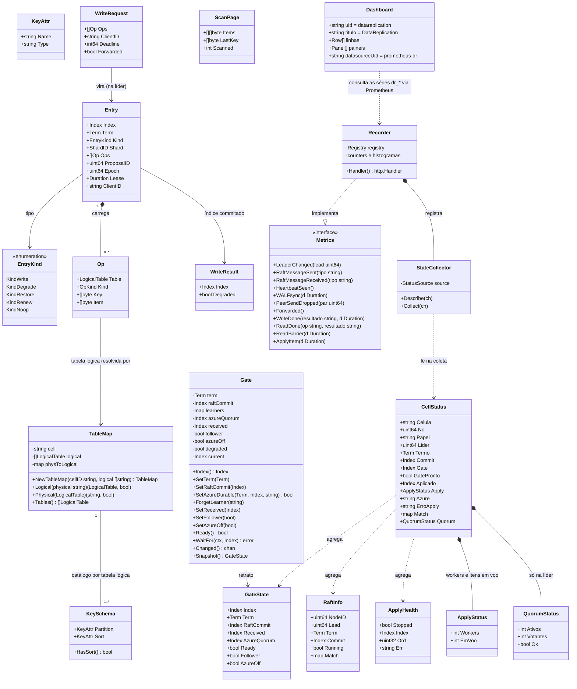

# POC local do DataReplication: três células AWS com Raft, gate, apply e leitura forte

## Requirements

- **Provar, numa máquina local com Docker, o conceito central do DataReplication entre três células AWS**: uma escrita feita em qualquer célula só é confirmada depois de commitada pelo Raft (2 de 3 com fsync), liberada pelo gate e aplicada no banco da célula líder; em seguida as três células aplicam o mesmo item, com a mesma versão (`_dr_v` = índice), cada uma na sua tabela; a leitura forte em qualquer célula devolve o item.
- **Completar o esboço** `doc/05_implementacao/codigo_exemplo` numa pasta própria `DataReplicationApp/`, preservando a arquitetura e os testes existentes, e acrescentar o que falta: Raft real (`etcdraft`), transporte gRPC entre células, `StateStore` do DynamoDB, parser do JSON do DynamoDB, leitura forte, propagação do gate, administração e a ligação de tudo no `bootstrap`.
- **Manter o produto pronto para a Azure sem exercitá-la**: o gate implementa as regras completas (G-01 a G-09) e aceita learners pela configuração; a POC roda com `LEARNERS` vazia no modo sem Azure (G-08), que é explicitamente só da POC.
- **Entregar um ambiente operável por tarefas**: imagem única, `docker-compose.yml` com LocalStack fixado e um volume por célula, `taskfile.yaml` com as tarefas da S.5 e um roteiro `e2e` que verifica CA-03 a CA-05.
- **Tornar o comportamento do cluster visível em tempo real**: cada célula expõe métricas Prometheus; o compose sobe Prometheus e Grafana, e o Grafana já abre com o dashboard "DataReplication" importado por provisioning, mostrando a célula líder, o quórum, as trocas de liderança, os ACKs, a replicação, o heartbeat do Raft, a durabilidade, as leituras fortes e a saúde de cada célula. Os cenários de falha do HOW_TO_RUN passam a ser observáveis no dashboard.
- **Aplicar no banco sem virar gargalo** (ADR-058): o applier grava itens de chaves diferentes em paralelo (`APPLY_WORKERS`, padrão 16), mantendo a ordem do log por chave e o `aplicado` como marca d'água contígua; o progresso do applier é um registro com CRC, sem fsync, no volume do Raft, e o WAL do Raft é a única cópia durável das entradas.
- **O laço do Raft nunca espera o apply** (ADR-060, depois do teste de carga de 14/10): o commit é publicado como sinal e o `CommitPump` lê as entradas por faixa da memória do Raft; a líder recusa escrita quando `gate − aplicado` passa de `APPLY_LAG_MAX`; `ELECTION_TICKS` configurável (30 no compose); a partida retoma no progresso do applier (ou em 1, sem progresso); `benchstore` para medir o teto do LocalStack (sem banco em memória: decisão do Bruno, 14/10); métricas de causa da contrapressão, do laço do Raft e da porta de API (TPS de entrada por célula). Passos O-27 e O-28.
- **Limites**: um shard; só `PutItem`, `GetItem` e `Scan` da tabela base; sem Azure, dedupe, mTLS, modo degradado ativo, compactação/snapshot do Raft, TTL, GSI, alertas do Prometheus. `DeleteItem` e `BatchWriteItem` ficam para a fase 2 e são recusados.
- **Pronto quando**: partindo de volumes vazios, os critérios CA-01 a CA-18 passam, `go test -race ./...` passa no container de teste e os critérios de observabilidade abaixo passam.
- **Critérios de observabilidade**:
  - **OB-01**: com `task subir`, `GET http://localhost:909N/metrics` responde 200 nas três células com as séries `dr_*` listadas na O-15.
  - **OB-02**: o Prometheus em `http://localhost:9095` mostra os três alvos `cell-1`, `cell-2`, `cell-3` como `up`, coletados a cada 1 s.
  - **OB-03**: o Grafana em `http://localhost:3000` abre sem login, com o datasource Prometheus configurado e o dashboard "DataReplication" (uid `datareplication`) já importado e definido como página inicial, sem nenhum passo manual.
  - **OB-04**: com `task carga` rodando, o dashboard mostra a líder atual, quórum OK, taxa de ACKs `ok` maior que zero, `commit`, `gate` e `aplicado` subindo juntos nas três células e mensagens de heartbeat sendo trocadas.
  - **OB-05**: ao parar a líder (CA-09), `dr_leader_changes_total` sobe, `dr_raft_term` aumenta e o painel "Líder atual" muda em até 5 s; ao parar duas células (CA-07), o painel "Quórum" mostra "SEM QUÓRUM" e os ACKs `no_leader` aparecem; ao religar, tudo volta ao normal.

## Entities



Notas de modelagem (conservadoras):
- `Entry`, `Op`, `WriteRequest`, `WriteResult`, `Lease`, `DegradedPolicy` e os tipos de `sendrule.go` ficam como estão; só entram `KindNoop` e o campo `ProposalID` em `Entry`.
- `Op.Key` é a chave serializada de forma **canônica**: o JSON do DynamoDB só com os atributos da chave, na ordem partição → ordenação (ex.: `{"pk":{"S":"cli-1"}}`). `Op.Item` é o item completo em JSON do DynamoDB, **sem** `_dr_v`.
- O valor zero de `Gate` continua com o comportamento atual (líder, Azure exigida), para não quebrar os testes do esboço.
- `RaftInfo` ganha `QuorumActive int` (votantes ativos recentemente, contando a própria líder; 0 na follower) e `Voters int`. `CellStatus` ganha `quorum` (só na líder), derivado desses dois campos.
- `port.Metrics` registra **eventos** (contadores e histogramas). O **estado** (líder, termo, commit, gate, aplicado, quórum, saúde) não é empurrado por ninguém: o `StateCollector` lê o mesmo `CellStatus` do `/status` na hora da coleta. `port.NopMetrics` é a implementação vazia usada nos testes e quando nada é injetado.
- `Applier.Applied()` é a **marca d'água** (ADR-058): o maior índice que, com todos os anteriores, está no banco da célula. Itens de índices maiores podem já estar gravados. O progresso salvo (`SaveProgress(índice, ordem)`) é a marca d'água, com `ordem` = número de itens da entrada. `ApplyStatus` mostra os workers efetivos e os itens despachados e não concluídos.
- O `Dashboard` é um arquivo JSON do Grafana versionado no repositório; não é entidade de código, mas é contrato: só pode consultar séries que a O-15 define.

## Approach

1. **Base de código e arquitetura**:
   - Copiar `doc/05_implementacao/codigo_exemplo` para `DataReplicationApp/` (o esboço permanece intacto como referência) e evoluir em `DataReplicationApp/`. Arquitetura hexagonal já usada: `domain` (só biblioteca padrão) ← `usecase` (depende de `port`) ← `adapter/in|out` ← `bootstrap` (único que importa `fx`) ← `cmd`.
   - Somente `adapter/out/etcdraft` importa `go.etcd.io/raft/v3` e o `wal` do etcd. O transporte (`peergrpc`, `peerclient`) trata mensagens do Raft como `[]byte`.
   - O laço do Ready segue a RT-04 no modo síncrono: cada `Ready` já agrupa entradas num único `wal.Save` com fdatasync.
   - Uma única codificação de `Entry`: JSON via `encoding/json`, no payload do Raft.

2. **Gate (G-01 a G-10)**:
   - O `domain.Gate` ganha três entradas: `received` (maior gate recebido da líder), `follower` (papel) e `azureOff` (modo POC).
   - Fórmula: líder → `commit` limitado pela maioria Azure, a não ser que `degraded` ou `azureOff`; follower → `min(commit local, received)`. `current = max(current, next)` mantém a monotonia através das trocas de papel.
   - `Ready()` = `azureOff || degraded || learners confirmados no termo ≥ 2`.
   - O modo sem Azure é ligado só pelo bootstrap quando `LEARNERS` está vazia **e** `POC_SEM_AZURE=true`; sem essa variável, `LEARNERS` vazia derruba a partida (SG-12). Na partida registra um aviso.
   - `GateSync` (usecase) mantém o papel do gate sincronizado com o Raft e, na líder, publica o gate a cada avanço e a cada `GATE_PUBLISH_INTERVAL`; na follower, recebe e aplica `SetReceived`.

3. **Raft (RT-01 a RT-12)**:
   - Partida do zero: snapshot sintético (índice 1, termo 1, `ConfState` com votantes de `PEERS` e learners de `LEARNERS`) gravado no WAL e aplicado ao `MemoryStorage`; `raft.RestartNode` com `Applied = 1`. Partida com WAL existente: reabrir, conferir a `ConfState` gravada com a configuração (RT-10), recarregar HardState e entradas, `Applied` = índice do snapshot.
   - Laço do Ready estritamente na ordem da RT-04; erro de `wal.Save` é fatal (log `Fatal`, saída 1, o Docker reinicia).
   - `Propose` gera um `ProposalID`, registra um waiter e devolve o índice quando a entrada com aquele id é commitada; `raft.ErrProposalDropped` → `usecase.ErrBackpressure`; prazo → `usecase.ErrPending`.
   - Entradas vazias e de `ConfChange` viram `Noop` com o índice e o termo delas.
   - `ReadIndex` só na líder, casando o `ReadState` pelo contexto da requisição.
   - Eventos de learner: `MsgAppResp` sem rejeição vindo de um id da lista de learners vira `LearnerProgress` num canal bloqueante (G-04). Na POC o canal nunca recebe nada.

4. **Apply (AP-01 a AP-10)**:
   - `CommitPump` com goroutines independentes: progresso dos learners e commits (gate e entrega ao `Applier`, pela memória). O `CommitPump` não grava nada em disco: o WAL do Raft é a única cópia durável das entradas. Com a fila do `Applier` cheia, a goroutine de commits espera (contrapressão).
   - `Applier` paralelo por chave (ADR-058): um despachante lê as entradas em ordem, espera `gate >= índice` e entrega cada item ao worker `hash(tabela, chave) mod APPLY_WORKERS`; cada worker grava um item por vez, na ordem em que recebeu. A mesma chave fica sempre no mesmo worker (ordem do log por chave, exigida pelo DELETE da fase 2). O `aplicado` é a marca d'água contígua e só ela libera o ACK da líder e a leitura forte. O `BatchWriteItem` do DynamoDB não serve para juntar itens: não aceita condição, e a checagem do `_dr_v` se perderia.
   - `Applier` passa a classificar o erro do banco: transitório → repetir com backoff exponencial de 100 ms a 5 s, sem limite, com log a cada tentativa; permanente → **estacionar** (o Applier fica parado na entrada sem pular, `Health()` mostra índice, ordem e erro, `/readyz` cai, o processo continua de pé) até o contexto acabar.
   - `StateStore` do DynamoDB faz `PutItem` condicional por `_dr_v`; `ConditionalCheckFailedException` é sucesso ("já aplicado").
   - Tabela física = lógica com `{cell}` trocado pelo `CELL_ID` local (`TableMap.Physical`).
   - Compactação do Raft desligada na POC (RT-11, AP-10): não há laço de compactação.
   - Progresso do applier (`adapter/out/progress`): um registro de 16 bytes com CRC, gravado sem fsync no arquivo `progress` do volume do Raft, ao lado do diretório do WAL; um registro que não confere conta como ausente e o replay, idempotente, recomeça do início do que o Raft guarda.
   - Pool HTTP do SDK do DynamoDB com `max(2 × APPLY_WORKERS, 32)` conexões ociosas por host (o padrão do SDK é 10).

5. **Leitura forte (A.6)**:
   - `ReadService` (usecase): na líder, conferir `Gate.Ready()` (senão `ErrGateNotReady`), `ReadIndex`, ler o gate **depois**; na follower, `BarrierClient.Barrier` na líder (ReadIndex e gate na mesma resposta). Esperar `Applier.WaitApplied(min(readIndex, gate))`, ler a tabela local com leitura consistente e tirar `_dr_v`.
   - Uma barreira por chamada (cada página do `Scan` é uma chamada).
   - Prazo esgotado na espera → `ErrReadTimeout` (503 `READ_TIMEOUT`); sem líder → `ErrNoLeader` (503 `NO_LEADER`).

6. **Borda HTTP compatível com DynamoDB**:
   - O parser devolve uma requisição tipada por operação (`PutItem`, `GetItem`, `Scan`) e faz **toda** a validação antes de qualquer caso de uso (SG-07): tabela pela lista permitida (`ResourceNotFoundException`), chave completa e com o tipo do `KeySchema`, `_dr_v` proibido, item ≤ 400 KB, parâmetros fora do escopo recusados, `IndexName` recusado (ADR-050), `DeleteItem`/`BatchWriteItem` → "não suportado nesta fase", demais operações → fora do escopo.
   - O handler despacha para `port.Writer` ou `port.Reader`; o 200 do `PutItem` traz `x-dr-index`; os erros seguem o formato `__type`/`message` do esboço, com 503 + `x-dr-code`.

7. **Encaminhamento e transporte**:
   - gRPC sem `.proto`: `api/peerv1` declara à mão o serviço `datareplication.peer.v1.Peer` com quatro métodos unários (`Step`, `Forward`, `ReadBarrier`, `GateUpdate`) e um codec JSON forçado em cliente e servidor.
   - O `Forward` preserva a **classe** do resultado (`OK` com índice, `NO_LEADER`, `PENDING`, `THROTTLING`, `LEASE_EXPIRED`, `INTERNAL`); o cliente reconstrói o erro do usecase correspondente. Prazo do `Forward` esgotado → `ErrPending`.
   - Mensagens do Raft: uma fila por par (4096 mensagens) com descarte quando cheia e `ReportUnreachable`; `GateUpdate`: um slot por par que guarda só o valor mais recente (nunca bloqueia, nunca perde o último).

8. **Configuração, administração e operação**:
   - `config` com viper (`AutomaticEnv`) alimentando a função pura `LoadFrom(getenv)`, que concentra a validação e continua testável.
   - `adminhttp` com `net/http`: `/livez`, `/readyz`, `/status` a partir de um `StatusReporter` do usecase.
   - Erros fatais de qualquer laço de fundo (`etcdraft.Run`, `CommitPump.Run`, `Applier.Run`, `GateSync.Run`) → `log.Fatal` → saída 1 → `restart: on-failure`. O Applier estacionado não é fatal.
   - Testes de integração com o LocalStack só rodam com `DR_IT_DYNAMODB_ENDPOINT` definida; sem ela, `t.Skip`, para o `go test -race ./...` do CA-14 passar sem LocalStack.
   - CA-07 é verificado depois que a líder isolada perde a liderança pelo `CheckQuorum` (esperar ≥ 3 s depois de parar as duas células): a escrita então recebe `NO_LEADER` sem propor nada. Uma escrita que recebeu `PENDING` é "resultado desconhecido" e **pode** aparecer depois que o quórum volta; isso é documentado, não é defeito.

9. **Observabilidade (métricas, Prometheus e Grafana)**:
   - **Exposição**: cada célula serve `GET /metrics` na porta de administração que já existe (`:9090`, host `909N`), no formato de texto do Prometheus. Nenhuma porta nova na célula.
   - **Biblioteca**: `github.com/prometheus/client_golang` (padrão de fato em Go), justificada no README conforme a N-01. Só o adaptador `adapter/out/prommetrics` a importa.
   - **Eventos por porta, estado por coleta**: casos de uso e adaptadores registram eventos pela porta `port.Metrics` (contadores e histogramas, operações atômicas e sem espera). O estado é lido na hora da coleta por um `prometheus.Collector` próprio a partir do `StatusReporter`, o mesmo do `/status`. Assim ninguém mantém gauges sincronizados à mão e o `/metrics` nunca diverge do `/status`.
   - **Rótulo da célula**: todas as séries levam o rótulo constante `celula` (via registro embrulhado), para o dashboard agrupar por célula sem depender do rótulo `instance`.
   - **Não interferir no Raft**: o laço do Ready só faz incrementos atômicos (sem mutex compartilhado, sem canal, sem rede). A leitura de estado roda na goroutine do scrape. Uma falha do Prometheus ou do Grafana nunca afeta escrita, leitura ou eleição.
   - **Quórum**: na líder, `QuorumActive` = votantes com `RecentActive` no progresso do Raft (incluindo ela); `dr_quorum_ok` = 1 quando `QuorumActive` ≥ maioria. Na follower o quórum não é exportado; o dashboard usa o máximo entre as células, então sem líder o painel mostra "SEM QUÓRUM".
   - **Heartbeat**: o Raft troca `MsgHeartbeat` e `MsgHeartbeatResp` a cada tick (100 ms). As contagens por tipo de mensagem e o instante do último heartbeat visto mostram o "pulso" de cada célula; ele para quando a célula cai.
   - **Prometheus e Grafana no compose**: duas containers novas com imagens de versão fixa. O Prometheus coleta `cell-1:9090`, `cell-2:9090`, `cell-3:9090` a cada 1 s e fica em `localhost:9095`. O Grafana fica em `localhost:3000`, com acesso anônimo de administrador (só na POC) e **provisioning** por arquivos montados: datasource Prometheus com uid fixo `prometheus-dr` e um provedor de dashboards que carrega o JSON do repositório na partida. Nada é configurado à mão.
   - **Dashboard como código**: o JSON fica em `observability/grafana/dashboards/datareplication.json`, versionado. Um teste Go confere que toda métrica citada no dashboard existe no registro do `prommetrics`, para o dashboard e o código não divergirem.
   - **Geração de tráfego**: `task carga` escreve em laço alternando as três células (para aparecerem encaminhamentos) e não para em erro, para os cenários de falha ficarem visíveis no dashboard enquanto acontecem.

## Structure

### Inheritance Relationships
1. `port.ConsensusEngine` interface define o motor de consenso; `etcdraft.Node` implementa `port.ConsensusEngine`, `port.RaftInbound` e `port.RaftStatus`.
2. `port.StateStore`, `port.Scanner` e `port.Catalog` interfaces definem o banco da célula; `dynamodb.Store` implementa as três (o catálogo é carregado por `Store.LoadCatalog`).
3. `port.ApplyProgress`: `progress.File` implementa (O-07f).
4. `port.Forwarder`, `port.BarrierClient` e `port.GatePublisher` interfaces; `peerclient.Client` implementa as três e também `etcdraft.Sender`.
5. `port.Writer` (entrada): `usecase.WriteService` implementa (já existe). `port.Reader` (entrada): `usecase.ReadService` implementa.
6. `port.AppliedWaiter`: `usecase.Applier` implementa (já existe).
7. `peerv1.PeerServer` interface (contrato gRPC); `peergrpc.Server` implementa.
8. `usecase.Degrader`: `usecase.DegradeService` implementa (já existe; na POC com `reject`).
9. `port.Metrics` interface define os eventos observáveis; `prommetrics.Recorder` implementa com o Prometheus e `port.NopMetrics` implementa vazio. `prommetrics.StateCollector` implementa `prometheus.Collector`.
10. Erros: `dynamohttp.APIError` (já existe) para erros de borda; erros sentinela do usecase (`ErrPending`, `ErrNoLeader`, `ErrBackpressure`, `ErrLeaseExpired` existentes; `ErrNotLeader`, `ErrGateNotReady`, `ErrReadTimeout` novos); erros sentinela de porta `port.ErrStoreTransient` e `port.ErrStorePermanent` (embrulhados com `%w`).

### Dependencies
1. `dynamohttp.Server` chama `port.Writer` e `port.Reader`, e usa `dynamohttp.Parser`, que depende de `domain.TableMap` e `port.Catalog`.
2. `usecase.WriteService` depende de `port.ConsensusEngine`, `port.Forwarder`, `*domain.Gate`, `port.AppliedWaiter`, `usecase.Degrader` (sem mudanças).
3. `usecase.ReadService` depende de `port.ConsensusEngine`, `*domain.Gate`, `port.AppliedWaiter`, `port.BarrierClient`, `port.StateStore`, `port.Scanner`.
4. `usecase.GateSync` depende de `port.ConsensusEngine`, `*domain.Gate`, `port.GatePublisher`.
5. `usecase.CommitPump` depende de `port.ConsensusEngine`, `*domain.Gate`, `*domain.Lease` e do canal para o `Applier`.
6. `usecase.Applier` depende de `*domain.Gate`, `port.StateStore`, `port.ApplyProgress`, canal do `CommitPump`, `Workers` (de `APPLY_WORKERS`) e `port.Metrics` (opcional).
7. `usecase.StatusReporter` depende de `port.RaftStatus`, `*domain.Gate`, `*usecase.Applier`, `port.Catalog`.
8. `peergrpc.Server` chama `port.RaftInbound`, `port.Writer` e duas interfaces próprias do pacote: `LeaderBarrier` (implementada por `usecase.ReadService`) e `GateReceiver` (implementada por `usecase.GateSync`).
9. `etcdraft.Node` chama `etcdraft.Sender` (implementado por `peerclient.Client`) para enviar mensagens serializadas.
10. `adminhttp.Server` chama `usecase.StatusReporter`.
11. Métricas: `etcdraft.Node`, `peerclient.Client`, `dynamohttp.Server` e `usecase.ReadService` recebem um `port.Metrics` (campo opcional; nulo vira `port.NopMetrics`). `prommetrics.StateCollector` lê `usecase.StatusReporter`. `adminhttp.Server` recebe o `http.Handler` de `/metrics` pronto, sem importar o Prometheus.
12. Prometheus coleta o `/metrics` das três células; Grafana lê o Prometheus pelo datasource `prometheus-dr` e carrega o dashboard do diretório de provisioning.
13. `bootstrap` liga tudo com `fx`: `New(extra...)` monta o núcleo, `Runtime()` os adaptadores reais e `NewProduction()` os dois; `cmd/datareplication/main.go` chama `NewProduction()` e registra no log o erro de partida (o `fx.NopLogger` esconderia a mensagem da RT-10).

### Layered Architecture
1. Camada de entrada (`adapter/in`): `dynamohttp` (API DynamoDB, parser e validação de borda), `peergrpc` (servidor entre células), `adminhttp` (saúde e estado). Só traduz protocolo.
2. Camada de casos de uso (`usecase`): escrita, leitura forte, apply, bombeamento de commits, sincronização do gate, modo degradado, retrato de estado.
3. Camada de domínio (`domain`): entrada, gate, lease, mapa de tabelas, esquema de chave, regra de envio antes do fsync. Só biblioteca padrão.
4. Camada de portas (`port`): contratos entre casos de uso e adaptadores.
5. Camada de saída (`adapter/out`): `etcdraft` (Raft + WAL), `peerclient` (gRPC), `progress` (progresso do applier), `dynamodb` (banco da célula), `prommetrics` (métricas Prometheus).
6. Tratamento de erros: erros sentinela no usecase e nas portas; o mapeamento para HTTP fica **num único lugar** (`dynamohttp.Server.writeError`), e o mapeamento para o fio do `Forward`/`ReadBarrier` num único par de funções em `api/peerv1` (`CodeOf(err)` / `ErrOf(code)`, que importam os sentinelas do usecase).
7. Plataforma (`platform/config`, `platform/logx`) e montagem (`bootstrap`).
8. Observabilidade fora do processo (`observability/`): configuração do Prometheus, provisioning do Grafana e o JSON do dashboard, todos montados pelo compose como somente leitura.

Árvore de `DataReplicationApp/`:

```text
DataReplicationApp/
├── Dockerfile
├── docker-compose.yml
├── taskfile.yaml
├── README.md
├── HOW_TO_RUN.md
├── observability/
│   ├── prometheus/prometheus.yml
│   └── grafana/
│       ├── provisioning/datasources/prometheus.yml
│       ├── provisioning/dashboards/datareplication.yml
│       └── dashboards/datareplication.json
├── go.mod / go.sum
├── cmd/datareplication/main.go
├── api/peerv1/{peer.go, codec.go, codes.go}
└── internal/
    ├── domain/{entry.go, gate.go, lease.go, tablemap.go, keyschema.go, sendrule.go}
    ├── port/{ports.go, metrics.go}
    ├── usecase/{write.go, read.go, apply.go, replicate.go, degrade.go, gatesync.go, status.go}
    ├── adapter/in/{dynamohttp/{handler.go, parser.go, attr.go}, peergrpc/server.go, adminhttp/server.go}
    ├── adapter/out/{etcdraft/{node.go, storage.go, codec.go}, peerclient/client.go, progress/progress.go, dynamodb/{store.go, convert.go, catalog.go}, prommetrics/{recorder.go, collector.go}}
    ├── platform/{config/config.go, logx/logx.go}
    └── bootstrap/app.go
```

## Operations

> Ordem obrigatória: O-01 → O-29 (O-14 a O-21 são a observabilidade, feitas depois da POC base; O-22 a O-26 são o progresso do applier verificado no Docker, o `CommitPump` independente do applier e o apply paralelo, ADR-058; O-27 e O-28 são o laço do Raft sem espera, a admissão e as métricas novas, ADR-060; O-29 é um LocalStack por célula), com uma exceção de dependência: as portas de O-07a e os erros novos do usecase (`ErrNotLeader`, `ErrGateNotReady`, `ErrReadTimeout`, em `read.go`) entram **antes** de O-03, porque o `etcdraft` os usa. Cada passo termina com `go build ./...` e `go test -race ./...` verdes (no container de teste) antes do seguinte. Comentários e mensagens de log em português.

### O-01 Criar a base - `DataReplicationApp/`
1. Responsabilidade: copiar o esboço e atualizar dependências.
2. Passos:
   - Copiar `doc/05_implementacao/codigo_exemplo/{go.mod,go.sum,internal}` para `DataReplicationApp/`.
   - `go.mod`: `go 1.27`; acrescentar `github.com/spf13/viper`, `google.golang.org/grpc`, `go.etcd.io/raft/v3`, `go.etcd.io/etcd/server/v3`, `go.etcd.io/etcd/client/pkg/v3` (se o `wal` exigir), `github.com/aws/aws-sdk-go-v2/{config,service/dynamodb,credentials}`, `github.com/aws/smithy-go`, `go.uber.org/zap` (logger do `wal`, usar `zap.NewNop()`), `google.golang.org/protobuf` (o `raftpb` da v3.7 usa protobuf-go: campos ponteiro, `proto.Marshal`); `go mod tidy`.
   - Resolver conflitos de versão de `google.golang.org/grpc` com o `etcd/server/v3` na versão que ambos aceitam; registrar a versão escolhida no README.
3. Pronto quando: `go build ./...` e os testes do esboço passam sem alteração.

### O-02a Update Domain - `domain/entry.go`
1. Acrescentar `KindNoop` ao fim do `iota` de `EntryKind` (não renumerar os existentes).
2. Acrescentar `ProposalID uint64` a `Entry`, com comentário: "identificador da proposta, gerado pela líder; casa a entrada commitada com quem a propôs (RT-07). Não é o ClientID do SDK."
3. Atualizar o comentário de `Op.Key`: chave canônica em JSON do DynamoDB, só atributos da chave, partição antes da ordenação.

### O-02b Update Domain - `domain/gate.go`
1. Atributos novos: `received Index`, `follower bool`, `azureOff bool`, `changed chan struct{}` (fechado e trocado a cada avanço de `current`).
2. Métodos novos:
   - `SetReceived(i Index)`: `update(func(){ g.received = max(g.received, i) })`.
   - `SetFollower(on bool)`: `update(func(){ g.follower = on })`. Não zera `received` (é valor já provado).
   - `SetAzureOff(on bool)`: `update(func(){ g.azureOff = on })`. Comentário obrigatório: "SÓ DA POC (G-08, SG-12): com a Azure desligada o ACK vira o commit AWS. Nunca ligar em produção."
   - `Changed() <-chan struct{}`: devolve o canal atual (criando-o se nulo) para quem quer acordar a cada avanço.
   - `Snapshot() GateState`: retrato sob o mutex.
3. `update` passa a calcular:
   - `next := g.raftCommit`
   - se `g.follower`: `next = min(next, g.received)`
   - senão, se `!g.degraded && !g.azureOff`: `next = min(next, g.azureQuorum)`
   - `prev := g.current; g.current = max(g.current, next)`; libera waiters `<= current`; se `current > prev`, fecha `g.changed` e zera.
4. `Ready()`: `g.azureOff || g.degraded || len(g.learners) >= 2`.
5. Testes de tabela novos em `gate_test.go` (com `-race`), além dos existentes:
   - maioria 2 de 3 (G-01): learners (5, 9, 7) → gate = min(commit, 7);
   - termo antigo ignorado (G-03); troca de termo zera progresso e não recua `current` (G-02, G-03);
   - heartbeat não é modelado no domínio: o teste de G-04 fica no `etcdraft` (O-03);
   - `Ready` falso com 1 learner, verdadeiro com 2 (G-07); verdadeiro com `azureOff` (G-08);
   - follower: commit 10, received 6 → 6; received 12 → 10 (G-06); received menor não recua;
   - troca de papel: líder com `current` 8 vira follower com received 5 → `current` continua 8; follower vira líder com `azureOff` e commit 12 → 12;
   - `azureOff` com commit 15 → 15 e `Ready` verdadeiro (G-08);
   - `WaitFor` remove o waiter no prazo (G-09) e `Changed` acorda a cada avanço;
   - valor zero do `Gate` mantém o comportamento antigo (gate parado sem learners).

### O-02c Create Domain - `domain/tablemap.go`
1. Responsabilidade: lista permitida de tabelas e conversão físico ↔ lógico (SG-08, AP-05).
2. `NewTableMap(cellID string, logical []string) (TableMap, error)`:
   - `cellID` não vazio; cada nome não vazio, com `strings.Count(n, "{cell}") == 1`, sem repetição; senão erro com o nome.
   - Monta `physToLogical[strings.Replace(n, "{cell}", cellID, 1)] = LogicalTable(n)`; dois lógicos com o mesmo físico → erro.
3. `Logical(physical string) (LogicalTable, bool)`: busca exata no mapa (nunca troca texto do `CELL_ID` no nome pedido).
4. `Physical(l LogicalTable) (string, bool)`: só para tabelas da lista; troca o marcador `{cell}` pelo `cellID`.
5. `Tables() []LogicalTable`: cópia, na ordem da configuração.
6. Testes: `t1_cell_{cell}` com `CELL_ID=1` → `t1_cell_1` ↔ lógico correto; `cadastro_cliente_cell_1` na célula 2 → não encontrado; nomes sem/duplo `{cell}` e repetidos → erro.

### O-02d Create Domain - `domain/keyschema.go`
1. `KeyAttr{Name string; Type string}` com `Type` em `"S"`, `"N"`, `"B"`.
2. `KeySchema{Partition KeyAttr; Sort KeyAttr}`; `HasSort() bool` = `Sort.Name != ""`; `Names() []string` (partição, depois ordenação).
3. `CanonicalKey(k KeySchema, attrs map[string]json.RawMessage) ([]byte, error)`: monta a chave canônica de `Op.Key` (partição antes da ordenação, valores compactados); atributo ausente → erro. Usado pelo parser e pelo `LastKey` do Scan.
4. Testes de `HasSort`, `Names` e `CanonicalKey`.

### O-03 Implement Adapter - `adapter/out/etcdraft`
1. Responsabilidade: `port.ConsensusEngine` real (RT-01 a RT-11), único importador de `raft` e `wal`.
2. Atributos de `Node`: `id uint64`, `voters []uint64`, `learners []uint64`, `dir string`, `node raft.Node`, `storage *raft.MemoryStorage`, `wal *wal.WAL`, `send Sender`, ~~`committed chan port.CommitBatch` (buffer 1024)~~ (substituído na O-27 por `commitMu` e `commitCh chan struct{}`, ADR-060), `events chan port.LearnerProgress` (buffer 1024, bloqueante), `lead atomic.Uint64`, `term atomic.Uint64`, `commit atomic.Uint64`, `pending map[uint64]chan domain.Index` + mutex, `reads map[string]chan domain.Index` + mutex, `nextProposal atomic.Uint64` (semente `uint64(time.Now().UnixNano())`), `log zerolog.Logger`.
3. `Sender` interface (no próprio pacote): `Send(to uint64, msg []byte) bool` (false = descartado).
4. `Open(cfg Config, send Sender, log zerolog.Logger) (*Node, error)`:
   - `cfg`: `ID`, `Voters`, `Learners`, `Dir`, `TickInterval` (100 ms).
   - Se `!wal.Exist(dir)`: `wal.Create(zap.NewNop(), dir, metadata(id))`; `ConfState{Voters, Learners}`; `w.SaveSnapshot(walpb.Snapshot{Index:1, Term:1, ConfState:&cs})`; `w.Save(HardState{Term:1, Commit:1}, nil)`; `storage.ApplySnapshot(raftpb.Snapshot{Metadata:{Index:1, Term:1, ConfState:cs}})`; `storage.SetHardState`.
   - Senão: `wal.ValidSnapshotEntries` → último snapshot; `wal.Open` nele; `ReadAll` → metadata, HardState, entradas. Conferir metadata = `id`. Conferir `ConfState` do snapshot × configuração (conjuntos ordenados); diferença → erro `"PEERS/LEARNERS diferem do que está gravado no WAL (votantes X, learners Y); rode task limpar"` (RT-10, CA-12). Aplicar snapshot, HardState e entradas ao `MemoryStorage`.
   - `raft.Config{ID, ElectionTick:cfg.ElectionTicks (O-27; antes 10), HeartbeatTick:1, Storage, Applied:restartApplied(...) (O-27; antes 1), MaxSizePerMsg:1<<20, MaxInflightMsgs:256, MaxUncommittedEntriesSize:32<<20, CheckQuorum:true, PreVote:true, DisableProposalForwarding:true, Logger: adaptador zerolog}`; `raft.RestartNode(cfg)`.
5. `Run(ctx) error` (laço único):
   - ticker de `TickInterval` → `node.Tick()`.
   - `rd := <-node.Ready()`:
     1. `SoftState` não nulo → atualizar `lead`; logar mudança de líder (`lider`, `termo`).
     2. `rd.Snapshot` não vazio → retornar erro "snapshot recebido; a POC não usa snapshots" (RT-11).
     3. `before, after := domain.SplitBeforeSync(isLeader, rd.Messages, kindOf)`; enviar `before`.
     4. `wal.Save(rd.HardState, rd.Entries)`; erro → retornar erro (fatal, RT-05).
     5. `storage.Append(rd.Entries)`; `HardState` não vazio → `storage.SetHardState`, atualizar `term`.
     6. enviar `after` (`MsgSnap` em `after` → logar erro e não enviar).
     7. `rd.ReadStates` → entregar cada `Index` ao waiter de `reads[string(RequestCtx)]`.
     8. `rd.CommittedEntries` → converter (passo 6) num `CommitBatch`; atualizar `commit`; entregar índice aos waiters `pending[ProposalID]` cuja entrada é `KindWrite`; ~~`committed <- batch` (bloqueante, risco 3; com `ctx.Done`)~~ **substituído na O-27:** publicar o último índice como sinal (atômico + fechar e recriar `commitCh`), sem esperar ninguém (ADR-060).
     9. `node.Advance()`.
   - `send(m)`: `data, _ := m.Marshal()`; `if !s.Send(m.To, data) { node.ReportUnreachable(m.To) }`.
   - `kindOf(m)`: mapear `raftpb.MsgApp`→`domain.MsgApp`, `MsgAppResp`→`MsgAppResp`, votos, pré-votos, heartbeat, `MsgSnap`; resto → `MsgOther`.
6. Conversão de entradas commitadas: `EntryNormal` com `Data` vazio ou `EntryConfChange`/`EntryConfChangeV2` → `domain.Entry{Index, Term, Kind: KindNoop}`; `EntryNormal` com dados → `json.Unmarshal` em `domain.Entry`, sobrescrever `Index` e `Term` com os do Raft; erro de decodificação → retornar erro (fatal).
7. `Propose(ctx, e) (domain.Index, error)`:
   - `e.ProposalID = nextProposal.Add(1)`; registrar `ch := make(chan domain.Index, 1)` em `pending`; `defer` remover.
   - `data, _ := json.Marshal(e)`; `node.Propose(ctx, data)`: `raft.ErrProposalDropped` → `usecase.ErrBackpressure`; erro de contexto → `usecase.ErrPending`.
   - Esperar `ch` ou `ctx.Done()` (→ `usecase.ErrPending`).
8. `ReadIndex(ctx) (domain.Index, error)`: se não for líder → `usecase.ErrNotLeader`; `rctx` = 8 bytes aleatórios; registrar waiter; `node.ReadIndex(ctx, rctx)`; esperar `ReadState` ou prazo (→ `usecase.ErrReadTimeout`).
9. `Step(ctx, msgs [][]byte) error` (`port.RaftInbound`): para cada `data`: `Unmarshal` em `raftpb.Message`; se `Type == MsgAppResp && !Reject && from ∈ learners` → `events <- port.LearnerProgress{Term: m.Term, Index: m.Index, Learner: strconv(from), SentAt: time.Now()}` (bloqueante com `ctx`; G-04); `node.Step(ctx, m)`.
10. Demais: `Leader()` (`lead == 0` → `false`; `NodeID: strconv(lead)`, `Local: lead == id`); `Term()`; `Committed()`; `LearnerEvents()`; `LearnerDurable()` → `nil` na POC; `TransferLeadership(ctx, to)` → `node.TransferLeadership`; `Status() port.RaftInfo` a partir de `node.Status()` (`Match` só na líder).
11. Testes (`node_test.go`, `-race`): três nós em memória com um `Sender` de canal e diretórios temporários — elege exatamente um líder; `Propose` na líder devolve índice ≥ 2 e as três recebem a mesma entrada em `Committed()` com índices contíguos (Noop incluso); fechar e reabrir um nó reentrega as entradas commitadas; reabrir com `Voters` diferentes falha com a mensagem do `task limpar`; um learner simulado (id 4) produz evento de progresso só para `MsgAppResp` não rejeitado e nunca para `MsgHeartbeatResp` (G-04); `MsgAppResp` e votos nunca saem antes do `wal.Save` (verificado por um `Sender` que registra a ordem e um WAL instrumentado ou pela função `SplitBeforeSync`).

### O-04 Implement Transport - `api/peerv1`, `adapter/in/peergrpc`, `adapter/out/peerclient`
1. `api/peerv1`:
   - `codec.go`: codec `json` (`encoding.Codec` com `Marshal`/`Unmarshal` via `encoding/json`, `Name() = "drjson"`), usado com `grpc.ForceCodec` no cliente e `grpc.ForceServerCodec` no servidor.
   - `peer.go`: tipos `StepRequest{Msgs [][]byte}`, `Empty{}`, `ForwardRequest{Ops []domain.Op; ClientID string; Deadline int64}`, `ForwardResponse{Code string; Index uint64; Message string}`, `BarrierResponse{Code string; ReadIndex uint64; Gate uint64}`, `GateUpdateRequest{Term uint64; Gate uint64; From uint64}`; interface `PeerServer` com os quatro métodos; `ServiceDesc` escrito à mão (`ServiceName: "datareplication.peer.v1.Peer"`); `RegisterPeerServer(s *grpc.Server, impl PeerServer)`; funções de chamada `Invoke*` para o cliente.
   - `codes.go`: constantes `OK`, `NO_LEADER`, `NOT_LEADER`, `PENDING`, `THROTTLING`, `LEASE_EXPIRED`, `GATE_NOT_READY`, `READ_TIMEOUT`, `INTERNAL`.
2. `peergrpc.Server` (implementa `PeerServer`):
   - `Step` → `RaftInbound.Step(ctx, req.Msgs)`.
   - `Forward` → `Writer.Write(ctx, port.WriteRequest{Ops, ClientID, Deadline, Forwarded: true})` com o prazo do contexto gRPC; converte resultado/erro no `Code` (`errors.Is` com os sentinelas do usecase).
   - `ReadBarrier` → `LeaderBarrier.LeaderBarrier(ctx)` → `Code` + `ReadIndex` + `Gate`.
   - `GateUpdate` → `GateReceiver.OnGateUpdate(term, gate)`.
   - O `*grpc.Server` é criado uma vez (`sync.Once`), para `Serve` e `Stop` não correrem.
3. `peerclient.Client` (implementa `etcdraft.Sender`, `port.Forwarder`, `port.BarrierClient`, `port.GatePublisher`):
   - `New(self, peers, forwardTimeout, log, extra ...grpc.DialOption)`: `extra` serve aos testes (dialer em memória).
   - Atributos: `self uint64`, `peers map[uint64]*peer`, `forwardTimeout time.Duration`, `log`. Cada `peer`: `conn *grpc.ClientConn` (insecure, `ForceCodec`), `raftQ chan []byte` (4096), `gateSlot` (valor mais recente + sinal).
   - `Send(to, msg) bool`: `select { case p.raftQ <- msg: return true; default: return false }`. Goroutine por par drena até 256 mensagens por `Step` com prazo de 1 s; erro → log em nível debug e segue.
   - `Forward(ctx, leader string, r)`: contexto com `min(ctx, forwardTimeout)`; log "escrita encaminhada à líder" (`lider`); chama `Forward`; `Code` → erro do usecase (`NO_LEADER`→`ErrNoLeader`, `PENDING`→`ErrPending`, `THROTTLING`→`ErrBackpressure`, `LEASE_EXPIRED`→`ErrLeaseExpired`, `INTERNAL`→erro genérico); erro de transporte ou prazo → `ErrPending`; `OK` → `WriteResult{Index}`.
   - `Barrier(ctx, leader string) (ri, gate domain.Index, err error)`: `NOT_LEADER`/`NO_LEADER` → `ErrNoLeader`; `GATE_NOT_READY` → `ErrGateNotReady`; transporte → `ErrReadTimeout`.
   - `Publish(term, gate)`: grava no slot de cada par (sobrescreve) e sinaliza; goroutine por par envia o valor mais recente com prazo de 1 s.
4. Testes: servidor e cliente em `bufconn` — ida e volta dos quatro métodos; `Forward` preserva cada código; fila cheia faz `Send` devolver `false`; `Publish` repetido entrega o último valor.

### O-05 Implement Adapter - `adapter/out/dynamodb`
1. `convert.go`: conversão JSON do DynamoDB ↔ `types.AttributeValue` para `S`, `N`, `B`, `BOOL`, `NULL`, `M`, `L`, `SS`, `NS`, `BS` (valores `B` em base64); `itemFromJSON([]byte) (map[string]types.AttributeValue, error)` e `itemToJSON(map) ([]byte, error)`; `stripVersion(map)` remove `_dr_v`.
2. `catalog.go` — métodos do `Store` que implementam `port.Catalog`:
   - `LoadCatalog(ctx, wait time.Duration, log) error`: para cada lógica, `DescribeTable(físico)` até `TableStatus == ACTIVE`, tentando a cada 1 s até `wait`; monta `KeySchema` a partir de `KeySchema` + `AttributeDefinitions`; tabela ausente no fim do prazo → erro `"tabela X não encontrada em TABLE_WAIT"`. Log por tabela conferida.
   - `KeySchema(l) (domain.KeySchema, bool)`; `Ready() bool` (todas conferidas).
3. `store.go` — `Store` (implementa `port.StateStore`, `port.Scanner` e `port.Catalog`):
   - `New(ctx, endpoint, region string, tm domain.TableMap)`: `config.LoadDefaultConfig` + `BaseEndpoint` quando `endpoint != ""`.
   - `ApplyBatch(ctx, ops)`: para cada op `OpPut`: físico via `tm.Physical`; item + `_dr_v` (`N`, versão); `PutItem` com `ConditionExpression: "attribute_not_exists(#v) OR #v < :v"`, `#v=_dr_v`, `:v=versão`. `ConditionalCheckFailedException` → `nil`. `OpDelete` → `ErrStorePermanent` "não suportado nesta fase".
   - `Get(ctx, table, key) ([]byte, error)`: `GetItem` com `ConsistentRead: true`; não encontrado → `nil, nil`; tira `_dr_v`.
   - `Scan(ctx, table, limit, startKey) (port.ScanPage, error)`: `Scan` com `ConsistentRead: true`, `Limit` (se > 0), `ExclusiveStartKey`; tira `_dr_v` de cada item; `LastKey` em JSON canônico.
   - `classify(err) error`: `smithy.APIError` com código `ProvisionedThroughputExceededException`, `ThrottlingException`, `RequestLimitExceeded`, `InternalServerError`, `ServiceUnavailable`, `LimitExceededException` ou sem `APIError` (rede) → `fmt.Errorf("%w: %v", port.ErrStoreTransient, err)`; qualquer outro → `port.ErrStorePermanent`.
4. Testes de integração (só com `DR_IT_DYNAMODB_ENDPOINT`): criar tabela temporária; apply com versão 5 e depois 3 → item fica com 5; reaplicar 5 → sucesso; `Get`/`Scan` não trazem `_dr_v`; `DescribeTable` monta o `KeySchema`. Testes de unidade de `convert.go` e `classify` sem rede.

### O-06 Implement Edge - `adapter/in/dynamohttp`
1. `parser.go` — `Parser{Tables domain.TableMap; Catalog port.Catalog}`; `Parse(target string, body []byte) (Request, error)`; `Request{Op string; Write port.WriteRequest; Table domain.LogicalTable; Key []byte; Limit int; StartKey []byte}`. Todo texto é copiado do corpo (decodificação para structs próprias; nada de `json.RawMessage` apontando para o buffer do `fasthttp`, N-06).
   - Target sem prefixo `DynamoDB_20120810.` → 400 `UnknownOperationException`.
   - `DeleteItem`, `BatchWriteItem` → 400 `ValidationException` `"operação não suportada nesta fase (fase 2)"` (CA-13).
   - `UpdateItem`, `Query`, `TransactWriteItems`, `TransactGetItems`, `BatchGetItem` e demais → 400 `ValidationException` `"operação fora do escopo do DataReplication"`.
   - Comum: `TableName` → `Tables.Logical`; ausente → 400 `ResourceNotFoundException` `"Requested resource not found"` (CA-10); `KeySchema` do catálogo.
   - `PutItem`: `Item` presente; cada valor de atributo com exatamente um tipo conhecido e bem formado (`N` numérico válido, `B` base64 válido, conjuntos não vazios e sem repetição); atributos da chave presentes e com o tipo do `KeySchema` (senão 400 `"One or more parameter values were invalid: Missing the key pk in the item"` / `"Type mismatch for key pk"`); `_dr_v` presente → 400 `"o atributo _dr_v é reservado"`; tamanho (soma de bytes de nomes e valores) > 400 KB → 400 `"Item size has exceeded the maximum allowed size"`; `ConditionExpression`, `Expected`, `ConditionalOperator`, `ExpressionAttributeNames`, `ExpressionAttributeValues` presentes ou `ReturnValues` ≠ `NONE` → 400 `"parâmetro fora do escopo: X"`. Monta `Op{Table, OpPut, Key canônica, Item}`.
   - `GetItem`: `Key` com exatamente os atributos do `KeySchema` e tipos certos; `ProjectionExpression`, `AttributesToGet`, `ExpressionAttributeNames` → 400. `ConsistentRead` é ignorado (sempre forte, ADR-057).
   - `Scan`: `IndexName` → `ValidateIndex(name, true)`; `FilterExpression`, `ScanFilter`, `Segment`, `TotalSegments`, `ProjectionExpression`, `AttributesToGet`, `ExpressionAttributeNames`, `ExpressionAttributeValues` → 400; `Select` diferente de vazio/`ALL_ATTRIBUTES` → 400; `Limit` < 1 → 400; `ExclusiveStartKey` validada como chave.
2. `handler.go`: `type ParseFunc func(target string, body []byte) (Request, error)`; `New(w port.Writer, r port.Reader, parse ParseFunc, o Options)` (produção passa `(&Parser{…}).Parse`; os testes passam funções simples); erro de parse sem tipo vira 400 `ValidationException`; `handle` despacha por `Request.Op`:
   - `PutItem` → `Writer.Write`; 200 `{}` com header `x-dr-index: <índice>`.
   - `GetItem` → `Reader.Get`; 200 `{"Item": ...}` ou `{}`.
   - `Scan` → `Reader.Scan`; 200 `{"Items": [...], "Count": n, "ScannedCount": n, "LastEvaluatedKey": ...}` (o último só quando houver).
   - `writeError(c, err)`: mapeamento único — `APIError` → status/tipo próprios; `ErrNoLeader` → 503 `NO_LEADER` + `Retry-After: 1`; `ErrPending`/`DeadlineExceeded` → 503 `PENDING`; `ErrBackpressure` → 400 `ThrottlingException`; `ErrLeaseExpired` → 503 `LEASE_EXPIRED`; `ErrGateNotReady` → 503 `GATE_NOT_READY`; `ErrReadTimeout` → 503 `READ_TIMEOUT`; resto → 500 `InternalServerError`.
3. Testes: cada recusa de CA-10 e CA-13 (com um `Writer` falso que falha se for chamado — nada é proposto); `t1_cell_1` (SG-08); `x-dr-index` no 200; `_dr_v` nunca na resposta de leitura; JSON de erro válido com aspas na mensagem.

### O-07a Update Port - `port/ports.go`
1. `StateStore`: `ApplyBatch(ctx, ops []VersionedOp) error`; `Get(ctx, table domain.LogicalTable, key []byte) ([]byte, error)` (sem `consistent`); **remover** `AppliedIndex`.
2. Novas: `Scanner{Scan(ctx, table, limit int, startKey []byte) (ScanPage, error)}`; `ScanPage`; `Catalog{KeySchema(domain.LogicalTable) (domain.KeySchema, bool); Ready() bool}`; `BarrierClient{Barrier(ctx, leader string) (domain.Index, domain.Index, error)}`; `GatePublisher{Publish(term domain.Term, gate domain.Index)}`; `RaftInbound{Step(ctx, msgs [][]byte) error}`; `RaftStatus{Status() RaftInfo}`; `RaftInfo`.
3. `Reader`: `Get(ctx, table, key) ([]byte, error)` e `Scan(ctx, table, limit, startKey) (ScanPage, error)`.
4. Erros: `ErrStoreTransient`, `ErrStorePermanent`.
5. Ajustar os fakes dos testes do esboço às assinaturas novas (só onde mudou).

### O-07b Implement Service - `usecase/read.go`
1. `ReadService{Consensus port.ConsensusEngine; Gate *domain.Gate; Applied port.AppliedWaiter; Barrier port.BarrierClient; Store port.StateStore; Scanner port.Scanner; WaitLeader time.Duration}`.
2. `LeaderBarrier(ctx) (ri, gate domain.Index, err error)`: não é líder → `ErrNotLeader`; `!Gate.Ready()` → `ErrGateNotReady`; `ri := Consensus.ReadIndex(ctx)`; `gate := Gate.Index()` **depois** do `ReadIndex`.
3. `barrier(ctx) (domain.Index, error)`: resolve a líder (mesma espera limitada do `WriteService`, `WaitLeader`); líder local → `LeaderBarrier`; senão `Barrier.Barrier(ctx, leader.NodeID)`; devolve `min(ri, gate)`.
4. `Get(ctx, table, key)`: `b := barrier`; `Applied.WaitApplied(ctx, b)` (prazo → `ErrReadTimeout`); `Store.Get`.
5. `Scan(ctx, table, limit, startKey)`: idem, uma barreira por chamada; `Scanner.Scan`.
6. Erros novos: `ErrNotLeader`, `ErrGateNotReady`, `ErrReadTimeout`.
7. Testes com motor falso: líder espera o apply até `min(ri, gate)`; follower usa o `BarrierClient` e não o gate local; gate não pronto → `ErrGateNotReady`; prazo na espera → `ErrReadTimeout`; sem líder → `ErrNoLeader`.

### O-07c Implement Service - `usecase/gatesync.go`
1. `GateSync{Consensus port.ConsensusEngine; Gate *domain.Gate; Publisher port.GatePublisher; Interval time.Duration; Log zerolog.Logger}`.
2. `Run(ctx) error`: ticker de `Interval`; a cada tick e a cada `Gate.Changed()`:
   - `l, ok := Consensus.Leader()`; `Gate.SetFollower(!(ok && l.Local))`; `Gate.SetTerm(Consensus.Term())`.
   - Se líder local: `Publisher.Publish(term, Gate.Index())`.
   - Se o gate não avançou por 50 ticks com `commit > gate`, log "gate parado" (uma vez por episódio).
3. `OnGateUpdate(term, gate)`: `Gate.SetReceived(gate)` (o commit local continua limitando).
4. Testes: follower não passa do commit local; publica no avanço e no intervalo; troca de papel atualiza `SetFollower`.

### O-07d Update Service - `usecase/apply.go`
1. Atributos novos: `Backoff{Min: 100ms, Max: 5s}`, `Log zerolog.Logger`, `health ApplyHealth` (sob `mu`).
2. Aplicar cada item via `applyItem(ctx, op)`: laço — `err := Store.ApplyBatch`; `nil` → ok; `errors.Is(err, port.ErrStoreTransient)` → log "erro transitório no apply, repetindo" (`indice`, `ordem`, `espera`) e esperar `min(espera*2, Max)` (com `ctx`); outro erro → permanente.
3. Permanente: gravar `health{Stopped: true, Index, Ord, Err}`, log de erro "applier parado: saída humana (ADR-038)", e **bloquear** até `ctx.Done()` (sem consumir mais entradas, sem pular); `Run` devolve `ctx.Err()`.
4. `Health() ApplyHealth`.
5. `Noop` continua só avançando o aplicado.
6. Ajustar `TestPoisonItemStopsTheShard`: o fake devolve `ErrStorePermanent`; esperar `Health().Stopped` com índice 2, `Applied() == 1`, sem item 3 aplicado. Teste novo: transitório duas vezes e depois sucesso → aplica sem parar.

### O-07e Create Service - `usecase/status.go`
1. `StatusReporter{CellID string; NodeID uint64; Raft port.RaftStatus; Gate *domain.Gate; Applier *Applier; Catalog port.Catalog; AzureOff bool}`.
2. `Status() CellStatus`: preenche `celula`, `no`, `papel` (`lider`/`follower`), `lider`, `termo`, `commit`, `gate`, `gatePronto`, `aplicado` (marca d'água), `apply{workers, emVoo}` (O-24), `azure` (`off`/`on`), `erroApply` (com índice e ordem), `match` (só líder).
3. `Ready() (bool, string)`: catálogo pronto, Raft rodando, líder conhecida, applier não parado; devolve o motivo quando falso.

### O-07f Create Adapter - `adapter/out/progress`
1. Responsabilidade: implementa `port.ApplyProgress` (AP-06); é o único arquivo do nó além do WAL, no mesmo volume.
2. `Open(path) (*File, error)`: cria o diretório pai se faltar e abre (ou cria) o arquivo. O bootstrap passa `filepath.Join(filepath.Dir(RaftDir), "progress")`, ou seja `/var/lib/dr/raft/progress` (C-04).
3. `SaveProgress(idx, ord)`: grava um registro de 16 bytes (índice u64, ordem u32, CRC32C u32) no início do arquivo, no lugar do anterior, **sem fsync**.
4. `LoadProgress()`: arquivo vazio ou registro com CRC que não confere → `(0, 0)` sem erro; o applier recomeça do início do que o Raft guarda (replay idempotente pela versão).
5. `Close()`.
6. Testes: gravar, fechar, reabrir e ler o mesmo `(índice, ordem)`; registro corrompido vira `(0, 0)`.

### O-08 Implement Adapter - `adapter/in/adminhttp`
1. `net/http` em `ADMIN_ADDR`: `GET /livez` → 200 `ok`; `GET /readyz` → 200 ou 503 com o motivo; `GET /status` → JSON de `CellStatus` com as chaves em português da S.7.
2. `POST /transferir?para=N` não é implementado (PODE).
3. Teste com `httptest`.

### O-09a Update Config - `platform/config/config.go`
1. Campos novos: `NodeID uint64`, `Peers map[uint64]string`, `Learners map[uint64]string`, `Tables []string`, `DynamoEndpoint`, `AWSRegion`, `PeerAddr` (`:7000`), `RaftDir` (`/var/lib/dr/raft/wal`), `TableWait` (120 s), `GatePublishInterval` (100 ms), `ApplyWorkers int` (`APPLY_WORKERS`, padrão 16, de 1 a 256; O-25), `POCNoAzure bool` (`POC_SEM_AZURE`). Remover `WALDir`.
2. Regras (todas acumuladas em `errs`): `NODE_ID` inteiro > 0; `PEERS` no formato `id=host:porta` separado por vírgula, ids únicos, contém `NODE_ID`; `LEARNERS` vazia ou exatamente 3 ids, disjuntos de `PEERS`; `LEARNERS` vazia sem `POC_SEM_AZURE=true` → erro "LEARNERS vazia só é aceita na POC (POC_SEM_AZURE=true)" (SG-12); `TABLES` não vazia e cada nome com exatamente um `{cell}`; `AWS_REGION` obrigatória; manter todas as regras atuais (prazos SG-11, `DEGRADED_POLICY`, variáveis do modo eventual, `DEGRADE_AFTER` com padrão 2 s).
3. `Load()`: `v := viper.New(); v.AutomaticEnv(); return LoadFrom(v.GetString)`. `IDs(map[uint64]string) []uint64` devolve os ids em ordem (votantes e learners para o `etcdraft`).
4. Testes: casos válidos e cada erro novo; testes existentes continuam.

### O-09b Update Bootstrap - `bootstrap/app.go` e `cmd/datareplication/main.go`
1. Provedores: `config.Load`; logger com `celula` e `no`; `domain.TableMap`; `*domain.Gate` com `SetAzureOff(len(Learners)==0)` (log de aviso "POC sem Azure: gate = commit do Raft; nunca usar em produção"); `*progress.File` (`progress.Open(filepath.Join(filepath.Dir(RaftDir), "progress"))`, O-07f) como `port.ApplyProgress`; `*dynamodb.Store` (`StateStore`, `Scanner`, `Catalog`); `*peerclient.Client`; `*etcdraft.Node` como `ConsensusEngine`, `RaftInbound`, `RaftStatus`; canal `chan []domain.Entry` (buffer 4096) entre `CommitPump` e `Applier`; `*usecase.Applier` como `AppliedWaiter`; `WriteService`, `ReadService`, `GateSync`, `CommitPump`, `StatusReporter`, `DegradeService` (existente); `Parser`, `dynamohttp.Server`, `peergrpc.Server`, `adminhttp.Server`.
2. `fx.StartTimeout(5m)` (cabe o `TABLE_WAIT`). Ordem de `OnStart`: admin HTTP (para `/livez`) → `Store.LoadCatalog` com `TableWait` (erro → falha a partida) → servidor gRPC → `etcdraft.Run`, `CommitPump.Run`, `Applier.Run`, `GateSync.Run` em goroutines com um contexto cancelado no `OnStop` → API DynamoDB. Erro não-`context.Canceled` de qualquer laço → `log.Fatal()`.
3. `OnStop`: API → gRPC → cancelar laços e **esperar** que parem → `progress.Close` → fechar o WAL e o cliente gRPC.
4. `main.go`: `bootstrap.NewProduction()`; `app.Err()` e `app.Start` com erro → `log.Fatal` com a causa (CA-12 precisa da mensagem); espera o sinal e para com prazo de 30 s.
5. `logx.New()` em nível `info`.
6. Testes: grafo de produção com `fx.ValidateApp`; testes existentes do bootstrap ajustados (substitutos para `Reader` e `ParseFunc`, variáveis novas); `LEARNERS` vazia sem `POC_SEM_AZURE` falha.

### O-10 Create Image - `DataReplicationApp/Dockerfile`
1. Estágio `build`: `FROM golang:1.27-alpine`; `WORKDIR /src`; copiar `go.mod`/`go.sum`; `RUN --mount=type=cache,target=/go/pkg/mod go mod download`; copiar o resto; `RUN --mount=type=cache,target=/go/pkg/mod --mount=type=cache,target=/root/.cache/go-build CGO_ENABLED=0 go build -trimpath -o /out/datareplication ./cmd/datareplication`.
2. Estágio `test`: `FROM golang:1.27` (Debian; o `-race` exige CGO e glibc); mesmos caches; `CGO_ENABLED=1 go test -race -count=1 ./...`.
3. Estágio final: `FROM alpine:3.22`; `adduser -D -u 10001 dr`; `mkdir -p /var/lib/dr/raft && chown -R 10001:10001 /var/lib/dr`; copiar o binário; `USER 10001`; `EXPOSE 8000 7000 9090`; `HEALTHCHECK --interval=5s --timeout=2s CMD wget -qO- http://127.0.0.1:9090/livez || exit 1`; `ENTRYPOINT ["/usr/local/bin/datareplication"]`.
4. Pronto quando: `docker build .` e `docker build --target test .` passam.

### O-11 Create Compose - `DataReplicationApp/docker-compose.yml`
1. `x-dr-env`: `PEERS: 1=cell-1:7000,2=cell-2:7000,3=cell-3:7000`, `LEARNERS: ""`, `POC_SEM_AZURE: "true"`, `TABLES: cadastro_cliente_cell_{cell}`, `DYNAMODB_ENDPOINT: http://localstack:4566`, `AWS_REGION: sa-east-1`, `AWS_ACCESS_KEY_ID: test`, `AWS_SECRET_ACCESS_KEY: test`, `DEGRADED_POLICY: reject`, `TABLE_WAIT: 120s`, `GATE_PUBLISH_INTERVAL: 100ms`, `APPLY_WORKERS: 16`, `RAFT_DIR: /var/lib/dr/raft/wal`.
2. `localstack`: `image: localstack/localstack:4.14.0`, `SERVICES=dynamodb`, `4566:4566`, healthcheck `curl -fs http://localhost:4566/_localstack/health`.
3. `cell-1` com `build: .` e `image: datareplication-poc:local`; `cell-2` e `cell-3` só com `image: datareplication-poc:local`; todas com `pull_policy: never` (a imagem é local); cada uma com `<<: *dr-env` mais `CELL_ID`/`NODE_ID`; portas `800N:8000` e `909N:9090`; volume `cell-N-raft:/var/lib/dr/raft`; `depends_on: localstack: condition: service_healthy`; `restart: on-failure`.
4. Três volumes nomeados com `driver: local`, um por célula; uma rede padrão.
5. Pronto quando: `docker compose config` sem erro.

### O-12 Create Taskfile - `DataReplicationApp/taskfile.yaml`
1. `version: '3'`; `silent: true`; `vars`: `CELLS: "1 2 3"`, `AWS: aws`, `AWS_MAX_ATTEMPTS: "1"`, `CELL: "1"`, `LOCALSTACK: http://localhost:4566`; `env`: `AWS_ACCESS_KEY_ID=test`, `AWS_SECRET_ACCESS_KEY=test`, `AWS_REGION=sa-east-1`, `AWS_PAGER=""`, `AWS_MAX_ATTEMPTS={{.AWS_MAX_ATTEMPTS}}`.
2. Tarefas:
   - `subir`: `docker compose up -d --build`; `task: criar-tabelas`; laço por `CELLS` esperando `curl -fs http://localhost:909N/readyz` até 60 s, falhando com mensagem clara.
   - `criar-tabelas`: para cada N, `describe-table` no LocalStack; se não existir, `create-table` com `pk` S HASH e `PAY_PER_REQUEST`; depois `aws dynamodb wait table-exists` (CA-02).
   - `escrever`: `vars: PK: 'cli-{{(now).UnixNano}}'`; `put-item --endpoint-url http://localhost:800{{.CELL}} --table-name cadastro_cliente_cell_{{.CELL}}` com o item fixo da seção E e `--debug 2> <arquivo temporário>`; extrair `x-dr-index` dos cabeçalhos de resposta impressos pelo `--debug`; imprimir `pk=<PK> indice=<N>`; sair com o código do `put-item`.
   - `buscar`: para cada N, imprimir `== cadastro_cliente_cell_N (célula N) ==` e `scan --consistent-read --endpoint-url http://localhost:800N`.
   - `ler`: exige `PK`; para cada N, imprimir a célula e `get-item --key '{"pk":{"S":"{{.PK}}"}}'` no endpoint da célula N.
   - `inspecionar`: para cada N, imprimir a tabela e `scan` direto no `{{.LOCALSTACK}}` (com `_dr_v`).
   - `status`: `curl -s http://localhost:909N/status` para cada N.
   - `wal`: `docker compose exec cell-{{.CELL}} ls -la /var/lib/dr/raft /var/lib/dr/raft/wal` (o `progress` e os `.wal`).
   - `logs`: `docker compose logs -f`. `parar`: `docker compose down`. `limpar`: `docker compose down -v`.
   - `testar`: `docker build --target test .` (CA-14).
   - `e2e`: `subir`; `escrever` e capturar `pk` e índice; `buscar` com `--query` (JMESPath, sem `jq`) e conferir a `pk` e os quatro campos nas três células; `ler` e conferir o mesmo item sem `_dr_v`; `inspecionar` até 2 s (repetindo a cada 250 ms) e conferir o mesmo `_dr_v` = índice nas três tabelas; qualquer divergência → `echo "FALHOU: <o quê>"` e `exit 1`.
3. Pronto quando: `task e2e` passa a partir de `task limpar`.

### O-13 Create Docs - `DataReplicationApp/README.md`
1. Pré-requisitos (Docker com Compose v2, Task v3, AWS CLI v2; sem Go no host).
2. Tabela de tarefas e o que observar em cada uma.
3. Roteiros manuais de CA-04, CA-07 (parar duas células, **esperar 3 s**, escrever → `NO_LEADER`, `/status` com `commit` e `gate` parados; religar; nova escrita OK; nota de que um `PENDING` pode aparecer depois), CA-08, CA-09, CA-10, CA-12, CA-13.
4. Decisões da POC: modo sem Azure (G-08) e `POC_SEM_AZURE`; codec JSON no gRPC; versões de `grpc`/`etcd` escolhidas; riscos 1 a 8 da especificação.

### O-14 Create Port - `port/metrics.go` e quórum no `RaftInfo`
1. Interface `Metrics` com os métodos (todos sem retorno, sem bloquear e seguros para uso concorrente):
   - `LeaderChanged(lead uint64)`: a célula viu uma líder diferente da anterior (inclusive "sem líder", 0).
   - `RaftMessageSent(tipo string)` e `RaftMessageReceived(tipo string)`: `tipo` em `app`, `app_resp`, `vote`, `vote_resp`, `prevote`, `prevote_resp`, `heartbeat`, `heartbeat_resp`, `snap`, `outro`.
   - `HeartbeatSeen()`: chegou `MsgHeartbeat` ou `MsgHeartbeatResp`.
   - `WALFsync(d time.Duration)`: duração do `wal.Save` de um `Ready` com entradas ou HardState.
   - `PeerSendDropped(par uint64)`: mensagem do Raft descartada por fila cheia.
   - `Forwarded()`: escrita encaminhada pela follower à líder.
   - `WriteDone(resultado string, d time.Duration)`: `resultado` em `ok`, `no_leader`, `pending`, `throttling`, `lease_expired`, `recusada` (400 de validação), `erro` (500).
   - `ReadDone(op string, resultado string)`: `op` em `get`, `scan`; `resultado` em `ok`, `no_leader`, `gate_not_ready`, `read_timeout`, `recusada`, `erro`.
   - `ReadBarrier(d time.Duration)`: duração da barreira de leitura (ReadIndex local ou `ReadBarrier` na líder) mais a espera do apply.
   - `ApplyItem(d time.Duration)`: duração da gravação de um item no banco pelo applier, com as repetições (O-24).
2. `NopMetrics` (struct vazia que implementa `Metrics` sem fazer nada) e a função `MetricsOrNop(m Metrics) Metrics`.
3. `RaftInfo` ganha `QuorumActive int` e `Voters int`. `etcdraft.Node.Status()` preenche: `Voters` = número de votantes da configuração; na líder, `QuorumActive` = votantes cujo progresso tem `RecentActive` (a própria líder conta como ativa); na follower, 0.
4. `usecase.CellStatus` ganha `Quorum *QuorumStatus` (`json:"quorum,omitempty"`, só na líder) com `Ativos`, `Votantes` e `Ok` (`Ativos >= Votantes/2+1`).
5. Testes: `NopMetrics` satisfaz a interface; `StatusReporter` preenche `quorum` só na líder e calcula `Ok`; teste do `etcdraft` com 3 nós confere `QuorumActive == 3` na líder com todos de pé e `Voters == 3`.

### O-15 Implement Adapter - `adapter/out/prommetrics`
1. Responsabilidade: único pacote que importa `github.com/prometheus/client_golang`; implementa `port.Metrics` e a coleta do estado.
2. `NewRecorder(celula string, source StatusSource) *Recorder`:
   - Cria um `prometheus.Registry` próprio, embrulhado com o rótulo constante `celula`.
   - Registra os coletores padrão de processo e de Go (`go_*`, `process_*`).
   - `StatusSource` é uma interface do próprio pacote com `Status() usecase.CellStatus` e `Ready() (bool, string)` (implementada por `usecase.StatusReporter`).
   - `RegisterState(source StatusSource)`: registra o `StateCollector` depois. Existe porque o `StatusReporter` depende do nó Raft, que recebe o `Recorder`: o bootstrap cria o `Recorder` com fonte nula e liga a fonte no `runAdmin`.
3. Séries de **eventos** (atualizadas pelos métodos de `port.Metrics`):
   - `dr_leader_changes_total` (contador).
   - `dr_raft_messages_sent_total{tipo}` e `dr_raft_messages_received_total{tipo}` (contadores).
   - `dr_raft_last_heartbeat_timestamp_seconds` (gauge com o instante Unix do último heartbeat visto).
   - `dr_wal_fsync_duration_seconds` (histograma; buckets de 0,5 ms a 1 s).
   - `dr_peer_send_dropped_total{par}` (contador).
   - `dr_forwards_total` (contador).
   - `dr_writes_total{resultado}` (contador) e `dr_write_duration_seconds` (histograma; buckets de 1 ms a 10 s; só para `resultado="ok"`).
   - `dr_reads_total{op,resultado}` (contador) e `dr_read_barrier_duration_seconds` (histograma; buckets de 0,5 ms a 5 s).
   - `dr_apply_item_duration_seconds` (histograma; buckets de 0,5 ms a 10 s).
   - Todos os rótulos de `tipo`, `resultado` e `op` são pré-inicializados com zero, para as séries existirem desde a partida.
4. Séries de **estado** (`StateCollector`, lidas a cada coleta a partir de `source.Status()` e `source.Ready()`):
   - `dr_is_leader` (1 na líder, 0 na follower), `dr_leader_id` (id da líder conhecida, 0 sem líder), `dr_raft_term`.
   - `dr_commit_index`, `dr_gate_index`, `dr_gate_ready` (0/1), `dr_applied_index`.
   - `dr_quorum_active`, `dr_quorum_voters`, `dr_quorum_ok` (0/1), só na líder.
   - `dr_peer_match_index{par}` e `dr_peer_lag{par}` (`commit - match`), só na líder.
   - `dr_applier_stopped` (0/1), `dr_ready` (0/1), `dr_azure_off` (0/1).
   - `dr_apply_workers` e `dr_apply_inflight` (de `CellStatus.Apply`).
5. `Handler() http.Handler`: `promhttp.HandlerFor` do registro próprio.
6. Testes: cada método de `port.Metrics` muda a série certa (`testutil.ToFloat64`); o `StateCollector` com um `StatusSource` falso exporta líder, follower e quórum como descrito; `Gather` do registro contém todas as séries listadas acima; **teste de contrato com os dashboards**: lê cada `*.json` de `observability/grafana/dashboards/`, extrai todos os nomes `dr_*` das consultas e falha se algum não existir no registro.

### O-16 Instrument - `etcdraft`, `peerclient`, `dynamohttp`, `usecase/read.go`
1. Cada componente ganha um campo ou parâmetro `Metrics port.Metrics`; nulo vira `port.NopMetrics` (os testes existentes não mudam).
2. `etcdraft.Node`:
   - No `handleReady`, quando o `Lead` do `SoftState` muda: `LeaderChanged(novo)` junto com o log de mudança de líder que já existe.
   - Em `sendAll`, para cada mensagem enviada: `RaftMessageSent(tipo)`; quando o `Sender` recusa, só o `ReportUnreachable` que já existe (a contagem do descarte é do `peerclient`).
   - Em `Step`, para cada mensagem recebida: `RaftMessageReceived(tipo)`; `MsgHeartbeat`/`MsgHeartbeatResp` também chamam `HeartbeatSeen()`.
   - Medir o `wal.Save` só quando há entradas ou HardState e chamar `WALFsync(d)` depois dele, sem mudar a ordem da RT-04.
   - O nome do `tipo` vem de uma função de tradução única, ao lado de `kindOf`.
3. `peerclient.Client`: `Send` que devolve `false` chama `PeerSendDropped(to)`; `Forward` chama `Forwarded()` junto com o log que já existe.
4. `dynamohttp.Server`: mede cada requisição; `PutItem` chama `WriteDone(resultado, d)`; `GetItem`/`Scan` chamam `ReadDone(op, resultado)`. O resultado vem de uma função única que traduz o erro (mesma classificação do `writeError`; erro de parse → `recusada`). Erros de parse de uma operação desconhecida não contam.
5. `usecase.ReadService`: mede `barrier` + `WaitApplied` e chama `ReadBarrier(d)` quando a barreira termina sem erro.
6. Testes: um `Metrics` falso que registra as chamadas confere, em cada componente, o evento certo (mudança de líder no teste de 3 nós do `etcdraft`; `PeerSendDropped` com fila cheia; `WriteDone("recusada")` para um `_dr_v`, `WriteDone("ok")` e `WriteDone("no_leader")` no handler; `ReadBarrier` no `ReadService`).

### O-17 Update Admin e Bootstrap - `/metrics`
1. `adminhttp.New(addr, reporter, metrics http.Handler)`: registra `GET /metrics` com o handler recebido; `nil` não registra a rota. O pacote continua sem importar o Prometheus.
2. `bootstrap.Runtime()`: provê `*prommetrics.Recorder` (com `cfg.CellID` e o `StatusReporter`) como `port.Metrics`; injeta o `port.Metrics` em `etcdraft.Open`, `peerclient.New`, `dynamohttp.New` (pelo núcleo, com `port.NopMetrics` quando o `Runtime` não está presente) e `ReadService`; passa `Recorder.Handler()` ao `adminhttp`.
3. Testes: `adminhttp` responde `/metrics` quando recebe um handler e 404 quando não; o grafo de produção continua válido com `fx.ValidateApp`; teste de `/metrics` de ponta a ponta com o `Recorder` real e um `StatusSource` falso contendo `dr_is_leader`.

### O-18 Create Dashboard e importar no Grafana pelo compose - `observability/` e `docker-compose.yml`
1. Responsabilidade: criar o dashboard do Grafana como arquivo versionado e fazê-lo aparecer **sozinho** no Grafana quando o compose sobe, junto com o Prometheus que alimenta os painéis.
2. `observability/prometheus/prometheus.yml`: `scrape_interval` e `evaluation_interval` de 1 s; um job `datareplication` com `metrics_path: /metrics` e os alvos `cell-1:9090`, `cell-2:9090`, `cell-3:9090`.
3. `observability/grafana/provisioning/datasources/prometheus.yml`: um datasource do tipo Prometheus, nome `Prometheus`, `uid: prometheus-dr`, URL `http://prometheus:9090`, padrão (`isDefault: true`), `jsonData.timeInterval: 1s`, não editável.
4. `observability/grafana/provisioning/dashboards/datareplication.yml`: um provedor de arquivos chamado `DataReplication`, pasta `DataReplication`, apontando para `/var/lib/grafana/dashboards`, `updateIntervalSeconds: 10`, `allowUiUpdates: true`.
5. `observability/grafana/dashboards/datareplication.json` (modelo de dashboard do Grafana 12, `schemaVersion` atual):
   - `uid: datareplication`, título `DataReplication`, `refresh: 1s` (com `5s` e `10s` disponíveis), janela padrão dos últimos 15 minutos, fuso do navegador, todos os painéis com o datasource `prometheus-dr`.
   - Variável `celula` (consulta `label_values(dr_raft_term, celula)`, múltipla, "Todas" por padrão) usada nos painéis por célula.
   - Linha **Cluster**:
     - "Líder atual" (stat): `max(dr_leader_id)`; mapeamento de valor `0` → "SEM LÍDER" em vermelho; demais valores → `cell-N`.
     - "Termo" (stat): `max(dr_raft_term)`.
     - "Quórum" (stat): `max(dr_quorum_ok)`; `1` → "OK" em verde, `0` ou sem dado → "SEM QUÓRUM" em vermelho.
     - "Votantes ativos" (gauge): `max(dr_quorum_active)` de 0 a 3, limiar vermelho abaixo de 2.
     - "Células prontas" (stat): `sum(dr_ready)` de 3.
     - "Papel por célula" (state timeline): `dr_is_leader` por `celula`; `1` → "líder" (azul), `0` → "follower" (cinza); a ausência de dado aparece como célula fora do ar.
   - Linha **Liderança**:
     - "Trocas de liderança" (time series, barras): `sum by (celula) (increase(dr_leader_changes_total[1m]))`.
     - "Termo ao longo do tempo" (time series, degraus): `max(dr_raft_term)`.
     - Anotação do dashboard "Troca de líder" quando `changes(max(dr_leader_id)[10s:1s]) > 0`.
   - Linha **Escritas (ACKs)**:
     - "ACKs por resultado" (time series empilhada): `sum by (resultado) (rate(dr_writes_total[30s]))`, cores fixas (`ok` verde, `no_leader` vermelho, `pending` laranja, `throttling` amarelo, `recusada` cinza, `erro` roxo).
     - "Latência do ACK" (time series): p50 e p99 de `histogram_quantile` sobre `sum by (le) (rate(dr_write_duration_seconds_bucket[1m]))`.
     - "Encaminhamentos por célula" (time series): `sum by (celula) (rate(dr_forwards_total[30s]))`.
     - "Total de ACKs ok" (stat): `sum(increase(dr_writes_total{resultado="ok"}[$__range]))`.
   - Linha **Replicação**:
     - "Commit, gate e aplicado" (time series): `dr_commit_index`, `dr_gate_index`, `dr_applied_index` por `celula`.
     - "Atraso de apply por célula" (time series): `dr_commit_index - dr_applied_index`.
     - "Atraso por par na líder" (bar gauge): `max by (par) (dr_peer_lag)`.
   - Linha **Raft e heartbeat**:
     - "Heartbeats por célula" (time series): `sum by (celula) (rate(dr_raft_messages_received_total{tipo=~"heartbeat|heartbeat_resp"}[10s]))`.
     - "Segundos desde o último heartbeat" (stat por célula): `time() - dr_raft_last_heartbeat_timestamp_seconds`; verde abaixo de 1 s, amarelo até 3 s, vermelho acima.
     - "Mensagens do Raft por tipo" (time series): `sum by (tipo) (rate(dr_raft_messages_sent_total[30s]))`.
     - "Fsync do WAL" (time series): p50 e p99 de `dr_wal_fsync_duration_seconds`.
     - "Mensagens descartadas" (time series): `sum by (celula, par) (rate(dr_peer_send_dropped_total[1m]))`.
   - Linha **Leituras fortes**:
     - "Leituras por resultado" (time series): `sum by (op, resultado) (rate(dr_reads_total[30s]))`.
     - "Barreira de leitura" (time series): p50 e p99 de `dr_read_barrier_duration_seconds`.
   - Linha **Saúde**:
     - "Applier" (state timeline): `dr_applier_stopped` por `celula`; `0` → "aplicando" (verde), `1` → "PARADO" (vermelho).
     - "Pronta (/readyz)" (state timeline): `dr_ready` por `celula`.
     - "Gate pronto" (state timeline): `dr_gate_ready` por `celula`.
6. `docker-compose.yml`, dois serviços novos:
   - `prometheus`: imagem fixa `prom/prometheus:v3.5.0`; monta `./observability/prometheus/prometheus.yml` em `/etc/prometheus/prometheus.yml` somente leitura; argumentos `--config.file=/etc/prometheus/prometheus.yml`, `--storage.tsdb.retention.time=1d`, `--web.enable-lifecycle`; porta `9095:9090`; `depends_on` das três células (`service_started`); healthcheck em `/-/ready`.
   - `grafana`: imagem fixa `grafana/grafana:12.1.0`; monta `./observability/grafana/provisioning` em `/etc/grafana/provisioning` e `./observability/grafana/dashboards` em `/var/lib/grafana/dashboards`, ambos somente leitura; variáveis `GF_AUTH_ANONYMOUS_ENABLED=true`, `GF_AUTH_ANONYMOUS_ORG_ROLE=Admin`, `GF_AUTH_DISABLE_LOGIN_FORM=true`, `GF_DASHBOARDS_DEFAULT_HOME_DASHBOARD_PATH=/var/lib/grafana/dashboards/datareplication.json`, `GF_USERS_DEFAULT_THEME=dark`; porta `3000:3000`; `depends_on: prometheus` saudável; healthcheck em `/api/health`.
   - Nenhum volume nomeado novo: os dados do Prometheus e do Grafana são descartáveis.
7. Pronto quando: `docker compose config` sem erro; depois de `task subir`, `GET http://localhost:3000/api/dashboards/uid/datareplication` responde 200, `GET http://localhost:3000/api/datasources/uid/prometheus-dr/health` responde `OK` e `GET http://localhost:9095/api/v1/targets` mostra os três alvos `up` (OB-02, OB-03). Validação estrutural do JSON: o teste de contrato da O-15 passa e o JSON abre sem erro no Grafana (sem painéis "Datasource not found" nem consultas com erro).

### O-19 Update Taskfile - `dashboard` e `carga`
1. `subir`: depois de esperar as três células, espera `curl -fs http://localhost:3000/api/health` e `curl -fs http://localhost:9095/-/ready` (até 60 s cada) e imprime as URLs do Grafana e do Prometheus.
2. `dashboard`: imprime a URL `http://localhost:3000/d/datareplication` e tenta abri-la no navegador (`open` no macOS, `xdg-open` no Linux; sem nenhum dos dois, só imprime).
3. `carga`: escreve em laço até Ctrl+C, alternando as células 1, 2 e 3; variáveis `INTERVALO` (padrão `0.2` s) e `QTD` (padrão `0` = sem fim); cada escrita usa o item fixo da seção E com `pk` `cli-<nanossegundos>`; imprime uma linha curta por escrita (`cell-N ok indice=X` ou `cell-N 503 NO_LEADER`); **não para em erro**, para os cenários de falha aparecerem no dashboard; com `QTD` > 0, termina imprimindo o total de `ok` e de falhas. Usa `AWS_MAX_ATTEMPTS=1` como as outras tarefas.
4. Pronto quando: `task carga QTD=20` termina com 20 `ok` com o cluster de pé, e `task dashboard` imprime a URL.

### O-20 Update Docs - `README.md` e `HOW_TO_RUN.md`
1. `README.md`: seção "Observabilidade" com a arquitetura (métricas no `/metrics` da administração, Prometheus, Grafana com provisioning), a tabela de portas atualizada (9095 e 3000), a justificativa da biblioteca `prometheus/client_golang` e a lista de séries `dr_*` com uma linha de descrição cada.
2. `HOW_TO_RUN.md`:
   - Nova seção "Dashboard" depois de "Usar": `task subir`, `task dashboard`, `task carga` em outro terminal; o que cada linha do dashboard mostra e o que esperar com o cluster saudável.
   - Em cada cenário da seção "Cenários de falha", um item "No dashboard" dizendo o que muda (por exemplo, na CA-09: "Líder atual" muda, "Trocas de liderança" ganha uma barra, "Termo" sobe um degrau; na CA-07: "Quórum" fica "SEM QUÓRUM", "ACKs por resultado" passa a mostrar `no_leader`, "Heartbeats" das células paradas zeram).
   - Linhas novas em "Problemas comuns": dashboard vazio (Prometheus sem alvos `up`), painel "No data" sem `task carga`.

### O-21 Verify - observabilidade de ponta a ponta no Docker
1. `go test -race ./...` (inclui o teste de contrato do dashboard) e `task testar` verdes.
2. `task limpar`, `task subir`: OB-01, OB-02 e OB-03 conferidos pelos endpoints da O-18.
3. `task carga` em segundo plano; depois de 10 s, consultas na API do Prometheus confirmam OB-04: `max(dr_quorum_ok) == 1`, `sum(rate(dr_writes_total{resultado="ok"}[30s])) > 0`, `dr_applied_index` das três células igual ou a poucos índices do `dr_commit_index` da líder, `rate(dr_raft_messages_received_total{tipo="heartbeat"}[10s]) > 0` nas followers.
4. Parar a líder: em até 5 s `max(dr_leader_id)` muda e `sum(dr_leader_changes_total)` sobe (OB-05). Religar.
5. Parar duas células: `max(dr_quorum_ok)` cai para 0 (ou fica sem dado), `dr_writes_total{resultado="no_leader"}` cresce; religar e conferir a volta (OB-05).
6. `task limpar` no fim.

### O-22 Verify - progresso do applier no volume do Raft
1. `go test -race ./internal/adapter/out/progress ./internal/usecase` verde (O-07f e a retomada pelo progresso do applier).
2. No Docker: depois de algumas escritas, `task wal CELL=N` mostra o arquivo `progress` em `/var/lib/dr/raft` e os `.wal` em `/var/lib/dr/raft/wal`, no mesmo volume `cell-N-raft`.
3. Reiniciar uma follower (`docker compose restart cell-N`): ela volta ao `/readyz`, alcança o `aplicado` da líder e o `_dr_v` dos itens não muda (CA-08). O replay vem do WAL do Raft.

### O-23 Update Service - `usecase/replicate.go` (commits independentes do applier)
1. O `CommitPump` não grava nada em disco: a goroutine de commits chama `SetTerm`, `SetRaftCommit` e envia o lote ao `Applier` (com `ctx.Done()`); o progresso dos learners segue em goroutine própria.
2. Com a fila do `Applier` cheia, só a goroutine de commits espera (contrapressão); os eventos de learner continuam chegando ao gate.
3. Teste: com o `Applier` parado (canal sem leitor), os eventos de learner ainda avançam o gate. Os testes atuais do pump continuam passando.

### O-24 Update Service - `usecase/apply.go` (apply paralelo por chave, ADR-058)
1. Atributos novos: `Workers int` (0 ou 1 = um item por vez), `Metrics port.Metrics` (opcional), lista ordenada de entradas despachadas e não concluídas (índice, número de itens, itens restantes), contador atômico de itens em voo, canal fechado quando o applier estaciona. Constante `workerQueue = 256` itens por worker.
2. `Run`: carrega o progresso; cria `Workers` filas e uma goroutine por fila; roda o despachante; ao terminar, cancela e espera os workers. Erro de `SaveProgress` num worker encerra o `Run` com essa causa (fatal).
3. Despachante: lê os lotes em ordem; ignora índices já despachados nesta execução; espera `Gate.WaitFor(índice)`; registra a entrada (sem itens a gravar, ela já conta como concluída); entrega cada item ao worker `keySlot(op, Workers)`; itens até o progresso salvo não são entregues. Estacionado, para de despachar até o contexto acabar.
4. `keySlot(op, n)`: FNV-1a de 64 bits sobre a tabela lógica, um byte zero de separador e a chave canônica, módulo `n`; `n <= 1` → 0.
5. Worker: para cada item, se o applier está estacionado e o item vem depois do item venenoso, descarta; senão grava com `applyItem` (backoff atual), mede `ApplyItem(d)`, marca o item concluído. Erro permanente → estaciona.
6. Marca d'água: a cada entrada registrada ou item concluído, sob o mutex, retira do início da lista as entradas sem itens restantes; se retirou alguma, `applied` = índice da última retirada, acorda quem espera e grava `SaveProgress(índice, número de itens)` uma vez.
7. Estacionar: guarda em `Health` a **menor** posição (índice, ordem) entre os itens venenosos; na primeira vez fecha o canal de estacionado e registra o log "applier parado: saída humana (ADR-038)". Itens anteriores à posição continuam sendo gravados, então a marca d'água chega logo antes do item venenoso.
8. `WorkerCount()` (pelo menos 1) e `InFlight()` para o `/status`.
9. Testes (`-race`): com 64 workers e 8 chaves, pelo menos duas gravações ficam no banco ao mesmo tempo; a marca d'água não passa da entrada 1 enquanto ela está no banco, mesmo com a entrada 2 (outra chave, outro worker) já gravada, e o progresso final é (3, 0) com a entrada 3 `Noop`; 300 entradas em 3 chaves com 16 workers são gravadas na ordem do log por chave; com 8 workers e item venenoso na entrada 4, a marca d'água para em 3, `Health` mostra (4, 1) e a entrada 6, da mesma chave, não é gravada; `keySlot` estável e espalhando 200 chaves em pelo menos 12 de 16 workers. Benchmark com banco simulado de 4 ms por item e 1, 4, 16 e 64 workers, reportando itens/s. Os testes atuais do applier continuam passando com `Workers` zero.

### O-25 Update Config, Store, Status, Metrics e Bootstrap
1. `config`: `APPLY_WORKERS` inteiro de 1 a `MaxApplyWorkers` (256), padrão 16; fora disso, erro citando a variável. Teste: padrão, valores válidos e inválidos.
2. `dynamodb.New(ctx, endpoint, region, tm, applyWorkers)`: cliente HTTP do SDK (`awshttp.NewBuildableClient` com `WithTransportOptions`) com `MaxIdleConns` e `MaxIdleConnsPerHost` = `max(2 × applyWorkers, 32)`, passado em `config.WithHTTPClient`.
3. `usecase.CellStatus` ganha `Apply ApplyStatus` (`json:"apply"`, com `workers` e `emVoo`). Teste: sem `Workers`, 1 worker; com 16, 16.
4. `port.Metrics` ganha `ApplyItem` (e `NopMetrics`); `prommetrics` registra o histograma e os gauges `dr_apply_workers` e `dr_apply_inflight`; os fakes de métricas dos testes ganham o método; o teste de séries registradas inclui as três.
5. `bootstrap`: `Applier` com `Workers = cfg.ApplyWorkers` e `Metrics`; log "célula iniciada" com `applyWorkers`.
6. `docker-compose.yml`: `APPLY_WORKERS: "16"` no bloco `x-dr-env`. `README.md`: decisões "Apply paralelo por chave" e "Um volume por célula", e as três séries novas na tabela.

### O-26 Verify - apply paralelo
1. `go test -race -count=1 ./...` verde; os testes novos de O-22 a O-24 repetidos com `-count=30` sem falha.
2. `go test -run '^$' -bench Applier ./internal/usecase`: com 16 workers, pelo menos 10 vezes os itens/s de 1 worker.
3. No Docker: `task carga` com `APPLY_WORKERS=1` e depois com `16`; com 16, `dr_apply_inflight` passa de 1 sob carga e `dr_applied_index` acompanha o `dr_commit_index`.

### O-27 Update Raft, CommitPump, Write, Config e Bootstrap - laço do Raft sem espera e admissão (ADR-060)
1. `port.ConsensusEngine`: trocar `Committed() <-chan CommitBatch` por `CommitIndex() domain.Index`, `CommitChanged() <-chan struct{}` (fechado a cada avanço do commit), `CommittedEntries(lo, hi domain.Index, maxBytes uint64) ([]domain.Entry, error)` e `FirstIndex() domain.Index`. Remover `CommitBatch`. `port.AppliedWaiter` ganha `Applied() domain.Index`.
2. `etcdraft.Node`:
   - `Config` ganha `ElectionTicks int` (padrão 10) e `Applied uint64`. Na reabertura, `Applied = restartApplied(snap, commit gravado, cfg.Applied) = max(snap, min(want, commit))`.
   - No `Ready`, o passo 8 da O-03 passa a ser: entregar os índices aos waiters de propostas **só se houver proposta pendente** (só então decodificar as entradas), e publicar o último índice commitado (`publishCommit`: guarda no atômico, fecha `commitCh` e cria um novo sob `commitMu`). Nunca enviar a um consumidor.
   - `CommittedEntries` lê `storage.Entries(lo, hi+1, maxBytes)` e converte cada entrada como no passo 6 da O-03 (vazias e `ConfChange` viram `Noop`).
   - Métricas: `RaftLoop(d)` com a duração de cada `Ready`; `RaftTickGap(d)` com o intervalo real entre ticks.
   - `ErrProposalDropped` → `&usecase.BackpressureError{Cause}` com a causa de `dropCause()` (por `node.Status()`: não líder → `nao_lider`; `LeadTransferee` ≠ 0 → `transferencia`; senão `buffer_cheio`), e `Metrics.Throttled(causa)`.
3. `usecase.CommitPump`: campos `From domain.Index`, `ReadBytes uint64` (padrão 1 MiB) e `delivered atomic.Uint64` com `Delivered()`. Três goroutines: progresso (como hoje), **gate** (espera `CommitChanged()`, chama `SetTerm` e `SetRaftCommit(CommitIndex())`) e commits. Commits: cursor `next = max(From, FirstIndex(), 1)`; lê `CommittedEntries(next, CommitIndex(), ReadBytes)`, confere índices contíguos (buraco é erro) e envia ao `Applier` (fila de 64 lotes); espera `CommitChanged()` quando alcança o commit. `ResumeFrom(progresso)`: o índice do progresso do applier ou, sem progresso, 1; nunca 0.
4. `usecase.WriteService`: campos `Metrics` e `MaxApplyLag`. `admit()` roda depois da checagem do lease e antes do `Propose`: se `gate > aplicado` e `gate − aplicado > MaxApplyLag` → `Metrics.Throttled("atraso_apply")` e `BackpressureError{Cause: "atraso_apply"}`. `BackpressureError.Is(ErrBackpressure)` é verdadeiro (o mapeamento HTTP não muda).
5. `config`: `APPLY_LAG_MAX` (padrão `APPLY_WORKERS × 256`, de 1 a 10.000.000), `ELECTION_TICKS` (padrão 10, de 3 a 100).
6. Sem banco em memória (Bruno, 14/10): não criar `adapter/out/memstore` nem `STORE`; a POC usa só o LocalStack.
7. `cmd/benchstore`: mede o `PutItem` condicional direto no LocalStack (flags `-endpoint`, `-region`, `-tables`, `-workers`, `-duration`); imprime vazão e p50, p95 e p99. Copiado na imagem como `/usr/local/bin/benchstore`.
8. `bootstrap`: `applierQueue = 64`; `newStore` cria o `dynamodb`; ponto de retomada por `ResumeFrom(progresso)`; `Raft.Applied = retomada − 1`; `ElectionTicks` da configuração; `CommitPump` com `From`; `WriteService` com `Metrics` e `MaxApplyLag`; `StatusReporter` com `Pump`, `ApplyInbox`, `ApplyLagMax` e `ElectionTicks`; log "célula iniciada" com os valores novos.
9. `/status`: `apply.atraso`, `apply.atrasoMax`, `apply.fila`, `commitNaoEntregue`, `electionTicks`.
10. `docker-compose.yml`: `ELECTION_TICKS: "30"`, `APPLY_LAG_MAX: "${APPLY_LAG_MAX:-}"`; LocalStack com `DYNAMODB_HEAP_SIZE` maior que o padrão (na O-29, 512m por instância).
11. Testes (`-race`): 3.000 propostas de 64 clientes com os consumidores parados, sem troca de líder e com `CommitIndex() ≥ 3000`, e depois leitura contígua de tudo; proposta numa follower com causa `nao_lider`; `restartApplied`; gate acompanhando o commit com o applier parado; pump começando em `From`; `ResumeFrom`; sinal sem commit novo inofensivo; canal de eventos fechado devolve erro; admissão recusando e aceitando; configuração; `/status` com os campos novos.

### O-28 Update Metrics, Handler, Dashboard e Taskfile - métricas de causa e de entrada (ADR-060)
1. `port.Metrics` ganha `RaftLoop(d)`, `RaftTickGap(d)`, `Throttled(causa)`, `HTTPRequest(op, status, d)` e `HTTPInFlight(delta)` (e `NopMetrics`).
2. `dynamohttp`: `handle` envolve o atendimento: `HTTPInFlight(+1)` na entrada e `(-1)` na saída; `HTTPRequest(httpOp(alvo), código, duração)` em **toda** resposta, inclusive recusas. `httpOp` devolve um rótulo limitado: as operações conhecidas ou `outra`.
3. `prommetrics`: `dr_raft_loop_duration_seconds`, `dr_raft_tick_gap_seconds`, `dr_throttled_total{causa}`, `dr_http_requests_total{op,codigo}`, `dr_http_request_duration_seconds{op}`, `dr_http_inflight`; gauges coletados `dr_apply_lag`, `dr_apply_lag_max`, `dr_apply_inbox_batches`, `dr_commit_undelivered`, `dr_election_ticks`. Rótulos pré-inicializados (causas e operações conhecidas). Novo rótulo permitido pela norma 10: `causa` e `codigo`.
4. Dashboard v2: seção 08 "Entrada HTTP e contrapressão" (TPS por célula e por operação, códigos, latência, em andamento, contrapressão por causa) e seção 09 "Apply e laço do Raft" (atraso contra o teto, commit não entregue, fila do applier, vazão e latência do apply, duração do `Ready`, intervalo entre ticks). "Resultados de escrita por segundo" sem empilhamento. O teste de contrato inclui as séries novas.
5. Taskfile: `bench-localstack` (`WORKERS`, `DURATION`), `diag` (`WINDOW`; tabela por célula consultando o Prometheus) e `start` aceitando `APPLY_LAG_MAX`. As esperas por líder nova sobem para cerca de 20 s (eleição de 3 a 6 s).
6. `README.md` e `HOW_TO_RUN.md`: séries novas, decisão "laço do Raft nunca espera o apply", seção de teste de carga (limpar volumes, `fio`, `bench-localstack`, `APPLY_LAG_MAX` baixo, `diag`), risco 3 fechado.
7. Pronto quando: CA-17 e CA-18 da spec.

### O-29 Update Compose e Taskfile - um LocalStack por célula (Bruno, 14/10: 1a 2a 3a)
1. `docker-compose.yml`: trocar o serviço `localstack` por `localstack-1`, `localstack-2` e `localstack-3` (bloco `x-localstack` com `localstack/localstack:4.14.0`, `SERVICES=dynamodb`, `DYNAMODB_HEAP_SIZE: "${DYNAMODB_HEAP_SIZE:-512m}"` e o healthcheck), portas `4566`, `4567` e `4568` no host. Tirar `DYNAMODB_ENDPOINT` do bloco comum; cada `cell-N` ganha `DYNAMODB_ENDPOINT: "http://localstack-N:4566"` e `depends_on` só do `localstack-N` saudável. Código não muda: o endpoint já é por célula.
2. `taskfile.yaml`: sem a variável `LOCALSTACK`; `criar-tabelas`, `inspecionar` e o `e2e` usam `http://localhost:$((4565+N))` para a célula N; `bench-localstack` roda um `benchstore` por instância, ao mesmo tempo (`-endpoint http://localstack-N:4566 -tables cadastro_cliente_cell_N`), com a saída prefixada por `[localstack-N]`.
3. Nova `test-slow-db` (alias `test-banco-lento`, vars `CELL` e `PAUSE`, padrão 30 s): acha a líder, guarda o termo das três células, `docker compose pause localstack-CELL` (com `trap` para despausar), escreve pela líder a cada 0,5 s durante a pausa contando sucessos e falhas, imprime `apply.atraso` e `commitNaoEntregue` da célula pausada, falha se algum termo mudou, despausa e espera `aplicado >= gate` na célula (até 60 s).
4. Pronto quando: CA-19 da spec; `docker compose config` sem erro.

## Norms

1. **Arquitetura e dependências**: `adapter → usecase → domain` e `adapter → port`; `domain` só com biblioteca padrão; só `etcdraft` importa `go.etcd.io/raft/v3` e o `wal`; só `bootstrap` e `cmd` importam `fx`; bibliotecas limitadas à N-01 (mais `smithy-go`, `zap`, `protobuf` e `aws-sdk-go-v2/credentials`, exigidas pelas outras, e `prometheus/client_golang` para as métricas, todas justificadas no README); só `adapter/out/prommetrics` importa o Prometheus.
2. **Injeção de dependências**: structs com campos exportados preenchidos pelo `bootstrap` (padrão do esboço); provedores `fx` com `fx.Annotate(..., fx.As(new(port.X)))` para expor portas; nada de estado global.
3. **Tratamento de erros**:
   - Erros de negócio são sentinelas no `usecase` (`ErrPending`, `ErrNoLeader`, `ErrNotLeader`, `ErrBackpressure`, `ErrLeaseExpired`, `ErrGateNotReady`, `ErrReadTimeout`) e nas portas (`ErrStoreTransient`, `ErrStorePermanent`); contexto acrescentado com `fmt.Errorf("...: %w", err)` e conferido com `errors.Is`/`errors.As`.
   - Erros de borda são `dynamohttp.APIError{Status, Type, Message}`.
   - Mapeamento para HTTP só em `dynamohttp.Server.writeError`, no formato `{"__type":"com.amazonaws.dynamodb.v20120810#<Tipo>","message":"..."}` serializado com `encoding/json`; 503 sempre com `x-dr-code`.
   - Mapeamento para o fio do `Forward`/`ReadBarrier` só nos códigos de `api/peerv1`.
   - Erros fatais (fsync, laços parados) → `log.Fatal()`; nunca `panic` no caminho normal.
4. **Validação**: toda validação de requisição externa acontece no parser, antes de qualquer `Propose`; a configuração é validada inteira na partida e reúne todos os erros com `errors.Join`.
5. **Logs**: `zerolog` JSON no stdout com `celula`, `no` e, onde houver, `termo`; nada de log por requisição no caminho quente; logs obrigatórios: mudança de líder, gate parado, encaminhamento, erro e repetição do applier, aviso do modo sem Azure, tabela conferida. Mensagens em português.
6. **Concorrência**: estado compartilhado protegido por `sync.Mutex` ou `atomic`; esperas sempre com `select` em `ctx.Done()`; waiters removidos no prazo (G-09); canais com dono claro de fechamento.
7. **Testes**: `go test -race -count=1 ./...`; testes de tabela no domínio; fakes à mão no próprio pacote de teste (padrão `fakes_test.go`); integração com LocalStack só com `DR_IT_DYNAMODB_ENDPOINT`; todo estrutura compartilhada com teste `-race` (N-08).
8. **Documentação**: comentário de pacote em cada pacote novo; comentários citam a regra (G-xx, RT-xx, AP-xx, SG-xx, ADR-xxx) que o código cumpre; comentários e textos em português.
9. **fasthttp**: nada que aponte para o buffer da requisição sobrevive ao handler (N-06).
10. **Métricas**:
   - Nomes com prefixo `dr_`, em snake_case, unidade base no nome (`_seconds`, `_index`), contadores com sufixo `_total`.
   - Rótulos em português e de baixa cardinalidade: `celula`, `par`, `tipo`, `resultado`, `op`, `causa`, `codigo` (o `op` da porta de API é limitado às operações conhecidas mais `outra`). Nunca `pk`, nome de tabela física, mensagem de erro ou qualquer valor vindo do cliente.
   - Evento por `port.Metrics`; estado por coleta (`StateCollector`). Nenhum componente mantém gauge de estado à mão.
   - Toda série tem `Help` em português explicando o que mede.
   - Dashboard e configurações do Prometheus e do Grafana são arquivos versionados em `observability/`; nada é criado pela interface do Grafana. Mudou métrica → mudou o dashboard no mesmo commit (o teste de contrato garante).

## Safeguards

1. **Restrições funcionais**:
   - Nenhum ACK (200 do `PutItem`) antes de commit do Raft (2 de 3), `gate >= índice` e apply na célula da líder (SG-01).
   - Em toda célula, `aplicado <= gate` sempre; a follower nunca aplica além de `min(commit local, gate recebido)` (SG-02, G-06). Com o apply paralelo, nenhum item é **despachado** antes de `gate >= índice` da sua entrada.
   - O `aplicado` (marca d'água) só avança quando a entrada e todas as anteriores estão no banco; o ACK da líder e a leitura forte esperam a marca d'água, nunca um item isolado (ADR-058).
   - A mesma chave (tabela e chave canônica) é gravada sempre pelo mesmo worker, na ordem do log (ADR-058).
   - Só `PutItem`, `GetItem` e `Scan` da tabela base são atendidos; `DeleteItem`/`BatchWriteItem` → 400 "não suportado nesta fase"; demais → 400 fora do escopo.
   - Toda leitura é forte: barreira por chamada, follower sempre pergunta à líder, nunca usa gate guardado.
   - Nenhuma resposta de leitura contém `_dr_v`.
2. **Restrições de desempenho e tempo**:
   - `/readyz` das três células em até 60 s depois de `task subir` com a imagem já construída (CA-01).
   - Nova líder em até 10 s após parar a líder (CA-09), com `ELECTION_TICKS` 30 × 100 ms no compose (eleição de 3 a 6 s; ADR-060).
   - Item nas três tabelas físicas em até 2 s após o ACK (CA-03).
   - Um único fsync no caminho do ACK, o do WAL do Raft; o progresso do applier é gravado sem fsync e nunca é fonte de entradas (SG-16).
   - **Laço do Ready nunca espera o apply** (SG-17, ADR-060): nenhum envio bloqueante a consumidores dentro do laço; o commit é só um sinal.
   - Laço do Ready nunca bloqueia em rede (filas por par que descartam, SG-10); o envio de `GateUpdate` nunca bloqueia e nunca perde o valor mais recente.
   - **Métrica nunca bloqueia nem atrasa o laço do Ready do Raft**: dentro do `Run`, `handleReady`, `sendAll` e `Step` só há incrementos atômicos e medições de tempo locais; proibido mutex compartilhado com o scrape, canal, chamada de rede, alocação por mensagem além do incremento e qualquer chamada a `node.Status()` vinda de código de métrica dentro do laço.
   - A coleta (`/metrics`) roda na goroutine do servidor de administração e deve responder em menos de 100 ms com o cluster saudável; uma coleta lenta ou o Prometheus fora do ar nunca afeta escrita, leitura, eleição ou o `/readyz`.
   - Dashboard atualiza a cada 1 s (scrape de 1 s): uma troca de líder aparece no painel "Líder atual" em até 5 s (OB-05).
3. **Restrições de segurança**:
   - Só credenciais de teste (`test`/`test`) em arquivos; nenhuma credencial real (SG-13).
   - Sem TLS entre células e sem mTLS na API: aceitável **só** na POC.
   - Nada de `git push` sem pedido do Bruno.
   - Grafana com acesso anônimo de administrador e sem formulário de login, e Prometheus sem autenticação: aceitável **só** na POC local; as portas 3000 e 9095 são publicadas apenas no host local.
   - `/metrics` não expõe dado de cliente (nenhuma `pk`, item ou mensagem de erro em rótulo).
   - Imagem roda como uid 10001, não root.
4. **Restrições de integração**:
   - LocalStack fixado em `localstack/localstack:4.14.0` (SG-14), uma instância por célula (O-29).
   - AWS CLI chamado com `AWS_MAX_ATTEMPTS=1` em toda tarefa que fala com o DR (T-05).
   - `PEERS`, `LEARNERS` e `POC_SEM_AZURE` idênticos nas três células (bloco `x-` do compose).
   - Compatibilidade com o AWS CLI v2: respostas e erros no formato JSON 1.0 do DynamoDB.
   - Imagens de observabilidade com versão fixa: `prom/prometheus:v3.5.0` e `grafana/grafana:12.1.0`.
   - O Grafana sobe já configurado só por provisioning (datasource uid `prometheus-dr`, dashboard uid `datareplication`); nenhum passo manual na interface é necessário.
   - O dashboard só consulta séries definidas na O-15 (teste de contrato).
5. **Regras de negócio**:
   - Gate monotônico; progresso de learner só no termo atual; troca de termo descarta o progresso (SG-04).
   - Modo sem Azure só com `LEARNERS` vazia **e** `POC_SEM_AZURE=true`; aviso na partida; `/status` com `azure: "off"`; comentário "nunca em produção" no código (SG-12).
   - Apply sempre condicional por `_dr_v`; reaplicar nunca regride um item (SG-06).
   - Nome lógico só pela lista permitida; nunca troca de texto do `CELL_ID` no nome pedido (SG-08).
   - Escrita encaminhada no máximo uma vez; a follower devolve a mesma classe de resultado da líder.
   - Uma resposta `PENDING` é "resultado desconhecido": a entrada pode ser commitada depois que o quórum volta. CA-07 é verificado só depois que a líder isolada perde a liderança.
6. **Tratamento de exceções**:
   - Todo erro de API tem tipo DynamoDB e mensagem clara; 503 sempre com `x-dr-code` (`NO_LEADER`, `PENDING`, `LEASE_EXPIRED`, `GATE_NOT_READY`, `READ_TIMEOUT`).
   - Mensagens de erro não expõem caminhos de arquivo, endereços internos nem pilhas; o 500 é sempre "internal error".
   - Erro de `wal.Save` derruba o processo (SG-05); nunca se repete o fsync.
   - Erro permanente do banco estaciona o applier daquela célula (processo de pé, `/readyz` 503, `/status` com `erroApply`); com workers em paralelo, a marca d'água para logo antes do item venenoso e nenhum item posterior é gravado depois da parada (salvo os que já estavam a caminho do banco); erro transitório é repetido sem limite com backoff de 100 ms a 5 s.
   - Snapshot recebido de um par é erro (RT-11).
7. **Restrições técnicas**:
   - Go 1.27, módulo `example.com/datareplication`; build com `CGO_ENABLED=0 -trimpath`; testes com `-race` no estágio `test` (Debian).
   - Ordem do Ready exatamente como na RT-04; só o `MsgApp` da líder sai antes do fsync (SG-03).
   - Parâmetros do Raft da RT-06, incluindo `DisableProposalForwarding`.
   - WAL num subdiretório do volume (`/var/lib/dr/raft/wal`, C-04).
   - Configuração diferente da `ConfState` gravada impede a partida com mensagem pedindo `task limpar` (RT-10).
   - Sem snapshot nem compactação do Raft; não há laço de compactação (RT-11, AP-10).
   - Prazos em cascata: `REQUEST_DEADLINE < CLIENT_TIMEOUT`, `FORWARD_TIMEOUT < REQUEST_DEADLINE`, `WAIT_LEADER <= FORWARD_TIMEOUT`, `DEGRADE_AFTER < REQUEST_DEADLINE` (SG-11).
   - Testes do esboço continuam passando; só mudam onde a interface mudou (`StateStore.Get`, `Reader`, `Applier` com erro permanente, grafo do bootstrap).
8. **Restrições de dados**:
   - Tabelas `cadastro_cliente_cell_{1,2,3}` com `pk` String HASH, sem ordenação, sem índices, `PAY_PER_REQUEST`.
   - Item do cadastro: `pk` = `cli-<nanossegundos da partida + número da escrita>` gerado pelo Task (base `now.UnixNano` capturada uma vez no início da tarefa, somada ao contador da escrita; ex.: `cli-1791934579927602214`), `nome=Maria`, `sobrenome=Silva`, `email=maria.silva@exemplo.com`, `contato=+55 11 91234-5678`.
   - `_dr_v` (N) = índice da entrada; atributo reservado, recusado na entrada.
   - Item ≤ 400 KB; chave presente com o tipo do `KeySchema`.
   - Índices contíguos na entrega do `CommitPump` (entradas vazias viram `Noop`); a primeira entrada útil tem índice ≥ 2.
9. **Restrições de API**:
   - API DynamoDB em `:8000` (host `800N`), `X-Amz-Target: DynamoDB_20120810.<Operação>`, `Content-Type: application/x-amz-json-1.0`.
   - 200 do `PutItem` com `x-dr-index`.
   - Admin em `:9090` (host `909N`): `/livez`, `/readyz`, `/status` com as chaves da S.7 (mais `quorum` na líder) e `/metrics` no formato de texto do Prometheus.
   - Prometheus em `localhost:9095`; Grafana em `localhost:3000`, dashboard em `/d/datareplication`.
   - gRPC em `:7000`, não publicado no host; serviço `datareplication.peer.v1.Peer` com exatamente `Step`, `Forward`, `ReadBarrier`, `GateUpdate`.
