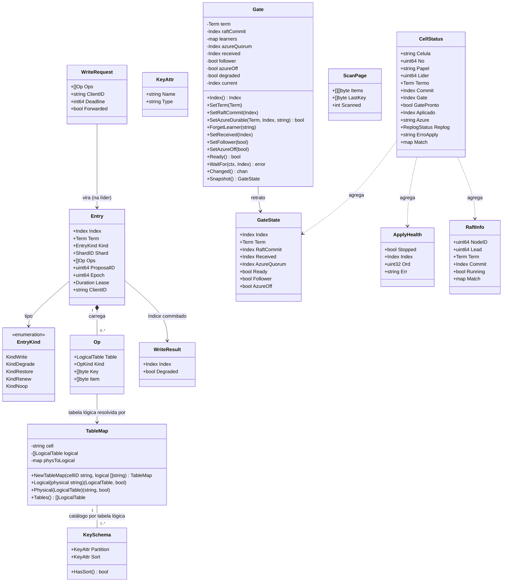

# POC local do DataReplication: três células AWS com Raft, gate, apply e leitura forte

## Requirements

- **Provar, numa máquina local com Docker, o conceito central do DataReplication entre três células AWS**: uma escrita feita em qualquer célula só é confirmada depois de commitada pelo Raft (2 de 3 com fsync), liberada pelo gate e aplicada no banco da célula líder; em seguida as três células aplicam o mesmo item, com a mesma versão (`_dr_v` = índice), cada uma na sua tabela; a leitura forte em qualquer célula devolve o item.
- **Completar o esboço** `doc/05_implementacao/codigo_exemplo` numa pasta própria `DataReplicationApp/`, preservando a arquitetura e os testes existentes, e acrescentar o que falta: Raft real (`etcdraft`), transporte gRPC entre células, `StateStore` do DynamoDB, parser do JSON do DynamoDB, leitura forte, propagação do gate, administração e a ligação de tudo no `bootstrap`.
- **Manter o produto pronto para a Azure sem exercitá-la**: o gate implementa as regras completas (G-01 a G-09) e aceita learners pela configuração; a POC roda com `LEARNERS` vazia no modo sem Azure (G-08), que é explicitamente só da POC.
- **Entregar um ambiente operável por tarefas**: imagem única, `docker-compose.yml` com LocalStack fixado e seis volumes, `taskfile.yaml` com as tarefas da S.5 e um roteiro `e2e` que verifica CA-03 a CA-05.
- **Limites**: um shard; só `PutItem`, `GetItem` e `Scan` da tabela base; sem Azure, dedupe, mTLS, modo degradado ativo, compactação/snapshot do Raft, truncamento do log de replicação, TTL, GSI, métricas. `DeleteItem` e `BatchWriteItem` ficam para a fase 2 e são recusados.
- **Pronto quando**: partindo de volumes vazios, os critérios CA-01 a CA-14 passam e `go test -race ./...` passa no container de teste.

## Entities



Notas de modelagem (conservadoras):
- `Entry`, `Op`, `WriteRequest`, `WriteResult`, `Lease`, `DegradedPolicy` e os tipos de `sendrule.go`/`retention.go` ficam como estão; só entram `KindNoop` e o campo `ProposalID` em `Entry`.
- `Op.Key` é a chave serializada de forma **canônica**: o JSON do DynamoDB só com os atributos da chave, na ordem partição → ordenação (ex.: `{"pk":{"S":"cli-1"}}`). `Op.Item` é o item completo em JSON do DynamoDB, **sem** `_dr_v`.
- O valor zero de `Gate` continua com o comportamento atual (líder, Azure exigida), para não quebrar os testes do esboço.

## Approach

1. **Base de código e arquitetura**:
   - Copiar `doc/05_implementacao/codigo_exemplo` para `DataReplicationApp/` (o esboço permanece intacto como referência) e evoluir em `DataReplicationApp/`. Arquitetura hexagonal já usada: `domain` (só biblioteca padrão) ← `usecase` (depende de `port`) ← `adapter/in|out` ← `bootstrap` (único que importa `fx`) ← `cmd`.
   - Somente `adapter/out/etcdraft` importa `go.etcd.io/raft/v3` e o `wal` do etcd. O transporte (`peergrpc`, `peerclient`) trata mensagens do Raft como `[]byte`.
   - `adapter/out/raftstore` é copiado sem mudanças e **não** é ligado no bootstrap: o laço do Ready segue a RT-04 no modo síncrono (cada `Ready` já agrupa entradas num único `wal.Save` com fdatasync). Registrar no README.
   - Uma única codificação de `Entry`: JSON via `encoding/json` (a mesma que o `replog` já usa), no payload do Raft e no log de replicação.

2. **Gate (G-01 a G-10)**:
   - O `domain.Gate` ganha três entradas: `received` (maior gate recebido da líder), `follower` (papel) e `azureOff` (modo POC).
   - Fórmula: líder → `commit` limitado pela maioria Azure, a não ser que `degraded` ou `azureOff`; follower → `min(commit local, received)`. `current = max(current, next)` mantém a monotonia através das trocas de papel.
   - `Ready()` = `azureOff || degraded || learners confirmados no termo ≥ 2`.
   - O modo sem Azure é ligado só pelo bootstrap quando `LEARNERS` está vazia **e** `POC_SEM_AZURE=true`; sem essa variável, `LEARNERS` vazia derruba a partida (SG-12). Na partida registra um aviso.
   - `GateSync` (usecase) mantém o papel do gate sincronizado com o Raft e, na líder, publica o gate a cada avanço e a cada `GATE_PUBLISH_INTERVAL`; na follower, recebe e aplica `SetReceived`.

3. **Raft (RT-01 a RT-12)**:
   - Partida do zero: snapshot sintético (índice 1, termo 1, `ConfState` com votantes de `PEERS` e learners de `LEARNERS`) gravado no WAL e aplicado ao `MemoryStorage`; `raft.RestartNode` com `Applied = 1`. Partida com WAL existente: reabrir, conferir a `ConfState` gravada com a configuração (RT-10), recarregar HardState e entradas, `Applied` = índice do snapshot.
   - Laço do Ready estritamente na ordem da RT-04; erro de `wal.Save` é fatal (log `Fatal`, saída 1, o Docker reinicia).
   - `Propose` gera um `ProposalID`, registra um waiter e devolve o índice quando a entrada com aquele id é commitada; `raft.ErrProposalDropped` → `usecase.ErrBackpressure`; prazo → `usecase.ErrPending`.
   - Entradas vazias e de `ConfChange` viram `Noop` com o índice e o termo delas.
   - `ReadIndex` só na líder, casando o `ReadState` pelo contexto da requisição.
   - Eventos de learner: `MsgAppResp` sem rejeição vindo de um id da lista de learners vira `LearnerProgress` num canal bloqueante (G-04). Na POC o canal nunca recebe nada.

4. **Apply (AP-01 a AP-10)**:
   - `CommitPump` sem mudanças de comportamento.
   - `Applier` passa a classificar o erro do banco: transitório → repetir com backoff exponencial de 100 ms a 5 s, sem limite, com log a cada tentativa; permanente → **estacionar** (o Applier fica parado na entrada sem pular, `Health()` mostra índice, ordem e erro, `/readyz` cai, o processo continua de pé) até o contexto acabar.
   - `StateStore` do DynamoDB faz `PutItem` condicional por `_dr_v`; `ConditionalCheckFailedException` é sucesso ("já aplicado").
   - Tabela física = lógica com `{cell}` trocado pelo `CELL_ID` local (`TableMap.Physical`).
   - `Checkpointer` igual ao esboço, com um `RaftCompactor` que não faz nada e registra em log.

5. **Leitura forte (A.6)**:
   - `ReadService` (usecase): na líder, conferir `Gate.Ready()` (senão `ErrGateNotReady`), `ReadIndex`, ler o gate **depois**; na follower, `BarrierClient.Barrier` na líder (ReadIndex e gate na mesma resposta). Esperar `Applier.WaitApplied(min(readIndex, gate))`, ler a tabela local com leitura consistente e tirar `_dr_v`.
   - Uma barreira por chamada (cada página do `Scan` é uma chamada).
   - Prazo esgotado na espera → `ErrReadTimeout` (503 `READ_TIMEOUT`); sem líder → `ErrNoLeader` (503 `NO_LEADER`).

6. **Borda HTTP compatível com DynamoDB**:
   - O parser devolve uma requisição tipada por operação (`PutItem`, `GetItem`, `Scan`) e faz **toda** a validação antes de qualquer caso de uso (SG-07): tabela pela lista permitida (`ResourceNotFoundException`), chave completa e com o tipo do `KeySchema`, `_dr_v` proibido, item ≤ 400 KB, parâmetros fora do escopo recusados, `IndexName` recusado (ADR-050), `DeleteItem`/`BatchWriteItem` → "não suportado nesta fase", demais operações → fora do escopo.
   - O handler despacha para `port.Writer` ou `port.Reader`; o 200 do `PutItem` traz `x-dr-index`; os erros seguem o formato `__type`/`message` do esboço, com 503 + `x-dr-code`.

7. **Encaminhamento e transporte**:
   - gRPC sem `.proto`: `api/peerv1` declara à mão o serviço `datareplication.peer.v1.Peer` com quatro métodos unários (`Step`, `Forward`, `ReadBarrier`, `GateUpdate`) e um codec JSON forçado em cliente e servidor.
   - O `Forward` preserva a **classe** do resultado (`OK` com índice, `NO_LEADER`, `PENDING`, `THROTTLING`, `LEASE_EXPIRED`, `INTERNAL`); o cliente reconstrói o erro do usecase correspondente. Prazo do `Forward` esgotado → `ErrPending`.
   - Mensagens do Raft: uma fila por par (4096 mensagens) com descarte quando cheia e `ReportUnreachable`; `GateUpdate`: um slot por par que guarda só o valor mais recente (nunca bloqueia, nunca perde o último).

8. **Configuração, administração e operação**:
   - `config` com viper (`AutomaticEnv`) alimentando a função pura `LoadFrom(getenv)`, que concentra a validação e continua testável.
   - `adminhttp` com `net/http`: `/livez`, `/readyz`, `/status` a partir de um `StatusReporter` do usecase.
   - Erros fatais de qualquer laço de fundo (`etcdraft.Run`, `CommitPump.Run`, `Checkpointer.Run`, `GateSync.Run`) → `log.Fatal` → saída 1 → `restart: on-failure`. O Applier estacionado não é fatal.
   - Testes de integração com o LocalStack só rodam com `DR_IT_DYNAMODB_ENDPOINT` definida; sem ela, `t.Skip`, para o `go test -race ./...` do CA-14 passar sem LocalStack.
   - CA-07 é verificado depois que a líder isolada perde a liderança pelo `CheckQuorum` (esperar ≥ 3 s depois de parar as duas células): a escrita então recebe `NO_LEADER` sem propor nada. Uma escrita que recebeu `PENDING` é "resultado desconhecido" e **pode** aparecer depois que o quórum volta; isso é documentado, não é defeito.

## Structure

### Inheritance Relationships
1. `port.ConsensusEngine` interface define o motor de consenso; `etcdraft.Node` implementa `port.ConsensusEngine`, `port.RaftCompactor` (não faz nada), `port.RaftInbound` e `port.RaftStatus`.
2. `port.StateStore`, `port.Scanner` e `port.Catalog` interfaces definem o banco da célula; `dynamodb.Store` implementa as três (o catálogo é carregado por `Store.LoadCatalog`).
3. `port.ReplicationLog` e `port.ApplyProgress`: `replog.Log` implementa (já existe).
4. `port.Forwarder`, `port.BarrierClient` e `port.GatePublisher` interfaces; `peerclient.Client` implementa as três e também `etcdraft.Sender`.
5. `port.Writer` (entrada): `usecase.WriteService` implementa (já existe). `port.Reader` (entrada): `usecase.ReadService` implementa.
6. `port.AppliedWaiter`: `usecase.Applier` implementa (já existe).
7. `peerv1.PeerServer` interface (contrato gRPC); `peergrpc.Server` implementa.
8. `usecase.Degrader`: `usecase.DegradeService` implementa (já existe; na POC com `reject`).
9. Erros: `dynamohttp.APIError` (já existe) para erros de borda; erros sentinela do usecase (`ErrPending`, `ErrNoLeader`, `ErrBackpressure`, `ErrLeaseExpired` existentes; `ErrNotLeader`, `ErrGateNotReady`, `ErrReadTimeout` novos); erros sentinela de porta `port.ErrStoreTransient` e `port.ErrStorePermanent` (embrulhados com `%w`).

### Dependencies
1. `dynamohttp.Server` chama `port.Writer` e `port.Reader`, e usa `dynamohttp.Parser`, que depende de `domain.TableMap` e `port.Catalog`.
2. `usecase.WriteService` depende de `port.ConsensusEngine`, `port.Forwarder`, `*domain.Gate`, `port.AppliedWaiter`, `usecase.Degrader` (sem mudanças).
3. `usecase.ReadService` depende de `port.ConsensusEngine`, `*domain.Gate`, `port.AppliedWaiter`, `port.BarrierClient`, `port.StateStore`, `port.Scanner`.
4. `usecase.GateSync` depende de `port.ConsensusEngine`, `*domain.Gate`, `port.GatePublisher`.
5. `usecase.CommitPump` depende de `port.ConsensusEngine`, `port.ReplicationLog`, `*domain.Gate`, `*domain.Lease`, canal para o `Applier`.
6. `usecase.Applier` depende de `*domain.Gate`, `port.StateStore`, `port.ApplyProgress`, canal do `CommitPump`.
7. `usecase.Checkpointer` depende de `port.ReplicationLog` e `port.RaftCompactor`.
8. `usecase.StatusReporter` depende de `port.RaftStatus`, `*domain.Gate`, `*usecase.Applier`, `port.ReplicationLog`, `port.Catalog`.
9. `peergrpc.Server` chama `port.RaftInbound`, `port.Writer` e duas interfaces próprias do pacote: `LeaderBarrier` (implementada por `usecase.ReadService`) e `GateReceiver` (implementada por `usecase.GateSync`).
10. `etcdraft.Node` chama `etcdraft.Sender` (implementado por `peerclient.Client`) para enviar mensagens serializadas.
11. `adminhttp.Server` chama `usecase.StatusReporter`.
12. `bootstrap` liga tudo com `fx`: `New(extra...)` monta o núcleo, `Runtime()` os adaptadores reais e `NewProduction()` os dois; `cmd/datareplication/main.go` chama `NewProduction()` e registra no log o erro de partida (o `fx.NopLogger` esconderia a mensagem da RT-10).

### Layered Architecture
1. Camada de entrada (`adapter/in`): `dynamohttp` (API DynamoDB, parser e validação de borda), `peergrpc` (servidor entre células), `adminhttp` (saúde e estado). Só traduz protocolo.
2. Camada de casos de uso (`usecase`): escrita, leitura forte, apply, bombeamento de commits, sincronização do gate, checkpoint, modo degradado, retrato de estado.
3. Camada de domínio (`domain`): entrada, gate, lease, mapa de tabelas, esquema de chave, regras de retenção e de envio antes do fsync. Só biblioteca padrão.
4. Camada de portas (`port`): contratos entre casos de uso e adaptadores.
5. Camada de saída (`adapter/out`): `etcdraft` (Raft + WAL), `peerclient` (gRPC), `replog` (log de replicação), `dynamodb` (banco da célula).
6. Tratamento de erros: erros sentinela no usecase e nas portas; o mapeamento para HTTP fica **num único lugar** (`dynamohttp.Server.writeError`), e o mapeamento para o fio do `Forward`/`ReadBarrier` num único par de funções em `api/peerv1` (`CodeOf(err)` / `ErrOf(code)`, que importam os sentinelas do usecase).
7. Plataforma (`platform/config`, `platform/logx`) e montagem (`bootstrap`).

Árvore de `DataReplicationApp/`:

```text
DataReplicationApp/
├── Dockerfile
├── docker-compose.yml
├── taskfile.yaml
├── README.md
├── go.mod / go.sum
├── cmd/datareplication/main.go
├── api/peerv1/{peer.go, codec.go, codes.go}
└── internal/
    ├── domain/{entry.go, gate.go, lease.go, tablemap.go, keyschema.go, retention.go, sendrule.go}
    ├── port/ports.go
    ├── usecase/{write.go, read.go, apply.go, replicate.go, checkpoint.go, degrade.go, gatesync.go, status.go}
    ├── adapter/in/{dynamohttp/{handler.go, parser.go, attr.go}, peergrpc/server.go, adminhttp/server.go}
    ├── adapter/out/{etcdraft/{node.go, storage.go, codec.go}, peerclient/client.go, replog/, raftstore/ (copiado, não ligado), dynamodb/{store.go, convert.go, catalog.go}}
    ├── platform/{config/config.go, logx/logx.go}
    └── bootstrap/app.go
```

## Operations

> Ordem obrigatória: O-01 → O-13, com uma exceção de dependência: as portas de O-07a e os erros novos do usecase (`ErrNotLeader`, `ErrGateNotReady`, `ErrReadTimeout`, em `read.go`) entram **antes** de O-03, porque o `etcdraft` os usa. Cada passo termina com `go build ./...` e `go test -race ./...` verdes (no container de teste) antes do seguinte. Comentários e mensagens de log em português.

### O-01 Criar a base - `DataReplicationApp/`
1. Responsabilidade: copiar o esboço e atualizar dependências.
2. Passos:
   - Copiar `doc/05_implementacao/codigo_exemplo/{go.mod,go.sum,internal}` para `DataReplicationApp/`.
   - `go.mod`: `go 1.27`; acrescentar `github.com/spf13/viper`, `google.golang.org/grpc`, `go.etcd.io/raft/v3`, `go.etcd.io/etcd/server/v3`, `go.etcd.io/etcd/client/pkg/v3` (se o `wal` exigir), `github.com/aws/aws-sdk-go-v2/{config,service/dynamodb,credentials}`, `github.com/aws/smithy-go`, `go.uber.org/zap` (logger do `wal`, usar `zap.NewNop()`), `google.golang.org/protobuf` (o `raftpb` da v3.7 usa protobuf-go: campos ponteiro, `proto.Marshal`); `go mod tidy`.
   - Resolver conflitos de versão de `google.golang.org/grpc` com o `etcd/server/v3` na versão que ambos aceitam; registrar a versão escolhida no README.
3. Pronto quando: `go build ./...` e os testes do esboço passam sem alteração.

### O-02a Update Domain - `domain/entry.go`
1. Acrescentar `KindNoop` ao fim do `iota` de `EntryKind` (não renumerar os existentes).
2. Acrescentar `ProposalID uint64` a `Entry`, com comentário: "identificador da proposta, gerado pela líder; casa a entrada commitada com quem a propôs (RT-07). Não é o ClientID do SDK."
3. Atualizar o comentário de `Op.Key`: chave canônica em JSON do DynamoDB, só atributos da chave, partição antes da ordenação.

### O-02b Update Domain - `domain/gate.go`
1. Atributos novos: `received Index`, `follower bool`, `azureOff bool`, `changed chan struct{}` (fechado e trocado a cada avanço de `current`).
2. Métodos novos:
   - `SetReceived(i Index)`: `update(func(){ g.received = max(g.received, i) })`.
   - `SetFollower(on bool)`: `update(func(){ g.follower = on })`. Não zera `received` (é valor já provado).
   - `SetAzureOff(on bool)`: `update(func(){ g.azureOff = on })`. Comentário obrigatório: "SÓ DA POC (G-08, SG-12): com a Azure desligada o ACK vira o commit AWS. Nunca ligar em produção."
   - `Changed() <-chan struct{}`: devolve o canal atual (criando-o se nulo) para quem quer acordar a cada avanço.
   - `Snapshot() GateState`: retrato sob o mutex.
3. `update` passa a calcular:
   - `next := g.raftCommit`
   - se `g.follower`: `next = min(next, g.received)`
   - senão, se `!g.degraded && !g.azureOff`: `next = min(next, g.azureQuorum)`
   - `prev := g.current; g.current = max(g.current, next)`; libera waiters `<= current`; se `current > prev`, fecha `g.changed` e zera.
4. `Ready()`: `g.azureOff || g.degraded || len(g.learners) >= 2`.
5. Testes de tabela novos em `gate_test.go` (com `-race`), além dos existentes:
   - maioria 2 de 3 (G-01): learners (5, 9, 7) → gate = min(commit, 7);
   - termo antigo ignorado (G-03); troca de termo zera progresso e não recua `current` (G-02, G-03);
   - heartbeat não é modelado no domínio: o teste de G-04 fica no `etcdraft` (O-03);
   - `Ready` falso com 1 learner, verdadeiro com 2 (G-07); verdadeiro com `azureOff` (G-08);
   - follower: commit 10, received 6 → 6; received 12 → 10 (G-06); received menor não recua;
   - troca de papel: líder com `current` 8 vira follower com received 5 → `current` continua 8; follower vira líder com `azureOff` e commit 12 → 12;
   - `azureOff` com commit 15 → 15 e `Ready` verdadeiro (G-08);
   - `WaitFor` remove o waiter no prazo (G-09) e `Changed` acorda a cada avanço;
   - valor zero do `Gate` mantém o comportamento antigo (gate parado sem learners).

### O-02c Create Domain - `domain/tablemap.go`
1. Responsabilidade: lista permitida de tabelas e conversão físico ↔ lógico (SG-08, AP-05).
2. `NewTableMap(cellID string, logical []string) (TableMap, error)`:
   - `cellID` não vazio; cada nome não vazio, com `strings.Count(n, "{cell}") == 1`, sem repetição; senão erro com o nome.
   - Monta `physToLogical[strings.Replace(n, "{cell}", cellID, 1)] = LogicalTable(n)`; dois lógicos com o mesmo físico → erro.
3. `Logical(physical string) (LogicalTable, bool)`: busca exata no mapa (nunca troca texto do `CELL_ID` no nome pedido).
4. `Physical(l LogicalTable) (string, bool)`: só para tabelas da lista; troca o marcador `{cell}` pelo `cellID`.
5. `Tables() []LogicalTable`: cópia, na ordem da configuração.
6. Testes: `t1_cell_{cell}` com `CELL_ID=1` → `t1_cell_1` ↔ lógico correto; `cadastro_cliente_cell_1` na célula 2 → não encontrado; nomes sem/duplo `{cell}` e repetidos → erro.

### O-02d Create Domain - `domain/keyschema.go`
1. `KeyAttr{Name string; Type string}` com `Type` em `"S"`, `"N"`, `"B"`.
2. `KeySchema{Partition KeyAttr; Sort KeyAttr}`; `HasSort() bool` = `Sort.Name != ""`; `Names() []string` (partição, depois ordenação).
3. `CanonicalKey(k KeySchema, attrs map[string]json.RawMessage) ([]byte, error)`: monta a chave canônica de `Op.Key` (partição antes da ordenação, valores compactados); atributo ausente → erro. Usado pelo parser e pelo `LastKey` do Scan.
4. Testes de `HasSort`, `Names` e `CanonicalKey`.

### O-03 Implement Adapter - `adapter/out/etcdraft`
1. Responsabilidade: `port.ConsensusEngine` real (RT-01 a RT-11), único importador de `raft` e `wal`.
2. Atributos de `Node`: `id uint64`, `voters []uint64`, `learners []uint64`, `dir string`, `node raft.Node`, `storage *raft.MemoryStorage`, `wal *wal.WAL`, `send Sender`, `committed chan port.CommitBatch` (buffer 1024), `events chan port.LearnerProgress` (buffer 1024, bloqueante), `lead atomic.Uint64`, `term atomic.Uint64`, `commit atomic.Uint64`, `pending map[uint64]chan domain.Index` + mutex, `reads map[string]chan domain.Index` + mutex, `nextProposal atomic.Uint64` (semente `uint64(time.Now().UnixNano())`), `log zerolog.Logger`.
3. `Sender` interface (no próprio pacote): `Send(to uint64, msg []byte) bool` (false = descartado).
4. `Open(cfg Config, send Sender, log zerolog.Logger) (*Node, error)`:
   - `cfg`: `ID`, `Voters`, `Learners`, `Dir`, `TickInterval` (100 ms).
   - Se `!wal.Exist(dir)`: `wal.Create(zap.NewNop(), dir, metadata(id))`; `ConfState{Voters, Learners}`; `w.SaveSnapshot(walpb.Snapshot{Index:1, Term:1, ConfState:&cs})`; `w.Save(HardState{Term:1, Commit:1}, nil)`; `storage.ApplySnapshot(raftpb.Snapshot{Metadata:{Index:1, Term:1, ConfState:cs}})`; `storage.SetHardState`.
   - Senão: `wal.ValidSnapshotEntries` → último snapshot; `wal.Open` nele; `ReadAll` → metadata, HardState, entradas. Conferir metadata = `id`. Conferir `ConfState` do snapshot × configuração (conjuntos ordenados); diferença → erro `"PEERS/LEARNERS diferem do que está gravado no WAL (votantes X, learners Y); rode task limpar"` (RT-10, CA-12). Aplicar snapshot, HardState e entradas ao `MemoryStorage`.
   - `raft.Config{ID, ElectionTick:10, HeartbeatTick:1, Storage, Applied:1, MaxSizePerMsg:1<<20, MaxInflightMsgs:256, MaxUncommittedEntriesSize:32<<20, CheckQuorum:true, PreVote:true, DisableProposalForwarding:true, Logger: adaptador zerolog}`; `raft.RestartNode(cfg)`.
5. `Run(ctx) error` (laço único):
   - ticker de `TickInterval` → `node.Tick()`.
   - `rd := <-node.Ready()`:
     1. `SoftState` não nulo → atualizar `lead`; logar mudança de líder (`lider`, `termo`).
     2. `rd.Snapshot` não vazio → retornar erro "snapshot recebido; a POC não usa snapshots" (RT-11).
     3. `before, after := domain.SplitBeforeSync(isLeader, rd.Messages, kindOf)`; enviar `before`.
     4. `wal.Save(rd.HardState, rd.Entries)`; erro → retornar erro (fatal, RT-05).
     5. `storage.Append(rd.Entries)`; `HardState` não vazio → `storage.SetHardState`, atualizar `term`.
     6. enviar `after` (`MsgSnap` em `after` → logar erro e não enviar).
     7. `rd.ReadStates` → entregar cada `Index` ao waiter de `reads[string(RequestCtx)]`.
     8. `rd.CommittedEntries` → converter (passo 6) num `CommitBatch`; atualizar `commit`; entregar índice aos waiters `pending[ProposalID]` cuja entrada é `KindWrite`; `committed <- batch` (bloqueante, risco 3; com `ctx.Done`).
     9. `node.Advance()`.
   - `send(m)`: `data, _ := m.Marshal()`; `if !s.Send(m.To, data) { node.ReportUnreachable(m.To) }`.
   - `kindOf(m)`: mapear `raftpb.MsgApp`→`domain.MsgApp`, `MsgAppResp`→`MsgAppResp`, votos, pré-votos, heartbeat, `MsgSnap`; resto → `MsgOther`.
6. Conversão de entradas commitadas: `EntryNormal` com `Data` vazio ou `EntryConfChange`/`EntryConfChangeV2` → `domain.Entry{Index, Term, Kind: KindNoop}`; `EntryNormal` com dados → `json.Unmarshal` em `domain.Entry`, sobrescrever `Index` e `Term` com os do Raft; erro de decodificação → retornar erro (fatal).
7. `Propose(ctx, e) (domain.Index, error)`:
   - `e.ProposalID = nextProposal.Add(1)`; registrar `ch := make(chan domain.Index, 1)` em `pending`; `defer` remover.
   - `data, _ := json.Marshal(e)`; `node.Propose(ctx, data)`: `raft.ErrProposalDropped` → `usecase.ErrBackpressure`; erro de contexto → `usecase.ErrPending`.
   - Esperar `ch` ou `ctx.Done()` (→ `usecase.ErrPending`).
8. `ReadIndex(ctx) (domain.Index, error)`: se não for líder → `usecase.ErrNotLeader`; `rctx` = 8 bytes aleatórios; registrar waiter; `node.ReadIndex(ctx, rctx)`; esperar `ReadState` ou prazo (→ `usecase.ErrReadTimeout`).
9. `Step(ctx, msgs [][]byte) error` (`port.RaftInbound`): para cada `data`: `Unmarshal` em `raftpb.Message`; se `Type == MsgAppResp && !Reject && from ∈ learners` → `events <- port.LearnerProgress{Term: m.Term, Index: m.Index, Learner: strconv(from), SentAt: time.Now()}` (bloqueante com `ctx`; G-04); `node.Step(ctx, m)`.
10. Demais: `Leader()` (`lead == 0` → `false`; `NodeID: strconv(lead)`, `Local: lead == id`); `Term()`; `Committed()`; `LearnerEvents()`; `LearnerDurable()` → `nil` na POC; `TransferLeadership(ctx, to)` → `node.TransferLeadership`; `MinPeerMatch()` → 0 e `Compact(upTo)` → só log "compactação desligada na POC" (AP-10); `Status() port.RaftInfo` a partir de `node.Status()` (`Match` só na líder).
11. Testes (`node_test.go`, `-race`): três nós em memória com um `Sender` de canal e diretórios temporários — elege exatamente um líder; `Propose` na líder devolve índice ≥ 2 e as três recebem a mesma entrada em `Committed()` com índices contíguos (Noop incluso); fechar e reabrir um nó reentrega as entradas commitadas; reabrir com `Voters` diferentes falha com a mensagem do `task limpar`; um learner simulado (id 4) produz evento de progresso só para `MsgAppResp` não rejeitado e nunca para `MsgHeartbeatResp` (G-04); `MsgAppResp` e votos nunca saem antes do `wal.Save` (verificado por um `Sender` que registra a ordem e um WAL instrumentado ou pela função `SplitBeforeSync`).

### O-04 Implement Transport - `api/peerv1`, `adapter/in/peergrpc`, `adapter/out/peerclient`
1. `api/peerv1`:
   - `codec.go`: codec `json` (`encoding.Codec` com `Marshal`/`Unmarshal` via `encoding/json`, `Name() = "drjson"`), usado com `grpc.ForceCodec` no cliente e `grpc.ForceServerCodec` no servidor.
   - `peer.go`: tipos `StepRequest{Msgs [][]byte}`, `Empty{}`, `ForwardRequest{Ops []domain.Op; ClientID string; Deadline int64}`, `ForwardResponse{Code string; Index uint64; Message string}`, `BarrierResponse{Code string; ReadIndex uint64; Gate uint64}`, `GateUpdateRequest{Term uint64; Gate uint64; From uint64}`; interface `PeerServer` com os quatro métodos; `ServiceDesc` escrito à mão (`ServiceName: "datareplication.peer.v1.Peer"`); `RegisterPeerServer(s *grpc.Server, impl PeerServer)`; funções de chamada `Invoke*` para o cliente.
   - `codes.go`: constantes `OK`, `NO_LEADER`, `NOT_LEADER`, `PENDING`, `THROTTLING`, `LEASE_EXPIRED`, `GATE_NOT_READY`, `READ_TIMEOUT`, `INTERNAL`.
2. `peergrpc.Server` (implementa `PeerServer`):
   - `Step` → `RaftInbound.Step(ctx, req.Msgs)`.
   - `Forward` → `Writer.Write(ctx, port.WriteRequest{Ops, ClientID, Deadline, Forwarded: true})` com o prazo do contexto gRPC; converte resultado/erro no `Code` (`errors.Is` com os sentinelas do usecase).
   - `ReadBarrier` → `LeaderBarrier.LeaderBarrier(ctx)` → `Code` + `ReadIndex` + `Gate`.
   - `GateUpdate` → `GateReceiver.OnGateUpdate(term, gate)`.
   - O `*grpc.Server` é criado uma vez (`sync.Once`), para `Serve` e `Stop` não correrem.
3. `peerclient.Client` (implementa `etcdraft.Sender`, `port.Forwarder`, `port.BarrierClient`, `port.GatePublisher`):
   - `New(self, peers, forwardTimeout, log, extra ...grpc.DialOption)`: `extra` serve aos testes (dialer em memória).
   - Atributos: `self uint64`, `peers map[uint64]*peer`, `forwardTimeout time.Duration`, `log`. Cada `peer`: `conn *grpc.ClientConn` (insecure, `ForceCodec`), `raftQ chan []byte` (4096), `gateSlot` (valor mais recente + sinal).
   - `Send(to, msg) bool`: `select { case p.raftQ <- msg: return true; default: return false }`. Goroutine por par drena até 256 mensagens por `Step` com prazo de 1 s; erro → log em nível debug e segue.
   - `Forward(ctx, leader string, r)`: contexto com `min(ctx, forwardTimeout)`; log "escrita encaminhada à líder" (`lider`); chama `Forward`; `Code` → erro do usecase (`NO_LEADER`→`ErrNoLeader`, `PENDING`→`ErrPending`, `THROTTLING`→`ErrBackpressure`, `LEASE_EXPIRED`→`ErrLeaseExpired`, `INTERNAL`→erro genérico); erro de transporte ou prazo → `ErrPending`; `OK` → `WriteResult{Index}`.
   - `Barrier(ctx, leader string) (ri, gate domain.Index, err error)`: `NOT_LEADER`/`NO_LEADER` → `ErrNoLeader`; `GATE_NOT_READY` → `ErrGateNotReady`; transporte → `ErrReadTimeout`.
   - `Publish(term, gate)`: grava no slot de cada par (sobrescreve) e sinaliza; goroutine por par envia o valor mais recente com prazo de 1 s.
4. Testes: servidor e cliente em `bufconn` — ida e volta dos quatro métodos; `Forward` preserva cada código; fila cheia faz `Send` devolver `false`; `Publish` repetido entrega o último valor.

### O-05 Implement Adapter - `adapter/out/dynamodb`
1. `convert.go`: conversão JSON do DynamoDB ↔ `types.AttributeValue` para `S`, `N`, `B`, `BOOL`, `NULL`, `M`, `L`, `SS`, `NS`, `BS` (valores `B` em base64); `itemFromJSON([]byte) (map[string]types.AttributeValue, error)` e `itemToJSON(map) ([]byte, error)`; `stripVersion(map)` remove `_dr_v`.
2. `catalog.go` — métodos do `Store` que implementam `port.Catalog`:
   - `LoadCatalog(ctx, wait time.Duration, log) error`: para cada lógica, `DescribeTable(físico)` até `TableStatus == ACTIVE`, tentando a cada 1 s até `wait`; monta `KeySchema` a partir de `KeySchema` + `AttributeDefinitions`; tabela ausente no fim do prazo → erro `"tabela X não encontrada em TABLE_WAIT"`. Log por tabela conferida.
   - `KeySchema(l) (domain.KeySchema, bool)`; `Ready() bool` (todas conferidas).
3. `store.go` — `Store` (implementa `port.StateStore`, `port.Scanner` e `port.Catalog`):
   - `New(ctx, endpoint, region string, tm domain.TableMap)`: `config.LoadDefaultConfig` + `BaseEndpoint` quando `endpoint != ""`.
   - `ApplyBatch(ctx, ops)`: para cada op `OpPut`: físico via `tm.Physical`; item + `_dr_v` (`N`, versão); `PutItem` com `ConditionExpression: "attribute_not_exists(#v) OR #v < :v"`, `#v=_dr_v`, `:v=versão`. `ConditionalCheckFailedException` → `nil`. `OpDelete` → `ErrStorePermanent` "não suportado nesta fase".
   - `Get(ctx, table, key) ([]byte, error)`: `GetItem` com `ConsistentRead: true`; não encontrado → `nil, nil`; tira `_dr_v`.
   - `Scan(ctx, table, limit, startKey) (port.ScanPage, error)`: `Scan` com `ConsistentRead: true`, `Limit` (se > 0), `ExclusiveStartKey`; tira `_dr_v` de cada item; `LastKey` em JSON canônico.
   - `classify(err) error`: `smithy.APIError` com código `ProvisionedThroughputExceededException`, `ThrottlingException`, `RequestLimitExceeded`, `InternalServerError`, `ServiceUnavailable`, `LimitExceededException` ou sem `APIError` (rede) → `fmt.Errorf("%w: %v", port.ErrStoreTransient, err)`; qualquer outro → `port.ErrStorePermanent`.
4. Testes de integração (só com `DR_IT_DYNAMODB_ENDPOINT`): criar tabela temporária; apply com versão 5 e depois 3 → item fica com 5; reaplicar 5 → sucesso; `Get`/`Scan` não trazem `_dr_v`; `DescribeTable` monta o `KeySchema`. Testes de unidade de `convert.go` e `classify` sem rede.

### O-06 Implement Edge - `adapter/in/dynamohttp`
1. `parser.go` — `Parser{Tables domain.TableMap; Catalog port.Catalog}`; `Parse(target string, body []byte) (Request, error)`; `Request{Op string; Write port.WriteRequest; Table domain.LogicalTable; Key []byte; Limit int; StartKey []byte}`. Todo texto é copiado do corpo (decodificação para structs próprias; nada de `json.RawMessage` apontando para o buffer do `fasthttp`, N-06).
   - Target sem prefixo `DynamoDB_20120810.` → 400 `UnknownOperationException`.
   - `DeleteItem`, `BatchWriteItem` → 400 `ValidationException` `"operação não suportada nesta fase (fase 2)"` (CA-13).
   - `UpdateItem`, `Query`, `TransactWriteItems`, `TransactGetItems`, `BatchGetItem` e demais → 400 `ValidationException` `"operação fora do escopo do DataReplication"`.
   - Comum: `TableName` → `Tables.Logical`; ausente → 400 `ResourceNotFoundException` `"Requested resource not found"` (CA-10); `KeySchema` do catálogo.
   - `PutItem`: `Item` presente; cada valor de atributo com exatamente um tipo conhecido e bem formado (`N` numérico válido, `B` base64 válido, conjuntos não vazios e sem repetição); atributos da chave presentes e com o tipo do `KeySchema` (senão 400 `"One or more parameter values were invalid: Missing the key pk in the item"` / `"Type mismatch for key pk"`); `_dr_v` presente → 400 `"o atributo _dr_v é reservado"`; tamanho (soma de bytes de nomes e valores) > 400 KB → 400 `"Item size has exceeded the maximum allowed size"`; `ConditionExpression`, `Expected`, `ConditionalOperator`, `ExpressionAttributeNames`, `ExpressionAttributeValues` presentes ou `ReturnValues` ≠ `NONE` → 400 `"parâmetro fora do escopo: X"`. Monta `Op{Table, OpPut, Key canônica, Item}`.
   - `GetItem`: `Key` com exatamente os atributos do `KeySchema` e tipos certos; `ProjectionExpression`, `AttributesToGet`, `ExpressionAttributeNames` → 400. `ConsistentRead` é ignorado (sempre forte, ADR-057).
   - `Scan`: `IndexName` → `ValidateIndex(name, true)`; `FilterExpression`, `ScanFilter`, `Segment`, `TotalSegments`, `ProjectionExpression`, `AttributesToGet`, `ExpressionAttributeNames`, `ExpressionAttributeValues` → 400; `Select` diferente de vazio/`ALL_ATTRIBUTES` → 400; `Limit` < 1 → 400; `ExclusiveStartKey` validada como chave.
2. `handler.go`: `type ParseFunc func(target string, body []byte) (Request, error)`; `New(w port.Writer, r port.Reader, parse ParseFunc, o Options)` (produção passa `(&Parser{…}).Parse`; os testes passam funções simples); erro de parse sem tipo vira 400 `ValidationException`; `handle` despacha por `Request.Op`:
   - `PutItem` → `Writer.Write`; 200 `{}` com header `x-dr-index: <índice>`.
   - `GetItem` → `Reader.Get`; 200 `{"Item": ...}` ou `{}`.
   - `Scan` → `Reader.Scan`; 200 `{"Items": [...], "Count": n, "ScannedCount": n, "LastEvaluatedKey": ...}` (o último só quando houver).
   - `writeError(c, err)`: mapeamento único — `APIError` → status/tipo próprios; `ErrNoLeader` → 503 `NO_LEADER` + `Retry-After: 1`; `ErrPending`/`DeadlineExceeded` → 503 `PENDING`; `ErrBackpressure` → 400 `ThrottlingException`; `ErrLeaseExpired` → 503 `LEASE_EXPIRED`; `ErrGateNotReady` → 503 `GATE_NOT_READY`; `ErrReadTimeout` → 503 `READ_TIMEOUT`; resto → 500 `InternalServerError`.
3. Testes: cada recusa de CA-10 e CA-13 (com um `Writer` falso que falha se for chamado — nada é proposto); `t1_cell_1` (SG-08); `x-dr-index` no 200; `_dr_v` nunca na resposta de leitura; JSON de erro válido com aspas na mensagem.

### O-07a Update Port - `port/ports.go`
1. `StateStore`: `ApplyBatch(ctx, ops []VersionedOp) error`; `Get(ctx, table domain.LogicalTable, key []byte) ([]byte, error)` (sem `consistent`); **remover** `AppliedIndex`.
2. Novas: `Scanner{Scan(ctx, table, limit int, startKey []byte) (ScanPage, error)}`; `ScanPage`; `Catalog{KeySchema(domain.LogicalTable) (domain.KeySchema, bool); Ready() bool}`; `BarrierClient{Barrier(ctx, leader string) (domain.Index, domain.Index, error)}`; `GatePublisher{Publish(term domain.Term, gate domain.Index)}`; `RaftInbound{Step(ctx, msgs [][]byte) error}`; `RaftStatus{Status() RaftInfo}`; `RaftInfo`.
3. `Reader`: `Get(ctx, table, key) ([]byte, error)` e `Scan(ctx, table, limit, startKey) (ScanPage, error)`.
4. Erros: `ErrStoreTransient`, `ErrStorePermanent`.
5. Ajustar os fakes dos testes do esboço às assinaturas novas (só onde mudou).

### O-07b Implement Service - `usecase/read.go`
1. `ReadService{Consensus port.ConsensusEngine; Gate *domain.Gate; Applied port.AppliedWaiter; Barrier port.BarrierClient; Store port.StateStore; Scanner port.Scanner; WaitLeader time.Duration}`.
2. `LeaderBarrier(ctx) (ri, gate domain.Index, err error)`: não é líder → `ErrNotLeader`; `!Gate.Ready()` → `ErrGateNotReady`; `ri := Consensus.ReadIndex(ctx)`; `gate := Gate.Index()` **depois** do `ReadIndex`.
3. `barrier(ctx) (domain.Index, error)`: resolve a líder (mesma espera limitada do `WriteService`, `WaitLeader`); líder local → `LeaderBarrier`; senão `Barrier.Barrier(ctx, leader.NodeID)`; devolve `min(ri, gate)`.
4. `Get(ctx, table, key)`: `b := barrier`; `Applied.WaitApplied(ctx, b)` (prazo → `ErrReadTimeout`); `Store.Get`.
5. `Scan(ctx, table, limit, startKey)`: idem, uma barreira por chamada; `Scanner.Scan`.
6. Erros novos: `ErrNotLeader`, `ErrGateNotReady`, `ErrReadTimeout`.
7. Testes com motor falso: líder espera o apply até `min(ri, gate)`; follower usa o `BarrierClient` e não o gate local; gate não pronto → `ErrGateNotReady`; prazo na espera → `ErrReadTimeout`; sem líder → `ErrNoLeader`.

### O-07c Implement Service - `usecase/gatesync.go`
1. `GateSync{Consensus port.ConsensusEngine; Gate *domain.Gate; Publisher port.GatePublisher; Interval time.Duration; Log zerolog.Logger}`.
2. `Run(ctx) error`: ticker de `Interval`; a cada tick e a cada `Gate.Changed()`:
   - `l, ok := Consensus.Leader()`; `Gate.SetFollower(!(ok && l.Local))`; `Gate.SetTerm(Consensus.Term())`.
   - Se líder local: `Publisher.Publish(term, Gate.Index())`.
   - Se o gate não avançou por 50 ticks com `commit > gate`, log "gate parado" (uma vez por episódio).
3. `OnGateUpdate(term, gate)`: `Gate.SetReceived(gate)` (o commit local continua limitando).
4. Testes: follower não passa do commit local; publica no avanço e no intervalo; troca de papel atualiza `SetFollower`.

### O-07d Update Service - `usecase/apply.go`
1. Atributos novos: `Backoff{Min: 100ms, Max: 5s}`, `Log zerolog.Logger`, `health ApplyHealth` (sob `mu`).
2. Aplicar cada item via `applyItem(ctx, op)`: laço — `err := Store.ApplyBatch`; `nil` → ok; `errors.Is(err, port.ErrStoreTransient)` → log "erro transitório no apply, repetindo" (`indice`, `ordem`, `espera`) e esperar `min(espera*2, Max)` (com `ctx`); outro erro → permanente.
3. Permanente: gravar `health{Stopped: true, Index, Ord, Err}`, log de erro "applier parado: saída humana (ADR-038)", e **bloquear** até `ctx.Done()` (sem consumir mais entradas, sem pular); `Run` devolve `ctx.Err()`.
4. `Health() ApplyHealth`.
5. `Noop` continua só avançando o aplicado.
6. Ajustar `TestPoisonItemStopsTheShard`: o fake devolve `ErrStorePermanent`; esperar `Health().Stopped` com índice 2, `Applied() == 1`, sem item 3 aplicado. Teste novo: transitório duas vezes e depois sucesso → aplica sem parar.

### O-07e Create Service - `usecase/status.go`
1. `StatusReporter{CellID string; NodeID uint64; Raft port.RaftStatus; Gate *domain.Gate; Applier *Applier; Log port.ReplicationLog; Catalog port.Catalog; AzureOff bool}`.
2. `Status() CellStatus`: preenche `celula`, `no`, `papel` (`lider`/`follower`), `lider`, `termo`, `commit`, `gate`, `gatePronto`, `aplicado`, `azure` (`off`/`on`), `replog{ultimo, duravel}`, `erroApply` (com índice e ordem), `match` (só líder).
3. `Ready() (bool, string)`: catálogo pronto, Raft rodando, líder conhecida, applier não parado; devolve o motivo quando falso.

### O-08 Implement Adapter - `adapter/in/adminhttp`
1. `net/http` em `ADMIN_ADDR`: `GET /livez` → 200 `ok`; `GET /readyz` → 200 ou 503 com o motivo; `GET /status` → JSON de `CellStatus` com as chaves em português da S.7.
2. `POST /transferir?para=N` não é implementado (PODE).
3. Teste com `httptest`.

### O-09a Update Config - `platform/config/config.go`
1. Campos novos: `NodeID uint64`, `Peers map[uint64]string`, `Learners map[uint64]string`, `Tables []string`, `DynamoEndpoint`, `AWSRegion`, `PeerAddr` (`:7000`), `RaftDir` (`/var/lib/dr/raft/wal`), `ReplogDir` (`/var/lib/dr/replog`), `TableWait` (120 s), `GatePublishInterval` (100 ms), `ReplogSyncInterval` (1 s), `POCNoAzure bool` (`POC_SEM_AZURE`). Remover `WALDir`.
2. Regras (todas acumuladas em `errs`): `NODE_ID` inteiro > 0; `PEERS` no formato `id=host:porta` separado por vírgula, ids únicos, contém `NODE_ID`; `LEARNERS` vazia ou exatamente 3 ids, disjuntos de `PEERS`; `LEARNERS` vazia sem `POC_SEM_AZURE=true` → erro "LEARNERS vazia só é aceita na POC (POC_SEM_AZURE=true)" (SG-12); `TABLES` não vazia e cada nome com exatamente um `{cell}`; `AWS_REGION` obrigatória; manter todas as regras atuais (prazos SG-11, `DEGRADED_POLICY`, variáveis do modo eventual, `DEGRADE_AFTER` com padrão 2 s).
3. `Load()`: `v := viper.New(); v.AutomaticEnv(); return LoadFrom(v.GetString)`. `IDs(map[uint64]string) []uint64` devolve os ids em ordem (votantes e learners para o `etcdraft`).
4. Testes: casos válidos e cada erro novo; testes existentes continuam.

### O-09b Update Bootstrap - `bootstrap/app.go` e `cmd/datareplication/main.go`
1. Provedores: `config.Load`; logger com `celula` e `no`; `domain.TableMap`; `*domain.Gate` com `SetAzureOff(len(Learners)==0)` (log de aviso "POC sem Azure: gate = commit do Raft; nunca usar em produção"); `*replog.Log` (`replog.Open(ReplogDir, 64<<20)`) como `port.ReplicationLog` e `port.ApplyProgress`; `*dynamodb.Store` (`StateStore`, `Scanner`); `*dynamodb.Catalog`; `*peerclient.Client`; `*etcdraft.Node` como `ConsensusEngine`, `RaftCompactor`, `RaftInbound`, `RaftStatus`; canal `chan []domain.Entry` (buffer 4096) entre `CommitPump` e `Applier`; `*usecase.Applier` como `AppliedWaiter`; `WriteService`, `ReadService`, `GateSync`, `CommitPump`, `Checkpointer` (`Interval = ReplogSyncInterval`, `Retention = nil`), `StatusReporter`, `DegradeService` (existente); `Parser`, `dynamohttp.Server`, `peergrpc.Server`, `adminhttp.Server`.
2. `fx.StartTimeout(5m)` (cabe o `TABLE_WAIT`). Ordem de `OnStart`: admin HTTP (para `/livez`) → `Store.LoadCatalog` com `TableWait` (erro → falha a partida) → servidor gRPC → `etcdraft.Run`, `CommitPump.Run`, `Applier.Run`, `Checkpointer.Run`, `GateSync.Run` em goroutines com um contexto cancelado no `OnStop` → API DynamoDB. Erro não-`context.Canceled` de qualquer laço → `log.Fatal()`.
3. `OnStop`: API → gRPC → cancelar laços e **esperar** que parem → `replog.Close` → fechar o WAL e o cliente gRPC.
4. `main.go`: `bootstrap.NewProduction()`; `app.Err()` e `app.Start` com erro → `log.Fatal` com a causa (CA-12 precisa da mensagem); espera o sinal e para com prazo de 30 s.
5. `logx.New()` em nível `info` (o `debug` da compactação desligada não polui o log).
6. Testes: grafo de produção com `fx.ValidateApp`; testes existentes do bootstrap ajustados (substitutos para `Reader` e `ParseFunc`, variáveis novas); `LEARNERS` vazia sem `POC_SEM_AZURE` falha.

### O-10 Create Image - `DataReplicationApp/Dockerfile`
1. Estágio `build`: `FROM golang:1.27-alpine`; `WORKDIR /src`; copiar `go.mod`/`go.sum`; `RUN --mount=type=cache,target=/go/pkg/mod go mod download`; copiar o resto; `RUN --mount=type=cache,target=/go/pkg/mod --mount=type=cache,target=/root/.cache/go-build CGO_ENABLED=0 go build -trimpath -o /out/datareplication ./cmd/datareplication`.
2. Estágio `test`: `FROM golang:1.27` (Debian; o `-race` exige CGO e glibc); mesmos caches; `CGO_ENABLED=1 go test -race -count=1 ./...`.
3. Estágio final: `FROM alpine:3.22`; `adduser -D -u 10001 dr`; `mkdir -p /var/lib/dr/raft /var/lib/dr/replog && chown -R 10001:10001 /var/lib/dr`; copiar o binário; `USER 10001`; `EXPOSE 8000 7000 9090`; `HEALTHCHECK --interval=5s --timeout=2s CMD wget -qO- http://127.0.0.1:9090/livez || exit 1`; `ENTRYPOINT ["/usr/local/bin/datareplication"]`.
4. Pronto quando: `docker build .` e `docker build --target test .` passam.

### O-11 Create Compose - `DataReplicationApp/docker-compose.yml`
1. `x-dr-env`: `PEERS: 1=cell-1:7000,2=cell-2:7000,3=cell-3:7000`, `LEARNERS: ""`, `POC_SEM_AZURE: "true"`, `TABLES: cadastro_cliente_cell_{cell}`, `DYNAMODB_ENDPOINT: http://localstack:4566`, `AWS_REGION: sa-east-1`, `AWS_ACCESS_KEY_ID: test`, `AWS_SECRET_ACCESS_KEY: test`, `DEGRADED_POLICY: reject`, `TABLE_WAIT: 120s`, `GATE_PUBLISH_INTERVAL: 100ms`, `REPLOG_SYNC_INTERVAL: 1s`, `RAFT_DIR: /var/lib/dr/raft/wal`, `REPLOG_DIR: /var/lib/dr/replog`.
2. `localstack`: `image: localstack/localstack:4.14.0`, `SERVICES=dynamodb`, `4566:4566`, healthcheck `curl -fs http://localhost:4566/_localstack/health`.
3. `cell-1` com `build: .` e `image: datareplication-poc:local`; `cell-2` e `cell-3` só com `image: datareplication-poc:local`; todas com `pull_policy: never` (a imagem é local); cada uma com `<<: *dr-env` mais `CELL_ID`/`NODE_ID`; portas `800N:8000` e `909N:9090`; volumes `cell-N-raft:/var/lib/dr/raft` e `cell-N-replog:/var/lib/dr/replog`; `depends_on: localstack: condition: service_healthy`; `restart: on-failure`.
4. Seis volumes nomeados com `driver: local`; uma rede padrão.
5. Pronto quando: `docker compose config` sem erro.

### O-12 Create Taskfile - `DataReplicationApp/taskfile.yaml`
1. `version: '3'`; `silent: true`; `vars`: `CELLS: "1 2 3"`, `AWS: aws`, `AWS_MAX_ATTEMPTS: "1"`, `CELL: "1"`, `LOCALSTACK: http://localhost:4566`; `env`: `AWS_ACCESS_KEY_ID=test`, `AWS_SECRET_ACCESS_KEY=test`, `AWS_REGION=sa-east-1`, `AWS_PAGER=""`, `AWS_MAX_ATTEMPTS={{.AWS_MAX_ATTEMPTS}}`.
2. Tarefas:
   - `subir`: `docker compose up -d --build`; `task: criar-tabelas`; laço por `CELLS` esperando `curl -fs http://localhost:909N/readyz` até 60 s, falhando com mensagem clara.
   - `criar-tabelas`: para cada N, `describe-table` no LocalStack; se não existir, `create-table` com `pk` S HASH e `PAY_PER_REQUEST`; depois `aws dynamodb wait table-exists` (CA-02).
   - `escrever`: `vars: PK: 'cli-{{(now).UnixNano}}'`; `put-item --endpoint-url http://localhost:800{{.CELL}} --table-name cadastro_cliente_cell_{{.CELL}}` com o item fixo da seção E e `--debug 2> <arquivo temporário>`; extrair `x-dr-index` dos cabeçalhos de resposta impressos pelo `--debug`; imprimir `pk=<PK> indice=<N>`; sair com o código do `put-item`.
   - `buscar`: para cada N, imprimir `== cadastro_cliente_cell_N (célula N) ==` e `scan --consistent-read --endpoint-url http://localhost:800N`.
   - `ler`: exige `PK`; para cada N, imprimir a célula e `get-item --key '{"pk":{"S":"{{.PK}}"}}'` no endpoint da célula N.
   - `inspecionar`: para cada N, imprimir a tabela e `scan` direto no `{{.LOCALSTACK}}` (com `_dr_v`).
   - `status`: `curl -s http://localhost:909N/status` para cada N.
   - `wal`: `docker compose exec cell-{{.CELL}} ls -la /var/lib/dr/raft/wal /var/lib/dr/replog`.
   - `logs`: `docker compose logs -f`. `parar`: `docker compose down`. `limpar`: `docker compose down -v`.
   - `testar`: `docker build --target test .` (CA-14).
   - `e2e`: `subir`; `escrever` e capturar `pk` e índice; `buscar` com `--query` (JMESPath, sem `jq`) e conferir a `pk` e os quatro campos nas três células; `ler` e conferir o mesmo item sem `_dr_v`; `inspecionar` até 2 s (repetindo a cada 250 ms) e conferir o mesmo `_dr_v` = índice nas três tabelas; qualquer divergência → `echo "FALHOU: <o quê>"` e `exit 1`.
3. Pronto quando: `task e2e` passa a partir de `task limpar`.

### O-13 Create Docs - `DataReplicationApp/README.md`
1. Pré-requisitos (Docker com Compose v2, Task v3, AWS CLI v2; sem Go no host).
2. Tabela de tarefas e o que observar em cada uma.
3. Roteiros manuais de CA-04, CA-07 (parar duas células, **esperar 3 s**, escrever → `NO_LEADER`, `/status` com `commit` e `gate` parados; religar; nova escrita OK; nota de que um `PENDING` pode aparecer depois), CA-08, CA-09, CA-10, CA-12, CA-13.
4. Decisões da POC: modo sem Azure (G-08) e `POC_SEM_AZURE`; `raftstore` não ligado; codec JSON no gRPC; versões de `grpc`/`etcd` escolhidas; riscos 1 a 8 da especificação.

## Norms

1. **Arquitetura e dependências**: `adapter → usecase → domain` e `adapter → port`; `domain` só com biblioteca padrão; só `etcdraft` importa `go.etcd.io/raft/v3` e o `wal`; só `bootstrap` e `cmd` importam `fx`; bibliotecas limitadas à N-01 (mais `smithy-go`, `zap` e `aws-sdk-go-v2/credentials`, exigidas pelas outras, justificadas no README).
2. **Injeção de dependências**: structs com campos exportados preenchidos pelo `bootstrap` (padrão do esboço); provedores `fx` com `fx.Annotate(..., fx.As(new(port.X)))` para expor portas; nada de estado global.
3. **Tratamento de erros**:
   - Erros de negócio são sentinelas no `usecase` (`ErrPending`, `ErrNoLeader`, `ErrNotLeader`, `ErrBackpressure`, `ErrLeaseExpired`, `ErrGateNotReady`, `ErrReadTimeout`) e nas portas (`ErrStoreTransient`, `ErrStorePermanent`); contexto acrescentado com `fmt.Errorf("...: %w", err)` e conferido com `errors.Is`/`errors.As`.
   - Erros de borda são `dynamohttp.APIError{Status, Type, Message}`.
   - Mapeamento para HTTP só em `dynamohttp.Server.writeError`, no formato `{"__type":"com.amazonaws.dynamodb.v20120810#<Tipo>","message":"..."}` serializado com `encoding/json`; 503 sempre com `x-dr-code`.
   - Mapeamento para o fio do `Forward`/`ReadBarrier` só nos códigos de `api/peerv1`.
   - Erros fatais (fsync, log de replicação, laços parados) → `log.Fatal()`; nunca `panic` no caminho normal.
4. **Validação**: toda validação de requisição externa acontece no parser, antes de qualquer `Propose`; a configuração é validada inteira na partida e reúne todos os erros com `errors.Join`.
5. **Logs**: `zerolog` JSON no stdout com `celula`, `no` e, onde houver, `termo`; nada de log por requisição no caminho quente; logs obrigatórios: mudança de líder, gate parado, encaminhamento, erro e repetição do applier, aviso do modo sem Azure, tabela conferida, compactação desligada. Mensagens em português.
6. **Concorrência**: estado compartilhado protegido por `sync.Mutex` ou `atomic`; esperas sempre com `select` em `ctx.Done()`; waiters removidos no prazo (G-09); canais com dono claro de fechamento.
7. **Testes**: `go test -race -count=1 ./...`; testes de tabela no domínio; fakes à mão no próprio pacote de teste (padrão `fakes_test.go`); integração com LocalStack só com `DR_IT_DYNAMODB_ENDPOINT`; todo estrutura compartilhada com teste `-race` (N-08).
8. **Documentação**: comentário de pacote em cada pacote novo; comentários citam a regra (G-xx, RT-xx, AP-xx, SG-xx, ADR-xxx) que o código cumpre; comentários e textos em português.
9. **fasthttp**: nada que aponte para o buffer da requisição sobrevive ao handler (N-06).

## Safeguards

1. **Restrições funcionais**:
   - Nenhum ACK (200 do `PutItem`) antes de commit do Raft (2 de 3), `gate >= índice` e apply na célula da líder (SG-01).
   - Em toda célula, `aplicado <= gate` sempre; a follower nunca aplica além de `min(commit local, gate recebido)` (SG-02, G-06).
   - Só `PutItem`, `GetItem` e `Scan` da tabela base são atendidos; `DeleteItem`/`BatchWriteItem` → 400 "não suportado nesta fase"; demais → 400 fora do escopo.
   - Toda leitura é forte: barreira por chamada, follower sempre pergunta à líder, nunca usa gate guardado.
   - Nenhuma resposta de leitura contém `_dr_v`.
2. **Restrições de desempenho e tempo**:
   - `/readyz` das três células em até 60 s depois de `task subir` com a imagem já construída (CA-01).
   - Nova líder em até 5 s após parar a líder (CA-09), com `ElectionTick` 10 × 100 ms.
   - Item nas três tabelas físicas em até 2 s após o ACK (CA-03).
   - Laço do Ready nunca bloqueia em rede (filas por par que descartam, SG-10); o envio de `GateUpdate` nunca bloqueia e nunca perde o valor mais recente.
3. **Restrições de segurança**:
   - Só credenciais de teste (`test`/`test`) em arquivos; nenhuma credencial real (SG-13).
   - Sem TLS entre células e sem mTLS na API: aceitável **só** na POC.
   - Nada de `git push` sem pedido do Bruno.
   - Imagem roda como uid 10001, não root.
4. **Restrições de integração**:
   - LocalStack fixado em `localstack/localstack:4.14.0` (SG-14).
   - AWS CLI chamado com `AWS_MAX_ATTEMPTS=1` em toda tarefa que fala com o DR (T-05).
   - `PEERS`, `LEARNERS` e `POC_SEM_AZURE` idênticos nas três células (bloco `x-` do compose).
   - Compatibilidade com o AWS CLI v2: respostas e erros no formato JSON 1.0 do DynamoDB.
5. **Regras de negócio**:
   - Gate monotônico; progresso de learner só no termo atual; troca de termo descarta o progresso (SG-04).
   - Modo sem Azure só com `LEARNERS` vazia **e** `POC_SEM_AZURE=true`; aviso na partida; `/status` com `azure: "off"`; comentário "nunca em produção" no código (SG-12).
   - Apply sempre condicional por `_dr_v`; reaplicar nunca regride um item (SG-06).
   - Nome lógico só pela lista permitida; nunca troca de texto do `CELL_ID` no nome pedido (SG-08).
   - Escrita encaminhada no máximo uma vez; a follower devolve a mesma classe de resultado da líder.
   - Uma resposta `PENDING` é "resultado desconhecido": a entrada pode ser commitada depois que o quórum volta. CA-07 é verificado só depois que a líder isolada perde a liderança.
6. **Tratamento de exceções**:
   - Todo erro de API tem tipo DynamoDB e mensagem clara; 503 sempre com `x-dr-code` (`NO_LEADER`, `PENDING`, `LEASE_EXPIRED`, `GATE_NOT_READY`, `READ_TIMEOUT`).
   - Mensagens de erro não expõem caminhos de arquivo, endereços internos nem pilhas; o 500 é sempre "internal error".
   - Erro de `wal.Save` ou do log de replicação derruba o processo (SG-05); nunca se repete o fsync.
   - Erro permanente do banco estaciona o applier daquela célula (processo de pé, `/readyz` 503, `/status` com `erroApply`); erro transitório é repetido sem limite com backoff de 100 ms a 5 s.
   - Snapshot recebido de um par é erro (RT-11).
7. **Restrições técnicas**:
   - Go 1.27, módulo `example.com/datareplication`; build com `CGO_ENABLED=0 -trimpath`; testes com `-race` no estágio `test` (Debian).
   - Ordem do Ready exatamente como na RT-04; só o `MsgApp` da líder sai antes do fsync (SG-03).
   - Parâmetros do Raft da RT-06, incluindo `DisableProposalForwarding`.
   - WAL num subdiretório do volume (`/var/lib/dr/raft/wal`, C-04).
   - Configuração diferente da `ConfState` gravada impede a partida com mensagem pedindo `task limpar` (RT-10).
   - Sem snapshot nem compactação do Raft; `Compact` só registra em log.
   - Prazos em cascata: `REQUEST_DEADLINE < CLIENT_TIMEOUT`, `FORWARD_TIMEOUT < REQUEST_DEADLINE`, `WAIT_LEADER <= FORWARD_TIMEOUT`, `DEGRADE_AFTER < REQUEST_DEADLINE` (SG-11).
   - Testes do esboço continuam passando; só mudam onde a interface mudou (`StateStore.Get`, `Reader`, `Applier` com erro permanente, grafo do bootstrap).
8. **Restrições de dados**:
   - Tabelas `cadastro_cliente_cell_{1,2,3}` com `pk` String HASH, sem ordenação, sem índices, `PAY_PER_REQUEST`.
   - Item do cadastro: `pk` = `cli-<nanossegundos>` gerado pelo Task, `nome=Maria`, `sobrenome=Silva`, `email=maria.silva@exemplo.com`, `contato=+55 11 91234-5678`.
   - `_dr_v` (N) = índice da entrada; atributo reservado, recusado na entrada.
   - Item ≤ 400 KB; chave presente com o tipo do `KeySchema`.
   - Índices contíguos no log de replicação (entradas vazias viram `Noop`); a primeira entrada útil tem índice ≥ 2.
9. **Restrições de API**:
   - API DynamoDB em `:8000` (host `800N`), `X-Amz-Target: DynamoDB_20120810.<Operação>`, `Content-Type: application/x-amz-json-1.0`.
   - 200 do `PutItem` com `x-dr-index`.
   - Admin em `:9090` (host `909N`): `/livez`, `/readyz`, `/status` com as chaves da S.7.
   - gRPC em `:7000`, não publicado no host; serviço `datareplication.peer.v1.Peer` com exatamente `Step`, `Forward`, `ReadBarrier`, `GateUpdate`.
