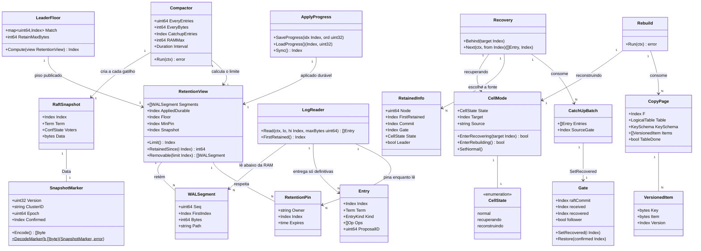

# Compactação do log do Raft na POC: snapshot-marcador, RAM e disco limitados, partida pela cauda, recuperação e reconstrução

## Requirements

- **Limitar a memória, o disco e o tempo de partida do log do Raft** em cada célula da POC (3 células AWS), sem perder ACK (RPO=0 contra a perda de uma célula) e sem que uma réplica atrasada tenha o índice do Raft à frente do banco dela. É a correção do OOM da POC atual (RT-11 e AP-10 antigos: memória e WAL crescendo para sempre).
- **Implementar tudo o que a decisão DO pede**: snapshot-marcador sem dados, compactação da RAM e do disco, partida relendo só desde o último snapshot, `GOMEMLIMIT` e `mem_limit`, teto de bytes na RAM, canal de recuperação (`Retained` e `CatchUp`) e reconstrução por cópia da tabela (`CopyTable`). Os IDs da trecho continuam valendo: RT-09 alterado, RT-11 substituído, RT-14 a RT-20, AP-01, AP-06 e AP-10 alterados, AP-15 a AP-19, SG-18 a SG-23 e CA-20 a CA-27.
- **Entregar em dois incrementos, cada um seguro sozinho.** No **Incremento A** (O-30 a O-37) entram o `LogReader`, o `Compactor`, a identidade, a partida pela cauda e o tratamento do `MsgSnap` nos dois sentidos, sem quedas: o marcador é aceito com aplicado ≥ S e descartado com aplicado < S. Isso resolve o OOM e o disco. O **Incremento B** (O-38 a O-44) acrescenta a recuperação, a reconstrução, as tasks novas e os critérios CA-24 a CA-27. Uma célula atrás da cauda no fim do Incremento A fica parada e visível no `/status`, mas não cai.
- **Fechar as lacunas que a análise apontou**, com decisões deste canvas (DC). Essas decisões precisam voltar para a `SPEC_POC_LOCAL.md` e para a trecho pelo `/spdd-sync`:
  - **DC-01**: os dois incrementos acima, com o tratamento do `MsgSnap` já no A.
  - **DC-02**: numa célula follower, o gate é `min(max(commit local, recuperado), recebido)`. O "recuperado" é o confirmado provado pela fonte do `CatchUp`.
  - **DC-03**: o `CommitPump` é o único alimentador do applier. Em `recuperando`, ele lê de uma fonte remota (o `Recovery`) em vez do `LogReader` local.
  - **DC-04**: a reconstrução termina gravando o progresso F com fsync e reiniciando o processo. A partida com progresso válido, mas atrás do disco retido, entra sozinha em `reconstruindo`, em vez de "não subir".
  - **DC-05**: S é o último índice entregue pelo laço **e** avançado (`Advance`), e não o commit publicado. Compactar a RAM até S nunca remove uma entrada que o etcd-raft ainda não processou.
  - **DC-06**: os dados do marcador (`cluster_id`, `epoch` e `confirmado`) ficam num arquivo `snapshot` com CRC e fsync no volume do Raft, porque o snapshot do WAL do etcd só guarda o índice, o termo e a `ConfState`.
  - **DC-07**: o tamanho do segmento do WAL é configurável (`WAL_SEGMENT_BYTES`), e o teto duro aceita um valor absoluto (`RETAIN_DISK_HARD_BYTES`). Sem as duas coisas, a CA-21 e a CA-26 não são reproduzíveis no notebook.
  - **DC-08**: a regra do `Match` na RAM da líder (RT-14) só vale para as followers **dentro da janela**. As tasks de teste forçam o caminho do `MsgSnap`.
  - **DC-09**: a fila de saída por par ganha um teto em bytes (`PEER_QUEUE_BYTES`), para que a memória do processo caiba no `mem_limit`.
  - **DC-10**: o pino da reconstrução na fonte dura até o `CatchUp` da célula reconstruída começar, ou até `REBUILD_PIN_TTL` (padrão de 5 min) passar sem isso, e não só enquanto dura o fluxo do `CopyTable`.
  - **DC-11** (P-02, aprovada pelo Bruno em 18/10): a reconstrução **sobrescreve no lugar** a tabela que a célula já tem, com o mesmo `PutItem` condicional do apply (`_dr_v` gravado < `_dr_v` copiado). Não apaga nem recria a tabela, e não usa tabela sombra. Um item só anda para frente, e uma tentativa abortada deixa a tabela pelo menos como estava. A tabela é a da IaC/`create-tables`; a aplicação não precisa de `DeleteTable` nem de `CreateTable`. Dois limites aceitos: (1) um item apagado na fonte continuaria vivo na célula, o que hoje não acontece porque não há `DeleteItem` (AP-19); a lápide com `_dr_v` fica para quando o delete entrar; (2) com uma história diferente (`cluster_id` ou `epoch` da fonte diferente do marcador local), a sobrescrita não é segura e a reconstrução é **recusada**, sem alternativa nesta entrega.
  - **DC-12** (P-03, aprovada pelo Bruno em 18/10): **fail-fast do volume do Raft perdido.** Uma célula com o volume do Raft vazio só cria o grupo quando ele está nascendo. Se há qualquer sinal de que o grupo já existe (um par rodando cujo `Genesis` não tem o token de partida desta célula, ou a tabela local já com itens), ela **não sobe**: sai com `ErrLostRaftVolume` e um log que aponta para `parklot/adr-troca-de-pvc-em-cell-ativa.md`. Na POC, a saída é `task clean`. A devolução segura da célula (remover o ID e adicionar um novo por ConfChange) é a feature `troca-de-pvc-em-cell-ativa`, no parking lot. Fica no Incremento B, porque usa o `Retained`.
  - **DC-18** (da implementação do Incremento B, 24/10): **o buraco do marcador recebido.** Um marcador aceito (RT-18) pula as entradas até o índice dele, que nunca entram no log local. Uma célula que se recuperou assim e depois serve de fonte do `CatchUp` cairia no erro fatal de contiguidade do `LogReader` ao ler uma faixa que atravessa o buraco. O índice do último marcador recebido fica num arquivo ao lado do marcador (`snapshot-recebido`, gravado antes do marcador e do `wal.SaveSnapshot`, para que uma queda só deixe o buraco maior), e o `LogReader.FirstRetained()` nunca fica abaixo dele + 1. A numeração continua depois da DC-17, usada pela observabilidade (`GGQPA-XXX-202610240015`).
  - **DC-19** (da verificação da CA-24, 24/10): **o destino de cada mensagem entre células é conferido no recebimento.** Com containers parando e reiniciando, o Docker reaproveita o IP de um para outro, e a conexão gRPC que uma célula tinha com um par passa a cair noutra célula. Um heartbeat da líder para o par 3 (com `commit = Match[3]`) chegou à célula 1, com o log atrás desse commit, e o etcd-raft entrou em pânico (`tocommit(785) is out of range`), em reinício contínuo. Regras: o `Node.Step` descarta toda mensagem com `To` diferente do próprio nó, com log de taxa limitada `"mensagem do Raft para outro nó descartada"`; o `GateUpdate` leva `To` e é ignorado (sem `Applied` na resposta) quando é para outro nó; o `CatchUp` e o `CopyTable` levam `Node` e respondem `SOURCE_NOT_READY`; o `peerclient.Retained` devolve `ErrSourceGone` quando a resposta vem de outro nó (a pré-partida também informa o `Node`). Destino 0 (célula de versão anterior) é aceito.
  - **DC-20** (da verificação da CA-25, 24/10): **a saída da janela não tem volta.** Na regra da O-31, um par está na janela enquanto os bytes retidos desde o `Match` cabem em `RETAIN_MAX_BYTES`. Com o par parado, os bytes passam do teto por um ciclo, o par sai, o piso sobe e o segmento com o `Match` dele é apagado. No ciclo seguinte, a conta começa do primeiro segmento que sobrou, cabe de novo e o par volta a parecer "na janela", mas o que ele precisa já não existe. Medido: o retido da líder nunca passou de 3 MiB e a janela só fechou depois de 12.800 itens. Regra: `LeaderFloor` também exige `Match + 1 ≥ FirstRetained()`; `Match` 0 (desconhecido, logo depois de uma eleição) segue só a regra dos bytes. O `Compactor` passa a logar cada segmento removido (`"segmento do WAL removido"`, com `limite`, `piso` e `aplicadoDuravel`), uma linha por arquivo.
- **Limites**: um shard, só AWS e sem troca de membros (o RT-10 continua: `PEERS` × `ConfState`). Ficam fora a regra K=1 da Azure, a supressão de candidatura, a promoção, a transferência de liderança, a tabela sombra da D8 e a recriação da tabela do AP-18 (as duas substituídas pela sobrescrita no lugar, DC-11). Sem `DeleteItem` (AP-19). Backup e restauração do banco e do WAL não são deste produto (P-04, 18/10): são feitos por outro escopo. As tasks novas seguem os nomes em inglês do `taskfile.yaml`, com os nomes da spec como `aliases`. Os passos são numerados a partir de O-30, porque O-16 a O-29 já existem no prompt da POC base.
- **Pronto quando**: CA-20 a CA-27 passam (com as adaptações de execução da O-44), os critérios antigos CA-01 a CA-19 continuam passando e `go test -race ./...` passa no container de teste.

## Entities

Notas de modelagem (extensão conservadora do que existe):
- `Entry`, `Op`, `Index`, `Term`, `KeySchema` e `LogicalTable` não mudam.
- `Gate` ganha só o campo `recovered` e dois métodos.
- `ApplyProgress` ganha só `Sync`.
- `ConsensusEngine.CommittedEntries` mantém a assinatura: passa a ler pelo `LogReader` quando o índice não está mais na RAM.
- `RaftSnapshot`, `WALSegment` e `RetentionPin` são tipos internos do `etcdraft`. `SnapshotMarker`, `CellState`, `CellMode` e as funções de retenção (`RetentionView`, `LeaderFloor`) ficam no `domain`, só com a biblioteca padrão.

## Approach

1. **Armazenamento e ciclo de vida do log**:
   - O WAL do etcd continua sendo o único armazenamento durável das entradas. O `MemoryStorage` vira uma cauda limitada. Nenhum `raft.Storage` próprio (alternativa rejeitada pela complexidade).
   - Um `Compactor` por shard, numa goroutine dentro do `etcdraft`, é o único que chama `wal.SaveSnapshot`, `MemoryStorage.CreateSnapshot`, `MemoryStorage.Compact`, `wal.ReleaseLockTo` e a remoção de arquivos. O laço do Ready continua igual ao ADR-060 (gravar, publicar o commit, `Advance`). O único efeito no laço é esperar o mutex do WAL durante um `SaveSnapshot` (SG-22). A exceção explícita é o **recebimento** de um marcador (RT-18), que grava no laço, como faz o etcd.
   - S é o índice avançado (DC-05). O laço guarda num atômico o último índice de `rd.CommittedEntries` **depois** do `Advance`. O gatilho do snapshot conta as entradas e os bytes desde o último S.
   - A ordem do snapshot segue o RT-11: progresso com fsync; arquivo `snapshot` com o marcador (fsync e rename, DC-06); `wal.SaveSnapshot`; `CreateSnapshot`; compactação da RAM; liberação do disco. Uma queda entre os passos só deixa um marcador mais antigo como ponto de partida, o que é seguro.
   - O limite de disco é `min(aplicado durável, piso, menor pino, S)`, calculado no `domain` a partir da lista de segmentos (nome `%016x-%016x.wal` = seq e primeiro índice esperado, tamanho do arquivo). O "aplicado" é o **último progresso com fsync**, nunca a marca d'água em memória.
   - O piso é calculado na líder: o menor `Match` das followers dentro da janela (bytes retidos desde o `Match` ≤ `RETAIN_MAX_BYTES`). Vai às followers no `GateUpdate`, e a follower usa o último valor recebido (0 se nunca recebeu, ou seja, nada é liberado).

2. **Leitura do log e alimentação do applier**:
   - O `LogReader` (no `etcdraft`) é o único leitor. Com o índice na RAM, lê do `MemoryStorage`. Abaixo dela, abre os `.wal` só para leitura (`os.Open`) a partir do último segmento cujo primeiro índice é ≤ `lo` e decodifica com `wal.NewDecoder`. Ele trata os registros `CrcType` (`UpdateCRC`), `EntryType` (buffer com substituição a partir de um índice que reaparece) e `StateType` (libera as entradas ≤ `commit`). Nunca roda no laço. Enquanto lê, registra um pino.
   - O `CommitPump` continua sendo o único dono do cursor e da contiguidade (DC-03). Em `normal`, lê pelo `ConsensusEngine.CommittedEntries`, que agora atravessa a RAM e o disco. Em `recuperando`, lê do `Recovery` (fonte remota) até o alvo e chama `Gate.SetRecovered` com o fim de cada lote antes de entregar (DC-02). O cursor de partida deixa de ser limitado pelo `FirstIndex` da RAM.
   - O applier recebe as entradas pelo mesmo canal, com a mesma regra de gate, versão, marca d'água e progresso. Na partida, a marca d'água começa no progresso (`pIdx − 1`, ou `pIdx` quando a ordem salva é `OrdComplete`), e não em 0. Isso evita um "aplicado" falso na partida, que bloquearia um marcador.

3. **Réplica atrasada (recuperação) e fora da janela (reconstrução)**:
   - Na líder, o `MsgSnap` sai pelo transporte normal: `ReportSnapshot(SnapshotFinish)` se a fila aceitou, `SnapshotFailure` se descartou (RT-17). O relato é feito no enfileiramento: o transporte é assíncrono, e um relato otimista só provoca uma nova sondagem.
   - Na follower, o `Step` olha o `MsgSnap` antes de entregá-lo ao Raft. Com `cluster_id` diferente, descarta e registra erro. Com índice > aplicado, descarta e chama `SnapshotPolicy.Behind(S)`. Com índice ≤ aplicado, entrega. No `handleReady`, um `rd.Snapshot` não vazio grava o arquivo `snapshot`, o `wal.SaveSnapshot`, o `wal.Save` e o `ApplySnapshot`, e publica o commit S (RT-18).
   - `Recovery` (usecase): `Behind(S)` põe a célula em `recuperando` com alvo = max(alvo, S). O `Recovery` pergunta `Retained` aos pares e escolhe a fonte: estado `normal`, primeiro retido ≤ aplicado + 1 e gate > aplicado, preferindo uma follower. Consome o `CatchUp(aplicado + 1, alvo)` e, ao entregar até o alvo, espera a marca d'água alcançá-lo e volta a `normal`. O próximo `MsgSnap` passa pela regra de aceitação. Sem fonte possível, passa a `reconstruindo`.
   - `Rebuild` (usecase): espera o applier ficar ocioso e chama `CopyTable` numa fonte `normal`. A fonte fixa F = aplicado dela e pina F − 1 (DC-10). Antes de copiar, confere a identidade da fonte (`cluster_id` e `epoch` iguais aos do marcador local; senão recusa, DC-11). Por tabela, confere que o `KeySchema` da fonte é igual ao do catálogo local e grava cada item **na tabela que já existe** com o `_dr_v` original pelo apply condicional (AP-04). Nada é apagado (DC-11). No fim, grava o progresso (F, `OrdComplete`) com fsync e devolve `ErrRestartAfterRebuild`, e o processo reinicia (DC-04). Na partida, a célula está atrás da cauda da líder, recebe o `MsgSnap`, entra em `recuperando` a partir de F + 1 e volta a `normal`.
   - Teto duro: na fonte, os pinos de reconstrução são soltos e o fluxo termina com o código `REBUILD_ABORTED`; a célula espera `REBUILD_RETRY` e recomeça a cópia desde o início, sobre a tabela que ficou (os itens já copiados falham na condição e não mudam). Se o que segura é o aplicado local, nada é apagado, o `/readyz` fica falso ("disco no teto duro: reconstrução necessária") e a reconstrução é manual (`POST /admin/reconstruir`).

4. **Tecnologia e integração**:
   - Os três métodos novos ficam em `api/peerv1`, declarados à mão (N-03): `Retained` (unário) e `CatchUp` e `CopyTable` (fluxos do servidor, `grpc.StreamDesc{ServerStreams: true}`), com o mesmo codec JSON. Cada mensagem do fluxo tem no máximo 1 MiB de entradas antes do JSON, abaixo do limite de 4 MiB do gRPC.
   - O adaptador DynamoDB ganha um método: `ScanVersioned`, para a cópia com `_dr_v`. A gravação da cópia é o `ApplyBatch` que já existe. Não há `DeleteTable` nem `CreateTable` (DC-11).
   - `GOMEMLIMIT` e `mem_limit` vêm pelo compose (AP-15). O orçamento de memória do processo é a soma de `RAFT_RAM_MAX`, das não commitadas (32 MiB), de `PEER_QUEUE_BYTES` × pares, da fila do applier (64 × 1 MiB) e dos fluxos (1 MiB cada). Com os padrões, isso é 256 + 32 + 128 + 64 + folga, ou seja, menos que os 800 MiB do `GOMEMLIMIT` com `mem_limit` de 1 GiB.
   - Desempenho: o `Compactor` roda a cada `RAFT_COMPACT_INTERVAL` (1 s), e o snapshot custa um fsync do WAL a cada 10.000 entradas ou 64 MiB. É medido por `dr_raft_snapshot_duration_seconds` e pelos que já existem, `dr_raft_loop_duration_seconds` e `dr_raft_tick_gap_seconds`.

5. **Erros e estados**:
   - Erros fatais (o processo sai e o Docker reinicia): falha de fsync do WAL, do progresso durável ou do arquivo `snapshot`; entrada ilegível; contiguidade quebrada; e `ErrRestartAfterRebuild` (saída intencional, logada como informação antes de sair).
   - Erros não fatais com estado visível: sem fonte (tenta de novo a cada `REBUILD_RETRY`), fonte que caiu (escolhe outra), reconstrução abortada e teto duro. A leitura forte numa célula fora de `normal` responde 503 com `x-dr-code: CELL_RECOVERING`. A escrita numa follower fora de `normal` continua sendo encaminhada à líder (não usa dados locais). Uma célula atrás da cauda não vence eleição, porque o log dela está atrás.
   - As mensagens de erro de borda seguem o formato do DynamoDB (N-05) e não expõem caminhos de arquivo nem índices internos além dos headers `x-dr-*`.

## Structure

### Inheritance Relationships
1. A interface `port.ApplyProgress` ganha `Sync() (domain.Index, error)`. `progress.File` a implementa.
2. A interface nova `port.SnapshotPolicy` (`Applied() domain.Index`, `Behind(target domain.Index)`) é implementada por `usecase.Recovery`. O `etcdraft.Node` a consome.
3. A interface nova `port.LogSource` (`Read(ctx, lo, hi domain.Index, maxBytes uint64) ([]domain.Entry, error)`, `FirstRetained() domain.Index`) é implementada pelo `etcdraft.LogReader`. O `peergrpc.Server` a consome (para o `CatchUp`).
4. A interface nova `port.RetentionPins` (`Pin(owner string, idx domain.Index) (release func())`, `PinFor(owner string, idx domain.Index, ttl time.Duration)`, `Unpin(owner string)` e `Has(owner string) bool`, este para o `CopyTable` notar o pino solto pelo teto duro) é implementada pelo `etcdraft.Retention`. O `LogReader`, o `peergrpc.Server` e o `Compactor` a consomem.
5. A interface nova `port.RetentionFloorSink` (`SetFloor(domain.Index)`) é implementada pelo `etcdraft.Retention`. O `usecase.GateSync` a consome.
6. A interface nova `port.RecoveryClient` (`Retained`, `CatchUp`, `CopyTable`) é implementada por `peerclient.Client`. `usecase.Recovery` e `usecase.Rebuild` a consomem.
7. As interfaces novas `port.EntryStream` (`Recv() (CatchUpBatch, error)`, `Close()`) e `port.CopyStream` (`Recv() (CopyPage, error)`, `Close()`) são implementadas pelo `peerclient`.
8. Não há interface de administração de tabela: a reconstrução grava pelo `port.StateStore` e confere o `KeySchema` pelo `port.Catalog`, que já existem (DC-11).
9. A interface `port.Scanner` ganha `ScanVersioned(ctx, table, limit, startKey) (VersionedPage, error)`. `dynamodb.Store` a implementa.
10. A interface `port.GatePublisher` muda para `Publish(gate, floor domain.Index)`. `peerclient.Client` a implementa.
11. A interface `peergrpc.GateReceiver` muda para `OnGateUpdate(gate, floor domain.Index) (applied domain.Index, ok bool)`: o aplicado local volta na resposta (DC-15 da observabilidade). `usecase.GateSync` a implementa.
12. A interface `peerv1.PeerServer` ganha `Retained(ctx, *RetainedRequest) (*RetainedResponse, error)`, `CatchUp(*CatchUpRequest, CatchUpServer) error` e `CopyTable(*CopyTableRequest, CopyTableServer) error`.
13. Os erros novos do usecase: `ErrCellRecovering`, `ErrNoSource`, `ErrRebuildAborted`, `ErrRestartAfterRebuild`, `ErrHistoryMismatch` e `ErrSchemaMismatch` (DC-11), `ErrLostRaftVolume` (DC-12), `ErrCaughtUp` e `ErrLeaderRebuild` (o 409 do disparo manual) (sentinelas com `errors.New`, como as existentes, em `usecase/recovery.go` e `usecase/rebuild.go`). Os erros novos do `etcdraft`: `ErrIdentity` (metadado do WAL de outro grupo ou formato antigo) e `ErrNotRetained` (faixa fora do disco retido).

### Dependencies
1. `etcdraft.Node` passa a depender de `port.SnapshotPolicy` (aceitação do `MsgSnap`) e possui o `LogReader`, a `Retention` e o `Compactor` (mesmo pacote, porque só o `etcdraft` toca o `wal`, o `raftpb` e o `MemoryStorage`).
2. `etcdraft.Compactor` depende de `port.ApplyProgress` (fsync e aplicado durável), de `*domain.Gate` (`confirmado` no marcador), de `domain.RetentionView` e `domain.LeaderFloor` (decisões puras) e de `port.Metrics`.
3. `usecase.CommitPump` depende de `port.ConsensusEngine` (sem mudar a assinatura), de `*domain.CellMode` e de `*usecase.Recovery` (fonte remota em `recuperando`).
4. `usecase.Recovery` depende de `port.RecoveryClient`, `*domain.CellMode`, `*domain.Gate`, `port.AppliedWaiter`, da lista de pares (configuração) e de `port.Metrics`.
5. `usecase.Rebuild` depende de `port.RecoveryClient`, `port.Catalog` (`KeySchema` local), `port.StateStore` (apply condicional), da identidade local (`cluster_id` e `epoch` do marcador), `port.ApplyProgress`, `*domain.CellMode` e do estado ocioso do applier (`InFlight()` e o tamanho da fila).
6. `usecase.GateSync` depende de `port.GatePublisher` (gate e piso), de `port.RetentionFloorSink` e de um provedor do piso da líder (`func() domain.Index`, vindo do `etcdraft.Node`).
7. `peergrpc.Server` depende de `port.LogSource`, `port.RetentionPins`, `port.Scanner` (`ScanVersioned`), `port.Catalog`, `*domain.CellMode`, `*domain.Gate`, `port.AppliedWaiter` e `port.RaftStatus`.
8. `usecase.ReadService` passa a depender de `*domain.CellMode`, e `usecase.StatusReporter` passa a depender de `*domain.CellMode`, do retrato do `etcdraft` (snapshot, memória, WAL) e de `Recovery`/`Rebuild` (progresso).
9. O `bootstrap` liga tudo (com fx, só nele) e decide o estado inicial da célula (DC-04).

### Layered Architecture
1. **Borda (adapter/in)**:
   - `dynamohttp` mapeia `ErrCellRecovering` → 503 `CELL_RECOVERING`.
   - `peergrpc` serve `Retained`, `CatchUp` e `CopyTable` e repassa o piso do `GateUpdate`.
   - `adminhttp` ganha `POST /admin/reconstruir` e os campos novos do `/status`.
2. **Casos de uso (usecase)**:
   - `CommitPump`: modo local ou remoto.
   - `Recovery`: escolha da fonte e consumo do `CatchUp`.
   - `Rebuild`: cópia, progresso F e reinício.
   - `GateSync`: piso.
   - `ReadService`: recusa fora de `normal`.
   - `StatusReporter`: retrato e `Ready`.
3. **Domínio (domain)**:
   - `SnapshotMarker`: codificação com CRC.
   - `CellState`/`CellMode`: transições.
   - `retention.go`: limite, janela, piso e removíveis.
   - `Gate`: recuperado e restauração.
   - `sizes.go`: leitura de "64MiB".
4. **Adaptadores de saída (adapter/out)**:
   - `etcdraft`: identidade, arquivo do marcador, `LogReader`, `Retention`, `Compactor`, `MsgSnap`, contagem de bytes da RAM e tamanho do segmento.
   - `progress`: `Sync`.
   - `peerclient`: métodos novos e teto em bytes por par.
   - `dynamodb`: `ScanVersioned`.
   - `prommetrics`: séries novas.
5. **Plataforma e montagem**:
   - `config`: variáveis novas e regras de coerência.
   - `bootstrap`: ligação, estado inicial e log de partida.
   - `docker-compose.yml`, `taskfile.yaml`, `README.md` e `HOW_TO_RUN.md`.
6. **Tratamento de erros**: sentinelas no `usecase` e no `etcdraft`, embrulhadas com `%w`. O mapa de erro → `x-dr-code` fica no `dynamohttp` e em `peerv1.CodeOf`/`ErrOf` (já existem, e cada código novo entra nos dois). Os laços fatais passam pelo `fatal` do `runRuntime`.

## Operations

> Ordem obrigatória: O-30 → O-44. O **Incremento A** é O-30 a O-37 e o **Incremento B** é O-38 a O-44. Cada passo termina com `go build ./...` e `go test -race ./...` verdes no container de teste. Comentários e mensagens de log em português. Nenhum passo cria `raft.Storage` próprio nem importa `wal`/`raftpb` fora do `etcdraft`.

### O-30 Update Config - `platform/config/config.go` (S.6 da trecho, DC-07, DC-09, DC-10)
1. Responsabilidade: ler e validar as variáveis novas, reunindo todos os erros (padrão do `LoadFrom`).
2. Atributos novos de `Config`:
   - `ClusterID string`: `CLUSTER_ID`, obrigatória, de 1 a 64 caracteres `[a-z0-9-]` (RT-20).
   - `SnapshotEveryEntries uint64`: `SNAPSHOT_EVERY_ENTRIES`, padrão 10.000, de 100 a 10.000.000.
   - `SnapshotEveryBytes int64`: `SNAPSHOT_EVERY_BYTES`, padrão 64 MiB, de 1 MiB a 1 GiB.
   - `RaftCatchupEntries uint64`: `RAFT_CATCHUP_ENTRIES`, padrão 5.000, menor que `SnapshotEveryEntries`.
   - `RaftRAMMax int64`: `RAFT_RAM_MAX`, padrão 256 MiB, maior que `SnapshotEveryBytes + 32 MiB`.
   - `RaftCompactInterval time.Duration`: `RAFT_COMPACT_INTERVAL`, padrão 1 s, de 100 ms a 1 min.
   - `RetainMaxBytes int64`: `RETAIN_MAX_BYTES`, padrão 2 GiB, de 1 MiB a 1 TiB; maior ou igual a `WalSegmentBytes`.
   - `RetainDiskHard float64`: `RETAIN_DISK_HARD`, padrão 0,85, de 0,5 a 0,95.
   - `RetainDiskHardBytes int64`: `RETAIN_DISK_HARD_BYTES`, padrão 0 (desligado); quando definido, maior que `RetainMaxBytes` (DC-07).
   - `WalSegmentBytes int64`: `WAL_SEGMENT_BYTES`, padrão 64.000.000 (o padrão do etcd), de 64 KiB a 1 GiB (DC-07).
   - `RebuildRetry time.Duration`: `REBUILD_RETRY`, padrão 1 min, de 1 s a 1 h.
   - `RebuildPinTTL time.Duration`: `REBUILD_PIN_TTL`, padrão 5 min, de 10 s a 1 h (DC-10).
   - `PeerQueueBytes int64`: `PEER_QUEUE_BYTES`, padrão 64 MiB, de 1 MiB a 1 GiB (DC-09).
3. Métodos:
   - `size(key string, def, lo, hi int64) int64` (local ao `LoadFrom`): vazio = padrão. Usa `domain.ParseSize` (O-31) e anexa ao erro `"<KEY> inválida %q: tamanho de <lo> a <hi> (ex.: 64MiB)"`.
   - Regras de coerência, depois das leituras: `RaftCatchupEntries < SnapshotEveryEntries`; `RaftRAMMax > SnapshotEveryBytes + 32 MiB`; `RetainDiskHardBytes == 0 || RetainDiskHardBytes > RetainMaxBytes`; `RetainMaxBytes >= WalSegmentBytes`. A regra "`RETAIN_MAX_BYTES` < volume × `RETAIN_DISK_HARD`" é conferida na partida pelo `bootstrap` (O-37), porque precisa do `statfs` do volume.
4. Restrições: `GOMEMLIMIT` não é lida pelo `config` (o runtime do Go a lê). As variáveis antigas continuam iguais.
5. Testes: padrões; cada faixa (abaixo, acima, formato inválido); cada regra de coerência; `CLUSTER_ID` ausente; todos os erros reunidos numa chamada.

### O-31 Create/Update Domain - `domain/marker.go`, `domain/cellstate.go`, `domain/retention.go`, `domain/sizes.go`, `domain/gate.go`
1. Responsabilidade: as decisões puras (só biblioteca padrão), testáveis sem etcd.
2. `marker.go`:
   - `type SnapshotMarker struct { Version uint32; ClusterID string; Epoch uint64; Confirmed Index }`. `const MarkerVersion = 1`.
   - `(m SnapshotMarker) Encode() []byte`: JSON do struct seguido de 4 bytes de CRC32-Castagnoli (little endian) do JSON.
   - `DecodeMarker(b []byte) (SnapshotMarker, error)`: `len(b) < 5` → `ErrBadMarker`; CRC diferente → `ErrBadMarker`; `Version != 1` → `fmt.Errorf("%w: versão %d", ErrBadMarker, v)`. `var ErrBadMarker = errors.New("marcador do snapshot inválido")`.
3. `cellstate.go`:
   - `type CellState uint8` com `CellNormal`, `CellRecovering` e `CellRebuilding`. `String()` devolve `normal`, `recuperando` e `reconstruindo`.
   - `type CellMode struct` com mutex, `state`, `target Index`, `source string` e `changed chan struct{}`, mais os métodos:
     - `State() CellState`, `Target() Index`, `Source() string`, `SetSource(string)`.
     - `EnterRecovering(target Index) bool`: em `CellRebuilding` devolve false e não muda nada. Senão, `state = CellRecovering` e `target = max(target, t)`, e devolve true.
     - `EnterRebuilding() bool`: vale de qualquer estado; zera `target` e `source`.
     - `SetNormal()`: vale só de `CellRecovering`. De `CellRebuilding`, só a partida (O-37) define o estado.
     - `Changed() <-chan struct{}`: fechado a cada transição, como o `Gate.Changed`.
4. `retention.go`:
   - `type Segment struct { Seq uint64; First Index; Bytes int64 }`.
   - `type RetentionView struct { Segments []Segment; AppliedDurable, Floor, MinPin, Snapshot Index }`, com `MinPin == 0` significando sem pino. Os segmentos vêm ordenados por `Seq`.
   - `(v RetentionView) Limit() Index`: `min(AppliedDurable, Floor, Snapshot)` e, com `MinPin > 0`, `min(..., MinPin)`.
   - `(v RetentionView) RetainedSince(i Index) int64`: a soma de `Bytes` a partir do último segmento com `First ≤ i` (do primeiro segmento, se nenhum).
   - `(v RetentionView) Removable(limit Index) []Segment`: o segmento k é removível se `k+1` existe, `Segments[k+1].First ≤ limit` e `k+1` não é o último (a cauda e o segmento anterior a ela nunca saem).
   - `(v RetentionView) FirstRetained() Index`: `Segments[0].First`, ou `Snapshot + 1` se a lista estiver vazia.
   - `LeaderFloor(match map[uint64]Index, self uint64, v RetentionView, retainMax int64) (floor Index, inWindow map[uint64]bool)`: para cada par ≠ `self`, ele está na janela se `v.RetainedSince(m) ≤ retainMax` e, com `m > 0`, `m + 1 ≥ v.FirstRetained()` (DC-20). `floor` = o menor `Match` na janela; sem nenhum par na janela, `floor = v.Snapshot`.
5. `sizes.go`: `ParseSize(s string) (int64, error)` aceita um inteiro de bytes ou os sufixos `KiB`, `MiB`, `GiB`, `TiB` (base 1024) e `KB`, `MB`, `GB` (base 1000); rejeita negativo e overflow.
6. `gate.go`:
   - Campo `recovered Index`.
   - `SetRecovered(i Index)`: `update(func(){ g.recovered = max(g.recovered, i) })`.
   - `Restore(confirmed Index)`: `update(func(){ g.received = max(g.received, confirmed) })`. Na líder não muda nada (o gate segue o commit gravado no `HardState`, que já é ≥ o confirmado). Sobe o recebido com um valor já provado (G6: o confirmado do marcador).
   - Em `update`: `next := g.raftCommit; if g.follower { next = min(max(g.raftCommit, g.recovered), g.received) }` (DC-02). O resto não muda.
   - `GateState` ganha `Recovered Index`.
7. Testes de tabela com `-race`:
   - O marcador de ida e volta, com o CRC corrompido e com a versão errada.
   - Todas as transições do `CellMode`.
   - `Limit`, `RetainedSince`, `Removable` (cauda protegida; arquivo com o índice no limite; lista vazia; um segmento) e `LeaderFloor` (par fora da janela; todos fora; a própria líder ignorada).
   - `ParseSize`.
   - Gate: um follower com o commit local parado e o recuperado subindo libera até `min(recuperado, recebido)`; a líder ignora o recuperado; a monotonia continua; o `Restore` na partida.

### O-32 Update Progress e Applier - `adapter/out/progress`, `port/ports.go`, `usecase/apply.go` (AP-06 alterado)
1. `port.ApplyProgress` ganha `Sync() (domain.Index, error)`: o maior índice gravado antes do sync passa a ser durável.
2. `progress.File`:
   - Atributos: `mu sync.Mutex`, `last domain.Index` (o índice do último `SaveProgress`) e `durable atomic.Uint64`.
   - `SaveProgress`: grava como hoje e, sob `mu`, atualiza `last` (maior índice gravado).
   - `Sync()`: lê `last` sob `mu`, chama `f.Sync()` **fora** do `mu` (o applier não espera o fsync) e, sem erro, faz `durable = max(durable, last)` e devolve `durable`.
   - `Durable() domain.Index`.
   - `const OrdComplete = math.MaxUint32`: a entrada inteira já está no banco (usada pela reconstrução, DC-04).
3. `Applier.Run`: depois do `LoadProgress`, sob `mu`, faz `applied = pIdx` se `pOrd == progress.OrdComplete`; senão `applied = pIdx − 1` (com `pIdx > 0`). O `usecase` não importa o pacote `progress`: a constante fica em `port` (`port.OrdComplete`), e `progress` a reexporta.
4. `Applier` ganha `Idle() bool`: `InFlight() == 0` e nenhuma entrada pendente em `pending`.
5. Testes: um `Sync` concorrente com `SaveProgress` sob `-race`; `Durable` nunca recua; a marca d'água na partida com o progresso parcial e com `OrdComplete`; o replay com `OrdComplete` não regrava nenhum item da entrada F.

### O-33 Update Adapter - `etcdraft`: identidade, arquivo do marcador, tamanho do segmento, índice avançado e bytes da RAM (RT-20, DC-05, DC-06, DC-07)
1. `Config` ganha `ClusterID string`, `SegmentBytes int64`, `MarkerPath string` (`/var/lib/dr/raft/snapshot`, ao lado do `progress`) e `Policy port.SnapshotPolicy` (nulo = aceita todo `MsgSnap`; só testes).
2. Identidade (RT-20):
   - `type walMeta struct { NodeID uint64 \`json:"node_id"\`; ClusterID string \`json:"cluster_id"\`; Genesis map[uint64]string \`json:"genesis,omitempty"\` }`. `wal.Create` grava esse JSON. `Genesis` (DC-12) vem de `Config.Genesis`, é só lido depois (`Node.Genesis()`) e não entra na comparação de identidade.
   - Na reabertura: um metadado que não é JSON (o formato antigo, só o número) → `fmt.Errorf("%w: WAL de formato antigo; rode task clean", ErrIdentity)`. Um `node_id` ou `cluster_id` diferente → `ErrIdentity` com os valores gravados e os configurados. `var ErrIdentity = errors.New("identidade do WAL não confere")`.
3. Tamanho do segmento: `Open` faz `wal.SegmentSizeBytes = cfg.SegmentBytes` antes do `Create`/`Open`, sob uma trava do pacote (é uma variável global do etcd). `SegmentBytes == 0` não altera o valor atual (o padrão do etcd, ou o que já foi definido). Um valor diferente de zero e diferente do já definido no mesmo processo é erro (os testes usam um só valor por binário de teste).
4. Arquivo do marcador (DC-06):
   - `writeMarker(path string, m domain.SnapshotMarker, idx domain.Index) error`: grava `path.tmp` com 8 bytes do índice + `m.Encode()`, faz `fsync` no arquivo, `rename` e `fsync` no diretório. Erro é fatal (como o RT-05).
   - `readMarker(path) (domain.SnapshotMarker, domain.Index, error)`: ausente → o marcador da partida do zero (`Version 1`, `ClusterID` da configuração, `Epoch 1`, `Confirmed 0`), para que o `Data` do snapshot sintético também decodifique. CRC inválido → `ErrBadMarker` (fatal: pede `task clean`).
   - Na partida, o snapshot do `MemoryStorage` usa o índice e o termo do **último snapshot do WAL** e `Data = marker.Encode()`. Um `cluster_id` do marcador diferente da configuração → `ErrIdentity`.
   - `Node.Marker() domain.SnapshotMarker` expõe o confirmado, para `Gate.Restore` no `bootstrap`.
5. Índice avançado (DC-05): `advanced atomic.Uint64`. Em `Run`, depois de `n.node.Advance()`, se o Ready tinha `CommittedEntries`, faz `advanced.Store(último índice)`. Na partida, vale o índice do snapshot. `Node.Advanced() domain.Index`.
6. Bytes da RAM:
   - `ram struct { mu sync.Mutex; first domain.Index; sizes []uint32 }` (um tamanho por índice a partir de `first`) e `ramBytes atomic.Int64`.
   - `recordAppend(ents)`: um índice ≤ último existente trunca `sizes` a partir dele e desconta os bytes; depois acrescenta.
   - `recordCompact(to)`: descarta os tamanhos até `to` e desconta.
   - `recordSnapshot(s)`: zera e define `first = s + 1`.
   - São chamados ao lado de `storage.Append`, `Compact` e `ApplySnapshot`.
   - `Node.RAM() (entries uint64, bytes int64)`.
7. Testes:
   - A identidade nova grava e relê; o formato antigo e o `cluster_id` diferente recusam.
   - O marcador de ida e volta, e a queda simulada entre `writeMarker` e `SaveSnapshot` (o marcador fica à frente do WAL) parte do snapshot do WAL com o confirmado do marcador.
   - O `advanced` só avança depois do `Advance`.
   - Os bytes da RAM com truncamento pela troca de líder (3 nós em memória, como no `node_test.go`).

### O-34 Implement Adapter - `etcdraft.LogReader` e `Retention`; Update Service - `CommitPump` (RT-16, AP-01 alterado, SG-20)
1. `Retention` (arquivo `retention.go` no `etcdraft`):
   - Atributos: `dir`; `mu`; `pins map[string]pin` (`pin{idx domain.Index; expires time.Time}`; o zero não expira); `floor atomic.Uint64`.
   - `Pin(owner, idx) (release func())`: o dono é único por chamada (`"ler-<n>"`), e `release` o remove.
   - `PinFor(owner, idx, ttl)`: cria ou atualiza com expiração.
   - `Unpin(owner)`.
   - `MinPin(now) domain.Index`: remove os expirados e devolve o menor (0 se nenhum).
   - `SetFloor(i)` e `Floor()`.
   - `Segments() ([]domain.Segment, error)`: lê o diretório, `fmt.Sscanf(nome, "%016x-%016x.wal", &seq, &first)`, `os.Stat` para o tamanho, ordenado por `seq`; ignora `.tmp` e arquivos com outro nome.
   - `DropRebuildPins()`: remove os donos com prefixo `"reconstrucao-"`.
2. `LogReader`:
   - Atributos: `node *Node` (RAM e commit), `ret *Retention` e `dir`.
   - `Read(ctx, lo, hi domain.Index, maxBytes uint64) ([]domain.Entry, error)`:
     - `hi = min(hi, CommitIndex())` e `lo > hi` → `nil, nil`.
     - Com `lo ≥ storage.FirstIndex()`: lê `storage.Entries(lo, hi+1, maxBytes)` e converte com `toDomain` (como hoje).
     - Senão, lê do disco a faixa `[lo, min(hi, ramFirst − 1)]`:
       - Registra `Pin("ler-<n>", lo − 1)` com `defer release()`.
       - Escolhe o último segmento com `First ≤ lo`; nenhum (lo abaixo do primeiro retido) → `ErrNotRetained`.
       - Abre os arquivos daí até o último com `os.Open` e cria `wal.NewDecoder(readers...)`.
       - Laço de `Decode`:
         - `CrcType` → `dec.UpdateCRC(rec.GetCrc())`.
         - `EntryType` → `e := wal.MustUnmarshalEntry`. `e.Index < lo` é ignorado. Senão, um `e.Index ≤ último do buffer` trunca o buffer a partir de `e.Index` (versão nova sobrescreve) e acrescenta.
         - `StateType` → `hs := wal.MustUnmarshalState`; move do buffer para a saída as entradas com índice ≤ `hs.Commit`, até `maxBytes` (pelo menos uma) ou até passar de `hi`.
         - `SnapshotType` e `MetadataType` são ignorados.
         - `io.EOF` ou `io.ErrUnexpectedEOF` termina a leitura (a cauda pré-alocada ou em escrita).
       - A leitura para assim que entrega até `to` (ou `maxBytes`): as entradas abaixo da RAM são antigas e já têm um `HardState` posterior gravado, então a cauda em escrita não é lida.
     - Um segmento removido entre a listagem e o `os.Open` → `ErrNotRetained`.
     - Fecha os arquivos e confere a contiguidade da saída a partir de `lo`; um buraco é erro fatal (`"logreader: buraco em %d"`).
       - Saída vazia com `lo ≤ min(hi, ramFirst − 1)` → `ErrNotRetained`.
     - O `ctx` é conferido a cada 1.000 registros.
   - `FirstRetained()`: `max(RetentionView{Segments}.FirstRetained(), 2, buraco + 1)`: o índice 1 é o snapshot sintético de partida e nunca é uma entrada, e nada até o último marcador recebido está no log local (DC-18, O-36).
   - `ErrNotRetained` fica em `port` (o `CommitPump` o confere sem importar o `etcdraft`); o `etcdraft` o reexporta.
3. `Node.CommittedEntries` passa a delegar ao `LogReader.Read` (a assinatura da porta não muda). `Node.FirstIndex()` passa a devolver o primeiro índice retido em disco (`LogReader.FirstRetained()`). `Node.LogReader() port.LogSource` e `Node.Pins() port.RetentionPins` expõem os dois ao `bootstrap`.
4. `CommitPump.runCommits`: o cursor de partida continua `next = max(p.From, FirstIndex(), 1)`, mas o `FirstIndex` passa a ser o primeiro retido **em disco** (não mais o da RAM). Começar no primeiro retido é seguro: o disco só é liberado até o progresso durável (G1), então tudo o que está antes dele já foi aplicado. Na partida, sem a entrada `next` na RAM nem no disco (`ErrNotRetained`), o pump não é fatal: espera o commit avançar (a célula está atrás da cauda e vai receber `MsgSnap`; O-36 e O-39). Fora da partida, `ErrNotRetained` continua fatal (é bug, pelo G1).
5. Testes (CA-20):
   - Um WAL real num diretório temporário com `SegmentBytes` de 64 KiB e três termos: entradas não commitadas da líder do termo 2 sobrescritas pela líder do termo 3. Saem só as versões commitadas, contíguas, e nada acima do último `HardState.commit`.
   - A leitura que atravessa (o `MemoryStorage` compactado até a metade) é igual à leitura só do disco.
   - `ErrNotRetained` abaixo do primeiro segmento.
   - O pino existe durante a leitura e some depois.
   - A cauda pré-alocada não é erro.
   - O `CommitPump` lendo do disco depois de um `Compact` da RAM.

### O-35 Implement Adapter - `etcdraft.Compactor`; Update Service - `GateSync` e transporte do piso (RT-11, RT-14, RT-15, AP-06, SG-18, SG-22, SG-23, DC-08)
1. Responsabilidade: o ciclo snapshot → RAM → disco, fora do laço.
2. Atributos: `node *Node`, `progress port.ApplyProgress`, `gate *domain.Gate`, `ret *Retention`, `every uint64`, `everyBytes int64`, `catchup uint64`, `ramMax int64`, `retainMax int64`, `hardFrac float64`, `hardBytes int64`, `interval time.Duration`, `volume string` (o diretório do volume, para o `statfs`), `metrics port.Metrics`, `log zerolog.Logger` e `last struct{ idx domain.Index; bytes int64 }` (o último snapshot e os bytes da RAM nesse momento).
3. `Run(ctx) error`: um ticker de `interval`; a cada ciclo, `cycle(now)`; um erro de fsync é devolvido (fatal).
4. `cycle(now)`:
   1. `S := node.Advanced()`. Se `S − último snapshot ≥ every` ou os bytes **acrescentados** à RAM desde o último snapshot `≥ everyBytes` (um contador cumulativo do `ramTracker`, porque os bytes atuais caem com a compactação), chama `snapshot(S)`. Com a RAM acima do teto e `S` à frente do último snapshot, também chama `snapshot(S)`, para a compactação no teto ter até onde ir.
   2. `compactRAM(S)`.
   3. `releaseDisk(S)`.
   4. Atualiza o retrato (`Snapshot()` do compactador) para o `/status`.
5. `snapshot(S)`:
   - `t0`.
   - `d, err := progress.Sync()`, que é fatal com erro.
   - `m := SnapshotMarker{1, clusterID, 1, gate.Index()}`.
   - `writeMarker(path, m, S)`.
   - `cs := node.ConfState()` (guardado no `Node` a partir do snapshot de partida; a POC não troca membros).
   - `wal.SaveSnapshot(&walpb.Snapshot{Index: S, Term: termo de S, ConfState: cs})`, com o termo vindo de `storage.Term(S)`. Os dois são fatais com erro.
   - `storage.CreateSnapshot(S, cs, m.Encode())`; um `raft.ErrSnapOutOfDate` é ignorado.
   - Guarda `S` como o último snapshot no `Node` (o mesmo campo que a partida e o marcador recebido atualizam) e os bytes acrescentados nesse momento.
   - `metrics.SnapshotTaken(time.Since(t0))` e log `"snapshot gravado"` com `indice`, `aplicadoDuravel` (= `d`) e `duracao`.
6. `compactRAM`, sempre relativo ao **último snapshot gravado** (`snap`), nunca ao índice avançado: o Raft da líder precisa do snapshot no `MemoryStorage` para enviar a quem ficou atrás dele, e uma RAM compactada além do snapshot faria a líder mandar um marcador que não cobre o buraco:
   - `to := snap − catchup` (com piso em `FirstIndex − 1`).
   - Na líder, `floorRAM := menor Match das followers **na janela**`, calculado por `LeaderFloor` (DC-08), e `to = min(to, floorRAM − 1)`. Uma follower na janela com `Match` 0 segura toda a RAM (até o teto).
   - Se `ramBytes > ramMax`, `to = snap` (teto, ignorando o `Match`) e log de aviso `"memória do Raft no teto: compactando até o snapshot"`.
   - `to ≤ FirstIndex − 1` não faz nada. Senão, `storage.Compact(to)` e `recordCompact(to)`. Um `ErrCompacted` é ignorado.
7. `releaseDisk(S)`:
   - `segs := ret.Segments()`.
   - `floor`: na líder, `LeaderFloor(...)` → `ret.SetFloor(floor)`; na follower, `ret.Floor()`.
   - `d, err := progress.Sync()` (AP-06: fsync antes da liberação).
   - `v := RetentionView{segs, d, floor, ret.MinPin(now), snap}` e `limit := v.Limit()`, com `snap` = o último snapshot gravado (o WAL reabre a partir dele, então o segmento que o contém nunca sai). Um pino em 0 segura tudo (`limit = 0`).
   - Teto duro (`hardHit`): `hardBytes > 0` e `v.RetainedSince(v.FirstRetained()) ≥ hardBytes`, ou o uso do volume (`syscall.Statfs`: `1 − Bavail/Blocks`) `≥ hardFrac`.
     - Com teto duro e pinos de reconstrução, chama `ret.DropRebuildPins()`, recalcula `limit` e loga `"teto duro de disco: reconstrução abortada"`.
     - Com teto duro e `limit == d` (o aplicado local é o que segura), marca `hardHeldByApplied = true` (`/readyz` falso).
   - `wal.ReleaseLockTo(limit)` e, para cada `Removable(limit − 1)`, `os.Remove`: só os arquivos que o `ReleaseLockTo` já destravou (o seguinte começa antes do limite). Uma falha de remoção é logada e tentada de novo no próximo ciclo; não é fatal.
8. Piso no transporte:
   - `peerv1.GateUpdateRequest` ganha `Floor uint64`.
   - `port.GatePublisher.Publish(gate, floor domain.Index)`.
   - `GateSync.Tick` publica `(gate, s.Floor())`, com `Floor func() domain.Index` vindo do `Node` (o piso calculado no último ciclo).
   - `GateSync.OnGateUpdate(gate, floor)` faz `Gate.SetReceived(gate)` e `FloorSink.SetFloor(floor)`. Ele devolve o aplicado local, que vai na resposta do `GateUpdate` (O-48 da observabilidade).
   - `peerclient` guarda os dois valores no `p.gate`.
9. `Node.Status()` passa a preencher também a janela por par (para o `/status` da líder).
10. Testes:
    - O gatilho por entradas e por bytes.
    - A ordem (progresso com fsync antes do `SaveSnapshot`), com fakes que registram a sequência.
    - A RAM: compactação até S − catchup; uma follower na janela segura; uma fora da janela não segura; o teto ignora o `Match`.
    - O disco: nunca além do `Durable()` (SG-18); o pino segura; o teto solta só os pinos de reconstrução; `hardHeldByApplied`.
    - O `SaveSnapshot` concorrente com o laço do Ready sob `-race`, com 3 nós em memória e 3.000 propostas, sem troca de líder.
    - O piso de ida e volta no `GateUpdate`.

### O-36 Update Adapter - `etcdraft`: `MsgSnap` nos dois sentidos e partida pela cauda (RT-09 alterado, RT-17, RT-18, SG-19)
1. `sendAll`: um `MsgSnap` passa a ser serializado e enviado como as outras mensagens. `Send` → true chama `node.ReportSnapshot(to, raft.SnapshotFinish)`; false chama `node.ReportUnreachable(to)` e `node.ReportSnapshot(to, raft.SnapshotFailure)`. Log com taxa limitada (no máximo um por par a cada 10 s): `"marcador enviado"` com `para` e `indice`.
2. `Step` (recebimento), antes do `node.Step` para `m.Type == MsgSnap`:
   - `d, err := DecodeMarker(m.Snapshot.Data)`. Com erro, ou com `d.ClusterID != cfg.ClusterID`, descarta e loga um erro `"marcador de outro grupo descartado"`.
   - `S := m.Snapshot.Metadata.Index`. Com `Policy != nil` e `Policy.Applied() < S`, descarta e chama `Policy.Behind(S)`. A métrica `SnapshotDeferred()` (port) conta o caso. Nada chega ao Raft (SG-19).
   - Senão, entrega.
3. `handleReady` com `!raft.IsEmptySnap(rd.Snapshot)`, na ordem:
   - (DC-18) `writeHole(<marcador>-recebido, S)` com fsync, antes de tudo; o `Node` guarda o índice num atômico, lido de volta na partida (`readHole`; ausente = 0);
   - `writeMarker(path, decoded, S)`;
   - `wal.SaveSnapshot(walpb.Snapshot{Index, Term, ConfState})`;
   - `wal.Save(rd.HardState, rd.Entries)` (o passo de sempre);
   - `storage.ApplySnapshot(rd.Snapshot)` e `recordSnapshot(S)`, antes do `storage.Append(rd.Entries)`;
   - `publishCommit(S)` e `advanced` = S depois do `Advance`.
   - Erro em qualquer passo é fatal. Isso substitui o erro "snapshot recebido de um par". Fica explícito no comentário que é a exceção da SG-22 (recebimento, um registro pequeno).
4. Partida (RT-09):
   - `openStorage` já abre a partir do último snapshot válido. Passa a usar `Data = marker.Encode()` e a logar `"partida: WAL relido"` com `snapshot`, `entradas` (`len(ents)`), `primeiro` e `ultimo`.
   - A duração de `openStorage` vai para `metrics.StartupDuration`.
   - `restartApplied` não muda.
5. Testes:
   - 3 nós em memória: com `SNAPSHOT_EVERY_ENTRIES=100` e `catchup=10`, a follower 3 é desligada do transporte por 500 entradas e a líder é reiniciada. Com a política devolvendo aplicado < S, nada chega ao Raft da follower e `Behind(S)` é chamado. Com a política devolvendo aplicado ≥ S, a follower aceita, grava o snapshot, e o WAL relido depois de um reinício parte de S. Isso faz parte da CA-24.
   - Um marcador de outro `cluster_id` é descartado.
   - `ReportSnapshot` com `Finish` e `Failure`.
   - A partida com 100.000 entradas e um snapshot recente traz só a cauda (CA-22, unidade).

### O-37 Update Bootstrap, Compose e Peer Client - ligação do Incremento A, memória e verificação (AP-15, DC-04 parcial, DC-09, CA-20 a CA-23)
1. `bootstrap`:
   - `newRaft` passa `ClusterID`, `SegmentBytes`, `MarkerPath = filepath.Join(filepath.Dir(cfg.RaftDir), "snapshot")`, `Compaction` (progresso, gate e as variáveis da O-30) e `Policy` (no Incremento A, `noopPolicy{applier}`: `Applied()` = a marca d'água; `Behind(S)` só loga com taxa limitada `"célula atrás da cauda: aguardando recuperação (Incremento B)"`). O `atrasCauda` do `/status` é calculado pelo `Node`: o maior marcador adiado está à frente do aplicado.
   - Cria o `Compactor` e o roda pelo `fatal("compactor", ...)`.
   - Chama `Gate.Restore(node.Marker().Confirmed)` antes de iniciar os laços.
   - Na partida, confere `RETAIN_MAX_BYTES < Blocks × Bsize × RETAIN_DISK_HARD` do volume (`statfs` do pai de `RAFT_DIR`). Violado, a partida falha com a mensagem `"RETAIN_MAX_BYTES maior que o teto duro do volume"`.
   - Log `"célula iniciada"` com `snapshot`, `ramMax`, `retainMax` e `segmento`.
2. `peerclient`:
   - `New` ganha `queueBytes int64`. Cada `peer` ganha `queued atomic.Int64`.
   - `Send`: se `queued + len(msg) > queueBytes`, descarta (com `PeerSendDropped`) e devolve false. Senão, enfileira e soma.
   - `pumpRaft` subtrai ao tirar da fila.
   - O limite de 4.096 mensagens continua.
3. `docker-compose.yml`:
   - No bloco comum `x-`: `CLUSTER_ID: "poc-local"`, `GOMEMLIMIT: "${GOMEMLIMIT:-800MiB}"` e repasse das variáveis do host com vazio = padrão (`SNAPSHOT_EVERY_ENTRIES`, `SNAPSHOT_EVERY_BYTES`, `RAFT_CATCHUP_ENTRIES`, `RAFT_RAM_MAX`, `RETAIN_MAX_BYTES`, `RETAIN_DISK_HARD`, `RETAIN_DISK_HARD_BYTES`, `WAL_SEGMENT_BYTES`, `REBUILD_RETRY`, `REBUILD_PIN_TTL`, `PEER_QUEUE_BYTES`), no formato `"${VAR:-}"`.
   - Em cada `cell-N`, `mem_limit: "${CELL_MEM_LIMIT:-1g}"`.
4. `taskfile.yaml`:
   - `start` aceita as variáveis acima (repassadas ao `docker compose up`).
   - `clean` não muda.
   - O `wal` (CA-11) passa a listar também o arquivo `snapshot`.
5. Verificação do Incremento A:
   - CA-20 e CA-22 pelos testes de unidade.
   - CA-21 com `task start SNAPSHOT_EVERY_ENTRIES=200 RAFT_CATCHUP_ENTRIES=50 WAL_SEGMENT_BYTES=1MiB RETAIN_MAX_BYTES=4MiB` e `task load COUNT=5000 INTERVAL=0`: `raft.snapshot` avança nas 3 células, `raft.memoria.entradas ≤ 250` e `wal.retido.arquivos` cai depois de cada snapshot.
   - CA-23 adaptada (ver O-44).
   - Os critérios antigos de queda de follower e de líder (`test-follower-outage`, `test-leader-failover`, CA-08 e CA-09) passam **sem queda de processo**, inclusive com uma follower atrás da cauda (ela fica em `atrasCauda` até o Incremento B).
7. **Progresso atrás do disco retido na partida** (antecipa a DC-04; ponto 8 da revisão da validação, cenário FL-07):
   - Com o disco liberado só até o progresso com fsync (G1), o progresso gravado nunca fica atrás do primeiro índice retido. Se ficar (um arquivo `progress` antigo restaurado, ou o banco da célula voltando no tempo junto com ele), começar no primeiro retido pularia entradas sem aviso.
   - Regra pura `usecase.CheckResume(progresso, primeiroRetido) error`: com `progresso > 0` e `progresso + 1 < primeiroRetido`, devolve `ErrProgressBehind` (`"progresso %d atrás do disco retido %d: reconstrução necessária"`). Progresso 0 (ausente ou corrompido) é aceito: tudo antes do primeiro retido já foi aplicado com o progresso durável.
   - O `bootstrap` confere logo depois do `etcdraft.Open`; com erro, fecha o nó e a partida falha (a célula não sobe). No Incremento B, a O-42 troca a recusa pela partida em `reconstruindo`.
   - Testes: progresso 0; progresso na cauda; progresso igual ao primeiro retido − 1; progresso atrás.
6. Trazidos da O-42 para o Incremento A (a O-35, a O-36 e a verificação da CA-21 dependem deles):
   - `port.Metrics` ganha `SnapshotTaken(d)`, `SnapshotDeferred()` e `StartupDuration(d)` (e `NopMetrics` e os fakes). `prommetrics` ganha `dr_raft_snapshot_duration_seconds` (histograma), `dr_raft_snapshot_deferred_total` e `dr_startup_duration_seconds` (gauge com o último valor).
   - `port.RaftInfo` ganha `Snapshot`, `MemEntries`, `MemBytes`, `RetainedBytes`, `RetainedFiles`, `Floor`, `Pins`, `HardCeiling`, `HeldByApplied`, `BehindTail` e `Window map[uint64]bool` (só na líder), preenchidos pelo `Node.Status()` a partir do retrato do `Compactor` e da política.
   - `CellStatus` ganha os blocos `raft` (`snapshot`, `memoria{entradas, bytes}`, `atrasCauda`) e `wal` (`retido{bytes, arquivos}`, `piso`, `pinos`, `tetoDuro`, `janela`, só na líder), com as chaves em português e camelCase. `Ready()` ganha o caso `tetoDuro && seguradoPeloAplicado` → `"disco no teto duro: reconstrução necessária"`.
   - Ficam na O-42 (Incremento B): `celula`, `recuperacao`, `reconstrucao`, `compactacao`, as métricas `CatchUpEntries` e `RebuildItems`, os gauges do disco e do estado e a linha 11 do dashboard. Os gauges da RAM e do snapshot vieram antes, com a observabilidade (O-51 de `GGQPA-XXX-202610240015`).

### O-38 Update Transport - `api/peerv1`, `peergrpc`, `peerclient`: `Retained`, `CatchUp` e `CopyTable` (RT-19, SG-21, DC-10)
1. `api/peerv1`:
   - `RetainedRequest{}` e `RetainedResponse{Code string; Node uint64; FirstRetained, Commit, Gate uint64; State string; Leader bool; ClusterID string; Epoch uint64; EmptyVolume bool; BootToken string; Genesis map[uint64]string}` (`ClusterID` e `Epoch` para a recusa da DC-11; `EmptyVolume`, `BootToken` e `Genesis` para a DC-12, ver O-42).
   - `CatchUpRequest{From, To uint64; Owner uint64}` e `CatchUpBatch{Code string; Entries []domain.Entry; SourceGate uint64}`.
   - `CopyTableRequest{Tables []domain.LogicalTable; Owner uint64}` e `CopyTablePage{Code string; F uint64; Table domain.LogicalTable; KeySchema domain.KeySchema; Items []VersionedItem; TableDone, Done bool}`, com `VersionedItem{Key, Item []byte; Version uint64}`.
   - `ServiceDesc.Streams` com `grpc.StreamDesc{StreamName: "CatchUp", ServerStreams: true, Handler: ...}` e o mesmo para `CopyTable`. Os handlers fazem `stream.RecvMsg(req)` e chamam `srv.CatchUp(req, &catchUpServer{stream})`.
   - O `Client` ganha `Retained`, `CatchUp(ctx, req) (CatchUpClient, error)` e `CopyTable(...)`, por `cc.NewStream(ctx, &ServiceDesc.Streams[i], "/"+ServiceName+"/CatchUp")`, `SendMsg` e `CloseSend`.
   - Códigos novos em `codes.go`: `NOT_RETAINED`, `SOURCE_NOT_READY`, `REBUILD_ABORTED` e `CELL_RECOVERING`, com `CodeOf`/`ErrOf` simétricos.
2. `peergrpc.Server` ganha os campos `Log port.LogSource`, `Pins port.RetentionPins`, `Scanner port.Scanner`, `Catalog port.Catalog`, `Mode *domain.CellMode`, `SourceGate *domain.Gate` (o nome `Gate` já é o `GateReceiver`), `Applied port.AppliedWaiter`, `Status port.RaftStatus`, `Tables []domain.LogicalTable`, `PinTTL time.Duration`, `Identity func() (clusterID string, epoch uint64)` (do marcador do `etcdraft.Node`), `Genesis func() map[uint64]string` e `PreBoot *PreBoot{ClusterID, BootToken}` (não nulo = modo pré-partida), e os métodos:
   - `Retained`: devolve `Log.FirstRetained()`, o commit, `Gate.Index()`, `Mode.State().String()`, se é a líder, a identidade (`Identity()`) e o `Genesis` gravado no metadado do WAL. Na **pré-partida** (DC-12, antes do `etcdraft.Open`), responde só `{ClusterID, EmptyVolume: true, BootToken, State: "partida"}`; os outros métodos respondem `SOURCE_NOT_READY` e o `Step` é descartado.
   - `CatchUp(req, stream)`:
     - Fora de `normal` → uma mensagem com `SOURCE_NOT_READY` e fim.
     - `req.From < Log.FirstRetained()` → `NOT_RETAINED`.
     - `Pins.Unpin("reconstrucao-<owner>")` (DC-10: o `CatchUp` da célula reconstruída começou) e `release := Pins.Pin("catchup-<owner>", next − 1)`.
     - Laço `next = From` até `next > To`: `hi := min(To, SourceGate.Index())` (SG-21). Com `next > hi`, espera `SourceGate.Changed()` ou o contexto. `ents := Log.Read(ctx, next, hi, 1 MiB)`. Lote vazio (numa follower, o commit local ainda atrás do gate recebido) espera 10 ms e lê de novo. Envia `CatchUpBatch{Entries, SourceGate: hi}`, atualiza o pino para o último enviado e avança.
     - `ErrNotRetained` no meio → `NOT_RETAINED`.
   - `CopyTable(req, stream)`:
     - Fora de `normal` → `SOURCE_NOT_READY`.
     - `F := Applied.Applied()` e `Pins.PinFor("reconstrucao-<owner>", F − 1, 0)` (sem expiração durante o fluxo).
     - Por tabela: páginas de `Scanner.ScanVersioned(ctx, t, 100, startKey)`. A primeira página traz `F` e o `KeySchema` do `Catalog`. Envia `CopyTablePage`; no fim da tabela, `TableDone`; no fim de todas, `Done`.
     - Ao terminar (bem ou mal), troca o pino por `PinFor(..., F − 1, PinTTL)`.
     - Se o pino sumiu pelo teto duro (o `Compactor` chamou `DropRebuildPins`; conferido a cada página por `Pins.Has(owner)`), envia `REBUILD_ABORTED` e termina.
3. `peerclient` implementa `port.RecoveryClient`:
   - `Retained(ctx, node uint64) (port.RetainedInfo, error)`, com prazo de 1 s. `port.RetainedInfo.State` é texto, porque a pré-partida responde `"partida"`.
   - `CatchUp(ctx, node, from, to) (port.EntryStream, error)`.
   - `CopyTable(ctx, node, tables) (port.CopyStream, error)`.
   - Os códigos viram erros: `NOT_RETAINED` → `port.ErrNotRetained`, `SOURCE_NOT_READY` → `port.ErrSourceNotReady` e `REBUILD_ABORTED` → `usecase.ErrRebuildAborted`. Um erro de transporte vira `port.ErrSourceGone`.
4. Testes de ida e volta com o dialer em memória (padrão do `client_test.go`):
   - O `Retained`.
   - O `CatchUp` com um `To` acima do gate da fonte, que espera o gate e respeita a SG-21.
   - `NOT_RETAINED`.
   - O pino ativo durante o fluxo e solto no fim.
   - O `CopyTable` com duas tabelas e o F na primeira página.
   - `REBUILD_ABORTED` ao soltar o pino.
   - O pino com TTL depois do fluxo e solto pelo `CatchUp` do mesmo dono.

### O-39 Implement Service - `usecase/recovery.go`; Update Service - `CommitPump` (AP-16, AP-17, DC-02, DC-03)
1. `Recovery` implementa `port.SnapshotPolicy`. Atributos: `Self uint64`, `Peers []uint64`, `Client port.RecoveryClient`, `Mode *domain.CellMode`, `Gate *domain.Gate`, `Applier port.AppliedWaiter` (o nome `Applied` é o método da `SnapshotPolicy`), `Retry time.Duration` (`REBUILD_RETRY`), `Metrics`, `Log`, `stream port.EntryStream`, `from domain.Index` e `prog RecoveryProgress{Fonte; De, Ate, Alcancado}` sob mutex, lido por `Progress()` (para o `/status`). Uma fonte que recusa o fluxo ou cai no meio é trocada depois de 200 ms, para o pump não girar em vazio.
2. `Applied()`: `Applied.Applied()`.
3. `Behind(S)`: `if Mode.EnterRecovering(S) { log "célula atrás: recuperando até %d" com taxa limitada }`. Em `reconstruindo`, ignora.
4. `Next(ctx, from domain.Index) ([]domain.Entry, error)`. É chamado só pelo `CommitPump` em `recuperando`:
   - `from > Mode.Target()` → `ErrCaughtUp`.
   - Sem `stream` ou com `from` diferente do esperado, `pickSource(ctx)`:
     - Chama `Retained` em todos os pares, com prazo de 1 s cada.
     - Elegíveis: `State == "normal"`, `FirstRetained ≤ from` e `Gate ≥ from`.
     - Ordem: followers primeiro e, entre elas, o maior `Gate`.
     - Nenhuma elegível e pelo menos um par `normal` respondeu com `FirstRetained > from` → `ErrNoSource`. Nenhum par respondeu → espera `Retry` e tenta de novo.
     - Abre `CatchUp(from, Target)` e guarda `Mode.SetSource`.
   - `b, err := stream.Recv()`:
     - `io.EOF` (alcançou o `To`) → fecha o stream e devolve `nil, nil` (o pump chama de novo e recebe `ErrCaughtUp` ou abre outro stream, se o alvo subiu).
     - `ErrSourceGone`/`ErrSourceNotReady` → descarta o stream e escolhe outra fonte.
     - `ErrNotRetained` → `ErrNoSource`.
   - Confere `b.Entries[0].Index == from` (senão, erro fatal de contiguidade). Faz `Gate.SetRecovered(min(último índice, b.SourceGate))` **antes** de devolver (DC-02). Atualiza o progresso e `Metrics.CatchUpEntries(len)`.
5. `CommitPump` ganha os campos `Mode *domain.CellMode`, `Remote RemoteSource` (`Next(ctx, domain.Index) ([]domain.Entry, error)`), `Applied port.AppliedWaiter` e `Log`. Toda espera do caminho normal também acorda com `Mode.Changed()`. `deliver` confere a contiguidade do lote inteiro. Em `runCommits`, no começo de cada volta:
   - `Mode.State() == CellRecovering`: `ents, err := Remote.Next(ctx, next)`.
     - `ErrCaughtUp`: espera `Applied.WaitApplied(ctx, Target)` numa goroutine de término (uma por alvo), que faz `Mode.SetNormalIf(alvo)` e loga `"recuperação concluída"`. Depois o pump espera `Mode.Changed()` ou `CommitChanged()`.
     - `domain.CellMode` ganha `SetNormalIf(t) bool` (volta a normal só se o alvo ainda é t: um alvo que subiu enquanto o aplicado alcançava o antigo mantém a recuperação), e `EnterRecovering` passa a avisar `Changed()` também na subida do alvo, para o pump parado no alvo antigo voltar a pedir.
     - `ErrNoSource`: `Mode.EnterRebuilding()` e log `"sem fonte que retenha %d: reconstrução"`.
     - Lote vazio: continua.
     - Lote com entradas: entrega pelo canal como hoje e avança `next` e `delivered`.
   - `Mode.State() == CellRebuilding`: não entrega nada; espera `Mode.Changed()` ou o contexto.
   - `CellNormal`: o caminho de hoje (`ConsensusEngine.CommittedEntries`).
6. `ReadService`: o campo `Mode`. Fora de `normal`, a leitura devolve `ErrCellRecovering` antes da barreira. `LeaderBarrier` não muda (uma líder está sempre em `normal`). `dynamohttp` mapeia para 503 com `x-dr-code: CELL_RECOVERING`.
7. `bootstrap`: `Recovery` como `Policy` do `Node` (substitui o `noopPolicy`); `CommitPump` com `Mode` e `Remote`; `ReadService` com `Mode`.
8. Testes com o motor falso e o `RecoveryClient` falso:
   - `Behind` → `recuperando`, e o alvo só sobe.
   - A escolha da fonte prefere a follower, ignora a fonte fora de `normal` e a que não retém.
   - O gate de uma follower com o commit local parado libera as entradas do `CatchUp` (sem o `SetRecovered`, o applier ficaria preso; o teste prova os dois).
   - O `CommitPump` muda de local para remoto e volta, sem buraco nem duplicata (contiguidade conferida).
   - A troca de fonte no meio.
   - O alvo que sobe durante a recuperação.
   - `ErrNoSource` → `reconstruindo`.
   - A leitura com `CELL_RECOVERING`.

### O-40 Update Adapter - `adapter/out/dynamodb`: `ScanVersioned` e `HasItems` (AP-18, DC-11, DC-12)
1. `ScanVersioned(ctx, table, limit, startKey) (port.VersionedPage, error)`: o mesmo `Scan` consistente de hoje. Para cada item, lê `_dr_v` (`N`; ausente → versão 0), extrai a chave canônica (`canonicalKey`) e devolve `port.VersionedItem{Key, Item: itemToJSON(stripVersion(it)), Version}`. `LastKey` como no `Scan`. `port.VersionedPage{Items []VersionedItem; LastKey []byte}`.
2. `HasItems(ctx, tables []domain.LogicalTable) (bool, error)`: um `Scan` com `Limit: 1` por tabela física; `true` se alguma tem item. Usado só pelo fail-fast da partida (DC-12, O-42). Tabela ausente → erro (a partida espera e tenta de novo).
3. Nada de `DeleteTable` nem `CreateTable` no adaptador (DC-11). A tabela é a criada pela `create-tables` (na produção, pela IaC).
4. Testes contra o LocalStack (padrão do `store_test.go`):
   - `ScanVersioned` com `_dr_v` e sem ele no item.
   - `HasItems` com a tabela vazia e com um item.
   - Sobrescrita no lugar: uma tabela com itens velhos (`_dr_v` menor), itens iguais e um item mais novo que o copiado. Depois do `ApplyBatch` da cópia, os velhos ficam com a versão da fonte, os iguais não mudam e o mais novo não regride.

### O-41 Implement Service - `usecase/rebuild.go`; Update Admin - `POST /admin/reconstruir` (AP-18, AP-19, DC-04, DC-10)
1. `Rebuild`. Atributos: `Self uint64`, `Peers []uint64`, `Client port.RecoveryClient`, `Catalog port.Catalog`, `Identity func() (clusterID string, epoch uint64)`, `Store port.StateStore`, `Progress port.ApplyProgress`, `Mode *domain.CellMode`, `Idle func() bool` (o applier ocioso e a fila vazia), `IsLeader func() bool`, `Tables []domain.LogicalTable`, `Retry time.Duration`, `Backoff` (o do applier, AP-07), `Metrics`, `Log` e `stat RebuildStatus{Tabela; ItensCopiados; F; Fonte; Recusada}` sob mutex, lido por `Status()`; `Refused()` diz se a última tentativa foi recusada.
2. `Run(ctx) error` (um laço de fundo, que só age em `reconstruindo`):
   - Espera `Mode.State() == CellRebuilding` (por `Mode.Changed()`).
   - Espera `Idle()`, conferindo a cada 100 ms.
   - `attempt(ctx)`:
     - `nil` → `Progress.Sync()` (fatal com erro), log `"reconstrução concluída em F=%d: reiniciando"` e `return ErrRestartAfterRebuild`.
     - `ErrRebuildAborted`, `ErrSourceGone` ou sem fonte → log, espera `Retry` e tenta de novo (a cópia recomeça do início, sobre a tabela que ficou).
     - `ErrHistoryMismatch` ou `ErrSchemaMismatch` → log de erro `"reconstrução recusada: %s; a sobrescrita no lugar não é segura (DC-11)"`, `/status` mostra `reconstrucao.recusada` com o motivo, `/readyz` falso, e **não** tenta de novo sozinha. Só um novo `POST /admin/reconstruir` (depois de corrigir a causa) tenta outra vez.
3. `attempt(ctx)`:
   - Escolhe a fonte com `Retained`: `normal`, preferindo uma follower e, entre elas, o maior gate.
   - Confere a identidade: `info.ClusterID` e `info.Epoch` iguais a `Identity()`. Diferente → `ErrHistoryMismatch` com os dois valores no log (DC-11).
   - `s := Client.CopyTable(ctx, fonte, Tables)`.
   - Para cada página:
     - Na primeira página de cada tabela, confere `p.KeySchema` contra `Catalog` (o `KeySchema` da tabela local, que precisa existir). Ausente ou diferente → `ErrSchemaMismatch`. Nada é apagado nem recriado (DC-11).
     - Para cada item, `Store.ApplyBatch(ctx, []port.VersionedOp{{Op: domain.Op{Table: p.Table, Kind: domain.OpPut, Key: it.Key, Item: it.Item}, Version: it.Version}})`, com o mesmo backoff do AP-07 para erro transitório. Um erro permanente aborta a tentativa.
     - `Metrics.RebuildItems(n)`, atualiza `stat`.
     - `Done` → `Progress.SaveProgress(F, port.OrdComplete)`.
4. `Ready()` e o `/status` mostram `reconstrucao{tabela, itensCopiados, f}`.
5. Disparo manual:
   - `adminhttp.New(addr, reporter, metrics, rebuilder)` ganha o quarto parâmetro (nulo = sem a rota) e `POST /admin/reconstruir`, que chama `Rebuilder.Trigger()` (= `Mode.EnterRebuilding()`; depois de uma recusa, também libera uma nova tentativa) e responde 202 `{"estado":"reconstruindo"}`. Na líder, `Trigger` devolve `ErrLeaderRebuild`.
   - Numa célula líder, responde 409 `{"erro":"a líder não se reconstrói"}`.
   - Já em `reconstruindo`, responde 202 sem efeito.
6. O disparo automático vem da O-39 (`ErrNoSource`) e da partida (O-42).
7. `runRuntime`: `fatal("rebuild", rebuild.Run)`. O `fatal` passa a tratar `ErrRestartAfterRebuild` com `Info` antes de sair com código 1 (o compose tem `restart: on-failure`).
8. Testes com fakes:
   - A cópia de duas tabelas, gravação com a versão original e progresso `(F, OrdComplete)`.
   - Abortada → espera `Retry` e copia de novo sobre a tabela que ficou, sem apagá-la.
   - `cluster_id` ou `epoch` da fonte diferente → `ErrHistoryMismatch`, nenhuma gravação, sem nova tentativa automática.
   - `KeySchema` diferente ou tabela local ausente → `ErrSchemaMismatch`, nenhuma gravação.
   - Um item que só existe na célula (sem par na fonte) continua lá: documenta o limite do delete (DC-11, AP-19).
   - A espera pelo applier ocioso.
   - O `/admin/reconstruir` na follower (202) e na líder (409).
   - Um item com versão menor que o que já está no banco não regride, porque a condição de versão é a mesma do AP-04 (SG-06).

### O-42 Update Bootstrap e Status - fail-fast do volume perdido, estado inicial, `/status`, `/readyz` e métricas (DC-04, DC-12, S.7 da trecho)
0. **Fail-fast do volume do Raft perdido (DC-12)**, antes do `etcdraft.Open`:
   - `etcdraft.HasState(dir) bool` (= `wal.Exist`). Com estado, segue direto para o passo 1 (o caminho de hoje).
   - Sem estado:
     - Token de partida: lê `/var/lib/dr/raft/boot-token` (ao lado do `progress`, no mesmo volume). Ausente → gera 128 bits aleatórios (`crypto/rand`, hex) e grava com tmp, fsync, rename e fsync do diretório, **antes** de subir a pré-partida. Ilegível ou falha de fsync → fatal. O arquivo fica no volume depois da criação do WAL; nada mais o lê.
     - Sobe o `peergrpc.Server` em modo pré-partida (O-38) e o `adminhttp` com `/readyz` falso (`"partida: decidindo se o grupo está nascendo"`).
     - `local := Store.HasItems(ctx, tabelas)` (um `Scan` com `Limit: 1` por tabela; novo método do `dynamodb.Store`, sem `_dr_v` na resposta).
     - Repete a cada 2 s: `Retained` em todos os pares e `d := domain.DecideBoot(self, clusterID, bootToken, local, respostas)`.
   - `domain/boot.go`, função pura (só a biblioteca padrão), na ordem:
     1. `local` → `Refuse("volume do Raft vazio com a tabela local já com itens")`.
     2. Um par com `ClusterID` diferente → `Refuse("par de outro grupo")`.
     3. Um par **rodando** (`!EmptyVolume`) com `Genesis[self] != bootToken` → `Refuse("o grupo já existe e não nasceu com esta célula")`.
     4. Um par sem resposta → `Wait`.
     5. Senão → `Create(genesis)`, com `genesis` = o `bootToken` de cada par vazio, o `Genesis` de cada par rodando e o próprio token.
   - `Wait` → log com taxa limitada `"aguardando os pares %v para decidir se o grupo está nascendo"`.
   - `Refuse(motivo)` → `fmt.Errorf("%w: %s; a célula não sobe. Devolver a célula ao grupo é a feature troca-de-pvc-em-cell-ativa (parklot/adr-troca-de-pvc-em-cell-ativa.md); na POC, rode task clean", ErrLostRaftVolume, motivo)`, pelo `fatal` (sai com código 1). O Docker reinicia e a recusa se repete, com o mesmo log.
   - `Create(genesis)` → `etcdraft.Open` com `Config.Genesis = genesis`, gravado no metadado do WAL (`walMeta{NodeID, ClusterID, Genesis map[uint64]string}`, O-33). Fecha o modo pré-partida e segue para o passo 1.
   - Por que o token: no nascimento, uma célula lenta pode encontrar as outras já rodando e com commit. O token prova que elas a viram vazia **antes de ela ter qualquer estado**. Como ele fica no volume, sobrevive a uma queda da célula no nascimento. Uma célula que perdeu o volume perde o token junto, volta com outro e é recusada.
   - Por que é seguro: o `boot-token` é gravado antes de a célula responder e o WAL é criado depois da decisão. Um volume com o token e sem WAL é de uma célula que nunca iniciou o Raft, então nunca votou nem confirmou nada; reusar o token não esconde nenhuma promessa perdida.
1. O estado inicial da célula, no `bootstrap`, antes de iniciar os laços:
   - `P, _ := progress.LoadProgress()` e `R := node.FirstIndex()` (o primeiro retido em disco).
   - Se `usecase.StartsRebuilding(P, R)` (= `P + 1 < R` e `R > 2`, fora a partida do zero, em que o snapshot sintético é o índice 1; um progresso 0 com o disco já liberado também reconstrói, porque o disco só sai até um progresso com fsync, G1), a célula começa em `reconstruindo`, com o log `"progresso %d atrás do disco retido %d: reconstrução automática"`. Isso substitui o "não sobe" do RT-09 (DC-04) e a recusa `ErrProgressBehind` do Incremento A (O-37, item 7).
   - Senão, a célula começa em `normal`.
2. `StatusReporter` ganha os campos `Mode`, `Recovery` e `Rebuild`. O retrato do `Compactor` e os blocos `raft` e `wal` já existem e não mudam aqui: vêm da O-37, item 6, e o `raft.memoria` já tem `teto`, `primeiro` e `porPar` (O-51 da observabilidade, `GGQPA-XXX-202610240015`). `CellStatus` ganha só:
   - `Modo ModoStatus{Estado string; Alvo domain.Index; Fonte string} \`json:"modo"\`` (a chave `celula` já é o ID da célula; as tasks leem `modo.estado`).
   - `Recuperacao *struct{ Fonte uint64; De, Ate, Alcancado uint64 } \`json:"recuperacao,omitempty"\``.
   - `Reconstrucao *struct{ Tabela string; ItensCopiados uint64; F uint64 } \`json:"reconstrucao,omitempty"\``.
   - `Compactacao struct{ SnapshotEveryEntries, RaftCatchupEntries uint64; RaftRAMMax, RetainMaxBytes, WalSegmentBytes, RetainDiskHardBytes int64 } \`json:"compactacao"\``, que as tasks de teste conferem (o `retainDiskHardBytes` é o que a `test-disk-hard-ceiling` exige).
   - A `Reconstrucao` também traz `Fonte` e `Recusada` (o motivo da DC-11).
   - As chaves JSON ficam em português, em camelCase, como as atuais.
3. `Ready()` ganha dois casos: `Mode.State() != CellNormal` → `"célula em <estado>"`, e `wal.TetoDuro && heldByApplied` → `"disco no teto duro: reconstrução necessária"`.
4. Métricas. Já existem e **não são registradas de novo**: `SnapshotTaken`, `SnapshotDeferred` e `StartupDuration`, com as séries `dr_raft_snapshot_duration_seconds`, `dr_raft_snapshot_deferred_total` e `dr_startup_duration_seconds` (O-37, item 6). Também já existem os gauges da RAM e do snapshot (`dr_raft_mem_bytes`, `dr_raft_mem_entries`, `dr_raft_mem_max_bytes`, `dr_raft_mem_peer_bytes{par}`, `dr_raft_snapshot_index` e `dr_raft_behind_tail`), o evento `dr_raft_mem_ceiling_total` e as séries `dr_repl_*` e `dr_recovery_*` (O-47 e O-51 da observabilidade). Esta operação acrescenta só:
   - `port.Metrics` ganha `CatchUpEntries(n int)` e `RebuildItems(n int)` (e `NopMetrics` e os fakes). Eventos no `prommetrics`: `dr_catchup_entries_total` e `dr_rebuild_items_total`.
   - Coletados do `/status`: `dr_wal_retained_bytes`, `dr_wal_files`, `dr_retention_floor`, `dr_wal_pins` e `dr_cell_state{estado}`, com os três rótulos pré-inicializados e o valor 1 no estado atual.
5. Dashboard: uma linha nova, **"11 · Log do Raft | disco, piso e recuperação"**, logo abaixo da linha 10 (row com id 70 e `y` 205; painéis com ids a partir de 71). A linha 10, da observabilidade, já mostra a RAM da líder contra `RAFT_RAM_MAX`, a RAM retida por célula, o teto atingido, as réplicas abandonadas e a recuperação; a linha 11 não repete esses painéis. Ela traz:
   - o índice do snapshot por célula (`dr_raft_snapshot_index`) e o `dr_raft_mem_entries` por célula;
   - o WAL retido e os arquivos;
   - o piso e os pinos;
   - o estado da célula (`dr_cell_state`);
   - as entradas do `CatchUp` e os itens da reconstrução.

   Na linha 10, a O-42 revê as descrições que citam o Incremento B como pendente: o painel 67 ("réplicas abandonadas … só voltam pelo Incremento B"), o painel 68 ("a sessão fica aberta até o Incremento B") e a ajuda do `dr_repl_behind_leader_ram`. Elas passam a dizer que a réplica volta pelo `CatchUp` ou pela reconstrução, e a sessão de recuperação (DC-17) fecha quando a célula volta à régua. O teste de contrato do dashboard inclui as séries novas.
6. Testes:
   - o `/status` com os blocos novos na líder e na follower;
   - `Ready` em cada estado;
   - as séries novas registradas e pré-inicializadas, e o registro do `prommetrics` sem nome duplicado;
   - o estado inicial `reconstruindo` com um progresso falso atrás do disco.
7. Testes da DC-12 (a pré-partida abre portas reais; a simulação das três células roda sobre a regra pura e a partida real é coberta pela CA-28 e pelo `task clean` + `e2e`):
   - `DecideBoot` em tabela: todos vazios → `Create`; um sem resposta → `Wait`; um rodando com o token certo → `Create`; um rodando com outro token ou sem `Genesis[self]` → `Refuse`; `ClusterID` diferente → `Refuse`; tabela local com itens → `Refuse`, mesmo com todos vazios.
   - Simulação com três células sobre `DecideBoot`: três células vazias partindo com atrasos diferentes (uma 5 s depois) sobem todas; uma célula com o volume apagado depois de o grupo existir é recusada; uma célula que reinicia depois de ser vista vazia e antes de criar o WAL reusa o `boot-token` e sobe.
   - Na pré-partida, o `bootstrap` sobe um `peergrpc.Server` com `PreBoot` na porta do gRPC e um `adminhttp` com um `Reporter` de pré-partida na porta de administração, e para os dois antes do `etcdraft.Open`. Sem as tabelas ainda (a `create-tables` roda depois do compose), o `HasItems` espera 2 s e tenta de novo.
   - O `boot-token` gravado e relido; um arquivo corrompido é fatal.

### O-43 Update Taskfile, Compose e Docs - tasks novas (S.5 da trecho, DC-08)
1. `taskfile.yaml` (as tasks novas usam o auxiliar `scripts/drtool.py`, só biblioteca padrão: líder, campo do `/status`, rajada de escritas pela API, escrita até sair da janela, espera dos estados e comparação das 3 tabelas direto no LocalStack; os estados curtos também valem pelo log `"recuperação concluída"` e `"reconstrução concluída"`):
   - `rebuild` (`aliases: [reconstruir]`, variável `CELL`): `curl -fsS -X POST http://localhost:909{{.CELL}}/admin/reconstruir` e imprime a resposta.
   - `test-lagging-follower` (`aliases: [test-atrasada]`, variável `CELL`):
     1. Confere no `/status` que `compactacao.snapshotEveryEntries ≤ 1000` (senão falha com a mensagem "rode task start SNAPSHOT_EVERY_ENTRIES=200 RAFT_CATCHUP_ENTRIES=50 WAL_SEGMENT_BYTES=1MiB").
     2. Confere que `CELL` não é a líder.
     3. `docker compose stop cell-$CELL`.
     4. Escreve `snapshotEveryEntries + raftCatchupEntries + 100` itens pela líder.
     5. Reinicia a líder (`docker compose restart cell-$LIDER`), o que força a cauda (DC-08), e espera uma líder.
     6. `docker compose start cell-$CELL`.
     7. Espera até 120 s que o `/status` da célula mostre `celula.estado` passando por `recuperando` e chegando a `normal`, com o mesmo `aplicado` da líder.
     8. `task scan` e confere os mesmos itens e `_dr_v` nas 3 tabelas (pelo `inspect`).
   - `test-out-of-window` (`aliases: [test-fora-da-janela]`, variável `CELL`):
     1. Exige `retainMaxBytes ≤ 8 MiB` no `/status` (senão falha com "rode task start ... RETAIN_MAX_BYTES=4MiB WAL_SEGMENT_BYTES=1MiB").
     2. Para a célula e escreve até `wal.janela[CELL] == false` no `/status` da líder (com uma escrita contínua de itens de cerca de 1 KiB).
     3. Religa, mantém uma escrita lenta durante a cópia (`drtool.py trickle 0.5 <arquivo de parada>`, em segundo plano: o shell embutido do task não dá o `$!`, então a escrita para quando o arquivo de parada aparece, e não por `kill`) e espera `reconstruindo` e depois `normal` (até 300 s). `recuperando` só aparece quando o snapshot da líder passou do F copiado; senão o marcador é aceito direto, o que também é correto.
     4. Para a escrita e confere as 3 tabelas com os mesmos itens e `_dr_v`, inclusive os escritos durante a cópia.
   - `test-disk-hard-ceiling` (`aliases: [test-teto-disco]`, variável `CELL`): exige `RETAIN_DISK_HARD_BYTES` definido (pelo `/status`); dispara `rebuild` numa follower com escrita contínua; espera o log `"teto duro de disco: reconstrução abortada"` na fonte; confere que as escritas continuam com ACK, que `wal.retido` cai e que a reconstrução recomeça depois de `REBUILD_RETRY` (CA-26).
   - `soak` (`aliases: [carga-longa]`, variáveis `DURATION`, padrão `1h`, e `INTERVAL`, padrão `0.1`):
     1. Roda a escrita contínua em segundo plano por `DURATION` (`drtool.py trickle INTERVAL`, um item a cada `INTERVAL` pela líder: 10 TPS com 0,1).
     2. No fim, consulta o Prometheus: `avg_over_time(process_resident_memory_bytes[10m])` e `avg_over_time(dr_wal_retained_bytes[10m])` agora e com `offset 20m`.
     3. Falha se algum crescer mais de 10% em alguma célula ou se `docker inspect` mostrar `OOMKilled=true` (CA-27).
   - `test-lost-volume` (`aliases: [test-volume-perdido]`, variável `CELL`), DC-12:
     1. Confere que `CELL` não é a líder e escreve 10 itens pela líder.
     2. `docker compose stop cell-$CELL`, `docker compose rm -f cell-$CELL` e `docker volume rm <projeto>_cell-$CELL-raft` (o projeto vem do `docker compose ls`).
     3. `docker compose up -d cell-$CELL` e espera até 30 s que o container saia, com o log contendo `troca-de-pvc-em-cell-ativa`.
     4. Escreve 10 itens pela líder e confere o ACK (as outras duas seguem).
     5. Imprime que a célula fica fora até `task clean` e não a religa.
   - `test-slow-db` não muda. A CA-23 é verificada pela O-44.
2. `docker-compose.yml`: nada além da O-37.
3. `README.md` e `HOW_TO_RUN.md`:
   - A seção "Log do Raft limitado", com o desenho (marcador, RAM, disco, piso, janela, pinos, estados) e as variáveis com os valores de teste.
   - As tasks novas e o que observar no dashboard.
   - A limpeza obrigatória dos volumes antigos (RT-20).
   - As decisões DC-01 a DC-12, com um link para `parklot/adr-troca-de-pvc-em-cell-ativa.md`.
   - Os riscos: a dependência do formato do WAL do etcd, a partida proporcional ao retido, a lentidão da reconstrução no LocalStack e o DELETE ainda não suportado (com a sobrescrita no lugar, um delete futuro exige lápide com `_dr_v`, DC-11).

### O-44 Verify - Incremento B e regressão (CA-20 a CA-27, CA-01 a CA-19)
1. `go test -race -count=1 ./...` verde. Os testes novos de O-31 a O-41 repetidos com `-count=20` sem falha.
2. CA-24: `task clean`, `task start SNAPSHOT_EVERY_ENTRIES=200 RAFT_CATCHUP_ENTRIES=50 WAL_SEGMENT_BYTES=1MiB` e `task test-lagging-follower CELL=<uma follower>`.
3. CA-25: `task clean`, `task start SNAPSHOT_EVERY_ENTRIES=200 RAFT_CATCHUP_ENTRIES=50 WAL_SEGMENT_BYTES=1MiB RETAIN_MAX_BYTES=4MiB` e `task test-out-of-window CELL=<uma follower>`. A tabela fica pequena (menos de 5.000 itens), por causa da lentidão do LocalStack.
4. CA-26: o mesmo ambiente da CA-25 com `RETAIN_DISK_HARD_BYTES=12MiB REBUILD_RETRY=20s` e `task test-disk-hard-ceiling CELL=<uma follower>`.
5. CA-23 adaptada (o `RAFT_RAM_MAX` em bytes é inalcançável com TPS baixo):
   - Com `SNAPSHOT_EVERY_ENTRIES=200`, `task test-slow-db CELL=<follower> PAUSE=120` e 2.000 escritas durante a pausa.
   - A follower pausada mantém `dr_raft_mem_entries ≤ 250`, o `CommitPump` lê do disco (`commitNaoEntregue` cai depois de despausar sem a RAM conter as entradas) e ela alcança o gate sem reiniciar.
   - O teto em bytes é coberto pelo teste de unidade da O-35.
6. CA-28 (DC-12): `task clean`, `task start` (as três sobem, inclusive com o nascimento pelos tokens) e `task test-lost-volume CELL=<uma follower>`. Depois, `task clean` e `task start` de novo, e o `e2e` passa.
7. CA-27: `task clean`, `task start` (padrões) e `task soak DURATION=1h`. "Carga do CF-06" passa a ser o `load` a 10 TPS (AP-14). A versão na AWS é o CF-06 da validação (`validation/CF-06-soak-longa-duracao.md`, 4 h com CRG-1); a vazão de 3.000 TPS é medida lá.
8. Regressão: o `e2e` e as tasks de teste existentes (`test-follower-forwarding`, `test-follower-restart`, `test-follower-outage`, `test-leader-failover`, `test-no-quorum`, `test-slow-db` e `test-invalid-requests`) passam, com `task clean` antes por causa do RT-20.

## Norms

1. **Arquitetura e dependências**:
   - `adapter → usecase → domain` e `adapter → port`.
   - `domain` só com a biblioteca padrão (o marcador, a retenção, os estados e os tamanhos estão lá).
   - Só o `etcdraft` importa `go.etcd.io/raft/v3`, `go.etcd.io/etcd/server/v3/storage/wal` e `walpb`.
   - O `peerv1` continua declarado à mão, com codec JSON e sem `.proto` (N-03).
   - Só `bootstrap` e `cmd` importam `fx`.
   - Nenhuma biblioteca nova: os waiters do DynamoDB e o `syscall.Statfs` já estão no SDK e na biblioteca padrão.
2. **Injeção de dependências**:
   - Structs com campos exportados preenchidos pelo `bootstrap` (o padrão atual).
   - Portas novas expostas por provedores `fx` com funções de conversão (`func(n *etcdraft.Node) port.LogSource { return n.LogReader() }`).
   - O `Compactor`, o `LogReader` e a `Retention` são criados pelo `etcdraft.Open` e expostos por métodos do `Node`; o `bootstrap` não monta as peças internas.
   - Nada de estado global, exceto o `wal.SegmentSizeBytes` do etcd, ajustado uma vez, sob `sync.Once`, e documentado.
3. **Tratamento de erros**:
   - Sentinelas no `usecase` (`ErrCellRecovering`, `ErrNoSource`, `ErrCaughtUp`, `ErrRebuildAborted`, `ErrRestartAfterRebuild`), nas portas (`ErrNotRetained`, `ErrSourceNotReady`, `ErrSourceGone`) e no `etcdraft` (`ErrIdentity`, mais `domain.ErrBadMarker`). O contexto é acrescentado com `fmt.Errorf("...: %w", err)` e conferido com `errors.Is`.
   - Cada código novo do `peerv1` tem o par `CodeOf`/`ErrOf` e um teste de simetria.
   - Na borda, 503 com `x-dr-code: CELL_RECOVERING` e corpo `{"__type":"com.amazonaws.dynamodb.v20120810#InternalServerError","message":"célula em recuperação; tente outra célula"}` no formato da N-05.
   - Erro de fsync (WAL, progresso, marcador) é sempre fatal e nunca é repetido (RT-05). Erro de rede, de fonte ou de remoção de arquivo nunca é fatal.
4. **Validação de dados**:
   - Toda variável nova tem faixa e regra de coerência no `config`, com mensagem `"<VAR> inválida %q: <regra>"`.
   - O marcador recebido é validado pelo CRC, pela versão e pelo `cluster_id` antes de qualquer efeito.
   - Os nomes de arquivo `.wal` são validados pelo formato antes do uso.
   - Os índices recebidos de pares são validados (contiguidade, `From ≤ To`, `To ≤ gate` da fonte).
5. **Logs**:
   - JSON no stdout com `celula`, `no` e `termo` (N-04), e nada por entrada ou por item.
   - Sempre com log: snapshot gravado (índice e duração), compactação no teto, teto duro, marcador enviado (com taxa limitada), marcador adiado (com taxa limitada), mudança de estado da célula, escolha e troca de fonte, início e fim de reconstrução, reinício pós-reconstrução, partida (entradas relidas e duração).
   - Taxa limitada = no máximo uma mensagem por chave a cada 10 s, com um contador de suprimidas no log seguinte.
6. **Concorrência**:
   - Toda estrutura compartilhada nova (`CellMode`, `Retention`, bytes da RAM, `progress.File`, `Compactor`) tem teste com `-race` (N-08).
   - Nenhuma trava do `Node` é segurada durante fsync, rede ou leitura de disco.
   - O `Compactor` nunca segura a trava do `Node` ao chamar `wal.SaveSnapshot`.
7. **Testes**:
   - Testes de tabela no `domain`.
   - WAL real em `t.TempDir()` no `etcdraft` (`SegmentBytes` de 64 KiB).
   - 3 nós em memória para o `MsgSnap`.
   - Dialer em memória para o gRPC.
   - LocalStack para o adaptador DynamoDB (o padrão existente, pulado sem `DYNAMODB_ENDPOINT`).
   - Cada teste novo cita no nome ou no comentário o ID que prova (RT, AP, SG, CA ou DC).
8. **Documentação**:
   - Comentários e mensagens em português (N-07).
   - Cada tipo novo tem um comentário de pacote ou de tipo que diz a regra e o ID.
   - Os desvios conscientes (DC-04 e a sobrescrita no lugar da tabela sombra da D8 e da recriação do AP-18, DC-11) ficam comentados no código onde acontecem.
   - O README lista as variáveis novas com os valores de teste.
9. **Métricas**: o padrão da `port.Metrics`: métodos que nunca bloqueiam, `NopMetrics` atualizado e rótulos limitados e pré-inicializados (`estado` com três valores). Os gauges de estado são lidos do `/status` na coleta, e não empurrados.

## Safeguards

1. **Restrições funcionais**:
   - O disco nunca é liberado além do último progresso com fsync (`Durable()`), e o fsync do progresso vem antes de cada snapshot e de cada liberação (SG-18, G1).
   - Uma célula nunca entrega ao Raft um `MsgSnap` com índice maior que a sua marca d'água, nem de outro `cluster_id` (SG-19, G2).
   - O `LogReader` só entrega entradas confirmadas por um `HardState.commit` posterior, contíguas, e uma versão reescrita substitui a anterior (SG-20, G3).
   - O `CatchUp` nunca envia além do gate da fonte (SG-21, G4), e nunca oferece uma faixa que atravesse o buraco de um marcador recebido (DC-18).
   - O aplicado ≤ gate continua valendo em todas as células. Na follower, o gate é `min(max(commit local, recuperado), recebido)`, e o recuperado só vem do `SourceGate` de um lote do `CatchUp` (SG-02 com DC-02).
   - Um só alimentador do applier: só o `CommitPump` escreve no canal do applier (DC-03).
   - Nenhuma mensagem do Raft para outro nó chega ao Raft local, e nenhum pedido do canal de recuperação é servido para outro destino (DC-19).
   - Nenhum ACK antes do commit (2 de 3), de gate ≥ índice e do apply na líder (SG-01, sem mudança).
   - A reconstrução nunca regride um item: a cópia usa a mesma condição de versão do AP-04 (SG-06).
   - Fora de `normal`, a célula não responde leitura forte e tem o `/readyz` falso (AP-16).
2. **Restrições de desempenho**:
   - Os bytes no `MemoryStorage` nunca passam de `RAFT_RAM_MAX` por mais de um ciclo do `Compactor` (SG-23, G7). O teste prova isso com o teto em 33 MiB.
   - Com `SNAPSHOT_EVERY_ENTRIES=200`, `raft.memoria.entradas ≤ 200 + RAFT_CATCHUP_ENTRIES` com as followers na janela (CA-21).
   - A partida relê só as entradas depois do último snapshot, e `dr_startup_duration_seconds` não cresce com o total escrito quando o retido está estável (CA-22).
   - O laço do Ready não ganha trabalho novo, exceto a espera do mutex do WAL durante um `SaveSnapshot` e o recebimento de um marcador. Com a carga baixa (10 TPS), `dr_raft_tick_gap_seconds` continua perto de 100 ms e o termo não muda (CA-18).
   - Com 1 h de `soak`, o RSS e `dr_wal_retained_bytes` não crescem mais de 10% entre janelas de 10 min, e nenhum container é morto por OOM (CA-27).
3. **Restrições de segurança**:
   - Nenhuma credencial real (`test`/`test`), e o `CLUSTER_ID` não é segredo.
   - O gRPC continua sem TLS na POC (mTLS fora do escopo).
   - O `POST /admin/reconstruir` só existe na porta de administração (9090), não publicada além do host.
   - Nada de push sem pedido do Bruno (SG-13).
4. **Restrições de integração**:
   - O formato do WAL é o do etcd v3.7.2 (`NewDecoder`, `MustUnmarshalEntry`, `MustUnmarshalState`, os tipos `CrcType`, `EntryType`, `StateType` e `SnapshotType`, e nomes `%016x-%016x.wal`). Toda atualização do etcd roda a CA-20 de novo.
   - O serviço gRPC passa a ter exatamente `Step`, `Forward`, `ReadBarrier`, `GateUpdate`, `Retained`, `CatchUp` e `CopyTable`.
   - Os volumes criados antes desta mudança não sobem (RT-20) e pedem `task clean`.
   - O LocalStack continua fixado em `4.14.0` (SG-14).
5. **Regras de negócio**:
   - A janela da réplica é medida em bytes retidos desde o `Match` (`RETAIN_MAX_BYTES`). Fora da janela, a réplica não segura o piso nem a RAM da líder (DC-08), e as escritas continuam (D5).
   - O teto duro solta só os pinos de reconstrução, e nunca apaga o que o aplicado local ainda não tem. Nesse caso a célula fica fora até a reconstrução manual.
   - O confirmado nunca recua: vai no marcador e é restaurado no gate na partida (G6, SG-04).
   - A reconstrução só usa a cópia por Scan porque não há DELETE (AP-19). A entrada do `DeleteItem` exige rever a reconstrução (lacuna 6).
   - A membresia não muda (RT-10): a `ConfState` do marcador é sempre a dos `PEERS`.
   - Uma célula com o volume do Raft vazio nunca cria o grupo se ele já existe: só cria com todos os pares vazios ou com um `Genesis` que tem o `boot-token` gravado no seu volume, e nunca com a tabela local já com itens. Na dúvida (par sem resposta), espera; não cria (DC-12).
6. **Tratamento de exceções**:
   - Toda recusa na borda tem `__type`, `message` e `x-dr-code` (N-05), sem caminho de arquivo, nome de segmento ou pilha.
   - Os erros são classificados por domínio: consenso e armazenamento (`etcdraft`), recuperação (`usecase`), transporte (`peerv1`) e banco (`dynamodb`).
   - Os erros fatais saem pelo `fatal` do `runRuntime`, sempre com log antes. `ErrRestartAfterRebuild` é a única saída intencional e é logada como informação.
7. **Restrições técnicas**:
   - Snapshot, compactação, leitura de `.wal`, remoção de arquivos, `CatchUp` e reconstrução nunca rodam no laço do Ready (SG-22, G5).
   - Nenhuma leitura de disco no caminho do heartbeat.
   - `wal.SegmentSizeBytes` só é ajustado antes do primeiro `Create`/`Open` do processo.
   - Cada mensagem gRPC nova tem no máximo 1 MiB de entradas ou 100 itens antes do JSON.
   - A fila por par é limitada a `PEER_QUEUE_BYTES` e a 4.096 mensagens, e nunca bloqueia (SG-10).
8. **Restrições de dados**:
   - O marcador é JSON com CRC32-C e versão 1. O arquivo `snapshot` é gravado com tmp, fsync, rename e fsync do diretório.
   - O progresso `(F, OrdComplete)` significa a entrada F inteira no banco.
   - `_dr_v` é copiado sem mudança na reconstrução e nunca aparece nas respostas da API (ADR-051).
   - A reconstrução nunca apaga nem recria tabela. Ela só grava itens com o `_dr_v` da fonte pela condição do AP-04, numa tabela local que já existe com o mesmo `KeySchema` da fonte (DC-11).
   - A reconstrução só roda com `cluster_id` e `epoch` da fonte iguais aos do marcador local (DC-11).
9. **Restrições de API**:
   - A API DynamoDB não muda, exceto pelo 503 `CELL_RECOVERING`.
   - A administração ganha `POST /admin/reconstruir` (202 na follower, 409 na líder) e as chaves novas do `/status`: `raft.snapshot`, `raft.memoria`, `wal.retido`, `wal.piso`, `wal.pinos`, `wal.tetoDuro`, `wal.janela`, `celula.estado`, `recuperacao`, `reconstrucao` e `compactacao`.
   - As métricas têm um só dono. Uma série que já existe (`dr_raft_mem_*`, `dr_raft_snapshot_*`, `dr_raft_behind_tail`, `dr_startup_duration_seconds`, `dr_repl_*` e `dr_recovery_*`) não é registrada de novo nem renomeada: o registro duplicado derruba o processo na partida.
   - O `GateUpdate` leva o `Floor` e o destino `To` no pedido (O-35, DC-19) e o `Applied` na resposta (DC-15 da observabilidade). Ninguém lê o `Applied` para decidir gate, piso ou compactação. Os métodos novos têm os contratos da O-38, e os códigos `NOT_RETAINED`, `SOURCE_NOT_READY`, `REBUILD_ABORTED` e `CELL_RECOVERING` são os únicos novos.
