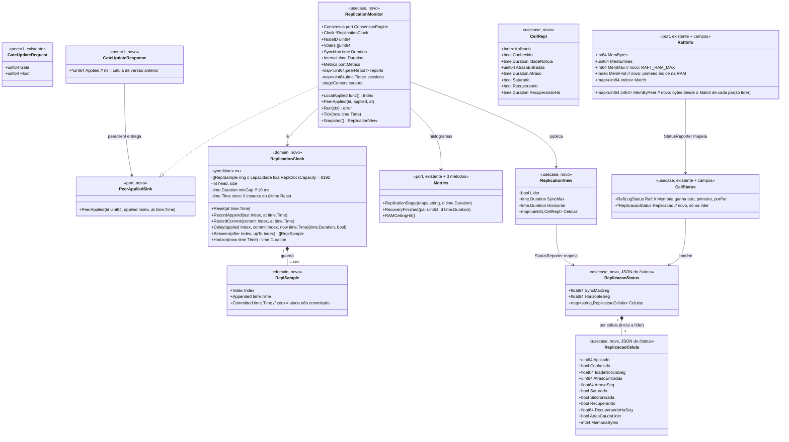

# Observabilidade da replicação na POC: células sincronizadas no banco, versão por célula, RAM retida pela líder, recuperação e tempo de replicação

## Requirements

- **Mostrar, a qualquer instante, se as três células têm no banco tudo o que foi confirmado** e quão perto cada uma está da líder ("cell-1 = drv_10, cell-2 = drv_05, cell-3 = drv_09"). A confirmação é sempre **da líder**, a partir do aplicado de cada célula (a marca d'água do `_dr_v` gravado no DynamoDB). O Match do log não serve como prova.
- **Acompanhar a RAM do Raft que a líder segura por causa de uma follower fora**, contra o teto `RAFT_RAM_MAX`, com a parte de cada par e o momento em que o teto é atingido (o ponto em que a líder abandona a follower, SG-23).
- **Medir com uma régua única (D-04), no relógio da líder:**
  - **tempo de replicação**: da entrada no log da líder até a líder confirmar o dado no banco do **quórum de bancos (2 de 3)** e de **todas as células**, mais as etapas auxiliares "até o commit" e "até o banco da líder";
  - **tempo de recuperação de cada célula**: de quando ela fica fora da régua até a líder confirmar que ela voltou para dentro.
- **Atualizar o dashboard do Grafana da POC local** com uma linha nova, "10 · Sincronização, memória retida e recuperação". Os limites ficam no painel.
- **Limites e decisões deste canvas** (continuam a numeração DC da compactação do log):
  - **DC-13 (régua de sincronia, D-01)**: uma célula está **sincronizada** quando o atraso de replicação dela, medido pela líder, é ≤ `REPL_SYNC_MAX` (padrão **2 s**). No painel, ficar acima por **mais de 15 s** é **dessincronia** (vermelho). Com a carga parada, a distância em entradas tem de chegar a **0**. O cluster está sincronizado quando as três células estão.
  - **DC-14 (memória, D-02)**: "memória" é só a RAM do Raft (o `MemoryStorage`). No painel, atenção em **70%** e crítico em **90%** de `RAFT_RAM_MAX`. O disco do log e o RSS do processo ficam fora.
  - **DC-15 (contrato)**: a resposta do `GateUpdate` passa a levar o aplicado da follower. O canal já existe e a líder já publica o gate a cada `GATE_PUBLISH_INTERVAL` (100 ms) mesmo sem avanço, então não há RPC nova. O campo é opcional nos dois sentidos, e uma célula de versão anterior aparece como "desconhecida".
  - **DC-16 (relógio)**: a líder guarda **amostras** (índice, instante em que entrou no log, instante do commit) num buffer circular de tamanho fixo, no máximo uma amostra a cada 10 ms. Os histogramas contam **amostras**, não entradas. Acima do horizonte do buffer, o atraso é "≥ horizonte" (saturado).
  - **DC-17 (sessão de recuperação)**: começa quando a célula sai da régua (atraso > `REPL_SYNC_MAX`, ou última notícia mais velha que `REPL_SYNC_MAX`). Uma célula sem notícia nenhuma conta com atraso = tempo desde o início da liderança, então só abre sessão depois de `REPL_SYNC_MAX` de liderança: as primeiras notícias chegam em um intervalo do `GateUpdate`, e uma troca de líder não gera sessões falsas. Termina quando ela volta para dentro. A duração é medida na líder; numa troca de líder, a sessão recomeça na nova líder.
- **Fora do escopo**: o truncamento (D-03); o disco do log como painel; alertas e Alertmanager; a `infra-aws/` (D-06); a recuperação por `CatchUp` e a reconstrução (Incremento B). Nesta feature, a célula atrás da cauda da líder aparece com a sessão **aberta e marcada como presa**.

## Entities

## Approach

1. **Fonte da verdade da sincronia na líder (DC-13, DC-15)**:
   - A líder já publica `GateUpdate` a cada 100 ms para cada par (`GateSync.Tick` → `peerclient.Publish` → `pumpGate`). A follower responde com o próprio aplicado (`Applier.Applied()`), e o `peerclient` entrega `(par, aplicado, instante)` ao `ReplicationMonitor` por `port.PeerAppliedSink`. Não há RPC nova nem cadência nova.
   - O aplicado da própria líder entra no monitor direto, com "notícia" sempre fresca. Assim, "todas as células" inclui o banco da líder (um applier parado na líder também é dessincronia).
   - O contrato é JSON (`peerv1.Codec`). O campo `Applied` é ponteiro: uma follower antiga responde `{}`, `Applied == nil` e a célula fica "desconhecida". Uma líder antiga decodifica a resposta nova como `Empty` e ignora o campo. A rolagem funciona nos dois sentidos.
   - O aplicado informado serve **só para medir**: gate, commit, ACK, piso e compactação não leem esse valor.

2. **Relógio de replicação amostrado (DC-16)**:
   - `domain.ReplicationClock` é um buffer circular fixo (8192 amostras, intervalo mínimo de 10 ms, horizonte de cerca de 80 s sob carga contínua). Na líder, o `etcdraft.Node` grava, dentro do `handleReady`, o último índice acrescentado (`RecordAppend`, depois do `storage.Append`) e o commit publicado (`RecordCommit`, junto do `publishCommit`). É uma trava curta, sem alocação, no mesmo padrão do `ramTracker`. Ao virar líder, o nó chama `Reset`.
   - `Delay(aplicado, commit, now)` devolve a idade do commit da primeira amostra acima do aplicado. Sem amostra que cubra o aplicado, devolve a idade da amostra mais antiga (ou o tempo desde o `Reset`) com `saturado = true`.
   - Medir em um relógio só elimina o desvio de NTP entre hosts.

3. **Monitor de replicação (`usecase.ReplicationMonitor`)**:
   - Uma goroutine com tick de `GATE_PUBLISH_INTERVAL` (100 ms, a mesma cadência das notícias). Ela fica fora do laço do Ready e é ligada como as outras (`fatal("replmonitor", ...)`).
   - A cada tick, na líder:
     1. calcula, por célula, o aplicado, a idade da notícia, a distância ao commit e o atraso (`Clock.Delay`);
     2. avança quatro cursores de etapa e observa o histograma `dr_replication_duration_seconds{etapa}`:
        - `commit`: commit − entrada no log, observado quando a amostra aparece commitada;
        - `banco_lider`: instante em que o aplicado local passou da amostra − commit;
        - `banco_quorum`: instante da notícia que fechou o quórum de bancos (2.º maior aplicado entre as 3) − entrada no log;
        - `banco_todas`: instante da notícia mais antiga entre as três células − entrada no log, quando o menor aplicado passa da amostra;
     3. abre e fecha as sessões de recuperação (DC-17) e observa `dr_recovery_duration_seconds{par}` no fechamento;
     4. publica um `ReplicationView` imutável para o scrape.
   - Na follower, ou sem líder: limpa notícias, sessões e cursores e publica a view com `Lider = false`. As séries de replicação só existem na líder, como as de quórum.

4. **RAM retida por par (DC-14)**:
   - O `ramTracker` ganha `bytesAfter(idx)` e `first()`. O `Compactor`, uma vez por ciclo (1 s) e só na líder, calcula `MemByPeer[par] = bytesAfter(Match[par])` e guarda no `CompactorStatus`. O scrape não percorre a RAM.
   - No `compactRAM`, quando `ramBytes > RAMMax`, o `Compactor` chama `metrics.RAMCeilingHit()` uma vez por ciclo. Um contador não se perde entre scrapes.
   - O `Node.Status` passa `MemMax`, `MemFirst` e `MemByPeer`. O `StatusReporter` marca `AtrasCaudaLider` para um par com `Match + 1 < MemFirst`: a líder não tem mais na RAM o que ele precisa, e ele só volta pelo Incremento B.

5. **Exportação e painel**:
   - Estado no scrape (`StateCollector`): gauges novos `dr_raft_mem_*`, `dr_repl_*` e `dr_recovery_*`. Eventos pela porta: `dr_replication_duration_seconds{etapa}`, `dr_recovery_duration_seconds{par}` e `dr_raft_mem_ceiling_total`.
   - O rótulo `par` é o ID do nó (`1`, `2`, `3`), igual a `dr_peer_lag`, e inclui a própria líder nas séries de replicação.
   - O Grafana ganha a linha 10, abaixo da 09. Os limites ficam nos thresholds e nas consultas: 2 s / 15 s (DC-13) e 70% / 90% (DC-14). O teste `TestDashboardOnlyUsesExistingMetrics` garante que o painel só usa séries registradas.

6. **Tratamento de erro**:
   - O projeto não tem `GlobalExceptionHandler`: erros são valores Go, e os fatais derrubam o processo pelo `fatal(...)` do bootstrap.
   - Nesta feature, **nada é fatal**. Uma falha do `GateUpdate` já é logada em Debug e só envelhece a notícia. O monitor nunca devolve erro além de `ctx.Err()`. Valores inválidos de configuração (`REPL_SYNC_MAX`) entram na lista de erros do `config.LoadFrom`, como as outras variáveis, e impedem a partida.

## Structure

### Inheritance Relationships
1. `port.PeerAppliedSink` é uma interface nova, com `PeerApplied(id uint64, applied domain.Index, at time.Time)`.
2. `usecase.ReplicationMonitor` implementa `port.PeerAppliedSink`.
3. `port.Metrics` ganha `ReplicationStage`, `RecoveryFinished` e `RAMCeilingHit`. `port.NopMetrics`, `prommetrics.Recorder` e os fakes de teste (`metrics_fake_test.go` em `usecase`, `etcdraft`, `peerclient` e `dynamohttp`) implementam os três.
4. `peerv1.PeerServer.GateUpdate` passa a devolver `*peerv1.GateUpdateResponse` (antes `*peerv1.Empty`); `peergrpc.Server` e `peerv1.Client` seguem.
5. `peergrpc.GateReceiver.OnGateUpdate` passa a devolver `(applied domain.Index, ok bool)`; `usecase.GateSync` implementa.

### Dependencies
1. `etcdraft.Node` grava em `*domain.ReplicationClock` (`Config.ReplClock`; nil = desligado).
2. `etcdraft.Compactor` calcula `MemByPeer` com `node.ram.bytesAfter` e `node.matches()`, e chama `metrics.RAMCeilingHit()`.
3. `usecase.GateSync` lê `Applied func() domain.Index` (o `Applier.Applied`).
4. `peerclient.Client` entrega as respostas do `GateUpdate` ao `AppliedSink port.PeerAppliedSink` (campo definido no bootstrap, como o `Metrics`).
5. `usecase.ReplicationMonitor` depende de `port.ConsensusEngine` (`Leader`, `CommitIndex`), `*domain.ReplicationClock`, `LocalApplied` e `port.Metrics`.
6. `usecase.StatusReporter` lê `ReplicationMonitor.Snapshot()` e o `RaftInfo` estendido.
7. `prommetrics.StateCollector` lê o `CellStatus` (`Raft.Memoria`, `Replicacao`).
8. O `bootstrap` cria um `*domain.ReplicationClock` e o injeta no `etcdraft.Config` e no monitor. Também liga o monitor ao `peerclient` e ao `StatusReporter` e roda `ReplicationMonitor.Run`.

### Layered Architecture
1. **Domínio (`internal/domain`)**: `ReplicationClock` e `ReplSample`, puros e testáveis, sem I/O.
2. **Portas (`internal/port`)**: `PeerAppliedSink`, os métodos novos de `Metrics` e os campos novos de `RaftInfo`.
3. **Casos de uso (`internal/usecase`)**: `ReplicationMonitor` (régua, sessões, etapas), `GateSync` (devolve o aplicado) e `StatusReporter` (o `/status` com `replicacao`).
4. **Adaptadores de entrada (`adapter/in/peergrpc`)**: só traduzem o `GateUpdate`.
5. **Adaptadores de saída**: `etcdraft` (amostras, RAM por par, teto), `peerclient` (entrega da notícia) e `prommetrics` (séries novas, único a importar o `client_golang`).
6. **Contrato (`api/peerv1`)**: `GateUpdateResponse`.
7. **Plataforma (`platform/config`)**: `REPL_SYNC_MAX`.
8. **Observabilidade (`observability/grafana`)**: a linha 10 do dashboard.
9. **Tratamento de erro**: erros como valores, sem caminho fatal novo; a configuração inválida impede a partida.

## Operations

> Ordem obrigatória: O-45 → O-53. Cada passo termina com `go build ./...` e `go test -race ./...` verdes (`task test`). Comentários, nomes de campos JSON e mensagens de log em português, como no resto do código. Nenhum pacote fora do `prommetrics` importa o `client_golang`, e nada novo bloqueia o laço do Ready.

### O-45 Update Config - `platform/config/config.go` (DC-13)
1. Responsabilidade: ler o limite da régua de sincronia.
2. Atributos:
   - `ReplSyncMax time.Duration`, com o comentário `// REPL_SYNC_MAX: atraso máximo de replicação de uma célula sincronizada (DC-13); padrão 2s`.
3. Lógica em `LoadFrom`:
   - `c.ReplSyncMax = dur("REPL_SYNC_MAX", 2*time.Second, false)`, no mesmo bloco do `GATE_PUBLISH_INTERVAL`.
   - Validação: `ReplSyncMax` precisa ficar entre `GatePublishInterval × 2` e `60s`. Fora disso, o erro vai para a lista `errs` com a mensagem `"REPL_SYNC_MAX deve ficar entre 2 × GATE_PUBLISH_INTERVAL e 60s"`.
4. Testes (`config_test.go`): o padrão é 2 s; `REPL_SYNC_MAX=500ms` é aceito; `50ms` e `2m` são recusados com a mensagem acima.
5. Atualizar o `docker-compose.yml` (o env das três células com `REPL_SYNC_MAX: 2s`, explícito) e o `HOW_TO_RUN.md` (a tabela de variáveis).

### O-46 Create Domain - `domain/replclock.go` (DC-16)
1. Responsabilidade: as amostras de (índice, entrada no log, commit) da líder, e o atraso em tempo de um aplicado qualquer.
2. Constantes: `ReplClockCapacity = 8192`, `ReplClockMinGap = 10 * time.Millisecond`.
3. Tipos:
   - `ReplSample{Index Index; Appended, Committed time.Time}`.
   - `ReplicationClock{mu sync.Mutex; ring [ReplClockCapacity]ReplSample; head, size int; commitPos int; since time.Time}`. O valor zero é utilizável: `since` zero conta como "desde sempre".
4. Métodos (todos com `mu`, sem alocação, exceto `Between`):
   - `Reset(at time.Time)`: `size = 0`, `head = 0`, `commitPos = 0`, `since = at`.
   - `RecordAppend(last Index, at time.Time)`:
     - ignora se `size > 0` e `last ≤` o índice da amostra mais nova (reescrita da cauda não commitada não cria amostra);
     - ignora se `size > 0` e `at − Appended da mais nova < ReplClockMinGap`;
     - senão, grava `{last, at, zero}` no anel, sobrescrevendo a mais antiga quando cheio (`commitPos` acompanha o descarte).
   - `RecordCommit(commit Index, at time.Time)`: a partir de `commitPos`, marca `Committed = at` em toda amostra com `Index ≤ commit` e `Committed` zero, e avança `commitPos`. O custo é O(amostras novas).
   - `Delay(applied, commit Index, now time.Time) (time.Duration, bool)`:
     - `applied ≥ commit` → `(0, false)`;
     - procura (busca binária, os índices são crescentes) a primeira amostra com `Index > applied` e `Committed` não zero; achou → `(now − Committed, false)`;
     - sem amostras → `(now − since, true)`, saturado;
     - `applied + 1 <` o primeiro índice coberto pela amostra mais antiga (`from`: o índice da amostra descartada + 1, ou o da primeira amostra depois do `Reset`) → `(now − Appended da mais antiga, true)`, saturado;
     - nenhuma amostra acima do aplicado (as entradas que faltam entraram no log menos de 10 ms depois da amostra mais nova e não viraram amostra) → `(now − Appended da mais nova − ReplClockMinGap, false)`, com piso 0. Sem isso, com a carga parada, uma célula sem as últimas entradas apareceria em dia para sempre;
     - amostra achada mas ainda não commitada (o aplicado está à frente do commit amostrado, caso raro) → `(0, false)`.
   - `Between(after, upTo Index) []ReplSample`: cópia das amostras com `after < Index ≤ upTo`, em ordem. É usada pelo monitor, fora do Ready.
   - `Horizon(now) time.Duration`: `now − Appended` da mais antiga (0 se vazio).
5. Testes (`replclock_test.go`):
   - amostragem respeita os 10 ms;
   - índice repetido ou menor não cria amostra;
   - `RecordCommit` marca só até o commit;
   - `Delay` sincronizado = 0;
   - `Delay` com aplicado entre amostras usa a amostra seguinte;
   - `Delay` antes da mais antiga devolve saturado;
   - `Delay` com as entradas depois da amostra mais nova continua envelhecendo;
   - anel cheio descarta a mais antiga e mantém `commitPos` coerente;
   - `Reset` zera tudo e passa a contar desde `at`;
   - teste com `-race`: um gravador e um leitor concorrentes.

### O-47 Update Ports and Contract - `port/metrics.go`, `port/ports.go`, `api/peerv1` (DC-15)
1. `port/metrics.go`: acrescentar à interface, com comentários no estilo existente:
   - `ReplicationStage(etapa string, d time.Duration)`: `etapa` em `commit`, `banco_lider`, `banco_quorum`, `banco_todas` (a régua D-04, medida no relógio da líder; cada observação é uma amostra do `ReplicationClock`);
   - `RecoveryFinished(par uint64, d time.Duration)`: sessão de recuperação encerrada (DC-17);
   - `RAMCeilingHit()`: um ciclo do `Compactor` encontrou a RAM do Raft acima de `RAFT_RAM_MAX` e compactou até o snapshot, ignorando o Match (SG-23).
   - Implementar os três em `NopMetrics` e nos quatro `metrics_fake_test.go`. Os fakes contam chamadas, como os métodos existentes.
2. `port/ports.go`:
   - `type PeerAppliedSink interface { PeerApplied(id uint64, applied domain.Index, at time.Time) }`, com o comentário `// PeerAppliedSink recebe o aplicado informado por uma follower na resposta do GateUpdate (DC-15). Só para medir: não decide nada.`
   - `RaftInfo` ganha `MemMax int64 // RAFT_RAM_MAX`, `MemFirst domain.Index // primeiro índice no MemoryStorage` e `MemByPeer map[uint64]int64 // bytes na RAM desde o Match de cada par (só na líder)`.
3. `api/peerv1/peer.go`:
   - `type GateUpdateResponse struct { Applied *uint64 }`, com o comentário `// GateUpdateResponse leva o aplicado da follower (DC-15); nil = célula de versão anterior.`
   - `PeerServer.GateUpdate(ctx, *GateUpdateRequest) (*GateUpdateResponse, error)`; `Client.GateUpdate` devolve `*GateUpdateResponse`; o `handler` do `ServiceDesc` acompanha os tipos.
   - Atualizar o comentário do pacote em `codec.go` (o `GateUpdate` agora tem resposta).
4. Teste de compatibilidade (`api/peerv1`, arquivo novo `compat_test.go`):
   - `Codec.Unmarshal([]byte("{}"), &GateUpdateResponse{})` dá `Applied == nil`;
   - `Codec.Marshal(&GateUpdateResponse{Applied: ptr(7)})`, decodificado em `Empty`, não dá erro;
   - `Marshal` com `Applied` 0 preserva o 0 (0 é um aplicado válido, diferente de nil).

### O-48 Update Transport - `peergrpc`, `usecase/gatesync.go`, `peerclient` (DC-15)
1. `usecase.GateSync`:
   - novo campo `Applied func() domain.Index` (nulo = não informa);
   - `OnGateUpdate(gate, floor domain.Index) (domain.Index, bool)`: mantém a lógica atual e, no fim, `if s.Applied == nil { return 0, false }; return s.Applied(), true`.
2. `peergrpc`:
   - `GateReceiver.OnGateUpdate(gate, floor domain.Index) (domain.Index, bool)`;
   - `Server.GateUpdate` devolve `&peerv1.GateUpdateResponse{}` e, com `ok`, `Applied = &v` (a cópia local do `uint64`).
3. `peerclient.Client`:
   - novo campo `AppliedSink port.PeerAppliedSink`, com o comentário `// AppliedSink recebe o aplicado das followers (DC-15). Definir antes do uso; nulo = ignorado.`;
   - em `pumpGate`, depois de uma chamada sem erro: `if resp != nil && resp.Applied != nil && c.AppliedSink != nil { c.AppliedSink.PeerApplied(p.id, domain.Index(*resp.Applied), time.Now()) }`;
   - o erro continua só em Debug; não cria log por chamada bem-sucedida.
4. Testes:
   - `usecase/read_test.go` (o teste que já cobre o `GateSync`): `OnGateUpdate` devolve o aplicado; sem `Applied`, devolve `ok = false`;
   - `peerclient/client_test.go`: com o dialer em memória e um servidor fake que devolve `Applied = 42`, o sink recebe `(par, 42)`; com `Applied = nil`, o sink não é chamado.

### O-49 Update Adapter - `etcdraft`: amostras, RAM por par e teto (DC-14, DC-16)
1. `Config`: `ReplClock *domain.ReplicationClock // amostras da líder (DC-16); nulo = desligado`.
2. `Node.handleReady`:
   - na troca de líder (o bloco `rd.SoftState`), se a nova líder é este nó e `ReplClock != nil`: `ReplClock.Reset(time.Now())`;
   - depois de `n.storage.Append(rd.Entries)` e `n.ram.recordAppend`: `if isLeader && len(rd.Entries) > 0 && n.cfg.ReplClock != nil { n.cfg.ReplClock.RecordAppend(domain.Index(rd.Entries[len(rd.Entries)-1].GetIndex()), now) }`, com o `now` lido uma vez no início do `handleReady` (reaproveitar `start`);
   - no passo (5), depois de `publishCommit(último)`: `if isLeader && ReplClock != nil { ReplClock.RecordCommit(último, start) }`. O `start` é o início do Ready, antes do fsync; a diferença para o instante real do commit é no máximo um Ready, e está documentada no comentário.
3. `ram.go`:
   - `bytesAfter(idx domain.Index) int64`: soma os tamanhos com índice `> idx`; com `idx < first`, devolve todos os bytes. Usa `mu`.
   - O primeiro índice na RAM vem do `Node.ramFirst()` que já existe (`MemoryStorage.FirstIndex`); o `ramTracker` não ganha método novo para isso.
4. `Compactor`:
   - `CompactorStatus` ganha `MemByPeer map[uint64]int64`;
   - em `cycle`, na líder, depois de `compactRAM`: monta `MemByPeer` para cada par (fora o próprio nó) com `bytesAfter(matches()[par])`; na follower, `nil`;
   - na prática, `releaseDisk` monta o `st` do ciclo e chama `memByPeer()` ali (o `Status()` já copia mapas; copiar `MemByPeer` do mesmo jeito);
   - em `compactRAM`, no ramo `ramBytes > c.cfg.RAMMax`: `c.metrics.RAMCeilingHit()` (uma vez por ciclo, antes do log com taxa limitada).
5. `Node.Status`: `info.MemMax = n.cfg.Compaction.RAMMax`, `info.MemFirst = n.ramFirst()`, `info.MemByPeer = cs.MemByPeer` (só quando `info.Lead == n.cfg.ID`).
6. Testes:
   - todos em `etcdraft/replobs_test.go`, com o mesmo cluster em memória de `node_test` e `compactor_test`:
     - `TestReplClockOnlyOnLeader`: depois de N propostas, a líder tem amostras commitadas e as followers não têm nenhuma; na troca de líder, a nova líder começa vazia;
     - `TestMemByPeerAndCeiling`: com uma follower parada, `MemByPeer` dela é maior que o da follower em dia; acima de `RAMMax`, o fake de métricas conta `RAMCeilingHit` e o Match da parada fica atrás de `MemFirst`;
     - `TestRAMTrackerBytesAfter`: `bytesAfter` nos limites (antes de `first`, no meio, no último, à frente).

### O-50 Implement Service - `usecase/replication.go` (DC-13, DC-16, DC-17, D-04)
1. Responsabilidade: a régua de sincronia, as etapas do tempo de replicação e as sessões de recuperação, na líder.
2. Atributos públicos: `Consensus port.ConsensusEngine`, `Clock *domain.ReplicationClock`, `LocalApplied func() domain.Index`, `NodeID uint64`, `Voters []uint64`, `SyncMax time.Duration`, `Interval time.Duration`, `Metrics port.Metrics`, `Log zerolog.Logger`.
3. Estado privado (com `mu sync.Mutex`):
   - `reports map[uint64]peerReport{applied domain.Index; at time.Time}`;
   - `sessions map[uint64]time.Time`;
   - `cur struct{commit, lider, quorum, todas domain.Index}`;
   - `wasLeader bool`;
   - `view atomic.Pointer[ReplicationView]`.
4. Métodos:
   - `PeerApplied(id, applied, at)`: guarda o report se `at` é mais novo que o guardado. Um aplicado **menor** que o anterior é aceito (reinício da follower) e logado em Debug.
   - `Run(ctx) error`: ticker de `Interval` (padrão 100 ms); a cada tick, `Tick(time.Now())`; devolve `ctx.Err()` no fim.
   - `Tick(now)`:
     1. `l, ok := Consensus.Leader()`. Sem `ok && l.Local`: se `wasLeader`, limpa `reports`, `sessions` e `cur`; publica `&ReplicationView{Lider: false}`; `wasLeader = false`; retorna.
     2. Se `!wasLeader`: zera `cur` com o commit atual (só mede o que foi proposto nesta liderança), limpa as sessões e marca `wasLeader = true`.
     3. `commit := Consensus.CommitIndex()`. Monta as três células: o próprio nó `{LocalApplied(), now, conhecido}` e cada par de `Voters` pelo report (sem report = desconhecido).
     4. Por célula: `AtrasoEntradas = commit − aplicado` (0 se negativo); `Atraso, Saturado = Clock.Delay(aplicado, commit, now)`; desconhecido → `Atraso = now − início da liderança`, `Saturado = true`; `IdadeNoticia = now − at`.
     5. Etapas, cada cursor avançando por `Clock.Between(cur.x, alvo)`:
        - `commit`: o alvo é `commit`; observa `Committed − Appended` das amostras commitadas.
        - `banco_lider`: o alvo é `LocalApplied()`; observa `now − Committed`.
        - `banco_quorum`: o alvo é o `(len(Voters)/2+1)`-ésimo maior aplicado entre as células **conhecidas** (sem quórum de conhecidas, não avança); observa `atQ − Appended`, em que `atQ` é a notícia mais antiga entre as células que formam o quórum.
        - `banco_todas`: o alvo é o menor aplicado, só se as três são conhecidas; observa `atMin − Appended`, em que `atMin` é a notícia mais antiga das três.
        - Duração negativa vira 0 (relógio monotônico do mesmo processo, só por arredondamento).
     6. Sessões (DC-17), por célula: `fora := Atraso > SyncMax || (Conhecido && IdadeNoticia > SyncMax)`; sem notícia, `Atraso = now − início da liderança` (carência de `SyncMax`).
        - `fora` e sem sessão → `sessions[id] = now` e log Info `"célula fora da régua de sincronia"` (par, atraso, aplicado, commit);
        - `!fora` e com sessão → `Metrics.RecoveryFinished(id, now − início)`, apaga a sessão e loga Info `"célula sincronizada de novo"` (par, duração).
     7. Publica a nova `ReplicationView` (mapas novos, nunca compartilhados).
   - `Snapshot() ReplicationView`: devolve a última view publicada (o valor zero se nenhuma) e `Horizonte = Clock.Horizon(now)`.
5. Testes (`replication_test.go`, com fakes de `ConsensusEngine` e de métricas e o relógio injetado por `Tick(now)`):
   - três células em dia → todas sincronizadas, `banco_todas` observado uma vez por amostra;
   - um par sem report → desconhecido; sessão só depois de `SyncMax` de liderança (carência); `banco_todas` parado e `banco_quorum` avançando;
   - par volta → `RecoveryFinished` com a duração certa;
   - follower reinicia (aplicado recua) → sessão abre e fecha sem pânico;
   - troca de papel → limpa tudo e publica `Lider = false`;
   - report antigo (`at` velho) não sobrescreve um novo;
   - nenhuma etapa observa a mesma amostra duas vezes.

### O-51 Update Status and Metrics - `usecase/status.go`, `prommetrics` (DC-13, DC-14)
1. `usecase.StatusReporter`: novo campo `Replication *ReplicationMonitor` (nulo = sem a seção).
2. `CellStatus`:
   - `MemoriaStatus` ganha `Teto int64 json:"teto"`, `Primeiro domain.Index json:"primeiro"` e `PorPar map[string]int64 json:"porPar,omitempty"`.
   - Novo `Replicacao *ReplicacaoStatus json:"replicacao,omitempty"`, só quando `Papel == "lider"` e a view tem `Lider = true`.
   - `ReplicacaoStatus{SyncMaxSeg float64 json:"syncMaxSeg"; HorizonteSeg float64 json:"horizonteSeg"; Celulas map[string]ReplicacaoCelula json:"celulas"}`.
   - `ReplicacaoCelula` com os campos do diagrama e as tags JSON em camelCase português (`aplicado`, `conhecido`, `idadeNoticiaSeg`, `atrasoEntradas`, `atrasoSeg`, `saturado`, `sincronizada`, `recuperando`, `recuperandoHaSeg`, `atrasCaudaLider`, `memoriaBytes`).
   - `Sincronizada = Conhecido && Atraso ≤ SyncMax && IdadeNoticia ≤ SyncMax`.
   - `AtrasCaudaLider = par ≠ self && Match[par] + 1 < MemFirst`.
   - `MemoriaBytes = MemByPeer[par]`.
3. `prommetrics.Recorder`:
   - `replStage *prometheus.HistogramVec`: `dr_replication_duration_seconds{etapa}`, help `"Tempo de replicação no relógio da líder, por etapa: commit, banco_lider, banco_quorum (2 de 3 bancos), banco_todas (D-04). Cada observação é uma amostra (≥ 10 ms)."`, buckets `ExponentialBucketsRange(0.0005, 60, 18)`, pré-inicializado com as 4 etapas (`ReplStages`).
   - `recovery *prometheus.HistogramVec`: `dr_recovery_duration_seconds{par}`, help `"Duração das sessões de recuperação encerradas, por célula, medida pela líder (DC-17)."`, buckets `{0.5, 1, 2, 5, 10, 15, 30, 60, 120, 300, 600, 1800, 3600}`.
   - `ramCeiling prometheus.Counter`: `dr_raft_mem_ceiling_total`, help `"Ciclos do Compactor com a RAM do Raft acima de RAFT_RAM_MAX: a líder compactou até o snapshot e abandonou o Match das réplicas atrasadas (SG-23)."`.
   - Métodos de evento: `ReplicationStage`, `RecoveryFinished` (`strconv.FormatUint`) e `RAMCeilingHit`.
4. `prommetrics.StateCollector`, novos `Desc` (todos gauges), emitidos em `Collect`:
   - sempre:
     - `dr_raft_mem_bytes`: "Bytes das entradas no MemoryStorage do Raft.";
     - `dr_raft_mem_entries`: "Entradas no MemoryStorage do Raft.";
     - `dr_raft_mem_max_bytes`: "RAFT_RAM_MAX: teto da RAM do Raft (DC-14).";
     - `dr_raft_snapshot_index`: "Índice do último snapshot-marcador.";
     - `dr_raft_behind_tail`: "1 se a célula recebeu um marcador à frente do aplicado e espera a recuperação.";
   - só na líder, por `par`:
     - `dr_raft_mem_peer_bytes{par}`: "Bytes da RAM do Raft desde o Match do par: o que a líder segura por ele.";
     - `dr_repl_applied_index{par}`: "Aplicado de cada célula conhecido pela líder (a própria líder incluída): a versão _dr_v garantida no banco.";
     - `dr_repl_known{par}`: "1 se a líder tem notícia do aplicado da célula.";
     - `dr_repl_report_age_seconds{par}`: "Idade da última notícia do aplicado da célula.";
     - `dr_repl_lag_entries{par}`: "Entradas commitadas que a célula ainda não tem no banco.";
     - `dr_repl_delay_seconds{par}`: "Atraso de replicação: idade, no relógio da líder, da entrada commitada mais antiga que a célula não tem no banco (M-11).";
     - `dr_repl_delay_saturated{par}`: "1 se o atraso passou do horizonte das amostras (valor mínimo).";
     - `dr_repl_synced{par}`: "1 se a célula está dentro de REPL_SYNC_MAX (DC-13).";
     - `dr_recovery_in_progress{par}`: "1 se a célula está numa sessão de recuperação.";
     - `dr_recovery_elapsed_seconds{par}`: "Duração da sessão de recuperação em curso (0 sem sessão).";
     - `dr_repl_behind_leader_ram{par}`: "1 se o par está atrás da primeira entrada na RAM da líder: só volta pelo Incremento B.";
   - só na líder, sem rótulo:
     - `dr_repl_sync_max_seconds`: "REPL_SYNC_MAX.";
     - `dr_repl_clock_horizon_seconds`: "Horizonte das amostras do relógio de replicação.".
   - Acrescentar todos ao `Describe`.
5. Testes:
   - `recorder_test.go`: os três eventos novos aparecem no `/metrics`; `TestAllSeriesRegistered` com os nomes novos; `TestStateCollectorLeaderAndFollower` cobre as séries de replicação, que existem na líder e somem na follower;
   - `status_test.go`: `replicacao` só na líder; `sincronizada`, `atrasCaudaLider` e `porPar` calculados como acima.

### O-52 Update Bootstrap, Dashboard and Docs - `bootstrap/app.go`, `observability/grafana`, `validation`, `HOW_TO_RUN.md`
1. Bootstrap:
   - provider `newReplClock() *domain.ReplicationClock` (`&domain.ReplicationClock{}`), passado ao `newRaft` (`ReplClock`);
   - provider `newReplicationMonitor(cfg, c port.ConsensusEngine, clk, a *usecase.Applier, m port.Metrics, log) *usecase.ReplicationMonitor`, com `LocalApplied: a.Applied`, `NodeID: cfg.NodeID`, os `Voters` dos IDs de `cfg.Peers` em ordem, `SyncMax: cfg.ReplSyncMax` e `Interval: cfg.GatePublishInterval`;
   - o próprio `newReplicationMonitor` recebe o `*peerclient.Client` e define `pc.AppliedSink = mon`. Passar o monitor ao `newPeerClient` fecharia um ciclo no fx (o nó Raft depende do peerclient, e o monitor do nó). Não há corrida: o `pumpGate` só lê o campo depois de um `Publish`, que passa por canal;
   - `newGateSync` define `Applied: a.Applied` (recebe `*usecase.Applier`);
   - `newStatus` define `Replication: mon`;
   - em `runRuntime`, `fatal("replmonitor", d.ReplMonitor.Run)` depois do `gatesync`; `runtimeDeps` ganha `ReplMonitor`;
   - o log de partida inclui `Dur("replSyncMax", cfg.ReplSyncMax)`;
   - `app_test.go` continua montando o grafo do fx sem erro.
2. Dashboard (`observability/grafana/dashboards/datareplication.json`): linha nova "10 · Sincronização, memória retida e recuperação" (`row`, `id` 57, `y` 167) e painéis `id` 58 a 69, com o datasource `prometheus-dr` e o filtro `$celula` onde fizer sentido. As séries "só na líder" usam `max by (par) (...)` para não dobrar séries na troca de líder.
   - 58 · **Cluster sincronizado** (stat, w 6). A consulta é `min(dr_repl_synced) * (count(dr_repl_known == 1) == 3)` com `or on() vector(0)`; o mapeamento é 1 = "SINCRONIZADO" (verde) e 0 = "FORA" (vermelho). A descrição explica a régua DC-13.
   - 59 · **Células fora da régua há mais de 15 s** (stat, w 6): `count(max by (par) (max_over_time(dr_repl_synced[15s])) == 0) or on() vector(0)` (fora durante os 15 s inteiros); 0 verde, ≥ 1 vermelho.
   - 60 · **Versão replicada por célula** (bar gauge, w 12, unidade `prefix:drv_`): A `max by (celula) (dr_applied_index{celula=~"$celula"})` (legenda `cell-{{celula}}`); B `max by (par) (dr_repl_applied_index)` (visão da líder, legenda `líder vê cell-{{par}}`); C `max(dr_commit_index * on(celula) group_left() (dr_is_leader == 1))` (commit da líder, como referência). A descrição não pode citar o nome do atributo de versão: o teste de contrato lê todo `dr_[a-z_]+` do JSON como série.
   - 61 · **Atraso de replicação por célula até o banco (s)** (timeseries, w 12): `max by (par) (dr_repl_delay_seconds)` e a linha `max(dr_repl_clock_horizon_seconds)` (horizonte das amostras); thresholds em modo linha/área, 2 amarelo e 15 vermelho; unidade s.
   - 62 · **Distância em entradas até o commit da líder** (timeseries, w 12): `max by (par) (dr_repl_lag_entries)`.
   - 63 · **Estado de sincronia por célula** (state-timeline, w 12): `max by (par) (dr_repl_synced)`, com 1 = sincronizada e 0 = fora.
   - 64 · **Idade da última notícia do aplicado** (timeseries, w 12): `max by (par) (dr_repl_report_age_seconds)`; threshold 2 s.
   - 65 · **RAM do Raft na líder x teto** (gauge, w 6): `max(dr_raft_mem_bytes * on(celula) group_left dr_is_leader) / max(dr_raft_mem_max_bytes)`; unidade percentunit; thresholds 0.7 amarelo e 0.9 vermelho (DC-14).
   - 66 · **RAM do Raft retida por célula x teto** (timeseries, w 12): `max by (par) (dr_raft_mem_peer_bytes)`, o total na líder e a linha `max(dr_raft_mem_max_bytes)` como "teto"; unidade bytes.
   - 67 · **Teto da RAM atingido | réplicas abandonadas** (stat, w 6): A `sum(increase(dr_raft_mem_ceiling_total[$__range])) or on() vector(0)` e B `sum(max by (par) (dr_repl_behind_leader_ram)) or on() vector(0)`; 0 verde, ≥ 1 vermelho.
   - 68 · **Recuperação por célula** (timeseries, w 12): `max by (par) (dr_recovery_elapsed_seconds)` (em curso) e, como pontos, `histogram_quantile(0.99, sum by (le, par) (rate(dr_recovery_duration_seconds_bucket[$__rate_interval])))`; legenda com `max`.
   - 69 · **Tempo de replicação da líder | P50/P99/P99.9 por etapa** (timeseries, w 12): `histogram_quantile(q, sum by (le, etapa) (rate(dr_replication_duration_seconds_bucket[$__rate_interval])))` para q = 0.5, 0.99 e 0.999; legenda `{{etapa}} p..`. A descrição explica `banco_quorum` × `banco_todas`.
   - Na linha 03, painel 23 ("Lag por peer da líder"): acrescentar à descrição `"Lag do LOG. Para o banco, ver a linha 10."`.
   - Distribuir em grade de 24 colunas, sem sobreposição, a partir de `y` 168.
   - `TestDashboardOnlyUsesExistingMetrics` precisa passar.
3. `validation/00_metodo_e_observabilidade.md`:
   - L-REPL e L-ETAPAS passam a "sim", com os nomes novos;
   - M-11 vira "feito: `dr_repl_delay_seconds{par}`";
   - M-04 fica com a parte RAM feita (`dr_raft_mem_*`, `dr_raft_snapshot_index`, `dr_raft_behind_tail`) e o disco ainda pendente;
   - M-01 fica parcial (propose → commit → banco da líder → bancos; o gate não tem etapa própria);
   - acrescentar à 5.3 a linha "B-SYNC | Sincronia | `dr_repl_synced`, `dr_repl_delay_seconds`, `dr_recovery_*` (DC-13, DC-17)".
4. `HOW_TO_RUN.md`: a seção do dashboard cita a linha 10 e como ler "cluster sincronizado" e "RAM x teto".

### O-53 Verify - POC local
1. `task test` (`go build ./...` e `go test -race ./...`) verde.
2. `task start` + `task k6-load`, com as três células em dia:
   - o painel 58 mostra "SINCRONIZADO";
   - os painéis 60 e 62 mostram as três versões a poucos índices do commit;
   - o painel 69 mostra `commit` < `banco_lider` ≤ `banco_quorum` ≤ `banco_todas`;
   - o `GET /status` da líder traz `replicacao.celulas` com as três células.
3. `task test-follower-outage` (cell-3 parada sob carga e depois de volta):
   - em até 2 s + 100 ms, `dr_repl_synced{par="3"} = 0` e `dr_recovery_in_progress{par="3"} = 1`;
   - o painel 59 fica em 1 depois de 15 s;
   - `dr_raft_mem_peer_bytes{par="3"}` cresce, e o painel 65 sobe;
   - `banco_todas` para de ser observado e `banco_quorum` continua;
   - na volta, a sessão fecha, `dr_recovery_duration_seconds_count{par="3"}` sobe 1, o cluster volta a "SINCRONIZADO" e, com a carga parada, `dr_repl_lag_entries` chega a 0 nas três.
4. Teto da RAM: com `RAFT_RAM_MAX` reduzido no compose de teste (por exemplo, 64 MiB, respeitando a validação de `SNAPSHOT_EVERY_BYTES + 32MiB`) e cell-3 parada sob carga:
   - `dr_raft_mem_ceiling_total` sobe;
   - `dr_repl_behind_leader_ram{par="3"} = 1`;
   - a sessão de cell-3 fica aberta (esperado até o Incremento B);
   - nenhuma queda de processo.
5. Troca de líder (`task test-leader-failover`): as séries de replicação passam para a nova líder, sem séries duplicadas nos painéis (`max by (par)`), e as sessões recomeçam na nova líder.
6. Regressão: `dr_raft_loop_duration_seconds` P99 e `dr_write_duration_seconds` P99 não pioram mais de 5% contra o `main` antes da mudança, com a mesma carga nos dois lados (o `main` numa worktree separada). Sem k6 no host, a carga é um gerador Python no formato do `k6/putitem-leader.js`: 4000 PutItem de 200 B com 16 clientes na líder.

## Norms

1. **Padrão de métricas do projeto**:
   - estado lido no scrape pelo `StateCollector`, a partir do `CellStatus`;
   - eventos pela porta `port.Metrics`, que nunca bloqueia e não devolve nada;
   - só o `prommetrics` importa o `client_golang`;
   - toda série leva o rótulo constante `celula`; rótulos novos só `par` (ID do nó) e `etapa` (4 valores fixos);
   - nomes com o prefixo `dr_` e o sufixo da unidade (`_seconds`, `_bytes`, `_total`, `_index`); `help` em português, citando a decisão (DC-xx, D-xx, SG-xx).
2. **Injeção de dependência**:
   - providers `newX` no `bootstrap/app.go` (fx);
   - campos exportados para as dependências do caso de uso, como em `GateSync` e `StatusReporter`;
   - dependências opcionais nulas = desligado (`ReplClock`, `AppliedSink`, `Replication`, `Applied`), sem pânico.
3. **Tratamento de erro**:
   - Go idiomático, com erro como valor e `fmt.Errorf("pacote: contexto: %w", err)`;
   - nenhum caminho novo é fatal; falha de transporte só envelhece a notícia;
   - não existe `GlobalExceptionHandler` nem exceção de negócio nesta feature: as respostas HTTP e gRPC não mudam de classe de erro;
   - a configuração inválida entra na lista de erros do `config.LoadFrom` e impede a partida, com a mensagem em português.
4. **Validação de dados**:
   - aplicado vindo da rede é só número de medição: aceito como está (inclusive recuo), nunca usado para decidir gate, commit, piso ou ACK;
   - `Applied == nil` = desconhecido, 0 = válido;
   - duração negativa vira 0.
5. **Concorrência**:
   - `ReplicationClock` com `sync.Mutex` curto e sem alocação no caminho do Ready, como o `ramTracker`;
   - `ReplicationMonitor` publica a view por `atomic.Pointer`, com mapas novos a cada tick, para que o scrape nunca leia um mapa em escrita;
   - tudo testado com `-race`.
6. **Logging (zerolog)**:
   - Info só nas transições de sessão (entrada e saída da régua), com `par`, `atraso`, `aplicado`, `commit` e `duracao`;
   - Debug para falha do `GateUpdate` e recuo de aplicado;
   - nada por tick ou por chamada bem-sucedida; avisos repetidos usam o `rateLog` existente.
7. **Documentação**:
   - comentário de pacote e de tipo exportado em português, dizendo o porquê e citando DC, D ou SG;
   - o dashboard tem `description` em todo painel novo, com a régua e os limites;
   - o catálogo `validation/00_metodo_e_observabilidade.md` e o `HOW_TO_RUN.md` ficam coerentes com os nomes das séries.
8. **Testes**:
   - tabela de casos com `t.Run`;
   - relógio injetado por parâmetro (`Tick(now)`, `RecordAppend(_, at)`), sem `time.Sleep` em teste de unidade;
   - fakes de métricas contando chamadas, no padrão dos `metrics_fake_test.go`.

## Safeguards

1. **Restrições funcionais**:
   - a sincronia é decidida pelo **aplicado** (banco), nunca pelo Match;
   - a régua é `REPL_SYNC_MAX` (padrão 2 s), e o painel marca dessincronia acima de 15 s;
   - célula sem notícia, ou com notícia mais velha que `REPL_SYNC_MAX`, é **não sincronizada**;
   - sem líder, não há séries `dr_repl_*` e o painel 58 mostra "FORA" (nunca "SINCRONIZADO" por falta de dado);
   - `banco_todas` só avança com as três células conhecidas, e `banco_quorum` com `len(Voters)/2+1` conhecidas;
   - a sessão de recuperação de uma célula atrás da RAM da líder fica aberta até ela voltar, e isso é esperado até o Incremento B.
2. **Restrições de desempenho**:
   - nada novo no laço do Ready além de `RecordAppend` e `RecordCommit`: O(1) amortizado, sem alocação, trava sem disputa com escrita longa;
   - o P99 de `dr_raft_loop_duration_seconds` e de `dr_write_duration_seconds` não piora mais de 5% (O-53);
   - o monitor roda a cada 100 ms com O(amostras novas + 3) por tick;
   - `MemByPeer` é calculado uma vez por ciclo do `Compactor` (1 s), nunca no scrape;
   - memória fixa do relógio: 8192 amostras (menos de 0,5 MiB).
3. **Restrições de segurança**:
   - o campo novo do gRPC não carrega dado de item, só um índice;
   - o `/status` e o `/metrics` continuam na porta de administração, sem dado de cliente;
   - na POC, o transporte continua sem TLS, como hoje.
4. **Restrições de integração**:
   - `GateUpdateResponse.Applied` é ponteiro e opcional: uma célula antiga responde `{}` e a líder mostra "desconhecida"; uma líder antiga ignora o campo;
   - nenhum outro método do `peerv1` muda;
   - o Prometheus da POC (`scrape_interval: 1s`) e o provisionamento do Grafana não mudam;
   - a `infra-aws/` não é tocada.
5. **Regras de negócio**:
   - D-04: uma régua só, a confirmação da líder do dado no banco;
   - tempo de replicação = entrada no log da líder → banco do quórum (2 de 3) e → banco de todas; etapas auxiliares `commit` e `banco_lider`;
   - tempo de recuperação = sessão DC-17 por célula;
   - os limites 2 s / 15 s (DC-13) e 70% / 90% de `RAFT_RAM_MAX` (DC-14) ficam no painel e na configuração, nunca fixos no código das consultas de decisão.
6. **Restrições de tratamento de erro**:
   - nenhum erro desta feature derruba o processo nem muda a resposta ao cliente;
   - erros de transporte não viram série nova (já existem logs em Debug), e mensagens de log não expõem dados de item;
   - a configuração inválida impede a partida com a mensagem clara de faixa;
   - o projeto não usa `GlobalExceptionHandler`: os erros seguem o caminho de valor do Go e o `fatal(...)` do bootstrap só para os fatais que já existem.
7. **Restrições técnicas**:
   - só o `prommetrics` importa o `client_golang`; só o `etcdraft` importa `raft` e `raftpb`;
   - nenhum `time.Now()` de outra célula entra num cálculo: toda duração usa o relógio da líder;
   - os histogramas contam amostras (≥ 10 ms entre elas), e isso está escrito no `help`;
   - o rótulo `par` tem no máximo 3 valores e `etapa` 4; nenhum rótulo com índice, tabela ou chave.
8. **Restrições de dados**:
   - `Applied == nil` ≠ 0;
   - um aplicado que recua (reinício) é aceito e abre sessão;
   - `AtrasoEntradas` nunca é negativo;
   - um atraso saturado é um **mínimo**, sinalizado por `dr_repl_delay_saturated`;
   - ao virar líder, o relógio recomeça vazio e os cursores partem do commit atual, sem medir entradas de outra liderança.
9. **Restrições de API**:
   - `/status` ganha só campos novos (`raft.memoria.teto`, `primeiro`, `porPar` e `replicacao`, este só na líder), sem renomear nem remover nada;
   - `/metrics` só acrescenta séries; `TestDashboardOnlyUsesExistingMetrics` e `TestAllSeriesRegistered` passam (nenhum texto do dashboard pode conter `dr_` seguido de algo que não seja uma série registrada);
   - o contrato `peerv1` só muda o tipo de resposta do `GateUpdate`, de forma compatível nos dois sentidos.
