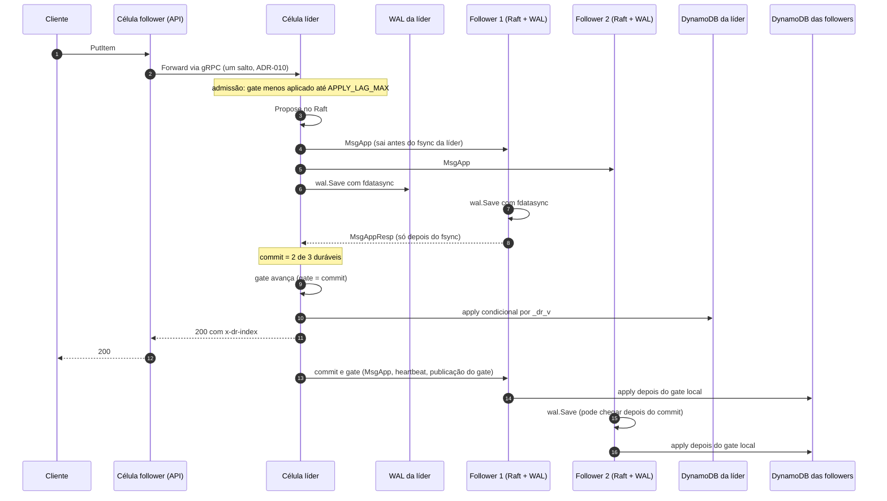

# RP-01 · Caminho da replicação: caminho feliz

| Campo | Valor |
|---|---|
| Categoria | Caminho de replicação (descrição) |
| Origem | Lista do Bruno: item "{descrever caminho feliz}" |
| Uso | Referência para todos os cenários: cada passo diz **onde o dado está** e **qual sinal prova** que ele passou dali |
| Base | código local de `DataReplicationApp/` (`usecase/write.go`, `usecase/replicate.go`, `adapter/out/etcdraft/node.go`, `usecase/apply.go`, `domain/gate.go`, `usecase/gatesync.go`) |

## O que "replicado" significa na POC

No instante do **200** ao cliente:

1. a entrada está no WAL, com fsync, de **pelo menos 2 das 3 células** (commit do Raft);
2. o gate da líder passou do índice dela (na POC, gate da líder = commit do Raft);
3. o item está gravado no **DynamoDB da líder**, com `_dr_v` = índice da entrada.

As **followers** gravam no próprio DynamoDB depois, sem o cliente esperar. Por isso, RPO = 0 na POC quer dizer: uma escrita confirmada sobrevive à perda de **qualquer uma** das células, inclusive do disco dela, desde que as outras duas voltem com o WAL íntegro. Perder duas células ao mesmo tempo está fora do que 3 votantes garantem (no produto, é o papel da Azure).

## Sequência

## Passos e sinais que provam cada um

| # | Passo | Onde o dado está | Sinal que prova | Falha possível neste passo |
|---|---|---|---|---|
| 1 | Chegada na API da célula | memória do processo | `dr_http_requests_total{op="PutItem"}`, `dr_http_inflight` | célula fora: conexão recusada |
| 2 | Encaminhamento (se follower) | memória, em trânsito no gRPC | `dr_forwards_total` (M-02 para latência e resultado) | prazo de 3 s → PENDING |
| 3 | Admissão | ainda fora do log | `dr_throttled_total{causa="atraso_apply"}` | 400 ThrottlingException |
| 4 | Propose | memória do Raft na líder (não durável) | `dr_throttled_total{causa="buffer_cheio"}` ou `{causa="nao_lider"}` | descarte → 400 |
| 5 | MsgApp para as followers | rede | `dr_raft_messages_sent_total{tipo="app"}` | fila cheia: `dr_peer_send_dropped_total` |
| 6 | fsync na líder | WAL da líder | `dr_wal_fsync_duration_seconds` | erro → fatal |
| 7 | fsync na follower e resposta | WAL de 2 células | `dr_raft_messages_received_total{tipo="app_resp"}` na líder, `dr_peer_match_index` | follower lenta: a outra completa a maioria |
| 8 | Commit | **durável em 2 de 3** | `dr_commit_index` da líder | — |
| 9 | Gate | idem | `dr_gate_index` (= commit na líder) | — |
| 10 | Apply na líder | DynamoDB da líder | `dr_applied_index`, `dr_apply_item_duration_seconds` | banco lento: PENDING; erro permanente: applier estaciona |
| 11 | ACK | cliente sabe | `dr_writes_total{resultado="ok"}`, `dr_write_duration_seconds`, header `x-dr-index` | prazo de 7,5 s estourado → PENDING (já durável) |
| 12 | Commit e gate chegam às followers | WAL das 3 | `dr_commit_index` e `dr_gate_index` das followers; gate publicado a cada avanço ou 100 ms | gate da follower = min(commit local, gate recebido) |
| 13 | Apply nas followers | **DynamoDB das 3** | `dr_applied_index` das followers, `dr_apply_lag` | apply lento: atraso sem limite (só a líder tem admissão) |
| 14 | Convergência | tabelas iguais | **oráculo** (ORC-04 R4) | só ele prova |

## Invariantes que valem o tempo todo

- `aplicado ≤ gate ≤ commit` em toda célula (B-INV-1).
- O gate nunca recua dentro da vida de um processo (B-INV-3).
- Nada é aplicado em banco algum antes do gate (por isso a cauda de uma líder isolada nunca aparece nas tabelas, CE-06).
- O apply é idempotente pela versão: `attribute_not_exists(_dr_v) OR _dr_v < :v`. Reaplicar uma entrada (replay após reinício) não muda nada.

## O que a observabilidade do app **não** prova neste caminho

Os sinais da tabela mostram que cada etapa **avançou um índice**. Não mostram que o **conteúdo** certo chegou ao banco certo. Isso é do oráculo (00, seção 3).
