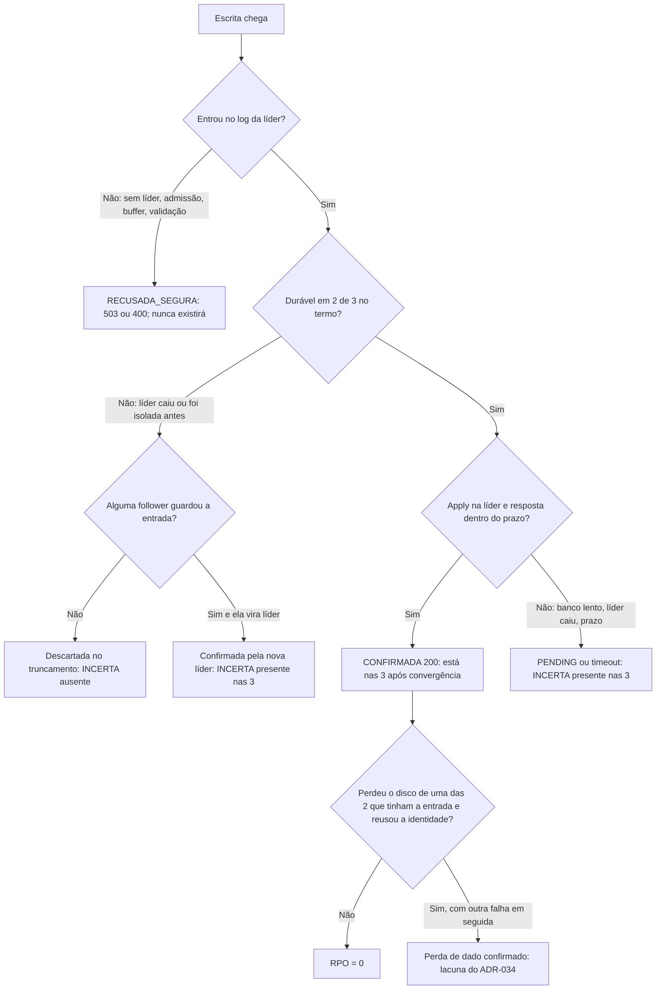

# RP-02 · Caminho da replicação: caminho de falha

| Campo | Valor |
|---|---|
| Categoria | Caminho de replicação (descrição) |
| Origem | Lista do Bruno: item "{descrever caminho de falha}" |
| Uso | Para cada ponto do caminho feliz (RP-01) em que uma falha pode acontecer: o que o cliente recebe, o que acontece com o dado e qual cenário valida |

## Regra que decide tudo

O destino de uma escrita depende de **um único fato**: a entrada chegou ou não ao WAL com fsync de 2 das 3 células **no termo em que foi proposta**. Se chegou, ela sobrevive a qualquer falha de uma célula e será aplicada nas 3. Se não chegou, ela pode sumir. A resposta ao cliente nem sempre sabe qual dos dois aconteceu: é por isso que existe a classe INCERTA.

## Pontos de falha

| # | Ponto (passo de RP-01) | Falha | Cliente recebe | Destino do dado | Cenários |
|---|---|---|---|---|---|
| P1 | 1 | célula de entrada fora | conexão recusada / erro do balanceador | nunca entrou | FP-01, FP-08, FP-12 |
| P2 | 2 | líder cai durante o encaminhamento | PENDING após 3 s | INCERTA (depende de P5) | FP-03, FR-03 |
| P3 | 3 | atraso de apply acima do teto | 400 ThrottlingException `atraso_apply` | nunca entrou | CF-05, CE-05, FB-02 |
| P4 | 4 | sem líder, buffer cheio, deixou de ser líder | 503 sem líder ou 400 ThrottlingException | nunca entrou | FP-02, FR-01, CF-05, FD-02 |
| P5 | 5 a 7 | líder cai, é isolada ou trava no fsync antes da maioria | PENDING ou timeout | sumirá se nenhuma follower guardou; será confirmada se a follower que guardou for eleita | FP-03, CE-02, CE-06, FR-01, FD-02 |
| P6 | 6 ou 7 | fsync com erro | — (processo cai) | como P5 para as entradas em voo | FD-01, FD-02, FD-03 |
| P7 | 8 a 10 | líder cai depois do commit, antes do apply ou da resposta | PENDING ou timeout | **durável**: aparece nas 3 | FP-03, FB-02 |
| P8 | 10 | banco da líder parado ou com erro permanente | PENDING, depois 400 `atraso_apply`; ou célula fora do Service | durável; aplicado na volta | FB-02, FB-03 |
| P9 | 11 | cliente desiste e repete | PENDING, nova tentativa | durável; a nova tentativa vira **outra** entrada (sem dedupe na POC) | CE-04, FC-03 |
| P10 | 12 e 13 | follower fora, lenta ou isolada | nada (o cliente já recebeu 200) | durável nas outras; alcança na volta por `MsgApp` enquanto a líder segura a RAM para ela (janela e `RAFT_RAM_MAX`); além disso, volta atrás da cauda: no Incremento A fica parada em `raft.atrasCauda`, no B alcança pelo `CatchUp` | FP-01, FP-04, FB-01, FR-02, FL-02 |
| P11 | depois do ACK | disco de uma das duas que tinham a entrada é perdido (ou restaurado de um backup antigo) e a célula volta com o mesmo NODE_ID | nada | **pode ser perdido** se outra falha vier em seguida; com o volume vazio, o fail-fast do Incremento B impede a volta | FD-05, FD-07 |
| P12 | depois do ACK | WAL com cauda rasgada | nada | a cauda não confirmada é segura de cortar, mas a POC não sobe | FD-06 |
| P13 | depois do ACK | perda simultânea de 2 células com disco | nada | fora da garantia de 3 votantes | FP-02 e FP-05 mostram a indisponibilidade, não perda |
| P14 | qualquer | escrita direta no banco | — | fora da camada; divergência | FB-04 |

## Recuperação de cada célula (o que acontece na volta)

1. **Reinício com o mesmo disco:** relê só a cauda do WAL desde o último snapshot (o tempo não cresce com o histórico, FL-01) e retoma o apply a partir do progresso salvo; o que estiver entre o progresso e o snapshot vem do disco pelo `LogReader`. O progresso pode voltar a um ponto anterior (o fsync dele é feito pelo `Compactor`, a cada ciclo de `RAFT_COMPACT_INTERVAL` e antes de cada snapshot) e reaplicar, de forma idempotente pela versão. Um progresso gravado atrás do disco retido faz a célula recusar a partida (FL-07).
2. **Atraso no log:** a líder reenvia por `MsgApp` enquanto segura a RAM para a follower (dentro da janela e até `RAFT_RAM_MAX`). Além disso, envia o snapshot-marcador; a follower só o aceita com o aplicado ≥ índice do marcador. No Incremento A ela fica parada; no B alcança pelo `CatchUp` e, fora da janela, se reconstrói (FL-02, FL-03).
3. **Atraso no apply:** a follower aplica no ritmo de `APPLY_WORKERS / latência do PutItem`. Se esse ritmo for menor que a entrada, ela nunca alcança (B-DRENO); o atraso fica no disco dela, até o teto duro (FL-04).
4. **Disco novo:** a POC sobe com WAL vazio e o mesmo NODE_ID. É inseguro (P11, FD-05); o fail-fast do Incremento B recusa a partida.

## O que precisa ser medido em toda falha

- A classe de cada resposta ao cliente (ORC-02) e o destino real de cada INCERTA (ORC-04 R3).
- O tempo em que o sistema ficou sem confirmar (RTO-04 e RTO-08).
- O tempo em que o sistema ficou **com uma célula a menos** (tempo em risco): de T0 até a célula afetada alcançar o apply.
